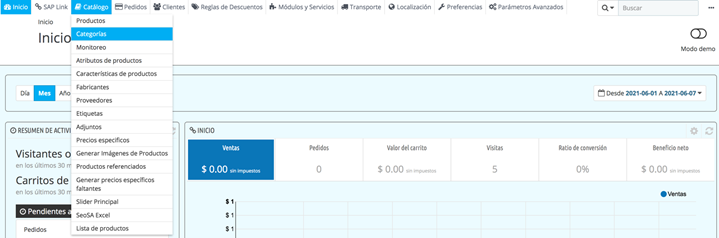
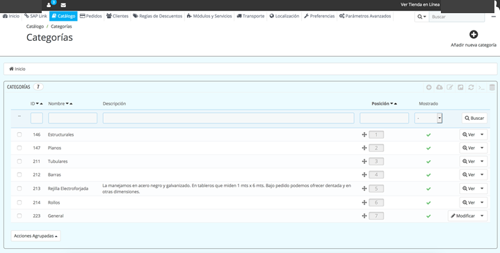
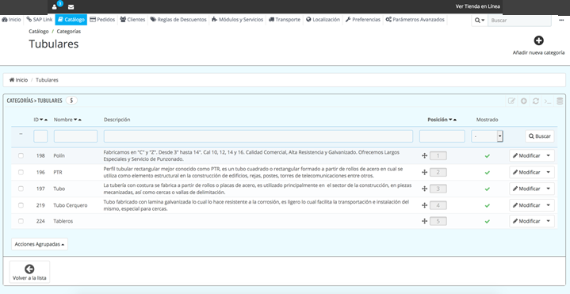
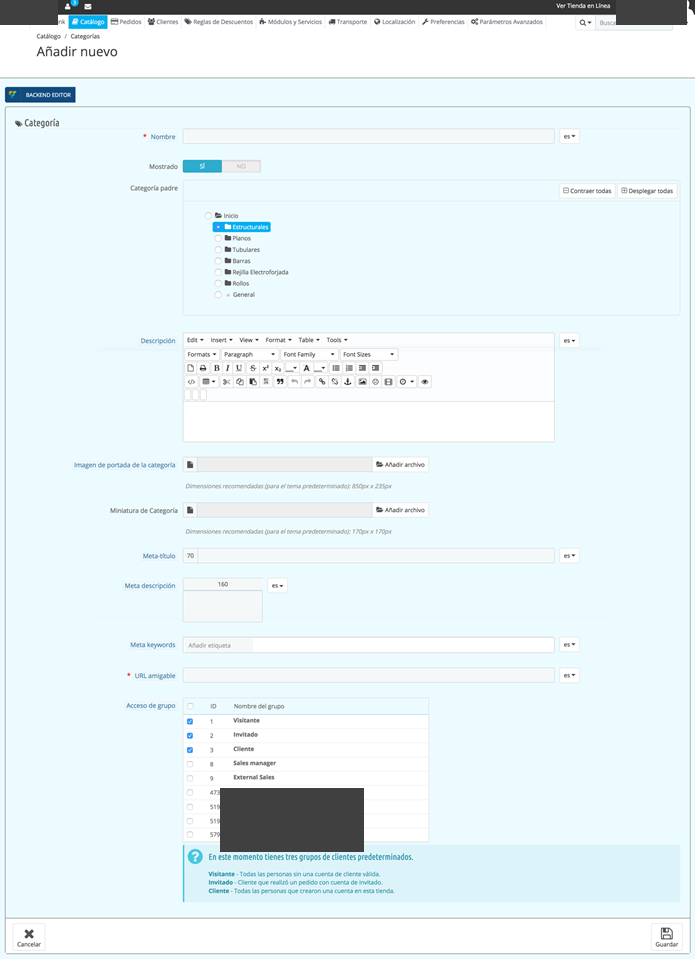

<!-- SPDX-License-Identifier: CC-BY-NC-ND-4.0 -->
<!-- Copyright (c) 2026 Onibex, LLC. Part of the Onibex eCommerce 360° Documentation — https://github.com/Onibex/ecommerce-docs -->

**English** · [Español](../../../es/faq/01-catalog/01-add-subcategories-and-images.md) | [↑ FAQ index](../README.md) | [Repository README](../../../README.md)

# Adding subcategories and images

> **Source:** English version of the Spanish FAQ article “Agregar subcategorías e imágenes” in the Onibex Help Center — <https://help.onibex.com/portal/en/kb/articles/agregar-subcategorias-e-im%C3%A1genes>.

1. Log in to /panel.

2. Once logged in, go to Catalog › Categories (Catálogo › Categorías) in the menu

3. The screen where the categories are registered is displayed; click the “View” (“Ver”) button

4. When entering the category, the subcategories are displayed; to modify one, click the “Edit” (“Modificar”) button, and to create a subcategory, click “Add new category” (“Añadir nueva categoría”)

5. The screen is displayed with the following fields:

   1. Name (name of the subcategory)
   2. Displayed (whether it will be enabled at that moment or not)
   3. Parent category (defaults to the category that was entered)
   4. Description
   5. Category Cover Image (recommended 850px x 235px)
   6. Category thumbnail (recommended 170px x 170px)
   7. Meta title
   8. Meta description
   9. Meta keywords
   10. Friendly URL (created automatically)
   11. Group access (select the group it will be shown to)

6. Click Save.

---

© 2026 Onibex, LLC · Licensed under [CC BY-NC-ND 4.0](../../../LICENSE) (SPDX: CC-BY-NC-ND-4.0) · [Commercial license](../../../COMMERCIAL-LICENSE.md) · [Trademarks and third-party notices](../../../THIRD-PARTY-NOTICES.md) · SAP and other SAP products and services mentioned herein are trademarks or registered trademarks of SAP SE or an SAP affiliate company in Germany and other countries; names are used for identification only.
