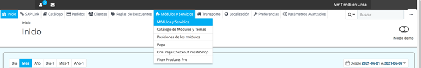
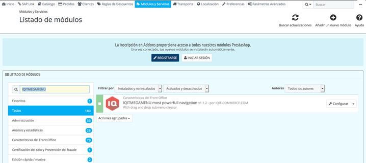
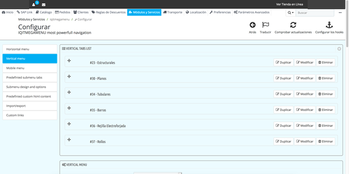
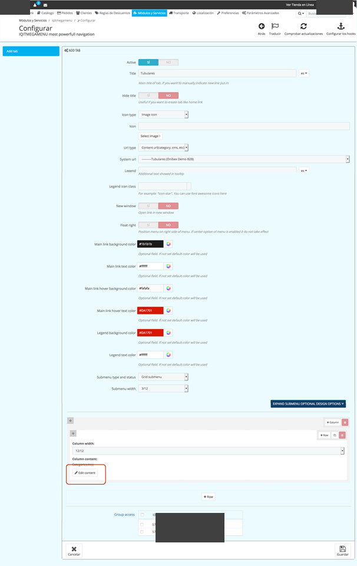
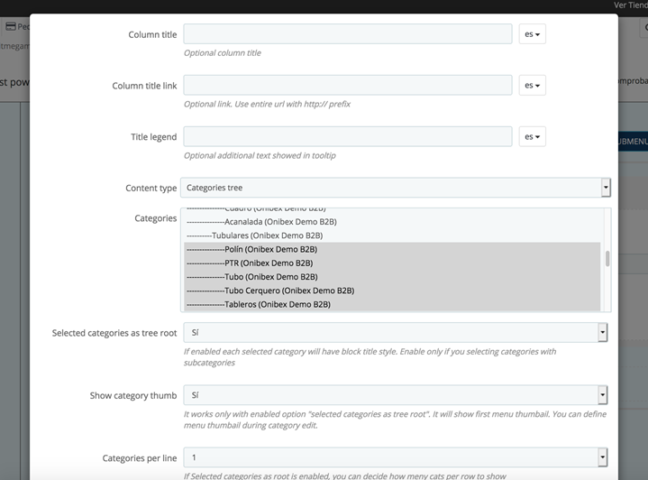

<!-- SPDX-License-Identifier: CC-BY-NC-ND-4.0 -->
<!-- Copyright (c) 2026 Onibex, LLC. Part of the Onibex eCommerce 360° Documentation — https://github.com/Onibex/ecommerce-docs -->

**English** · [Español](../../../es/faq/01-catalog/02-add-subcategory-to-menu.md) | [↑ FAQ index](../README.md) | [Repository README](../../../README.md)

# Adding the subcategory to the menu

> **Source:** English version of the Spanish FAQ article “Dar de alta la subcategoría en el menú” in the Onibex Help Center — <https://help.onibex.com/portal/en/kb/articles/dar-de-alta-la-subcategoria-en-el-menu-29-7-2021>.

1. Go to the Modules and Services › Modules and Services menu (Módulos y Servicios › Módulos y Servicios)

2. Search the module list for “IQITMEGAMENU”

3. Click the “Configure” (“Configurar”) button

4. A module menu appears on the left side; click “Vertical menu”

5. The categories registered in the module are displayed; click the “Edit” (“Modificar”) button on the category under which the category was previously added

6. Click the “Edit content” button

7. A pop-up opens; in the “categories” field, select the subcategory to be added with Shift + click.

8. Click the “save” button and close the pop-up

9. Likewise, at the bottom, click the “save” button and the menu is updated on the site

---

© 2026 Onibex, LLC · Licensed under [CC BY-NC-ND 4.0](../../../LICENSE) (SPDX: CC-BY-NC-ND-4.0) · [Commercial license](../../../COMMERCIAL-LICENSE.md) · [Trademarks and third-party notices](../../../THIRD-PARTY-NOTICES.md) · SAP and other SAP products and services mentioned herein are trademarks or registered trademarks of SAP SE or an SAP affiliate company in Germany and other countries; names are used for identification only.
