<!-- SPDX-License-Identifier: CC-BY-NC-ND-4.0 -->
<!-- Copyright (c) 2026 Onibex, LLC. Part of the Onibex eCommerce 360° Documentation — https://github.com/Onibex/ecommerce-docs -->

**English** · [Español](../../../es/faq/01-catalog/03-subcategory-features-mapping.md) | [↑ FAQ index](../README.md) | [Repository README](../../../README.md)

# Creating subcategory features and mapping them

> **Source:** English version of the Spanish FAQ article “Dar de alta características de la subcategoría y mapearlas” in the Onibex Help Center — <https://help.onibex.com/portal/en/kb/articles/dar-de-alta-caracter%C3%ADsticas-de-la-subcategoria-y-mapearlas>.

1. In the main menu of the PANEL, go to the Catalog → Product Features submenu (Catálogo → Características de Productos):

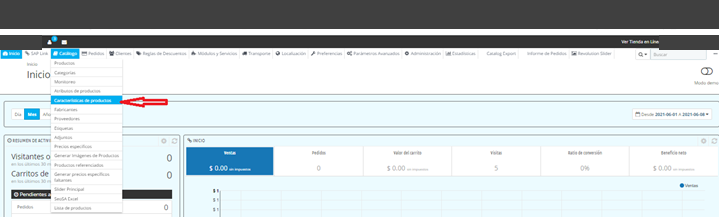

2. Edit or add the Feature of each new Class with the text and/or unit of measure as it should be displayed in the Filters section on the Category page of the Portal storefront

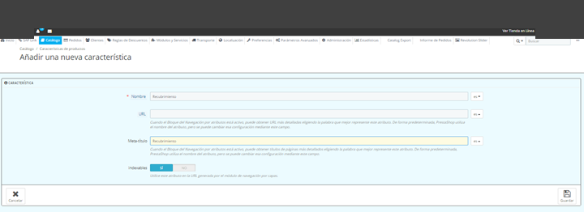

3. Look up in SAP the Hierarchy of each new Subcategory through T-Code V/76, in order to register it in the Category Mapping section (Mapeo de Categorías) of the “SAP Link” menu of the PANEL:

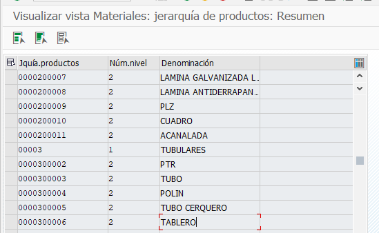

Planos → Acanalada = 0000200011

Tubulares → Tablero = 0000300006

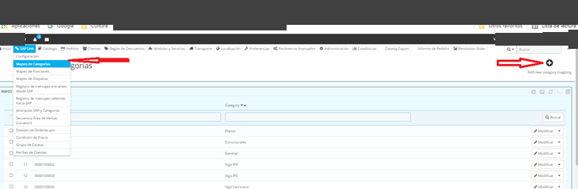

4. Add the new Hierarchy key looked up in SAP as the “Category Code” (“Código de Categoría”) and map it to the new Subcategory already registered in the Portal:

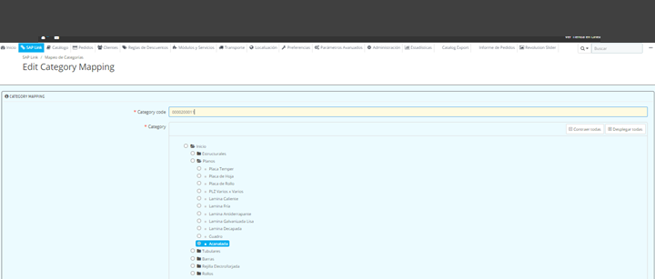

5. Go to the “SAP Link” menu to verify that the “Feature Mapping” (“Mapeo de Funciones”) section contains all the Characteristics of the new Classes registered in SAP:

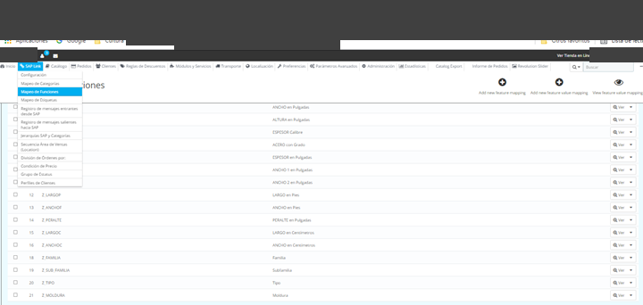

6. In the main menu of the PANEL, go to the “Modules and Services” (“Módulos y Servicios”) submenu and enter the “Filter Products Pro” module, where the Features (Funciones) will be mapped to the Portal storefront:

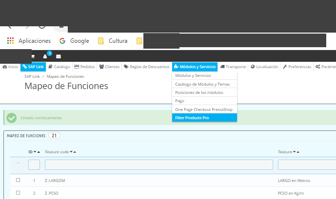

7. On the main page of the Filters configurator, click the “Add a new search engine” (“Adicionar un nuevo buscador”) option

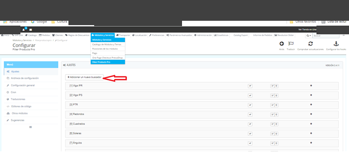

8. A new search engine is created, which is then edited to give it the name of the new subcategory as it will be displayed on the Portal storefront; in this first case: “Acanalada”:

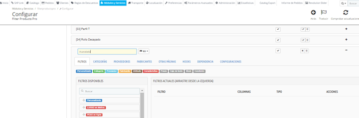

9. To this new “Acanalada” subcategory, add all the characteristics of its class Z_ACA that were created in SAP T-Code CL03:

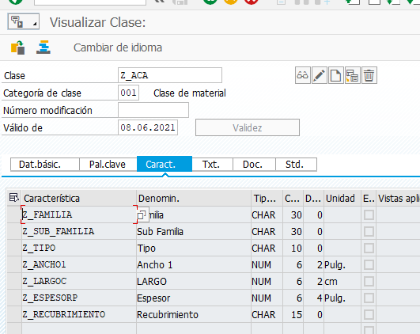

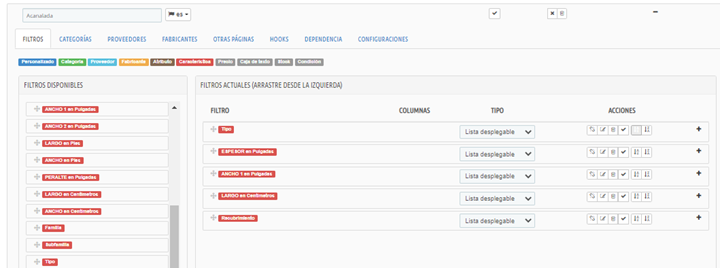

10. Once the Mapping of the Features (Funciones) that are available as Filters from the SAP Characteristics has been done, proceed to the next tab, CATEGORIES (CATEGORÍAS), to map the new search engine to the selected new Subcategory:

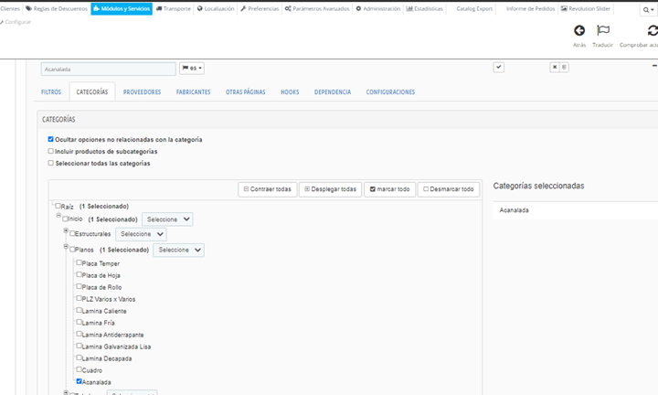

11. Proceed to the next and only other tab that has to be configured, HOOKS, which is where it is indicated that the filters will be anchored to the left section of the Subcategory page on the Portal storefront:

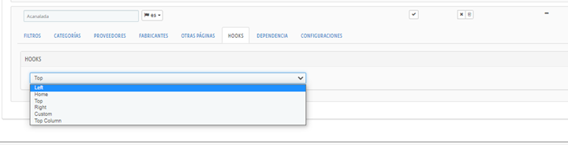

12. Once the full configuration is done, send all the new materials with their classifications, for which the standard T-Code BD10 can be used as follows:

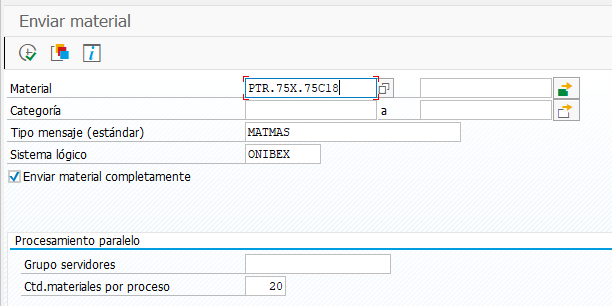

Make sure that all the materials have been listed and that the “Send material in full” checkbox is enabled.

13. Finally, assign images to the new materials.

---

© 2026 Onibex, LLC · Licensed under [CC BY-NC-ND 4.0](../../../LICENSE) (SPDX: CC-BY-NC-ND-4.0) · [Commercial license](../../../COMMERCIAL-LICENSE.md) · [Trademarks and third-party notices](../../../THIRD-PARTY-NOTICES.md) · SAP and other SAP products and services mentioned herein are trademarks or registered trademarks of SAP SE or an SAP affiliate company in Germany and other countries; names are used for identification only.
