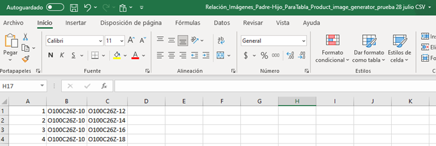
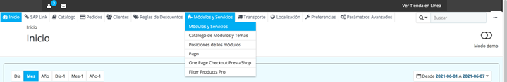
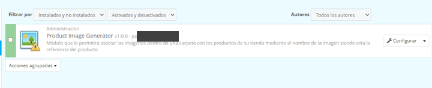
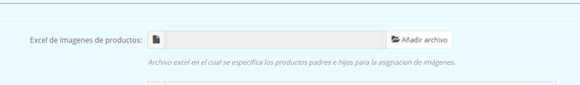
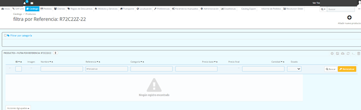
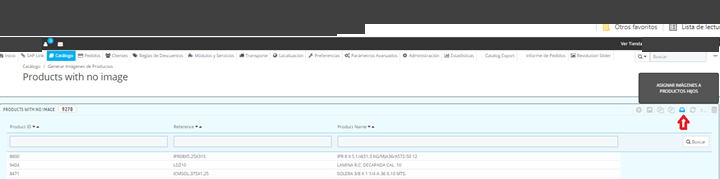

<!-- SPDX-License-Identifier: CC-BY-NC-ND-4.0 -->
<!-- Copyright (c) 2026 Onibex, LLC. Part of the Onibex eCommerce 360° Documentation — https://github.com/Onibex/ecommerce-docs -->

**English** · [Español](../../../es/faq/01-catalog/04-assign-parent-images-to-child-products.md) | [↑ FAQ index](../README.md) | [Repository README](../../../README.md)

# Assigning “parent” product images to new related “child” products

> **Source:** English version of the Spanish FAQ article “Asignar imágenes de productos “padres” a nuevos productos “hijos” relacionados” in the Onibex Help Center — <https://help.onibex.com/portal/en/kb/articles/asiganar-im%C3%A1genes-de-productos-padres-a-nuevos-productos-hijos-relacionados>.

1. Prepare an Excel file with the “parent” and “child” image relationship in three columns:

2. Remove the header so that only the “parent” and “child” relationship values remain, and save the file in CSV (MS-DOS) format.

3. Go to the Modules and Services › Modules and Services menu (Módulos y Servicios › Módulos y Servicios)

4. Search the module list for “PRODUCT IMAGE GENERATOR”:

5. Click the module's Configure button to enter and upload the previously prepared Excel file with only the two columns of the “parent” to “child” image relationship:

6. Once the product list has been imported, make sure that the “parent” product has an image in the portal:

7. The last step is that, once the “parent” images are in place, they are assigned to the “children” through the following function in the PANEL:

When this function is run, the “parent” images are automatically assigned to the “children”, which can be verified in the Product Catalog.

---

© 2026 Onibex, LLC · Licensed under [CC BY-NC-ND 4.0](../../../LICENSE) (SPDX: CC-BY-NC-ND-4.0) · [Commercial license](../../../COMMERCIAL-LICENSE.md) · [Trademarks and third-party notices](../../../THIRD-PARTY-NOTICES.md) · SAP and other SAP products and services mentioned herein are trademarks or registered trademarks of SAP SE or an SAP affiliate company in Germany and other countries; names are used for identification only.
