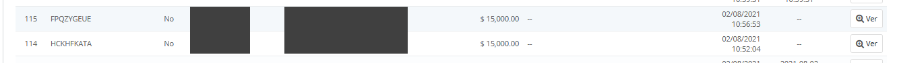
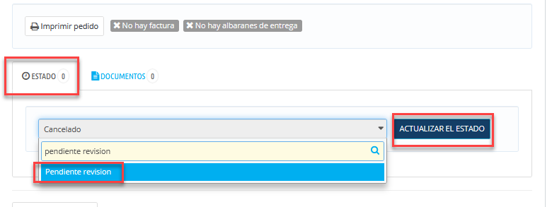
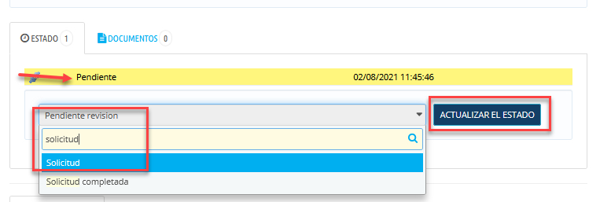

<!-- SPDX-License-Identifier: CC-BY-NC-ND-4.0 -->
<!-- Copyright (c) 2026 Onibex, LLC. Part of the Onibex eCommerce 360° Documentation — https://github.com/Onibex/ecommerce-docs -->

**English** · [Español](../../../es/faq/03-orders/01-alphanumeric-orders-to-confirmed.md) | [↑ FAQ index](../README.md) | [Repository README](../../../README.md)

# Alphanumeric orders: converting them to confirmed orders in SAP

> **Source:** English version of the Spanish FAQ article “Convertir pedidos con números alfanuméricos en pedidos confirmados en SAP” in the Onibex Help Center — <https://help.onibex.com/portal/en/kb/articles/c%C3%B3mo-convertir-pedidos-con-alfanum%C3%A9ricos-a-pedidos-confirmados-en-sap>.

1. Go to the order with the alphanumeric number\

2. In the STATUSES section, first change it to STATUS (1) "Pending Review" ("Pendiente Revisión")\

3. Then, change it to the next STATUS (2): REQUEST ("SOLICITUD")\

4. In this way, the order is automatically confirmed in SAP and is automatically changed to the STATUS CONFIRMED WEB ORDER ("PEDIDO WEB CONFIRMADO")

---

© 2026 Onibex, LLC · Licensed under [CC BY-NC-ND 4.0](../../../LICENSE) (SPDX: CC-BY-NC-ND-4.0) · [Commercial license](../../../COMMERCIAL-LICENSE.md) · [Trademarks and third-party notices](../../../THIRD-PARTY-NOTICES.md) · SAP and other SAP products and services mentioned herein are trademarks or registered trademarks of SAP SE or an SAP affiliate company in Germany and other countries; names are used for identification only.
