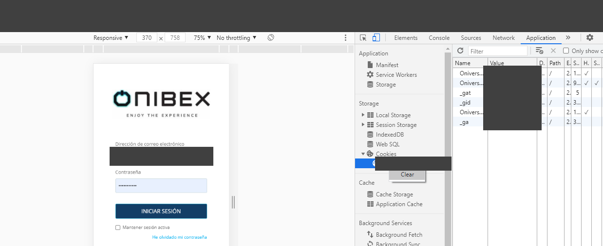
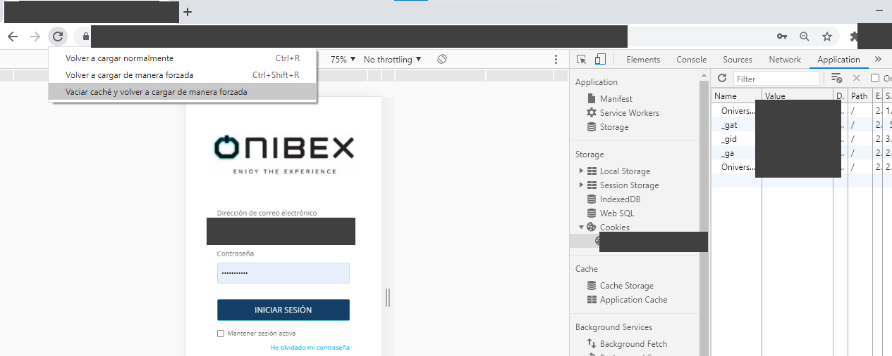

<!-- SPDX-License-Identifier: CC-BY-NC-ND-4.0 -->
<!-- Copyright (c) 2026 Onibex, LLC. Part of the Onibex eCommerce 360° Documentation — https://github.com/Onibex/ecommerce-docs -->

**English** · [Español](../../../es/faq/04-administration/01-refresh-cache-cookies-login-as-customer.md) | [↑ FAQ index](../README.md) | [Repository README](../../../README.md)

# Refreshing cache and cookies to fix “Login as customer”

> **Source:** English version of the Spanish FAQ article “Refrescar caché y cookies para corregir «Login as customer»” in the Onibex Help Center — <https://help.onibex.com/portal/en/kb/articles/refrescar-cach%C3%A9-para-correcci%C3%B3n-de-login-as-customer>.

On certain occasions, when multiple user sessions are opened from one browser and the session is not ended correctly, a login mix-up problem may occur; to correct this problem, it will be necessary to delete the cookies and refresh the cache.

First, the cookies are cleared using the following procedure:

1. Go to the "Panel" section of the platform
2. Use the F12 key or press the keys “**Control-Shift-i**” at the same time in the browser (Google Chrome is recommended)
3. In the Application tab, locate the Cookies section, right-click it and select Clear.

**The cookie cleanup process can be performed to verify that the data is displayed correctly.**

**In Firefox:** Go to Options -> Search for Cookies -> Clear data and cache

CTRL + Shift + I -> Storage -> Cookies (right-click and Delete)

**In Chrome: CTRL + Shift + I**

At the top right, look for: Application -> Cookies -> Right-click and select "Clear"

After this, the cache is refreshed using the following procedure:

1. Go to the "Panel" section of the platform
2. Use the F12 key or press the keys “**Control-Shift-i**” at the same time in the browser (Google Chrome is recommended)
3. Go to the “Refresh” icon of the page at the top left.
4. Right-click the option and select "Empty cache and hard reload"\

This process is only required if the cookies become corrupted for security reasons from the PANEL; this process allows the screens to be “refreshed” to the latest version available on the portal server.

---

© 2026 Onibex, LLC · Licensed under [CC BY-NC-ND 4.0](../../../LICENSE) (SPDX: CC-BY-NC-ND-4.0) · [Commercial license](../../../COMMERCIAL-LICENSE.md) · [Trademarks and third-party notices](../../../THIRD-PARTY-NOTICES.md) · SAP and other SAP products and services mentioned herein are trademarks or registered trademarks of SAP SE or an SAP affiliate company in Germany and other countries; names are used for identification only.
