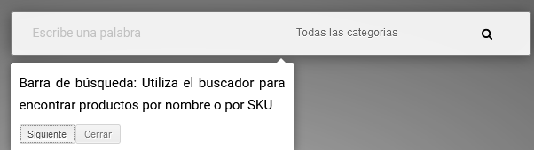
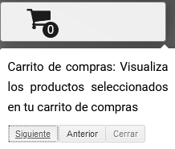
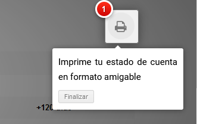
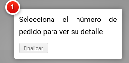
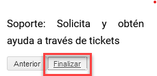

<!-- SPDX-License-Identifier: CC-BY-NC-ND-4.0 -->
<!-- Copyright (c) 2026 Onibex, LLC. Part of the Onibex eCommerce 360° Documentation — https://github.com/Onibex/ecommerce-docs -->

**English** · [Español](../../../es/faq/04-administration/02-why-navigation-tutorial-appears.md) | [↑ FAQ index](../README.md) | [Repository README](../../../README.md)

# Why does the navigation tutorial always appear?

> **Source:** English version of the Spanish FAQ article “¿Por qué siempre me aparece el tutorial de navegación?” in the Onibex Help Center — <https://help.onibex.com/portal/en/kb/articles/por-qu%C3%A9-siempre-me-aparece-el-tutorial-de-navegaci%C3%B3n>.

The navigation tutorial is a tool that allows the user to learn, step by step, how to use the platform correctly in each of its different sections, from the home page to the checkout process.

Below are some examples of the navigation tutorial:

This tutorial is shown the first time each user accesses the platform, and it must be completed so that it does not appear again in the future; this is achieved by following all the steps, clicking "Next" ("Siguiente") until it is fully completed, and then clicking "Finish" ("Finalizar")

---

© 2026 Onibex, LLC · Licensed under [CC BY-NC-ND 4.0](../../../LICENSE) (SPDX: CC-BY-NC-ND-4.0) · [Commercial license](../../../COMMERCIAL-LICENSE.md) · [Trademarks and third-party notices](../../../THIRD-PARTY-NOTICES.md) · SAP and other SAP products and services mentioned herein are trademarks or registered trademarks of SAP SE or an SAP affiliate company in Germany and other countries; names are used for identification only.
