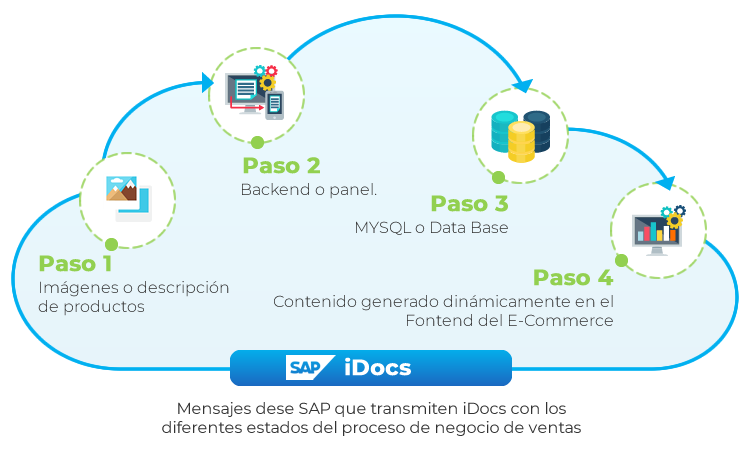
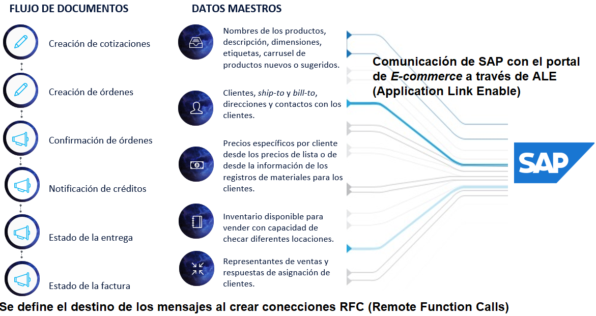

<!-- SPDX-License-Identifier: CC-BY-NC-ND-4.0 -->
<!-- Copyright (c) 2026 Onibex, LLC. Part of the Onibex eCommerce 360° Documentation — https://github.com/Onibex/ecommerce-docs -->

**English** · [Español](../../../es/technical-documents/01-overview/01-systems-integration-overview.md) | [↑ Technical documents index](../README.md) | [Repository README](../../../README.md)

# Systems integration overview: SAP ERP and eCommerce 360°

> **Source:** English version of chapter Introducción of the Spanish functional specification “D1 – Integración de sistemas” (Onibex Help Center) — <https://help.onibex.com/portal/en/kb/articles/d1-integraci%C3%B3n-de-sistemas-v-5-1-espa%C3%B1ol>.

The Onibex Business-to-Business (B2B) eCommerce system is one that comprises advanced functionalities of an *eCommerce* system; in addition, it is fully integrated with the SAP ERP (Enterprise Resource Planning) system. This chapter describes in detail the entire integration of the eCommerce system with SAP; but before going into the configurations required in SAP for this message exchange, we present the workflow for content management in Onibex eCommerce 360°.

The eCommerce system has a *backend*, or admin panel, which is used to manage or administer the specific content to be published in an online store. With the admin panel, non-technical staff can take responsibility for the content, the words and the graphics of a website, without having to know anything about code, such as HTML and CSS. In this way, one can focus more on statistics, on sales or on the business process, that is, on the way the content is displayed.

The *backend*, or admin panel, uses “put the content here” instructions that tell the eCommerce system to take the content, the “raw content”, from a database called ***MySQL*** and place it in a specific location within the layout of each page. Ultimately, this separates the responsibilities between the development of the design and the operation of the web pages that make up the eCommerce system. All of this is summarized in Figure-1 below.

**Figure-1**: Systems integration for the sales process of the cloud *eCommerce* system.

Onibex provides the implementation and the cloud services of the eCommerce system, fully integrated with the SAP ERP (*Enterprise Resource Planning*) system.

Most of the communication between the systems that Onibex integrates in the cloud originates from SAP messages exchanged with the admin panel of the eCommerce system. The information queried from SAP is of two types:

1. Master data: the types of data that change the least in the business process, that is, non-transactional data, such as the data contained in the customer master, the material master, and the pricing condition records.

2. Transactional data: temporary data that exist and draw attention during a particular period of time, after which work begins on a new document flow, such as orders, quotations, invoices, etc.

To elaborate on Figure-1 with regard to the integration of the eCommerce system with the two types of data exchanged from SAP, Figure-2 is added, which introduces the document flow and master data for the sales business process.

**Figure-2**: Integration of the two types of SAP data with the cloud *eCommerce* system.

Having completed this introduction to systems integration, the following three sections aim to show the steps that must be configured in SAP in order to exchange information through ALE (*Application Link Enabling*).

ALE comprises the controlled exchange of business messages to process the creation of documents such as sales orders and customer and material master data through *inbound* interfaces, as well as the consistent management of data from SAP to the *eCommerce* application, such as customer and material master data, inventory levels at a given plant and storage location, and the confirmation of the creation of documents such as the sales order, the delivery and the invoice.

Next: [Logical system definition in SAP](../02-ale-foundations/01-logical-system-definition.md) →

---

© 2026 Onibex, LLC · Licensed under [CC BY-NC-ND 4.0](../../../LICENSE) (SPDX: CC-BY-NC-ND-4.0) · [Commercial license](../../../COMMERCIAL-LICENSE.md) · [Trademarks and third-party notices](../../../THIRD-PARTY-NOTICES.md) · SAP and other SAP products and services mentioned herein are trademarks or registered trademarks of SAP SE or an SAP affiliate company in Germany and other countries; names are used for identification only.
