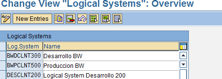
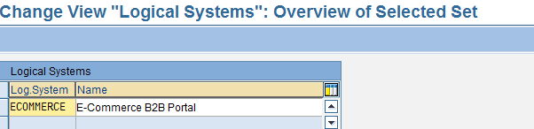

<!-- SPDX-License-Identifier: CC-BY-NC-ND-4.0 -->
<!-- Copyright (c) 2026 Onibex, LLC. Part of the Onibex eCommerce 360° Documentation — https://github.com/Onibex/ecommerce-docs -->

**English** · [Español](../../../es/technical-documents/02-ale-foundations/01-logical-system-definition.md) | [↑ Technical documents index](../README.md) | [Repository README](../../../README.md)

# Logical system definition in SAP

> **Source:** Onibex Help Center article “2. Logical system definition in SAP” — <https://help.onibex.com/portal/en/kb/articles/logical-system-definition-in-sap>. Spanish chapter D.1 of the functional specification “D1 – Integración de sistemas”.

ALE ensures a distributed but integrated SAP installation. To implement the distribution of business application processes, one needs to build a complete Logical Distribution Model of the system. Within the framework of this configuration, it is specified which applications to run over which systems, and which messages are exchanged between applications.

As a first step, the ALE transaction is configured to be able to receive and transmit information.

ROUTE: **IDOC Interface / Application Link Enabling (ALE) > Basic Settings > Logical Systems > Define Logical System.**

**T-Code:** **BD54**

As a standard, SAP has some entries into the different instances; after ensuring that an environment is open to configuration the new ECOMMERCE entry can be created. A screen similar to this one will show up:

***Figure-3*** *Logical Systems Creation Overview*

Press the *New Entries* button and create an entry with the ECOMMERCE key and the E-Commerce B2B Portal name.

***Figure-4*** *Creating the Logical System ID and Description*

Save your changes, the system will request to generate the respective transport order to move this change in configuration to other environments; that is, each of the configurations and programs described in this document, generates a transport order. Using transport orders, configurations and programs are moved from the Development environment ("DEV") to the quality environment, "QAs". Within this specific configuration, there are no other parameters to specify.

← Previous: [Systems integration overview: SAP ERP and eCommerce 360°](../01-overview/01-systems-integration-overview.md) · Next: [Defining the RFC destination in SAP](../02-ale-foundations/02-rfc-destination.md) →

---

© 2026 Onibex, LLC · Licensed under [CC BY-NC-ND 4.0](../../../LICENSE) (SPDX: CC-BY-NC-ND-4.0) · [Commercial license](../../../COMMERCIAL-LICENSE.md) · [Trademarks and third-party notices](../../../THIRD-PARTY-NOTICES.md) · SAP and other SAP products and services mentioned herein are trademarks or registered trademarks of SAP SE or an SAP affiliate company in Germany and other countries; names are used for identification only.
