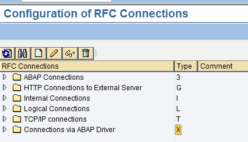
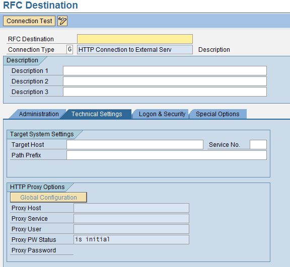
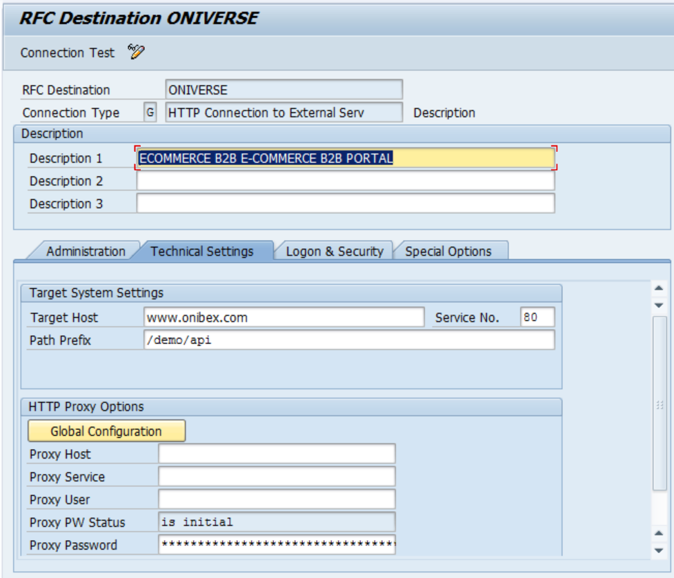
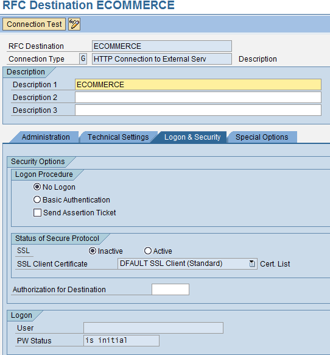
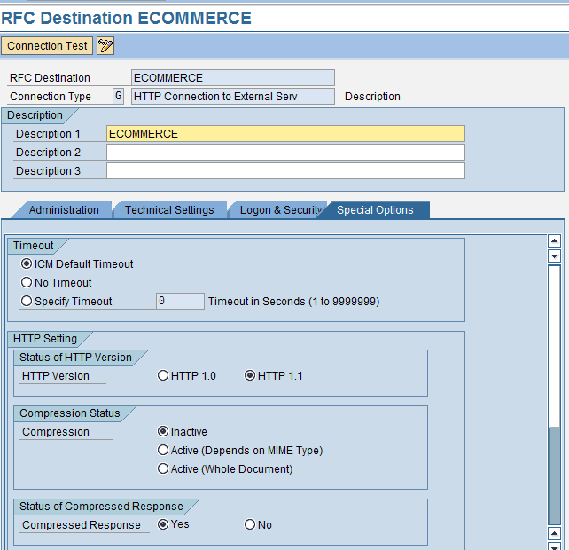
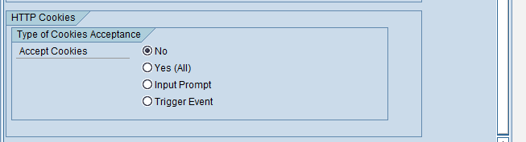
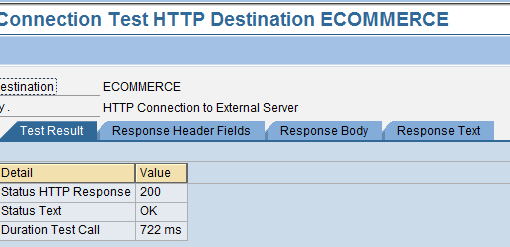

<!-- SPDX-License-Identifier: CC-BY-NC-ND-4.0 -->
<!-- Copyright (c) 2026 Onibex, LLC. Part of the Onibex eCommerce 360° Documentation — https://github.com/Onibex/ecommerce-docs -->

**English** · [Español](../../../es/technical-documents/02-ale-foundations/02-rfc-destination.md) | [↑ Technical documents index](../README.md) | [Repository README](../../../README.md)

# Defining the RFC destination in SAP

> **Source:** Onibex Help Center article “3. Defining the RFC Destination in SAP” — <https://help.onibex.com/portal/en/kb/articles/defining-the-rfc-destination-in-sap>. Spanish chapter D.2 of the functional specification “D1 – Integración de sistemas”.

For the e-commerce system to be able to write data in SAP, the *RFC* destination must be defined. This is a proprietary SAP interface for communications between SAP systems and external programs, such as ONIBEX's E-Commerce system. That is, data transactions are not limited to obtaining data from the server, but records can also be inserted; SAP can act as either Client or Server in an *RFC* call.

In order to configure the *RFC* in SAP, you need to know several parameters of the Web page to which you will be exchanging information, such as: URL, Port, *RFC* type, route, version of the protocol to use, etc.

ROUTE: **IDOC Interface / Application Link Enabling (ALE) > Communication > Create RFC Connections**

**T-Code: SM59**

When accessing this transaction, the following screen will appear:

**Figure-5** T-Code SM59 Initial Screen

Click over the HTTP *Connections to External Server* or Type G folder, and then press the “Create New” icon to create a new entry. The RFC Destination screen appears as shown in Figure-6.

***Figure-6*** *Fields necessary to establish communication.*

Then fill in the boxes in red:

1. **RFC Destination. –** Type in the target system ID, in this case: ECOMMERCE

2. **Description 1.-** Short text to describe what the connection is about: E-Commerce Portal.

3. **Target Host. –** IP address of the server in which the E-Commerce Portal is installed.

4. **Service NO.-** Port used for communication: 80

5. **Path Prefix:** Path where the app is located: /demos/CUSTOMER/api/

**Figure-7** RFC Destination screen filled in with typical data

In the following tab, the configuration is left as shown in Figure-8:

**Figure-8**: Logon & Security tab

Finally, the *Special Options* tab should look as shown in the following Figure-9:

**Figure-9**: Special Options tab

Lastly, test the communication to verify if the E-commerce backend responds to SAP, for this click on “Test Connection”. If communication is successful, the following screen should be displayed:

***Figure-10*** *Screen with successful connection test with external system.*

← Previous: [Logical system definition in SAP](../02-ale-foundations/01-logical-system-definition.md) · Next: [Port definition for IDoc processing in SAP](../02-ale-foundations/03-idoc-port-definition.md) →

---

© 2026 Onibex, LLC · Licensed under [CC BY-NC-ND 4.0](../../../LICENSE) (SPDX: CC-BY-NC-ND-4.0) · [Commercial license](../../../COMMERCIAL-LICENSE.md) · [Trademarks and third-party notices](../../../THIRD-PARTY-NOTICES.md) · SAP and other SAP products and services mentioned herein are trademarks or registered trademarks of SAP SE or an SAP affiliate company in Germany and other countries; names are used for identification only.
