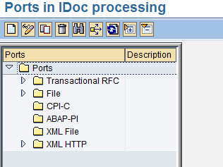
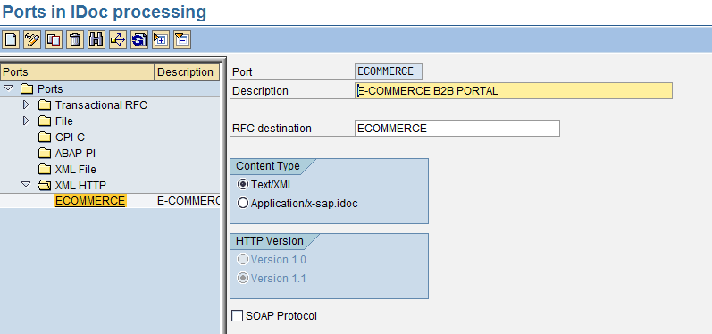

<!-- SPDX-License-Identifier: CC-BY-NC-ND-4.0 -->
<!-- Copyright (c) 2026 Onibex, LLC. Part of the Onibex eCommerce 360° Documentation — https://github.com/Onibex/ecommerce-docs -->

**English** · [Español](../../../es/technical-documents/02-ale-foundations/03-idoc-port-definition.md) | [↑ Technical documents index](../README.md) | [Repository README](../../../README.md)

# Port definition for IDoc processing in SAP

> **Source:** Onibex Help Center article “4. Port definition for iDoc processing in SAP” — <https://help.onibex.com/portal/en/kb/articles/port-definition-for-idoc-processing-in-sap>. Spanish chapter D.3 of the functional specification “D1 – Integración de sistemas”.

Along with the previous two sections of Logical Distribution Model and RFC Destination Definition, a recipient port must be configured for IDoc processing. IDocs are standardized documents like EDI (Electronic *Data Interchange)* documents that SAP supports for asynchronous communications with systems other than SAP. It is, IDocs are used to send or receive "business" documents such as sales orders, for example, to or from SAP *partners* systems, or some other external programs. The port is an SAP adapter that supports sending and receiving IDocs via transactional RFC calls or, in this case, using XML documents with HTTP protocol version 1.1.

Access transaction **WE21** to define the port.

When entering this transaction, you will see a screen like Figure-11:

***Figure-11 WE21*** *T-Code Initial Display.*

Left-click selects the last Folder: XML HTTP, click the blank sheet icon to create a new entry called ECOMMERCE, it is important that HTTP version 1.1 is selected as well.

***Figure-12*** *Configuring the Port for IDocs Processing.*

Save your changes and generate the transport order for the configuration.

← Previous: [Defining the RFC destination in SAP](../02-ale-foundations/02-rfc-destination.md) · Next: [SAP partner profile definition for IDocs](../02-ale-foundations/04-partner-profile.md) →

---

© 2026 Onibex, LLC · Licensed under [CC BY-NC-ND 4.0](../../../LICENSE) (SPDX: CC-BY-NC-ND-4.0) · [Commercial license](../../../COMMERCIAL-LICENSE.md) · [Trademarks and third-party notices](../../../THIRD-PARTY-NOTICES.md) · SAP and other SAP products and services mentioned herein are trademarks or registered trademarks of SAP SE or an SAP affiliate company in Germany and other countries; names are used for identification only.
