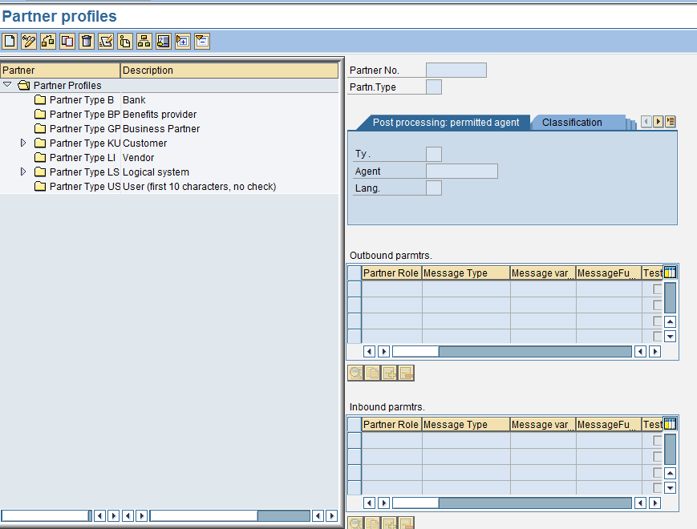
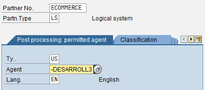
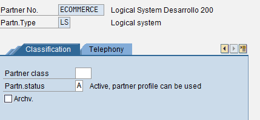
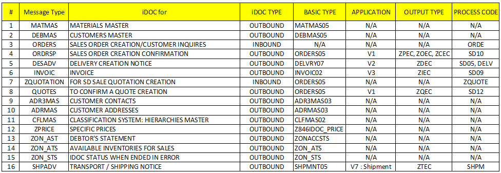

<!-- SPDX-License-Identifier: CC-BY-NC-ND-4.0 -->
<!-- Copyright (c) 2026 Onibex, LLC. Part of the Onibex eCommerce 360° Documentation — https://github.com/Onibex/ecommerce-docs -->

**English** · [Español](../../../es/technical-documents/02-ale-foundations/04-partner-profile.md) | [↑ Technical documents index](../README.md) | [Repository README](../../../README.md)

# SAP partner profile definition for IDocs

> **Source:** Onibex Help Center article “5. SAP Partner profile definition idocs” — <https://help.onibex.com/portal/en/kb/articles/sap-partner-profile-definition-idocs>. Spanish chapter D.4 of the functional specification “D1 – Integración de sistemas”.

To proceed with this part of the configuration, the logical system definition in SAP and port definition for IDoc processing in SAP must have been previously defined since next steps are configuring the different types of messages as shown in Figure-13.

The first partition made to the messages to be created is related to its Inbound or Outbound type. In addition, which type of information is queried should be considered: **1)** Master data, or **2)** Transactional data, such as document flows. In case of master data, it is not necessary to configure the message type part as shown in Figures 18 through 21. But for document flows such as SALES ORDERS, DELIVERIES, INVOICES, a message type that makes sense with the application area must be configured: **V1** for INQUIRIES or SALES ORDERS; **V2** for documents related to Dispatch activities such as DELIVERIES, PICKING LIST; or, **V3** for documents involved with billing, such as INVOICES, CREDIT MEMO REQUEST, OR CREDIT MEMO.

When entering the **WE20** *Partner Profiles* Transaction, this screen will be displayed:

**Figure-13** WE20 T-Code Initial Screen: "Creation of Partner Profiles".

The next step in creating a first message is to go to the folder called “*Partner Type* LS LOGICAL SYSTEM” and, place the cursor on that option, then click the white sheet icon to generate a new entry. The following data is fill in the fields for the new entry in Figure-14:

***Figure-14*** *Partner* *Profile* *Configurations for the Logical System.*

5. **Partner NO.-** Type the ID to the target system: ECOMMERCE.
6. **Partner Type**. – Type the LS type that corresponds to Logical System.
7. **Ty**. –Type US which corresponds to an SAP User ID.
8. **Agent**. – Fill in with the SAP user ID being used.
9. **Lang**. Fill in the initials for the current language: EN for English, or ES for Spanish.

**Note: It is very important that within the Classification tab, the Partner Status field has the letter "A"** (Active), otherwise, there may be problems when receiving **IDocs.**

**Figure-15** WE20 T-Code to activate the Partner Profile.

To start adding messages, we need to consider the parameters that are defined in the table in Figure-16:

**Figure-16** Agreement messages in SAP for an LS logical system with the ECOMMERCE partner that are configured through the WE20, BD64, and NACE transactions, if applicable.

These are the main messages that are exchanged through IDocs documents. As per the table in Figure-16, each message type has its own configuration parameters, even when filling the same sections in the same SAP formats, as it is the same "*Partner profile*", "*Distribution* *model*" and "*Condition* *Record",* among others.

In the following subsections, we will see how to add each message from Figure-16. As well as how to configure the corresponding formats in SAP for integration to the e-commerce system through IDocs.

Another section will describe other type of communication between SAP and the E-Commerce portal, this through Web Services. Web Services are used by activating the Internet Communication Framework (ICF) Service for two tasks: 1) Inventory and Pricing, and 2) ensuring that IDocs are created and executed immediately.

Finally, a complete list summarizes the SAP Objects used to integrate the processes and messages of this ERP with the E-Commerce system.

← Previous: [Port definition for IDoc processing in SAP](../02-ale-foundations/03-idoc-port-definition.md) · Next: [Setting up change pointers](../02-ale-foundations/05-change-pointers.md) →

---

© 2026 Onibex, LLC · Licensed under [CC BY-NC-ND 4.0](../../../LICENSE) (SPDX: CC-BY-NC-ND-4.0) · [Commercial license](../../../COMMERCIAL-LICENSE.md) · [Trademarks and third-party notices](../../../THIRD-PARTY-NOTICES.md) · SAP and other SAP products and services mentioned herein are trademarks or registered trademarks of SAP SE or an SAP affiliate company in Germany and other countries; names are used for identification only.
