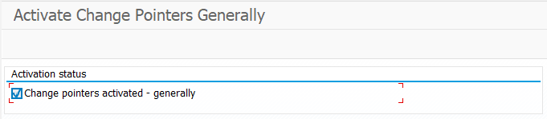
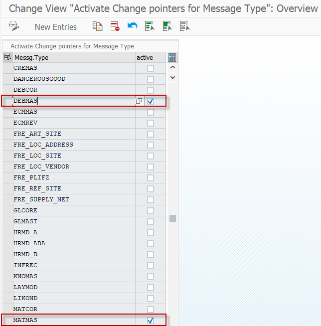
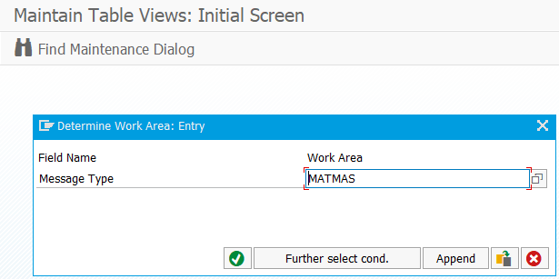
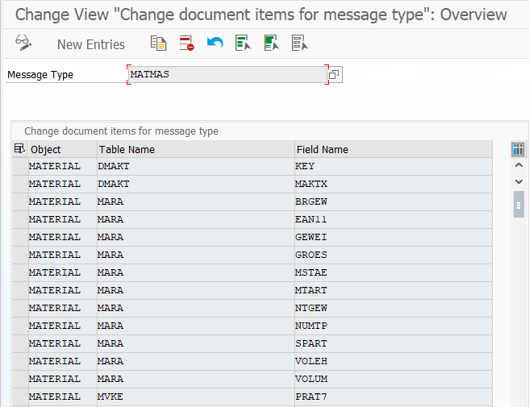
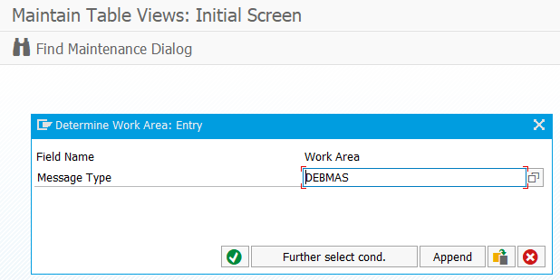
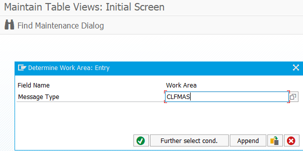
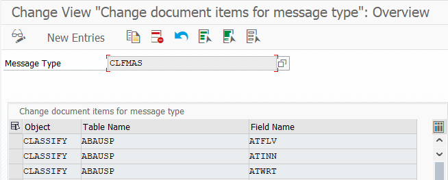

<!-- SPDX-License-Identifier: CC-BY-NC-ND-4.0 -->
<!-- Copyright (c) 2026 Onibex, LLC. Part of the Onibex eCommerce 360° Documentation — https://github.com/Onibex/ecommerce-docs -->

**English** · [Español](../../../es/technical-documents/02-ale-foundations/05-change-pointers.md) | [↑ Technical documents index](../README.md) | [Repository README](../../../README.md)

# Setting up change pointers

> **Source:** Onibex Help Center article “16. Setting up Change pointers” — <https://help.onibex.com/portal/en/kb/articles/setting-up-change-pointers>. Spanish chapter D.6 of the functional specification “D1 – Integración de sistemas”.

Change Pointers oversee the updates SAP makes to E-Commerce when there are changes to the Clients and Materials Master Data. To carry out these tasks, proceed with the following configurations:

**Transaction: BD61**

1. Generally, activate the *"change pointers":*

**Transaction BD50 / table** **TBDA2**

2. Activate *change pointers* for DEBMAS, ADRMAS, ADR3MAS, MATMAS, and CLFMAS message types:

**Transaction BD52 / table TBD62**

1. Specify the fields to trigger the *"Change pointers":*

Note: There are no changes to the DEBMAS message type; the standard definition is left same as the initial configuration.

Once the above steps are configured, any changes to the fields defined by the Material and Customers Master Data will be recorded in table BDCP2; thus, they will be evaluated with the RBDMIDOC program from Transaction BD21. Additionally, the RBDCPCLR program deletes all obsolete records from this BDCP2 table, thus preventing it from becoming too large.

← Previous: [SAP partner profile definition for IDocs](../02-ale-foundations/04-partner-profile.md) · Next: [MATMAS IDoc configuration (material master)](../03-master-data-idocs/01-matmas-idoc.md) →

---

© 2026 Onibex, LLC · Licensed under [CC BY-NC-ND 4.0](../../../LICENSE) (SPDX: CC-BY-NC-ND-4.0) · [Commercial license](../../../COMMERCIAL-LICENSE.md) · [Trademarks and third-party notices](../../../THIRD-PARTY-NOTICES.md) · SAP and other SAP products and services mentioned herein are trademarks or registered trademarks of SAP SE or an SAP affiliate company in Germany and other countries; names are used for identification only.
