<!-- SPDX-License-Identifier: CC-BY-NC-ND-4.0 -->
<!-- Copyright (c) 2026 Onibex, LLC. Part of the Onibex eCommerce 360° Documentation — https://github.com/Onibex/ecommerce-docs -->

**English** · [Español](../../../es/technical-documents/03-master-data-idocs/01-matmas-idoc.md) | [↑ Technical documents index](../README.md) | [Repository README](../../../README.md)

# MATMAS IDoc configuration (material master)

> **Source:** Onibex Help Center article “6. MATMAS iDoc configuration” — <https://help.onibex.com/portal/en/kb/articles/matmas-idoc-configuration>. Spanish chapter D.4.a of the functional specification “D1 – Integración de sistemas”.

As mentioned in the configuration table of Figure-16, MATMAS IDoc is used for sending information from SAP Material Master to an External system, in this case, to the E-Commerce system.

To start creating those messages, access the screen in **Figure-13**, then select the ***Outbound*** section and, press the icon  to add a new entry.

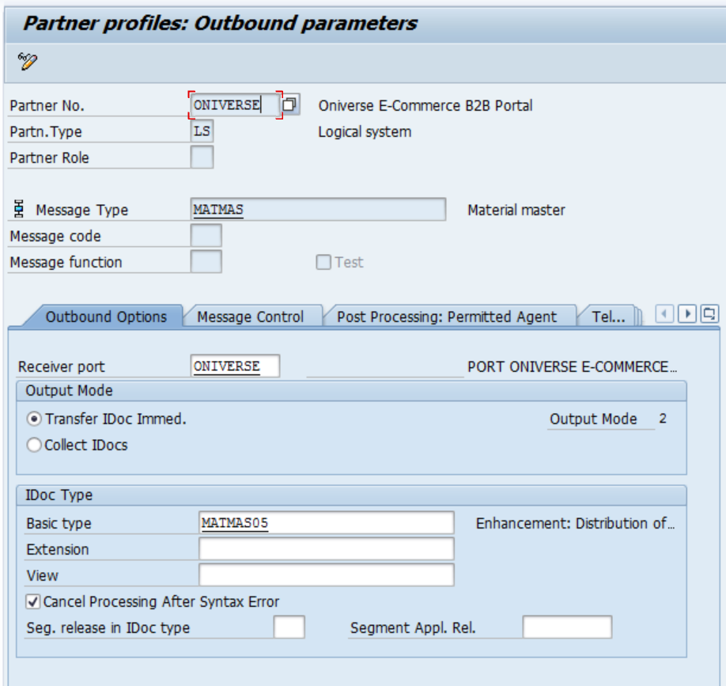

***Figure-17*** *WE20 Initial Screen for MATMAS Material Master.*

The following tabs are left unchanged; since IDoc MATMAS is related to master data, it is not necessary to configure any message.

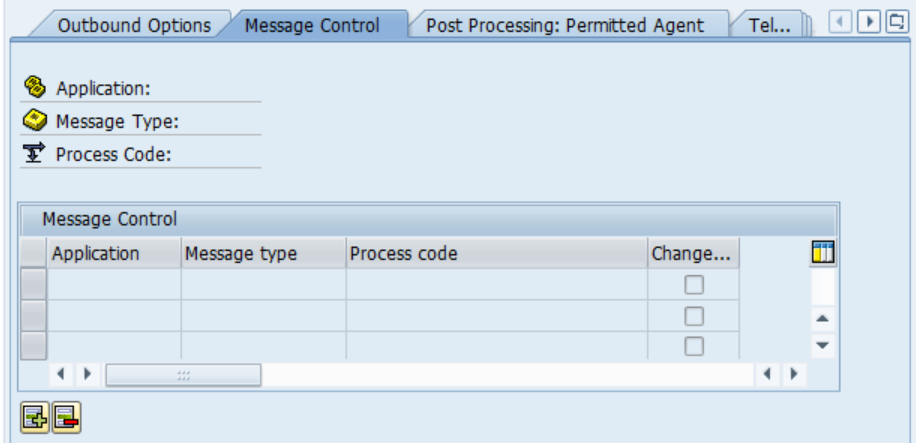

***Figure-18*** *Message Control tab*

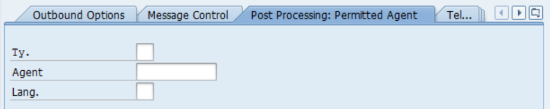

***Figure-19*** *Post-Processing tab*

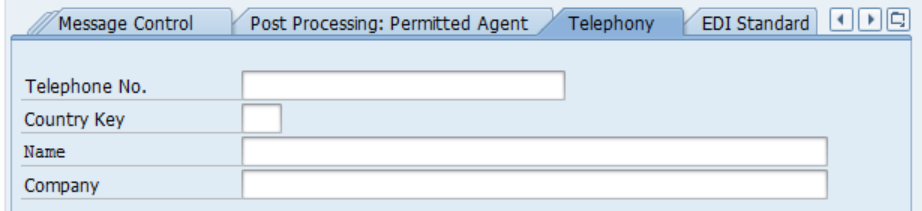

***Figure-20*** *Telephony tab*

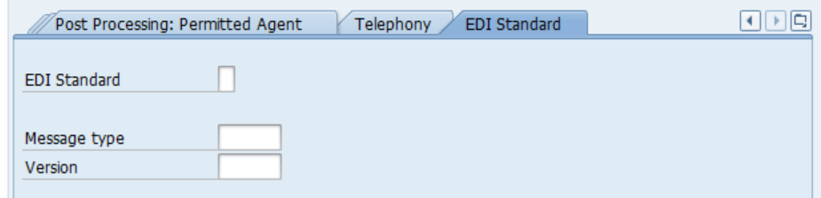

***Figure-21*** *EDI Standard tab.*

Once the appropriate options have been filled in, the next step is to configure the *DISTRIBUTION MODEL:* this is done in transaction **BD64.** Accessing BD64 T-Code, a screen like the one illustrated in Figure-22 is shown.

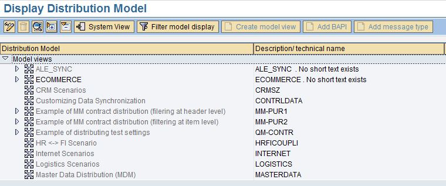

***Figure-22*** *Initial BD64 Transaction Screen:* *Distribution Model.*

Click on 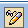 to enter modification mode, then press , this will bring up a screen like the one shown in Figure-23.

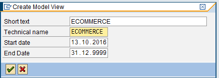

***Figure-23*** *Screen for creating the Definition of the Distribution Model, transaction BD64.*

Next add all the messages from the table in Figure-16; pay attention to the source and target system; for OUTBOUND messages, the Source system is the logical system that belongs to SAP, and the target system must be the E-COMMERCE. To start adding messages to transaction BD64 from Figure-22, press 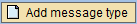 and then fill in the fields with the following data:

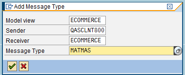

***Figure-24*** *Creating the MATMAS Message type to send Material Master records to ECOMMERCE using transaction BD64.*

Continue with a similar procedure for all other messages based on the table of Figure-16, and thus, a Model View is set up for ONIBEX E-COMMERCE B2B DATA MODEL like the one shown in Figure-25.

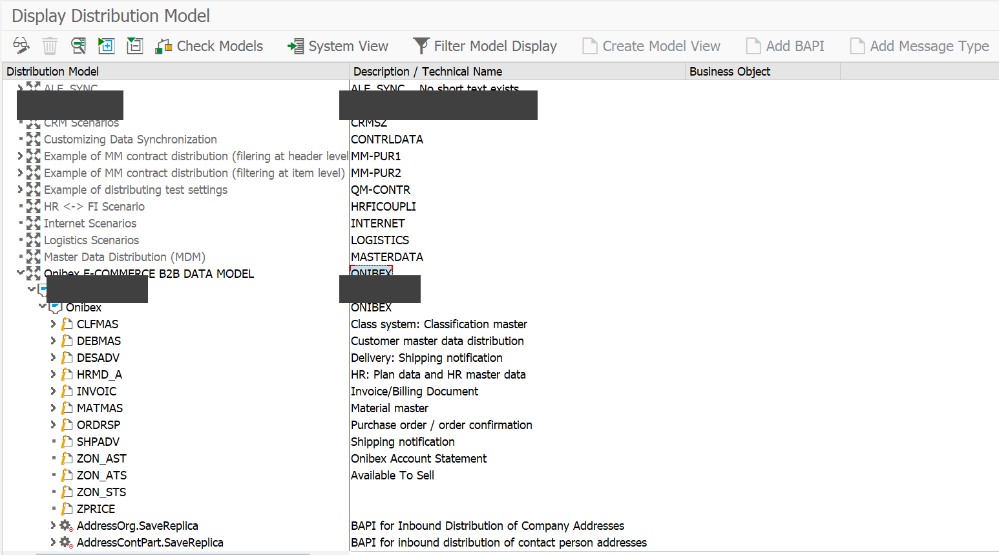

**Figure-25** Messages for ***Outbound*** IDocs in T-Code BD64: *Distribution Model*.

From this DATA MODEL some FILTERS can be setup in order to discriminate on certain organizational structures and record types. For instance, when opening MATMAS, no filter has been set. To display the filter attributes, press 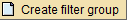 as shown in Figure-26.

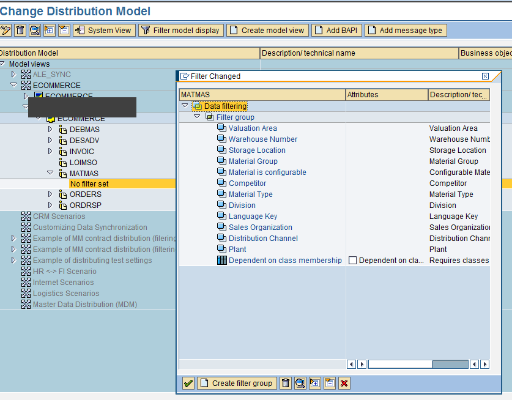

***Figure-26*** *Setting a Filter for the IDoc MATMAS in transaction BD64.*

To specify the values for each field, left double-click to enter the screen illustrated in Figure-27.

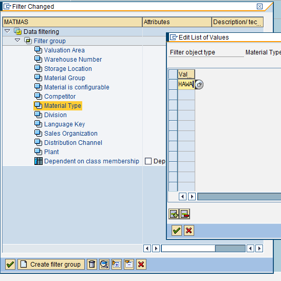

***Figure-27*** *Placing values in the Material Master Filter using transaction BD64.*

Notice that ONIBEX takes the HAWA material type from the inventory only.

Finally, send the records to the target system using transaction **BD10 MATERIAL SHIPPING.**

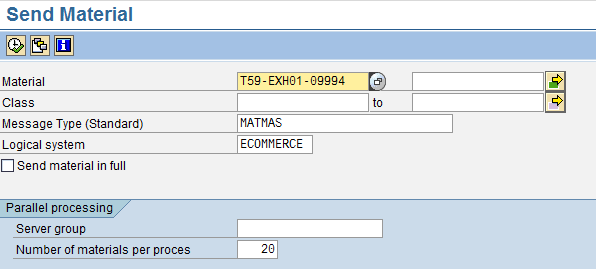

***Figure-28*** *Transaction screen BD10 to send Materials to Ecommerce catalog*

Click on the tick mark in T-Code BD10 from Figure-28, an IDoc for each material number is generated. SAP shows the following messages to confirm that material information is being sent.

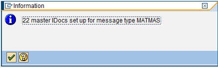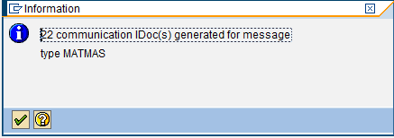

***Figure-29*** *Messages given by the system when processing IDocs using transaction BD10.*

The previous IDocs in Figure-29 can be viewed from transaction **WE02**, when marked green, IDocs were transmitted correctly, as shown in Figure-30.

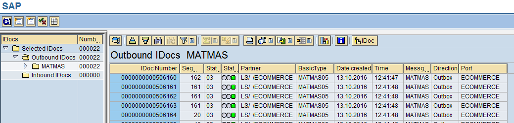

***Figure-30*** *IDoc* ***Outbound*** *MATMAS processed correctly and viewed by transaction WE02.*

← Previous: [Setting up change pointers](../02-ale-foundations/05-change-pointers.md) · Next: [DEBMAS IDoc configuration (customer master)](../03-master-data-idocs/02-debmas-idoc.md) →

---

© 2026 Onibex, LLC · Licensed under [CC BY-NC-ND 4.0](../../../LICENSE) (SPDX: CC-BY-NC-ND-4.0) · [Commercial license](../../../COMMERCIAL-LICENSE.md) · [Trademarks and third-party notices](../../../THIRD-PARTY-NOTICES.md) · SAP and other SAP products and services mentioned herein are trademarks or registered trademarks of SAP SE or an SAP affiliate company in Germany and other countries; names are used for identification only.
