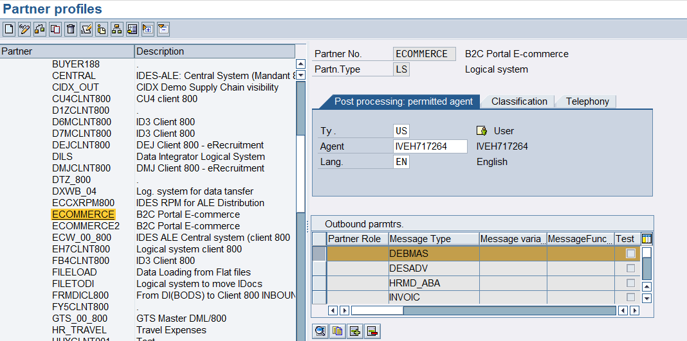
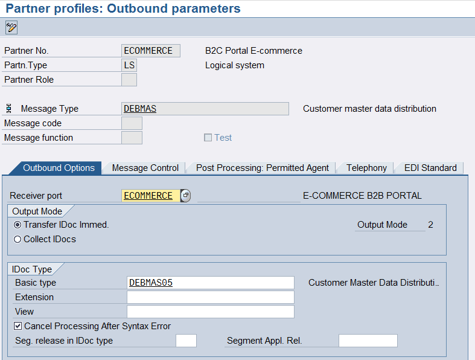
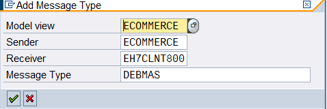
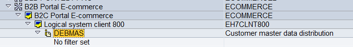
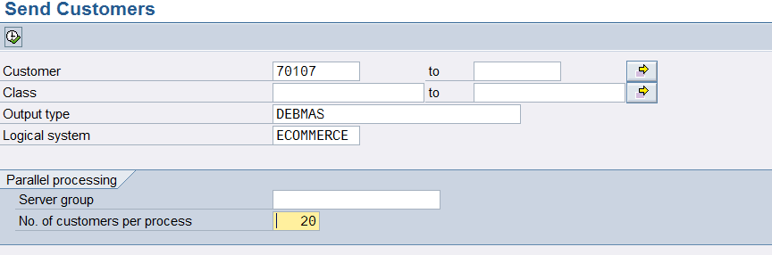
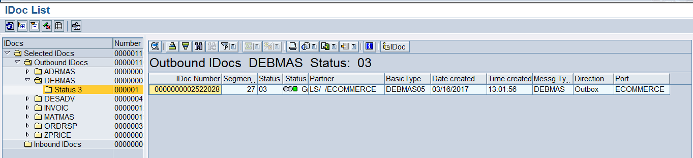
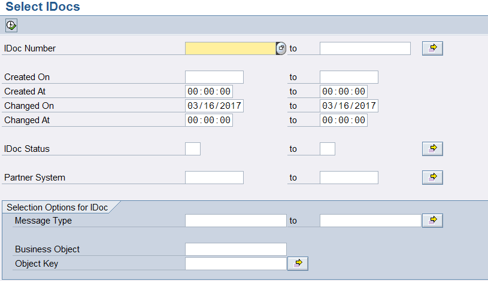

<!-- SPDX-License-Identifier: CC-BY-NC-ND-4.0 -->
<!-- Copyright (c) 2026 Onibex, LLC. Part of the Onibex eCommerce 360° Documentation — https://github.com/Onibex/ecommerce-docs -->

**English** · [Español](../../../es/technical-documents/03-master-data-idocs/02-debmas-idoc.md) | [↑ Technical documents index](../README.md) | [Repository README](../../../README.md)

# DEBMAS IDoc configuration (customer master)

> **Source:** Onibex Help Center article “7. DEBMAS iDoc configuration” — <https://help.onibex.com/portal/en/kb/articles/debmas-idoc-configuration>. Spanish chapter D.4.b of the functional specification “D1 – Integración de sistemas”.

As per table in Figure 16, **DEBMAS** IDocs contain the customers’ master data. Initially, this IDoc is also configured within transaction **WE20,** *Partner Profiles*, by adding a new message type as illustrated in Figure-31.

***Figure-31*** *Adding the Message Type DEBMAS for Partner Type* *LS Logical System*

To add this message just press the  icon, and a screen like the one in Figure-32 appears.

On the screen from Figure-32, add the message *type* ***DEBMAS*** and add **ECOMMERCE** as *Receiver port*; for the field *Basic type,* type **DEBMAS05.**

***Figure-32*** *Creating the IDoc for Customer Master through transaction WE20.*

The other screens in this IDoc should remain empty.

Following the standard procedure, go to transaction BD64 and place an entry in the Distribution Model; in this section, one might or might not consider setting up some filters for customers that will be uploaded to the E-Commerce portal database:

***Figure-33*** *Entry in transaction BD64 for the Distribution Model*

In order to process the customers and send them to the target system, enter transaction **BD12** as shown in the following figure:

***Figure-34*** *BD12 transaction screen for customer information routing to the target Ecommerce system.*

Once the information is sent, enter **WE02** transaction to verify if messages were processed, as shown in Figure-35.

**Figure-35** WE02 transaction screen where one can find out if the IDocs were successfully processed.

If any message is marked yellow, go to transaction **BD87** in order to reprocess the IDoc. Below is the screen for such transaction:

***Figure-36*** *Transaction selection screen* ***BD87*** *for processing IDocs in yellow.*

← Previous: [MATMAS IDoc configuration (material master)](../03-master-data-idocs/01-matmas-idoc.md) · Next: [Setting up the IDoc to create SD quotations](../04-sales-document-idocs/01-quotation-idoc.md) →

---

© 2026 Onibex, LLC · Licensed under [CC BY-NC-ND 4.0](../../../LICENSE) (SPDX: CC-BY-NC-ND-4.0) · [Commercial license](../../../COMMERCIAL-LICENSE.md) · [Trademarks and third-party notices](../../../THIRD-PARTY-NOTICES.md) · SAP and other SAP products and services mentioned herein are trademarks or registered trademarks of SAP SE or an SAP affiliate company in Germany and other countries; names are used for identification only.
