<!-- SPDX-License-Identifier: CC-BY-NC-ND-4.0 -->
<!-- Copyright (c) 2026 Onibex, LLC. Part of the Onibex eCommerce 360° Documentation — https://github.com/Onibex/ecommerce-docs -->

**English** · [Español](../../../es/technical-documents/04-sales-document-idocs/01-quotation-idoc.md) | [↑ Technical documents index](../README.md) | [Repository README](../../../README.md)

# Setting up the IDoc to create SD quotations

> **Source:** Onibex Help Center article “8. Setting up the iDoc to create SD QUOTATIONS” — <https://help.onibex.com/portal/en/kb/articles/setting-up-the-idoc-to-create-sd-quotations>. Spanish chapter D.4.c of the functional specification “D1 – Integración de sistemas”.

As a standard, SAP does not support the creation of quote documents within the SD module, therefore, an IDoc **Z** must be setup based on the basic message type ORDERS05. This type of message is processed by a program (called "*Function ZIDOC_INPUT_QUOTATION*") -written in the ABAP Workbench- to be processed by SAP as a **QT** document type. This QT document is ultimately the one used to generate quote type sales documents. Note that the document type is QT and not OR. In addition, a quote in SAP needs a range of dates the sales document will have to be indicated for validation, therefore this IDoc should be defined in the same way or similar to those presented earlier in the table of Figure-16.

The quote is a preliminary document that serves to formalize a possible sales transaction, and besides, it is the only way to keep product’s prices for customers, especially if their prices change constantly. If the effective period has already expired, a sales order with reference to that document cannot be generated and, a new sales document will need to be processed.

It is convenient to save the number of the quote cart from the ECommerce into the SAP PO number field (Purchase Order: "*Purchasing Order*"), and once the sales order is created for such a customer, both numbers are available in the same field of registration: the cart, and, the quote and the Purchase Order generated from the ECommerce.

To set up this whole new message type, go to **WE81** T-Code: **CREATE MESSAGE TYPES** transaction, to create a ZQUOTATION entry:

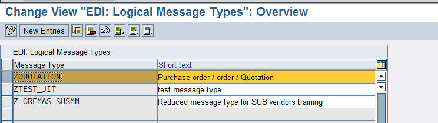

**Figure-37** **Transaction screen WE81** to define the input message for Reservations.

Then enter **WE82** transaction: **IDOC TYPE-** **MESSAGE TYPE COMBINATION** to create a combination of the ZQUOTATION message with the ORDERS05 IDoc type:

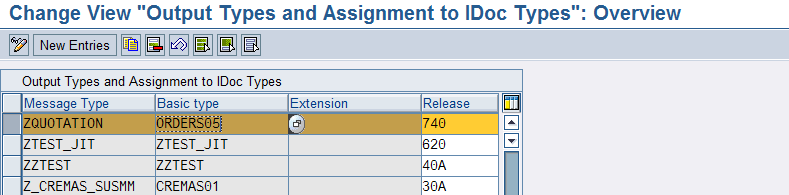

**Figure-38** **WE82** transaction screen to relate the input message to Reservations.

Now go to **WE42** T-Code: **Inbound Process Code** transaction to set up an entry to later relate to the ZIDOC_INPUT_QUOTATION function in order to create this QT document type.

Such a function ZIDOC_INPUT_QUOTATION is written in ABAP programming language. ABAP is SAP's own programming language, initially written in a Workbench development environment. To move such programs, as the function ZIDOC_INPUT_QUOTATION, from an SAP Development environment, DEV, to a quality test environment, QAS, a transport order is generated.

Returning to WE42 transaction, the main configuration screen is shown in Figure-39.

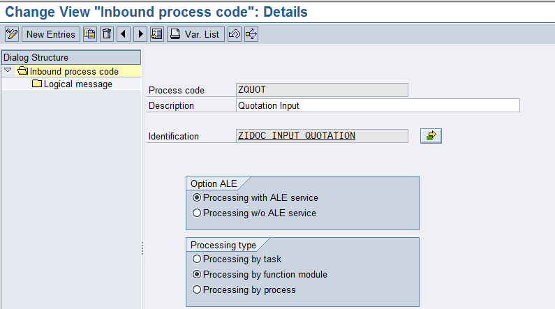

**Figure-39** Screen from **WE42** inbound message processing transaction for Reservations through the ZIDOC_INPUT_QUOTATION function.

The function to create is the following:

```
FUNCTION ZIDOC_INPUT_QUOTATION.
*"----------------------------------------------------------------------
*"*"Local Interface:
*"  IMPORTING
*"     VALUE(INPUT_METHOD) LIKE  BDWFAP_PAR-INPUTMETHD
*"     VALUE(MASS_PROCESSING) LIKE  BDWFAP_PAR-MASS_PROC
*"  EXPORTING
*"     VALUE(WORKFLOW_RESULT) LIKE  BDWFAP_PAR-RESULT
*"     VALUE(APPLICATION_VARIABLE) LIKE  BDWFAP_PAR-APPL_VAR
*"     VALUE(IN_UPDATE_TASK) LIKE  BDWFAP_PAR-UPDATETASK
*"     VALUE(CALL_TRANSACTION_DONE) LIKE  BDWFAP_PAR-CALLTRANS
*"     VALUE(DOCUMENT_NUMBER) LIKE  VBAK-VBELN
*"  TABLES
*"      IDOC_CONTRL STRUCTURE  EDIDC
*"      IDOC_DATA STRUCTURE  EDIDD
*"      IDOC_STATUS STRUCTURE  BDIDOCSTAT
*"      RETURN_VARIABLES STRUCTURE  BDWFRETVAR
*"      SERIALIZATION_INFO STRUCTURE  BDI_SER
*"      EDI_TEXT STRUCTURE  EDIORDTXT1 OPTIONAL
*"      EDI_TEXT_LINES STRUCTURE  EDIORDTXT2 OPTIONAL
*"----------------------------------------------------------------------
*{   INSERT         EH7K900900                                        1
*ENHANCEMENT-POINT IDOC_INPUT_ORDERS_G1 SPOTS ES_SAPLVEDA.

*  LOOP AT idoc_contrl.--
* SET/GET Parameter und interne Tabellen neu initialisieren
* initialize SET/GET Parameter and internal tables
*   PERFORM initialize_organizational_data.
**   PERFORM zinitialize_organizational_dat.
*** IDOC-Segmente in die entsprechenden Anwendungsdaten übernehmen
*** Move IDOC to internal tables
***    PERFORM interpret_idoc_orders.
**    PERFORM zinterpret_idoc_orders TABLES IDOC_DATA.
*** Prüfen ob gewisse Segmente gefüllt sind
*** check IDOC-Segments
**    PERFORM check_idoc_segments.
*** Prüfen und Ermitteln von Organisationsdaten
*** check internal tables and determine organization data
**    PERFORM check_idoc_orders.
*** Prüfen und Ermitteln von Konfigurationsdaten
*** check internal tables and determine configuration order data
**    PERFORM check_configuration.
*** ermitteln Partner für Auftrag
*** determine partner
**    PERFORM determine_partner.
*** ermitteln Positionstyp
*** determine item type
**    PERFORM determine_postyp.
*** ermitte-ln Texte
*** determine texts
**    PERFORM check_text.
*** exportieren Posguid ins globale Memory
*** export posguid to global memory
**    PERFORM check_posguid.
*** vergleichen errtab mit Ausnahmetabelle WFMCMSGENQ
*** compare ERRTAB with message table WFMCMSGENQ
**    PERFORM errorhandling TABLES errtab.
*** abschliessendes Bearbeiten der internen Fehlertabelle.
*** final coding to change the internal ERRTAB
**    CALL CUSTOMER-FUNCTION '011'
**         EXPORTING
**              dxvbak  = xvbak
**              docnum  = idoc_contrl-docnum
**         TABLES
**              derrtab = errtab
**              dxvbap  = xvbap
**              dxvbep  = xvbep
**              dxvbadr = xvbadr
**              dxvbpa  = xvbpa
**              dxvbuv  = xvbuv
**              dedidc  = idoc_contrl
**              dedidd  = idoc_data
**              dxkomv  = xkomv
**              dxvekp  = xvekp
**              dyvekp  = yvekp.
**    DESCRIBE TABLE errtab LINES anzahl.
**
**ENDLOOP.

DATA :
        V_DOC     TYPE VBELN,
        v_index   TYPE sy-tabix,
        v_ind2    TYPE sy-tabix,
        W_HEADER  TYPE BAPISDHD1,
        W_PART    TYPE BAPIPARNR,
        W_control TYPE EDIDC,
        I_PART    TYPE TABLE OF BAPIPARNR,
        W_ITEM    TYPE BAPISDITM,
        I_ITEM    TYPE TABLE OF BAPISDITM,
        W_SCHED   TYPE BAPISCHDL,
        I_SCHED   TYPE TABLE OF BAPISCHDL,
        W_RETURN  TYPE BAPIRET2,
        I_RETURN  TYPE TABLE OF BAPIRET2,
        W_EDD     TYPE EDIDD,
        W_ED2     TYPE EDIDD,
        w_stat    TYPE EDI_DS,
        W_K01     TYPE E1EDK01,
        W_K02     TYPE E1EDK02,
        W_K03     TYPE E1EDK03,
        W_K14     TYPE E1EDK14,
        W_KA1     TYPE E1EDKA1,
        W_p01     TYPE E1EDp01,
        W_p19     TYPE E1EDp19,
        v_plant   TYPE werks_d.

READ TABLE idoc_contrl into w_control INDEX 1.

  LOOP AT IDOC_DATA INTO W_EDD.
    v_index = sy-tabix.
*  move:  x_vbak.
    CASE W_EDD-SEGNAM.
      WHEN 'E1EDK01'.
        MOVE W_EDD-SDATA TO W_K01.
        W_HEADER-DOC_TYPE     = 'AG'.
        W_HEADER-PMNTTRMS     = W_K01-zterm.
        W_HEADER-CURRENCY     = W_K01-CURCY.
        w_header-INCOTERMS1   = 'FOB'.
        w_header-INCOTERMS2   = 'FREE ON BOARD'.
      WHEN 'E1EDK02'.
        MOVE W_EDD-SDATA TO W_K02.
        W_HEADER-PURCH_NO_C   = W_K02-belnr.
        W_HEADER-PO_DAT_S     = W_K02-datum.
      WHEN 'E1EDK03'.
        MOVE W_EDD-SDATA TO W_K03.
        case w_k03-iddat.
          when '001'.
             w_header-QT_VALID_F   = w_k03-datum.
          when '002'.
             w_header-QT_VALID_t   = w_k03-datum.
        endcase.
      WHEN 'E1EDK14'.
        MOVE W_EDD-SDATA TO W_K14.
        case w_k14-QUALF.
          WHEN '005'.
            v_plant = w_k14-orgid.
          WHEN '006'.
            w_header-DIVISION = w_k14-orgid.
          WHEN '007'.
            w_header-DISTR_CHAN = w_k14-orgid.
          WHEN '008'.
            w_header-SALES_ORG = w_k14-orgid.
        endcase.
      WHEN 'E1EDKA1'.
        MOVE W_EDD-SDATA TO W_KA1.
        CASE W_KA1-PARVW.
          WHEN 'AG'.
            W_PART-partn_role = 'AG'.
            W_PART-PARTN_NUMB = w_ka1-partn.
            APPEND w_part to i_Part.
          WHEN 'WE'.
            W_PART-partn_role = 'WE'.
            W_PART-PARTN_NUMB = w_ka1-partn.
            APPEND w_part to i_Part.
          WHEN 'RG'.
            W_PART-partn_role = 'RG'.
            W_PART-PARTN_NUMB = w_ka1-partn.
            APPEND w_part to i_Part.
          WHEN 'RE'.
            W_PART-partn_role = 'RE'.
            W_PART-PARTN_NUMB = w_ka1-partn.
            APPEND w_part to i_Part.
         ENDCASE.
      WHEN 'E1EDP01'.
        MOVE W_EDD-SDATA TO W_P01.
        V_IND2 = V_INDEX + 1.
        READ TABLE IDOC_DATA INTO W_ED2 INDEX V_IND2.
        MOVE W_ED2-SDATA TO W_P19.
        W_ITEM-ITM_NUMBER   =  W_P01-POSEX.
        W_ITEM-MATERIAL     =  W_P19-IDTNR.
        W_ITEM-PART_DLV     =  'C'.
        W_ITEM-PLANT        =  V_PLANT.
        W_ITEM-SHIP_POINT   =  V_PLANT.
        W_ITEM-STORE_LOC    =  '0001'.
        W_ITEM-TARGET_QTY   =  W_P01-MENGE.
        W_ITEM-TARGET_QU    =  W_P01-MENEE.
        W_ITEM-ITEM_CATEG   =  'AGN'.
        W_ITEM-PMNTTRMS     =  W_HEADER-PMNTTRMS.
        w_ITEM-INCOTERMS1   = 'FOB'.
        w_ITEM-INCOTERMS2   = 'FREE ON BOARD'.
        w_SCHED-ITM_NUMBER  = W_P01-POSEX.
        w_SCHED-SCHED_LINE  = '0001'.
        w_SCHED-REQ_DATE    = SY-DATUM.
        w_SCHED-REQ_QTY     = W_P01-MENGE.
        w_SCHED-SCHED_TYPE  = 'BN'.
        APPEND W_ITEM TO I_ITEM.
        APPEND W_SCHED TO I_SCHED.
    ENDCASE.
  ENDLOOP.

CALL FUNCTION 'BAPI_QUOTATION_CREATEFROMDATA2'
  EXPORTING
    QUOTATION_HEADER_IN            =  W_HEADER
  IMPORTING
    SALESDOCUMENT                  =  V_DOC
  TABLES
    RETURN                         =  I_RETURN
    QUOTATION_ITEMS_IN             =  I_ITEM
    QUOTATION_PARTNERS             =  I_PART
    QUOTATION_SCHEDULES_IN         =  I_SCHED.
if v_doc is NOT INITIAL.
  CALL FUNCTION 'BAPI_TRANSACTION_COMMIT'
    EXPORTING
      WAIT          = 'X'.

*  MOVE v_idoc

 w_stat-DOCNUM    = w_control-docnum.
 w_stat-status    = '53'.
 w_stat-LOGDAT    = sy-datum.
 w_stat-LOGtim    = sy-uzeit.
 concatenate 'Quotation #' v_doc 'Created' into w_stat-STATXT SEPARATED BY space.

CALL FUNCTION 'EDI_DOCUMENT_STATUS_SET'
  EXPORTING
    document_number               = w_control-docnum
    idoc_status                   = w_stat.

ENDIF.
*****
*****    IF anzahl GT 0 AND input_method = 'X'.
*****      EXPORT errtab TO MEMORY ID 'idoc_test_errtab'.
*****    ENDIF.
*****
*****    IF anzahl GT  0  AND
*****       xaprau EQ 'D'.
****** Bei der Anlage von Auslieferungsaufträgen dienen Meldungen bzgl.
****** Lieferplänen mit Absagegrund nur der Information: Sie dürfen
****** nicht zum Abbruch der IDoc-Verarbeitung führen.
******                When creating delivery orders messages regarding
****** scheduling agreement with 'reason for rejection' are only for
****** information: They must not force the idoc integration to fail.
*****      LOOP AT errtab WHERE arbgb EQ 'VG' AND
*****                           msgnr EQ '219'.
*****        anzahl = anzahl - 1.
*****      ENDLOOP.
*****      IF anzahl EQ 0.
*****        REFRESH errtab.
*****      ENDIF.
*****    ENDIF.
*****    IF anzahl NE 0
*****     AND input_method IS INITIAL.
*****      PERFORM determine_user.
*****      PERFORM statusrecord TABLES errtab.
****** Userexit zum Ändern der Statustabelle
****** User exit to change the status table
*****      CALL CUSTOMER-FUNCTION '010'
*****           EXPORTING
*****                docnum      = idoc_contrl-docnum
*****           TABLES
*****                derrtab     = errtab
*****                xbdidocstat = idoc_status.
*****    ELSE.
*****      IF check_orga IS INITIAL.
*****
****** EDI Kennzeichen für Sonderprüfungen innerhalb anderer Anwendungen als
****** Folge der Auftragsbearbeitung.
****** EDI checkmark for other applications processed during order creation.
*****        PERFORM edi_mode_to_mem.
*****************************************************************************
****** Aufruf Transaktion Auftragerfassung VA01                             *
****** call transaction Order Entry VA01                                    *
*****************************************************************************
*****        CASE xaprau.
*****          WHEN ' '.
*****            PERFORM call_va01_new_orders USING ok.
*****          WHEN 'Q'.
****** Aufruf Transaktion Auftragerfassung VA01 mit Bezug auf Angebot
****** call transaction Order Entry VA01 with refer to quote number.
*****            PERFORM call_va01_new_orders_angbt USING ok.
*****          WHEN 'C'.
****** Aufruf Transaktion Auftragerfassung VA01 mit Bezug auf Kontrakt
****** call transaction Order Entry VA01 with refer to contract number
*****            PERFORM call_va01_new_orders_contk USING ok.
*****          WHEN 'L'.
****** Aufruf Transaktion Auftragerfassung für Auftragsarten mit Vertiebs-
****** belegtypen D,G,K,L
****** call transaction Order Entry VA01 for order types with
****** SD document category D,G,K,L
*****            PERFORM call_va01_new_orders_cremo USING ok.
*****          WHEN 'R'.
****** Aufruf Transaktion Auftragerfassung für Auftragsarten mit Vertiebs-
****** belegtypen H (z.B. Konsigantionsretoure)
****** call transaction Order Entry VA01 for order types with
****** SD document category H (for example consingment return)
*****            PERFORM call_va01_new_orders_return USING ok.
*****          WHEN 'D'.
****** Aufruf Transaktion Auftragerfassung für Auslieferungsauftrag
****** call transaction Order Entry VA01 for delivery order
*****            PERFORM call_va01_new_orders_delord USING ok.
*****          WHEN 'K'.
****** Aufruf Transaktion Auftragerfassung für Anlegen mit Bezug auf
****** Positionsebene (Anlegen mit Bezug zum Angebot/Kontrakt)
****** call transaction Order Entry VA01 for delivery order
*****            PERFORM call_va01_new_orders_refer USING ok.
*****        ENDCASE.
****** Zusätzliche Aktionen nach call transaction VA01
****** additional checks after call transaction VA01
*****        CALL CUSTOMER-FUNCTION '003'
*****          EXPORTING
*****            sales_document = belegnummer
*****            docnum         = idoc_contrl-docnum
*****          TABLES
*****            didoc_data      = idoc_data
*****            dbdcmsgcoll     = xbdcmsgcoll
*****          CHANGING
*****            status         = ok.
*****
****** Löschen des EDI-Kennzeichens im Memory / delete EDI-checkmark from
****** memory
*****        PERFORM edi_mode_delete_mem.
*****
*****      ENDIF.
*****
****** füllen IDOC_Status
****** fill IDOC_Status
*****      IF ok = space.
*****        idoc_status-docnum = idoc_contrl-docnum.
*****        idoc_status-status = beleg_nicht_gebucht.
*****        IF check_orga = 'X'.
*****          idoc_status-msgty  = 'E'.
*****          idoc_status-msgid  = 'VG'.
*****          idoc_status-msgno  = '204'.
*****          idoc_status-msgv1  = xvbak-kunnr.
*****          idoc_status-msgv2  = lieferant.
*****          APPEND idoc_status.
*****        ELSE.
*****          idoc_status-msgty  = sy-msgty.
*****          idoc_status-msgid  = sy-msgid.
*****          idoc_status-msgno  = sy-msgno.
*****          idoc_status-msgv1  = msgv1.
*****          idoc_status-msgv2  = msgv2.
*****          idoc_status-msgv3  = msgv3.
*****          idoc_status-msgv4  = msgv4.
*****          APPEND idoc_status.
*****        ENDIF.
*****      ELSE.
*****        call_transaction_done = 'X'.
*****
******- Übergabe  BUS für Verknüpfungssätze --------------------------------*
******- set object type for the link ---------------------------------------*
******       if not object_type is initial.
******        return_variables-doc_number = object_type.
******        append return_variables.
******       endif.
******- Wenn Texte geschrieben werden muss nochmals ein Commit abgesetzt ---*
******- werden. Das Hilfsfeld CALL-TRANSACTION_DONE bewirkt, dass dieser ---*
******- Commit nicht von der ALE-Schicht abgesetzt wird, da der Commit von -*
******- Transaktion abgesetzt wurde ----------------------------------------*
*****        IF xe1edkt2 NE space OR
*****           xe1edpt2 NE space.
*****          COMMIT WORK.
*****        ENDIF.
****** Belegnummer in die Schnittstelle zurückgeben für Textworkflow
****** send document number back for textworkflow
*****        document_number = belegnummer.
*****      ENDIF.
*****      CLEAR msgv1.
*****      CLEAR msgv2.
*****      CLEAR msgv3.
*****      CLEAR msgv4.
*****    ENDIF.
*****
****** setzen Workflow Ausgangsparameter
****** Allocate IDOC numbers to Workflow output parameters
*****    IF ok = space.
*****      return_variables-wf_param = eid.
*****      return_variables-doc_number = idoc_contrl-docnum.
*****      APPEND return_variables.
*****      workflow_result = c_wf_result_error.
*****    ENDIF.
****** Abschließende Aktionen pro Auftrag
****** final checks per order
*****    CALL CUSTOMER-FUNCTION '004'
*****      EXPORTING
*****        sales_document = belegnummer
*****        docnum         = idoc_contrl-docnum
*****      TABLES
*****        didoc_data      = idoc_data
*****        didoc_status    = idoc_status
*****        didoc_cntrl     = idoc_contrl.
*****
*****  ENDLOOP.                             "End loop at idoc_contrl.
*****
******- Clear auf APPLICATION_VARIABLE - nur für Auslieferungsaufträge -----*
******- Clear APPLICATION_VARIABLE  - only for delivery-orders -------------*
*****  PERFORM clear_appl_variable.
******-potentiellen Mailempfänger ermitteln - nur für Auslieferungsaufträge *
******- determine mail receiver - only for delivery-orders -----------------*
*****  PERFORM determine_mail_receiver.
*****
****** Abschließende Aktionen (Massenverarbeitung)
****** final checks (mass processing)
*****  CALL CUSTOMER-FUNCTION '005'
*****    TABLES
*****      didoc_data        = idoc_data
*****      didoc_status      = idoc_status
*****      didoc_cntrl       = idoc_contrl
*****      dreturn_variables = return_variables.
*****
*}   INSERT
ENDFUNCTION.
```

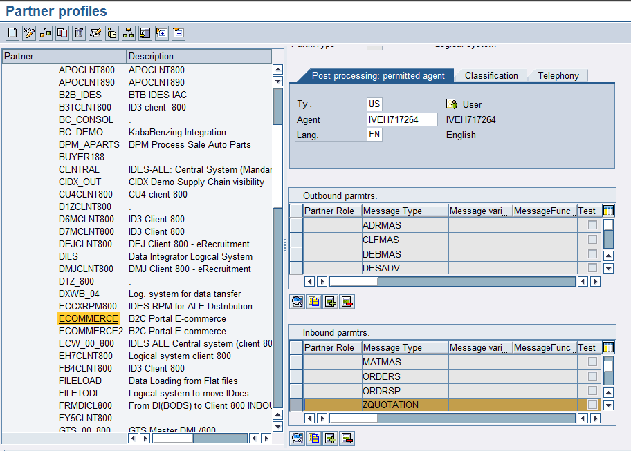

**Figure-40** **WE20** transaction screen to add the ZQUOTATION message as input to SAP from the Ecommerce Web Page.

Continuing with the message-based configuration from Figure-16 table. For Reservations, now enter **WE20** transaction to add within the INBOUND section the **Z** IDoc defined through the steps in Figures 37, 38 and 39. Double-click the *Message Type: “ZQUOTATION”* field to display the screen in Figure-41.

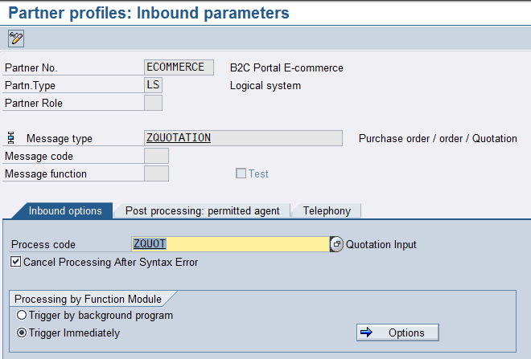

**Figure-41** **Inbound** **parameters** section of the **WE20** transaction to configure the *Message Type: “ZQUOTATION”* as the Reservations entry from the ECommerce portal.

In the *Process Code* field, a **Z** has been defined to use the BAPI standard and thus, to be able to generate the QT document.

The next step is to feed the distribution model for this IDoc in **BD64** T-Code.

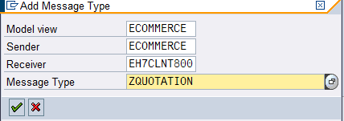

**Figure-42** Configuration screen when clicking “Add Message Type” button on BD**64** transaction to define the "Message *Type: ZQUOTATION"* Distribution Model as the Reservation entry from the ECommerce portal.

The final step, described through Figures 42 and 43, must be performed for all types of messages based on the table of Figure 16.

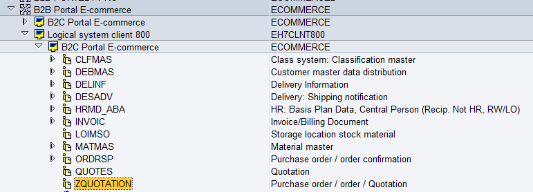

**Figure-43** Initial **BD64** T-Code screen in which the Distribution Model of the "*Message* *Type: ZQUOTATION"* has been defined as the Reservation entry from the ECommerce portal.

When the E-Commerce system sends a document to SAP, from WE02 transaction, ZQuotation IDocs can be found accessing **Inbound**:

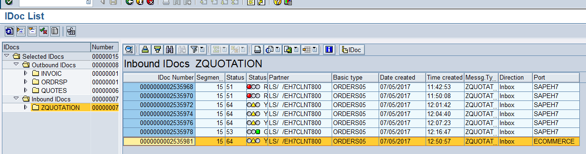

**Figure-44** This **WE02** secondary screen shows IDoc input "*Message* *Type: ZQUOTATION*" as a Reservation document from the E-Commerce portal

In the following screens from Figures 45 to 59, the information contained in that *ZQUOTATION* IDoc is displayed.

In Figure-45, a document type is selected: QT, the payment terms, the currency, and the cart number of the quote of the E-Commerce portal.

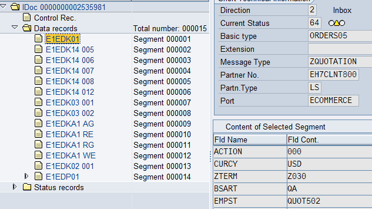

**Figure-45** This **WE02** secondary screen shows the *ZQUOTATION* IDoc segment fields corresponding to the payment condition, currency, and cart number of the quote.

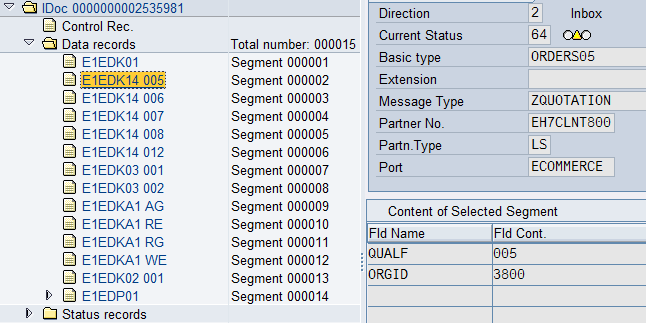

**Figure-46** This **WE02** secondary screen shows the *ZQUOTATION* IDoc segment fields corresponding to the plant information.

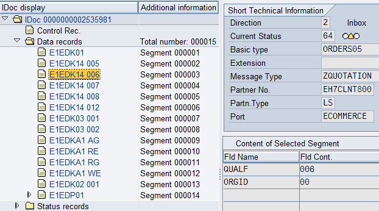

**Figure-47** This **WE02** secondary screen shows the *ZQUOTATION* IDoc segment fields corresponding to the industry information (Division).

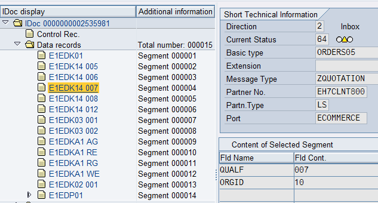

**Figure-48** This **WE02** secondary screen shows the *ZQUOTATION* IDoc segment fields corresponding to the *Distribution Channel* information.

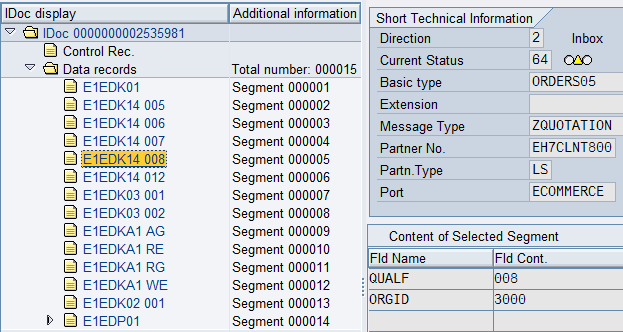

**Figure-49** This **WE02** secondary screen shows the *ZQUOTATION* IDoc segment fields corresponding to the sales organization information.

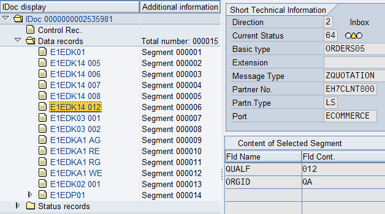

**Figure-50** This **WE02** secondary screen shows the *ZQUOTATION* IDoc segment fields corresponding to the document type information.

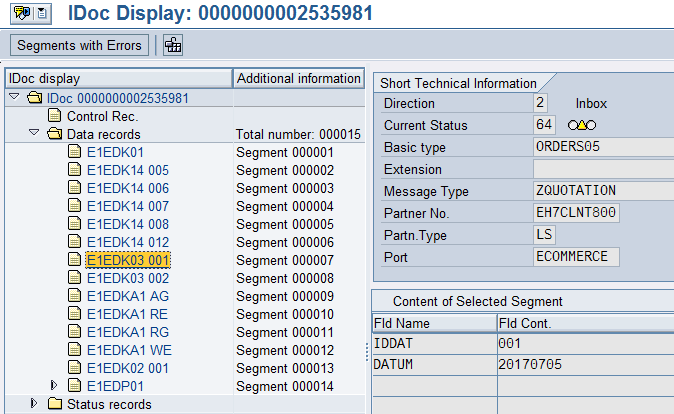

**Figure-51** This **WE02** secondary screen shows the *ZQUOTATION* IDoc segment fields corresponding to the document effective start date.

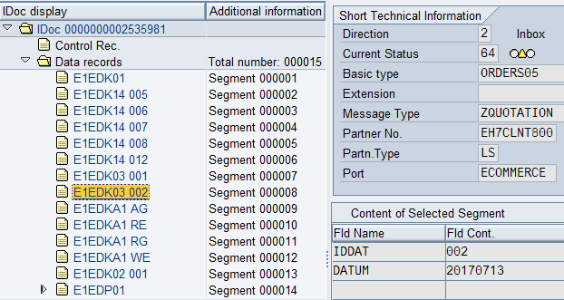

**Figure-52** This **WE02** secondary screen shows the *ZQUOTATION* IDoc segment fields corresponding to the document lifetime date.

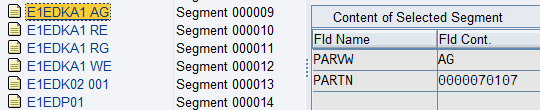

**Figure-53** This **WE02** secondary screen shows the *ZQUOTATION* IDoc segment fields corresponding to the partner information: Sold-*To-Party*.

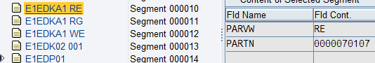

**Figure-54** This **WE02** secondary screen shows the *ZQUOTATION* IDoc segment fields corresponding to the partner information: *Bill*-*To-Party*.

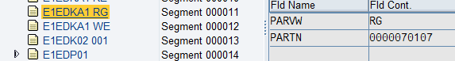

**Figure-55** This **WE02** secondary screen shows the *ZQUOTATION* IDoc segment fields corresponding to the *Payer* partner information.

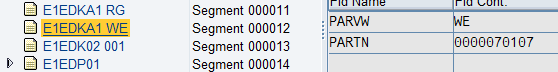

**Figure-56** This **WE02** secondary screen shows the *ZQUOTATION* IDoc segment fields corresponding to the *Ship-to* partner information.

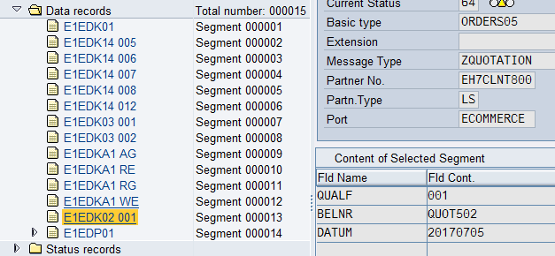

**Figure-57** This **WE02** secondary screen shows the *ZQUOTATION* IDoc segment fields corresponding to the order date and customer’s PO number.

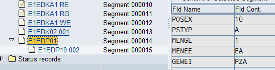

**Figure-58** This **WE02** secondary screen shows the *ZQUOTATION* IDoc segment fields corresponding to the PO information: item number, required quantity, base unit of measure, and sales unit of measure.

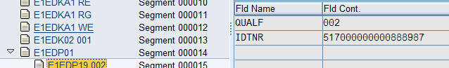

**Figure-59** This **WE02** secondary screen shows the *ZQUOTATION* IDoc segment fields corresponding to the material number.

When an IDoc is reprocessed in transaction **BD87**, a screen like the one in Figure-60 will show:

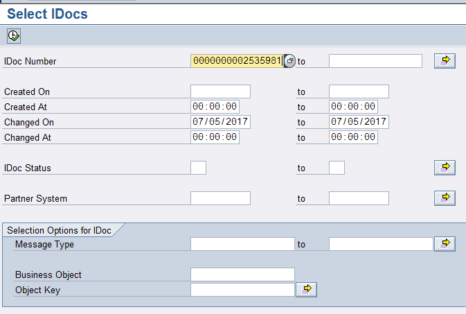

**Figure-60** Main **BD87** transaction screen to process IDocs in queue.

When running BD87 transaction, the following screen will show:

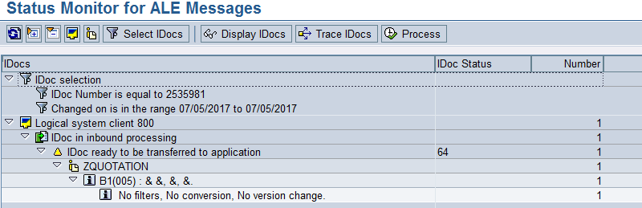

**Figure-61** BD87 transaction Sub-screen with a ZQUOTATION IDoc status and flow.

Click the Process button to create the quote Document:

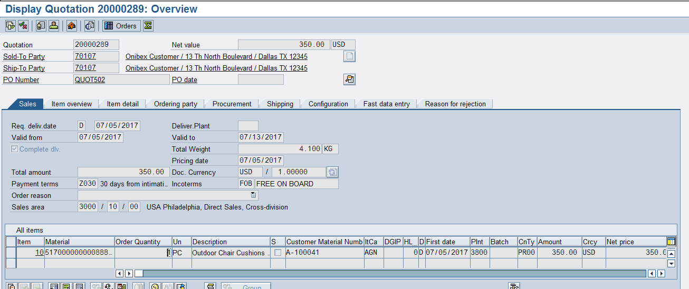

**Figure-62** Type of quote document created when processing the *ZQUOTATION* IDoc from the E-Commerce portal.

← Previous: [DEBMAS IDoc configuration (customer master)](../03-master-data-idocs/02-debmas-idoc.md) · Next: [Setting up the IDoc to confirm zQuote creation](../04-sales-document-idocs/02-quotation-confirmation-idoc.md) →

---

© 2026 Onibex, LLC · Licensed under [CC BY-NC-ND 4.0](../../../LICENSE) (SPDX: CC-BY-NC-ND-4.0) · [Commercial license](../../../COMMERCIAL-LICENSE.md) · [Trademarks and third-party notices](../../../THIRD-PARTY-NOTICES.md) · SAP and other SAP products and services mentioned herein are trademarks or registered trademarks of SAP SE or an SAP affiliate company in Germany and other countries; names are used for identification only.
