<!-- SPDX-License-Identifier: CC-BY-NC-ND-4.0 -->
<!-- Copyright (c) 2026 Onibex, LLC. Part of the Onibex eCommerce 360° Documentation — https://github.com/Onibex/ecommerce-docs -->

**English** · [Español](../../../es/technical-documents/04-sales-document-idocs/02-quotation-confirmation-idoc.md) | [↑ Technical documents index](../README.md) | [Repository README](../../../README.md)

# Setting up the IDoc to confirm zQuote creation

> **Source:** Onibex Help Center article “9. Setting up the iDOC to confirm zQuote creation” — <https://help.onibex.com/portal/en/kb/articles/setting-up-the-idoc-to-confirm-zquote-creation>. Spanish chapter D.4.d of the functional specification “D1 – Integración de sistemas”.

For the E-Commerce portal to find out about the quote number created in SAP, a new custom message called **ZQEC** needs to be included. An SAP configuration for this new message type **"ZQEC"** to be activated and generated at the same time a QT quote is created will need to be set. It is generated, as an output condition type, when the standard QT quote is created while processing the *ZQUOTATION* IDoc in the previous section. This type of output condition is configured to be processed by the *Application Link Enable* (ALE) to E-Commerce; thus, implement the parameter table presented in Figure-16.

To set up the new output NACE message type, access the NACE transaction to select the **V1** application and, click 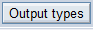. Create the ZQEC *output type* as a copy of the standard *AN00* message:

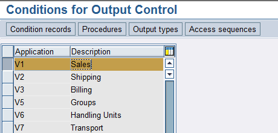

**Figure-63** Screen selecting the **V1** application area for sales documents and, clicking *Output* *types* to configure the **ZQEC** message to the E-Commerce portal.

Since the standard ***AN00*** *OUTPUT type* is copied to a custom output type named ZQEC the same configuration entries as those shown in Figure-64 must be set. In Figure-64, the *Access sequence* field should be selected as appropriate for the ZQEC message activation as an exclusive response to the Sales document creation when processing the *ZQUOTATION* IDoc.

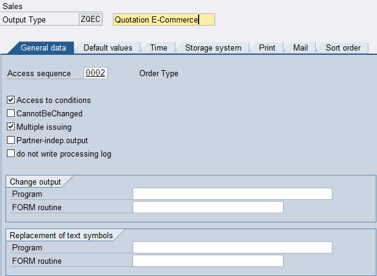

**Figure-64** First *output* *type* ZDEC configuration screen where the *Access* *sequence* is defined.

In the following tabs from NACE transaction, this ZQEC message type is configured so that immediately after a quote is activated with an SP (Sold-to-party) partner, an output is generated by the Application Link *Enabling* (ALE) transmission to the E-Commerce.

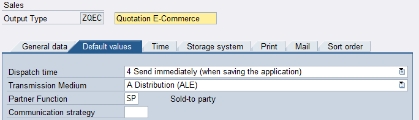

**Figure-65** Tab to *Access* *sequence* definition to generate an ALE output.

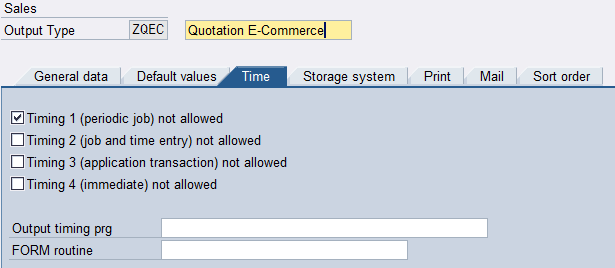

**Figure-66** Tab to define the time sequence between document type activation and message generation as output condition type.

Following the NACE transaction sequence, as shown in Figure-67, on the right side, select the ***Processing*** ***Routines*** folder, ensure that there is an entry for the A processing medium (ALE) containing: the RSNASTED program and the ALE_PROCESSING *form* *routine*.

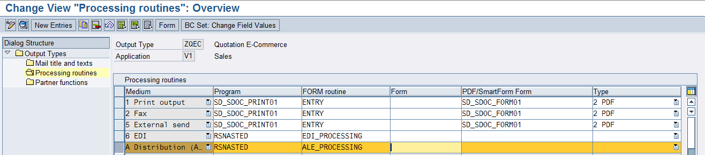

**Figure-67** Selecting the ***Processing Routines*** folder within the same **NACE** transaction.

Next, as shown in Figure-68, double-click the *Partner Functions* folder and make sure that there is an entry for media A and Partner function **SP.** This will be used later when creating the *Condition Record* for that message class.

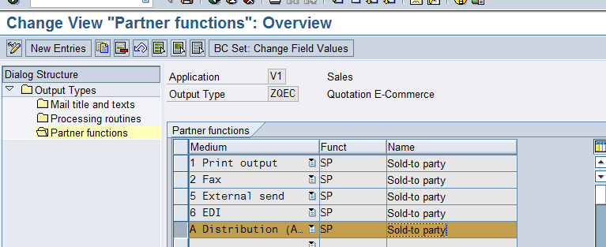

**Figure-68** Selecting the ***Partner*** ***function*** folder within the same **NACE** transaction.

Save the entry from Figure-68 and then return to the main menu shown in Figure-69. Following in the **V1** application area, enter the 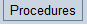 option:

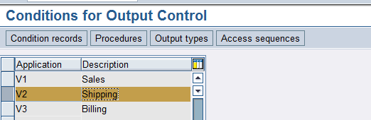

**Figure-69** Main menu of the same **NACE** transaction when entering **V1** ***Procedures*** option.

Choose **V06000** procedure to create an additional entry for the new *output* *type*:

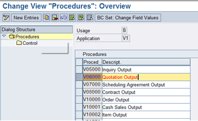

**Figure-70** Within the ***Procedures*** option, select output condition type V06000.

Next, to the right, double-click the **Control** folder, thus the screen of Figure-71 appears. Click 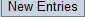 and, add the mustard color entry:

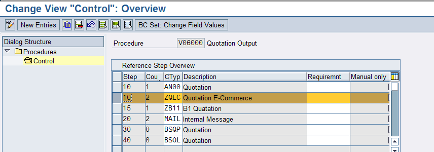

**Figure-71** Press ***New Entries***, determine the procedure for the ZQEC output condition.

Save changes and return to the initial configuration menu to create the *Condition Record* for this new *output type.* Enter the 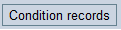 menu and, select the ZQEC entry by double-clicking on it:

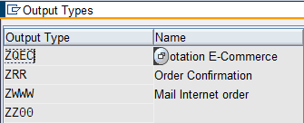

**Figure-72** Once inside the *Condition Records* option, double-click the ZQEC field.

A screen like the one in Figure-73 appears; there, select the quote type to be created. Note that this type of sales document must match the type being used as an IDoc.

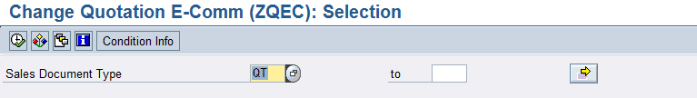

**Figure-73** Selecting the QT sales document type as Condition *Record* for the ZQEC message.

Click Run using the tick icon button, a window like Figure-74 appears to capture the following parameters:

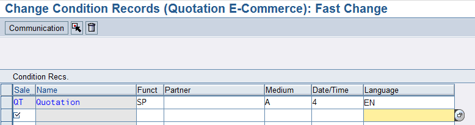

**Figure-74** Last step of the NACE transaction where the *Condition* *Record* has just been configured.

Save your changes.

Now let’s configure this new ZQEC message type as an output IDoc in the ***Outbound*** section within **WE20** transaction, as shown in Figure-75. To enlist the entry as *Partner* *Profile,* click on the right side of the WE20 transaction on the E-Commerce entry; then, on the left side, under *Outbound parameters,* click  to add a new entry for the standard **QUOTES** message.

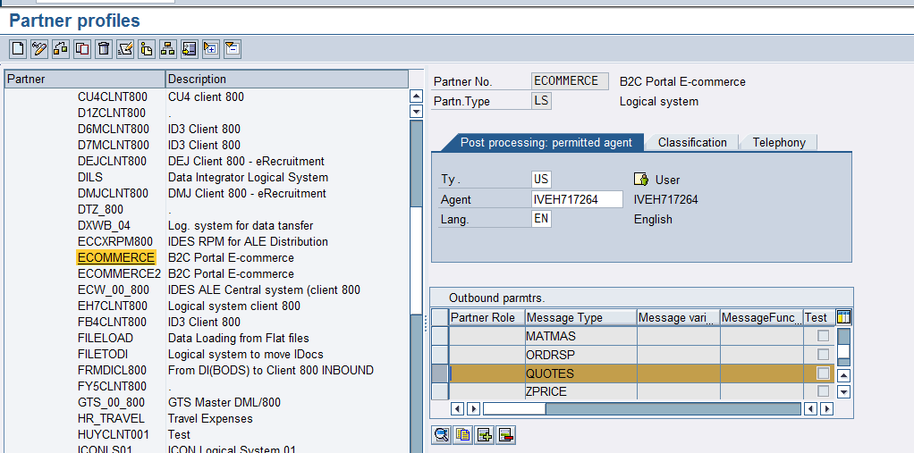

**Figure-75** WE20 Partner Profiles transaction, select the QUOTES parameter as the standard message for the ZQEC Output type.

On the screen from Figure 75, double-click on the QUOTES field to open the options screen shown in Figure-76. In the fields of this configuration, be sure to use the QUOTES message *type* and the ECOMMERCE port. Fill the Basic *Type* in using **ORDERS05**.

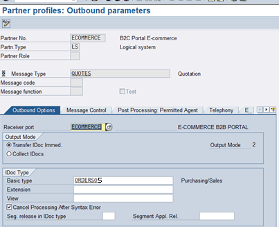

**Figure-76** First tab of the parameter’s configuration for the QUOTES message type.

Taking Figure-76 as a reference, select the next tab called *Message Control.* This is where the message configured in the NACE transaction is placed with *process code* SD12, as shown in Figure-77.

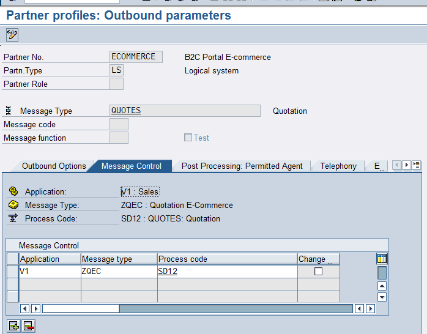

**Figure-77** Second tab where the message added in the NACE transaction is configured.

Save your changes as WE20 transaction is ready after these configurations.

Now move on to transaction **BD64** for the last configurations. BD64 T-Code deals with the Distribution Model of the QUOTES IDoc’s output towards the E-Commerce. In the editing mode of this transaction, the "Add Message Type" button is pressed to display the following Figure-78:

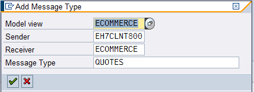

**Figure-78** Adding QUOTES IDoc as a message that is generated along with the output condition type ZQEC.

This QUOTES message corresponds to the eighth item of the table in Figure-16; and once added in transaction **BD64,** a Distribution Model for the E-Commerce portal similar to the one in Figure-79 is obtained.

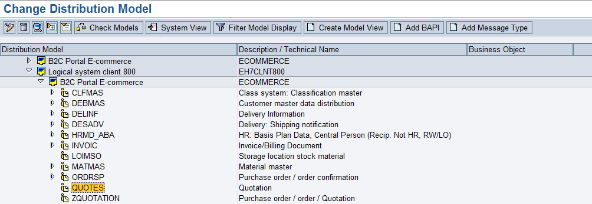

**Figure-79** Transaction BD64 after QUOTES message type is added to the Distribution Model for E-Commerce.

When QT document type for the QUOTATION message is added, go to VA22 transaction and select from top menu EXTRAS → Output section, as shown in Figure-80. Here verify that ZQEC response message has been created. It might be yellow waiting to be processed:

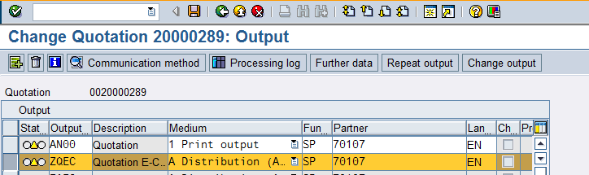

**Figure-80** View of the Output Headers section of Transaction VA22.

Go to transaction WE02, as shown in Figure-81, you may find it as an IDoc ready to be processed; to execute it go to **BD87.** When processing this IDoc, the light for the document will change to green.

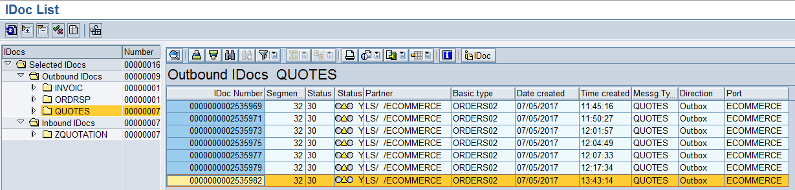

**Figure-81** WE02 Transaction showing the QUOTES IDoc VIEW as output confirmations for Reservations.

## Setting up the IDoc to confirm the creation of contracts

Price lists are loaded for a customer-material combination in VK11 transaction. T-Code VK11 requests the price list condition type, which is PR00. The next step is to select "Customer-Material" in the prompting screen for key combination, showing Figure-82 screen.

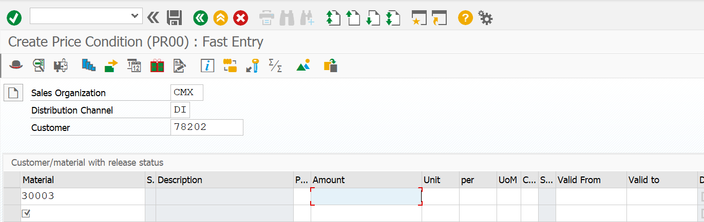

**Figure-82**: Example of PR00 price creation for a Customer-Material combination in VK11 T-Code.

In Figure-82, a first material record is entered, add as many as needed; then fill in each material list price in the amount column. When the customer’s specific price list is ready, the information is stored, and SAP displays the message: "Condition records have been saved".

Once all customer-specific pricing is created, their corresponding lists will be sent from SAP to the E-Commerce portal through a program called "ZONRE_CUST_MAT_PRICE2". This program runs on transaction SE38, as shown on Figure-83. After clicking on the run button, another screen appears to define delimitations or load a variant as the numbers of the customer to which the list prices will be sent. Once the parameterization field S_PAR marks ONIBEX, the program is run by clicking on the tick mark button: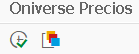

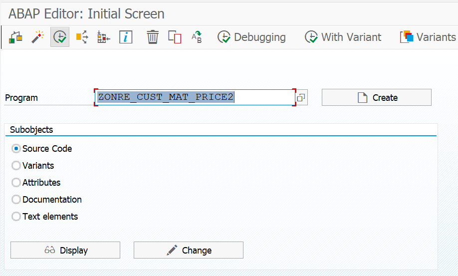

**Figure-83**: SE38 T-Code in which the Oniverse Price program is run to send specific prices to the E-Commerce portal.

After Oniverse Pricing program is run, SAP will inform how many IDocs with new list prices were sent to the E-Commerce portal.

Unlike price lists which just contain PR00 price condition, there are Contracts. Contracts are created and configured using **KA00** Condition Type. To create a Contract, use transaction VA41 as shown in Figure-84.

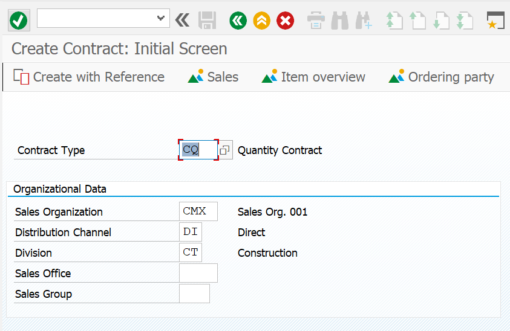

**Figure-84**: Create Contracts in VA41 transaction as Open Orders by Quantity.

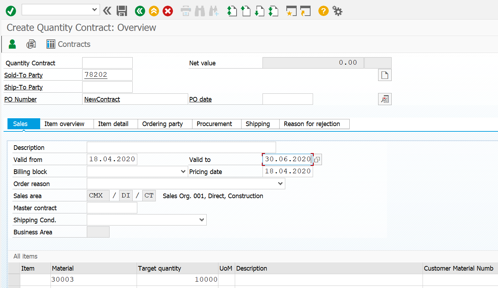

**Figure-85**: Fields to be filled in transaction VA41 as Open Order by Quantity.

Figure-85 shows the fields to create an Open Order by quantity on the main screen of VA41 transaction. Enter the Conditions, in the Contract’s header, as shown in Figure-86. The KA00 Condition Type has just been added along with its respective percentage discount, as follows:

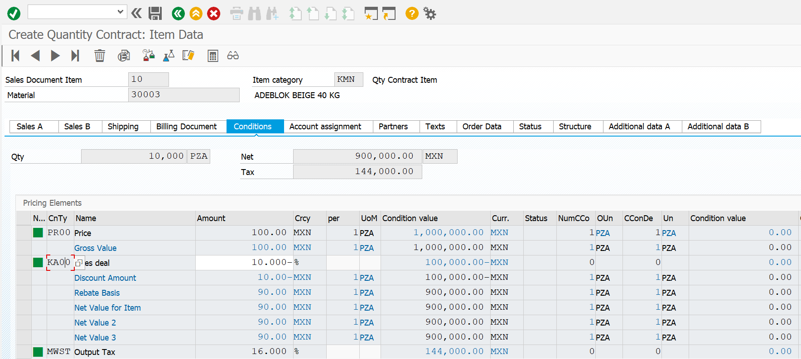

**Figure-86**: Adding Condition Type KA00 with a material discount.

After saving the document with this basic data for a new contract, SAP generates the message: "Open order by quantity has been saved", which automatically sends an IDoc to the portal to confirm the creation of the Contract. Outbound IDocs can be verified from WE02 and they are immediately reflected in the Contracts section of the E-Commerce portal.

← Previous: [Setting up the IDoc to create SD quotations](../04-sales-document-idocs/01-quotation-idoc.md) · Next: [ORDERS IDoc configuration for sales orders](../04-sales-document-idocs/03-orders-idoc.md) →

---

© 2026 Onibex, LLC · Licensed under [CC BY-NC-ND 4.0](../../../LICENSE) (SPDX: CC-BY-NC-ND-4.0) · [Commercial license](../../../COMMERCIAL-LICENSE.md) · [Trademarks and third-party notices](../../../THIRD-PARTY-NOTICES.md) · SAP and other SAP products and services mentioned herein are trademarks or registered trademarks of SAP SE or an SAP affiliate company in Germany and other countries; names are used for identification only.
