<!-- SPDX-License-Identifier: CC-BY-NC-ND-4.0 -->
<!-- Copyright (c) 2026 Onibex, LLC. Part of the Onibex eCommerce 360° Documentation — https://github.com/Onibex/ecommerce-docs -->

**English** · [Español](../../../es/technical-documents/04-sales-document-idocs/04-ordrsp-idoc.md) | [↑ Technical documents index](../README.md) | [Repository README](../../../README.md)

# Setting up the ORDRSP IDoc for confirmation of the sales order

> **Source:** Onibex Help Center article “11. Setting up the ORDRSP iDOC for confirmation of the Sales Order” — <https://help.onibex.com/portal/en/kb/articles/setting-up-the-ordrsp-idoc-for-confirmation-of-the-sales-order>. Spanish chapter D.4.g of the functional specification “D1 – Integración de sistemas”.

To configure ORDRSP IDoc message in response to the creation of a Sales Order from the E-Commerce portal, the first step is to define a new message type in the **NACE** transaction: **ZOEC** for **V1** application area. This ZOEC custom message is created in the *Output types* section as a copy of the standard **BA00** message, as shown in the following Figure-89:

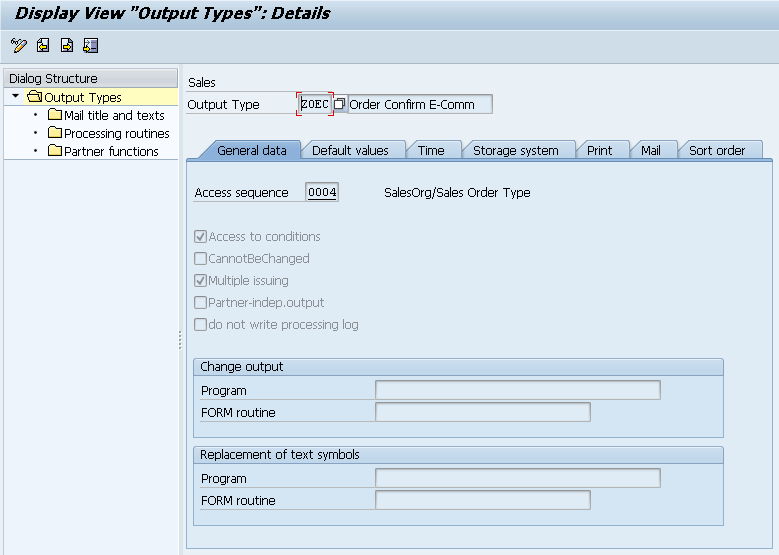

**Figure-89** Configuring the **ZOEC** *Output type* as a copy of the standard **BA00** message from transaction **NACE**.

Fill in the *Access sequence* field in the General Data tab, then complete the configuration of the other tabs in Figure-89; for Default values configure the distribution of the new message using **ALE** (Application Link Enabling), as shown in Figure-90:

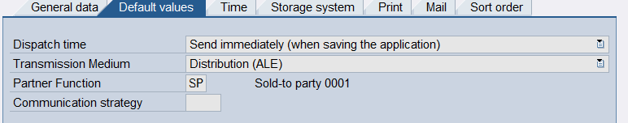

**Figure-90** Configuring the **ZOEC** *Output type* in its *Default* *values* tab in transaction NACE.

Then configure the remaining five tabs in Figure-89, which are shown respectively from Figure-91 to Figure-95:

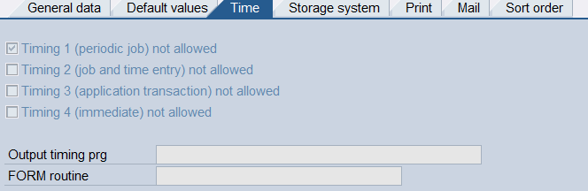

**Figure-91** Configuring the **ZOEC** *Output type* in its *Time* tab in the NACE transaction.

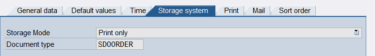

**Figure-92** Configuring the **ZOEC** *Output type* in its *Storage System* tab in the NACE T-Code.

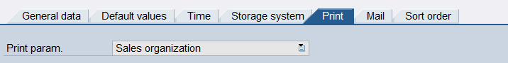

**Figure-93** Configuring the **ZOEC** *Output type* in its *Print* tab in the NACE transaction.

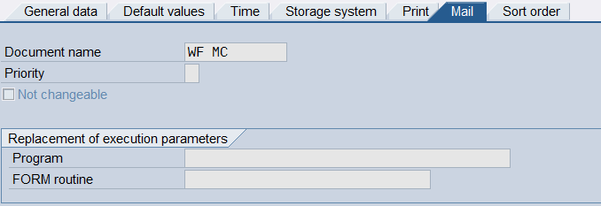

**Figure-94** Configuring the **ZOEC** *Output type* in its *Mail* tab in the NACE transaction.

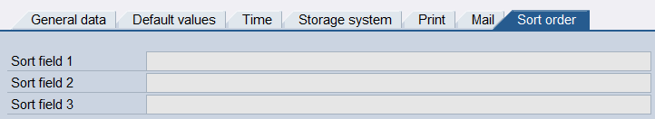

**Figure-95** Configuring the **ZOEC** *Output type* in its *Sort* *order* tab in the NACE transaction.

Returning to the folders on the left side of Figure-89, in the *Processing Routines* option, enter an entry for ALE with the ***RSNASTED*** program and ***ALE_PROCESSING*** as the *Form Routine*:

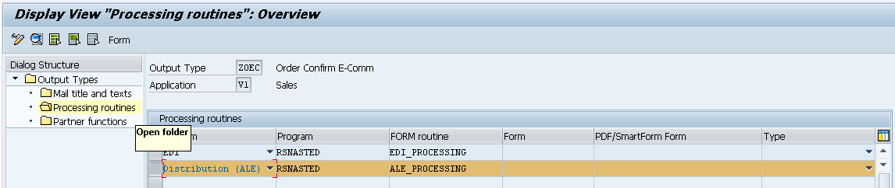

**Figure-96** Configuring the **ZOEC** *Output Type* within the *Processing Routines* Folder.

Within the last folder of the left dialog structure, in *Partner functions*, ensure that the *Sold-t*o-*Party* partner function exists for **ALE** medium input, as presented in Figure-97.

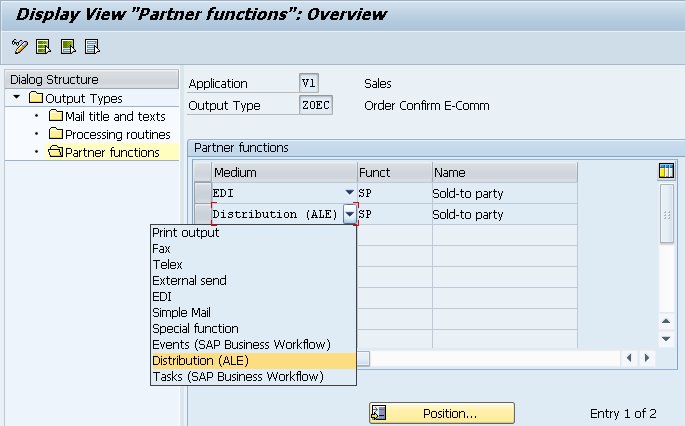

**Figure-97** Configuring the **ZOEC** *Output type* within the *Partner functions* Folder.

In the screen in Figure-89, access sequence 004 is selected, now shown in Figure-98 for V1 application area. No configuration of the standard access sequence 004 is changed even when there are different condition options to activate the ZOEC output message for the Sales Orders.

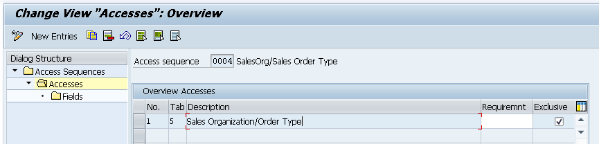

**Figure-98** Deploy the Access sequence to *access* the Sales Order message and thus, send a confirmation response message of Sales Order creation to the E-Commerce.

The ZOEC message must appear in the *Output procedure* **V10000**, as shown in the screen of Figure-99.

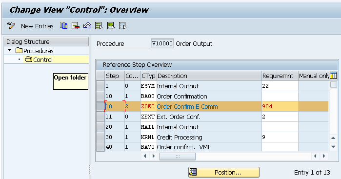

**Figure-99** Deployment of **V10000** *Procedure* selection for V1 application area in the NACE T-Code.

To finalize the configurations in this NACE transaction, define the *Condition* *Record* for the **ZOEC** *output type* with its respective sales organization and order type, as shown in the Figure-100. This will allow to generate orders automatically.

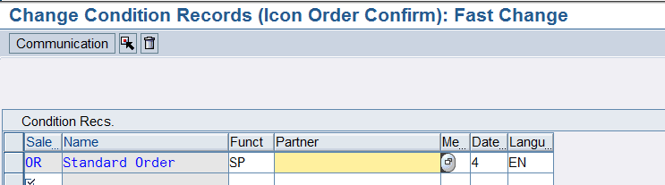

**Figure-100** Setting the *Condition* *Record* for E-Commerce Order Confirmation in NACE T-Code.

After the message type is configured for sales order creation confirmation, create an entry for the ORDRSP message type within the ***Outbound*** section to the ECOMMERCE logical system in **WE20** transaction. Fill the first two configuration tabs, as they appear respectively on the screens of Figure-101 and Figure-102.

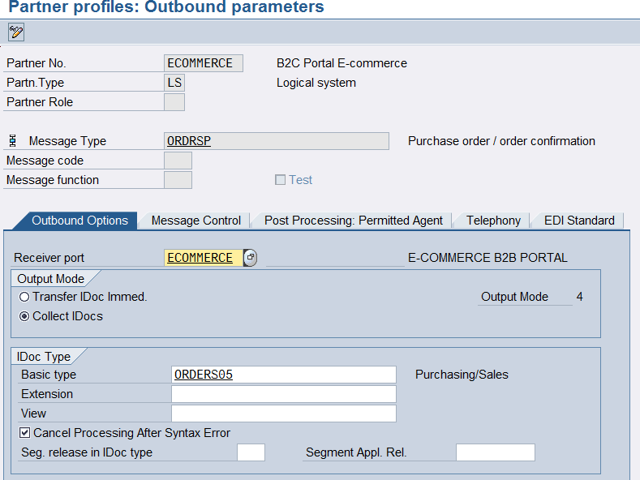

**Figure-101** Configuring the first tab of the output parameters for the ORDRSP message in WE20 transaction.

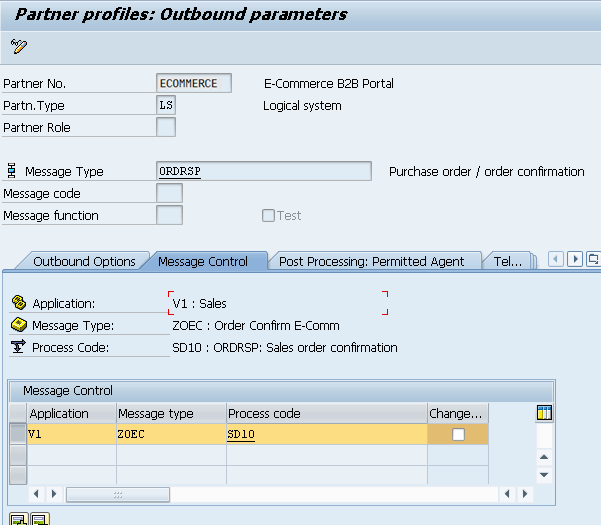

**Figure-102** Configuring the second tab of the output parameters for the ORDRSP message in WE20 transaction.

Other tabs may be empty.

Add this ORDRSP message in **BD64** transaction: Distribution Model. This is the same as presented in the screens of Figure-33, but now the Message *type* field changes to ORDRSP, which corresponds to the sales order creation confirmation, or message #4, in the table of Figure-16: Agreement messages in SAP for a LS logical system with the ECOMMERCE partner that are configured through the WE20, BD64, and NACE transactions, if applicable.

Finally, the **ZOEC** message must be generated automatically as an IDoc type ORDRSP to the E-Commerce after the sales order’s creation. This message can also be sent as ORDRSP message from transaction VA02 with the customer order number or "Purchase Order” and, then follow the path of the Details Menu shown in Figure-103. The screen in Figure-104 appears after that last instruction to display the output.

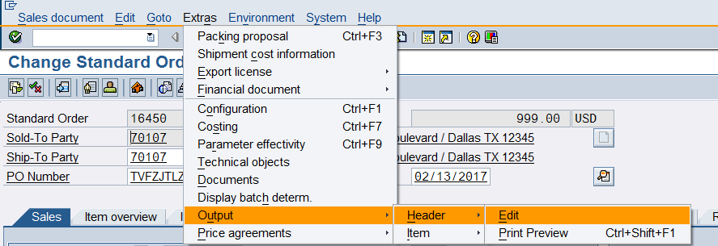

**Figure-103** Details section in the top menu to send the ORDRSP output message from the Purchase Order in the VA02 transaction.

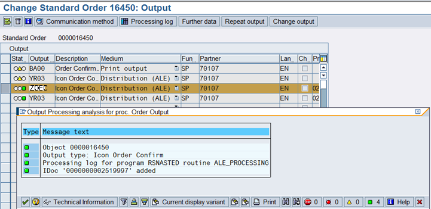

**Figure-104** Signaling the ZOEC output IDoc as ORDRSP message type to confirm the creation of the Sales Order in SAP to the E-Commerce.

To display the full contents of this ZOEC output IDoc, go to **WE02** shown in Figure-105. Figure-106 shows the deployment of segments and fields that SAP would send to E-Commerce.

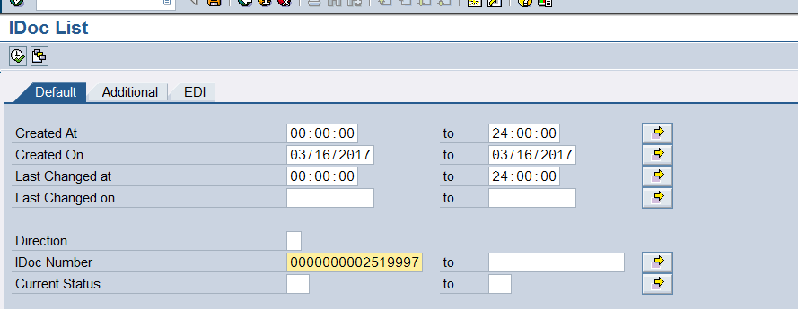

**Figure-105** WE02 Transaction where the IDoc number is entered for type ZOEC towards the E-Commerce.

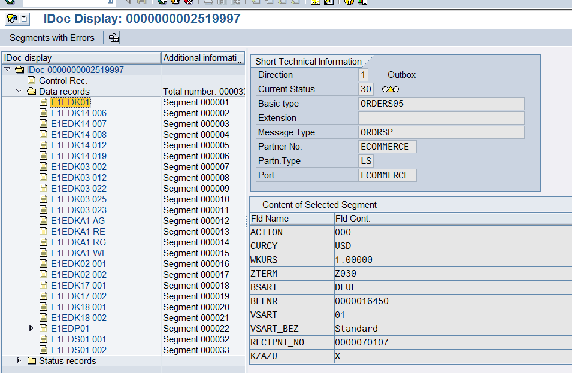

**Figure-106** Deployment of segments and fields from the output IDoc of type ZOEC to the E-Commerce using **WE02** Transaction.

To process this ZOEC IDoc manually, enter **BD87**.

← Previous: [ORDERS IDoc configuration for sales orders](../04-sales-document-idocs/03-orders-idoc.md) · Next: [DESADV IDoc configuration to send delivery confirmation](../04-sales-document-idocs/05-desadv-idoc.md) →

---

© 2026 Onibex, LLC · Licensed under [CC BY-NC-ND 4.0](../../../LICENSE) (SPDX: CC-BY-NC-ND-4.0) · [Commercial license](../../../COMMERCIAL-LICENSE.md) · [Trademarks and third-party notices](../../../THIRD-PARTY-NOTICES.md) · SAP and other SAP products and services mentioned herein are trademarks or registered trademarks of SAP SE or an SAP affiliate company in Germany and other countries; names are used for identification only.
