<!-- SPDX-License-Identifier: CC-BY-NC-ND-4.0 -->
<!-- Copyright (c) 2026 Onibex, LLC. Part of the Onibex eCommerce 360° Documentation — https://github.com/Onibex/ecommerce-docs -->

**English** · [Español](../../../es/technical-documents/04-sales-document-idocs/05-desadv-idoc.md) | [↑ Technical documents index](../README.md) | [Repository README](../../../README.md)

# DESADV IDoc configuration to send delivery confirmation

> **Source:** Onibex Help Center article “12. DESADV iDoc configuration to send Delivery confirmation” — <https://help.onibex.com/portal/en/kb/articles/desadv-idoc-configuration-to-send-delivery-confirmation>. Spanish chapter D.4.h of the functional specification “D1 – Integración de sistemas”.

This configuration is done starting out in the **NACE** transaction and thus, creating a ZDEC message type for **V2** application area, as shown in Figure-107. From Figure-108 to Figure-114, the settings for the different tabs comprising this new ZDEC message class in the NACE transaction are shown.

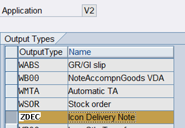

**Figure-107** Creation of the new **ZDEC** message in the **V2** application area of the NACE T-Code.

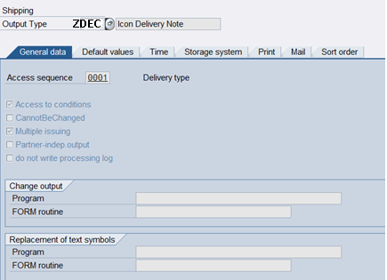

**Figure-108** Configuring the access sequence for the new ZDEC output type in the V2 Application Area of the NACE transaction.

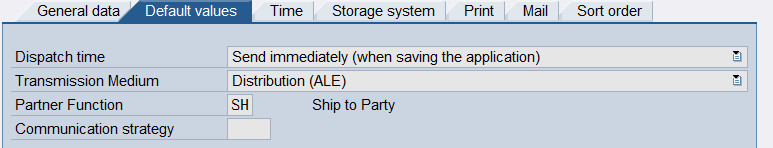

**Figure-109** Setting the second tab for the new ZDEC output type in the NACE T-Code.

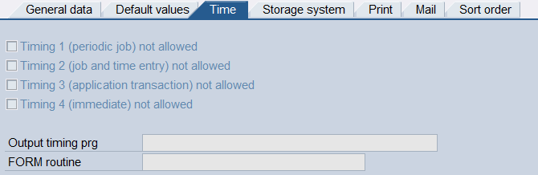

**Figure-110** Setting the third tab for the new ZDEC output type.

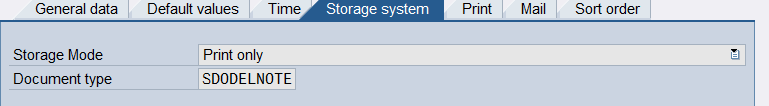

**Figure-111** Setting the fourth tab for the new ZDEC output type in the NACE T-Code.

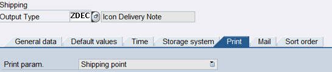

**Figure-112** Setting the fifth tab for the new ZDEC output type in the NACE T-Code.

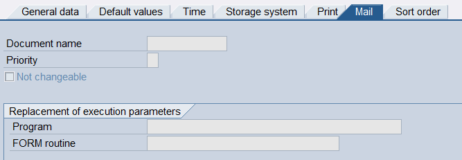

**Figure-113** Setting up the sixth tab for the new ZDEC output type in the NACE T-Code.

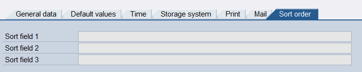

**Figure-114** Setting the seventh tab for the new ZDEC output type in the NACE T-Code.

Within the Message Class Dialog Structure, select the folder corresponding to Process Routines and double-click it; Figure-115 appears to add the corresponding settings to the ALE Distribution processing medium.

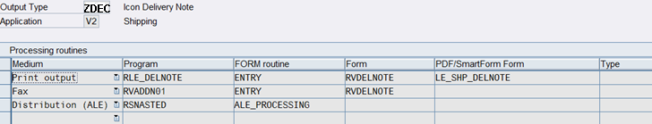

**Figure-115** Setup screen of the Processing Routines in the NACE Transaction for the new ZDEC message.

Within the same Message Class Dialog Structure, move to the Partner Functions folder and, double-click on it to display the screen of Figure-116.

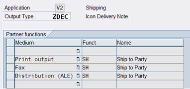

**Figure-116** Configuration screen of the Partner Functions in the NACE Transaction for the new ZDEC message.

Return to the main menu of the NACE Transaction to now access the Access Sequences button, which displays the screen of Figure-117.

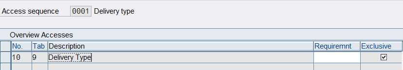

**Figure-117** Access Sequence Configuration Screen in the NACE Transaction for the new ZDEC message.

The **V10000** *output determination procedure* within the V2 delivery application must contain the data shown in Figure-118 in order to find the type of message to be created:

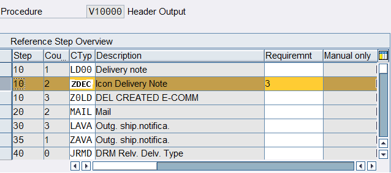

**Figure-118** Output procedure configuration screen in NACE Transaction for new **ZDEC** message.

The *Condition Record* for ZDEC message, considering the **LF** delivery, the **SH** Partner Function *Ship-to-party* and the **A** (ALE) medium, is created as depicted in Figure-119.

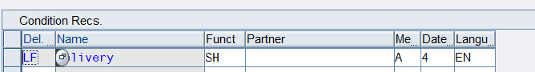

**Figure-119** Configuration screen of Condition Records in NACE Transaction for the new ZDEC message.

Once ZDEC message type has been configured, create a new entry for the ECOMMERCE logical system and the DESADV message type from **WE20**. It is important that DESADV message should not be used in any other logical system or it won’t work. This step is illustrated in Figure-120.

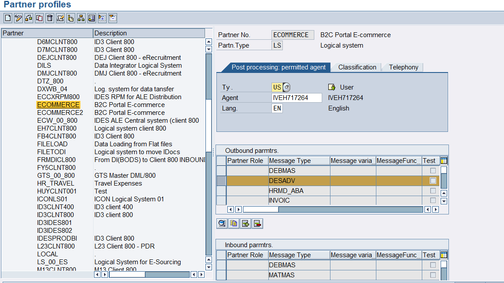

**Figure-120** New entry for the E-Commerce logical system with the DESADV message type in WE20 T-Code.

Double-click on the DESADV message type to display the configuration screen shown in Figure-121.

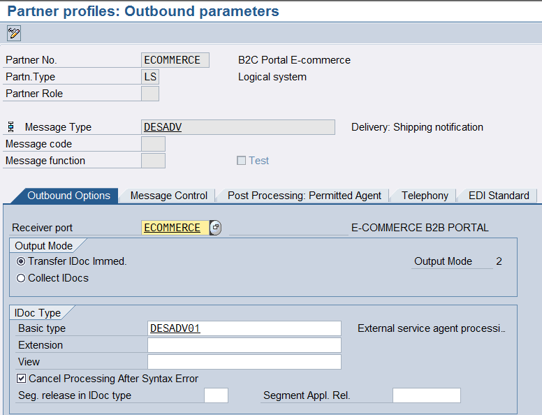

**Figure-121** Setting up the first tab of the DESADV message type in WE20 transaction.

And within the *Message Control* tab, set up the message that was previously configured in the NACE transaction, as illustrated in Figure-122.

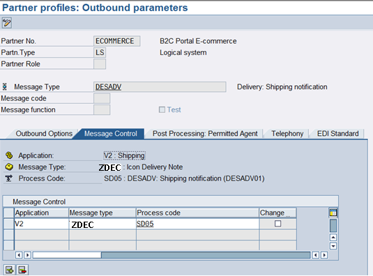

**Figure-122** Configuring the second tab of the DESADV message type in WE20 transaction.

Finally, add an entry in **BD64** transaction for this message type, as shown in Figure-123, and then, display this DESADV message type in the main menu of such a transaction as shown in Figure-124.

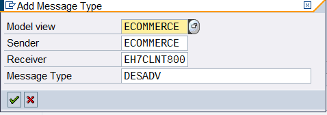

**Figure-123** Adding a new entry for the DESADV message type in BD64 transaction.

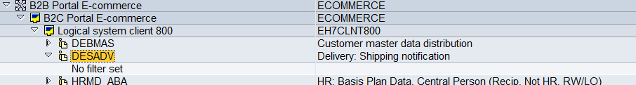

**Figure-124** Deployment of the newly created DESADV message type in transaction BD64.

Returning to the processing of the Purchase Order and its respective delivery shown in Figure-125, see how this ZDEC message is processed correctly and thus, generates an IDoc which is shown in Figure-126.

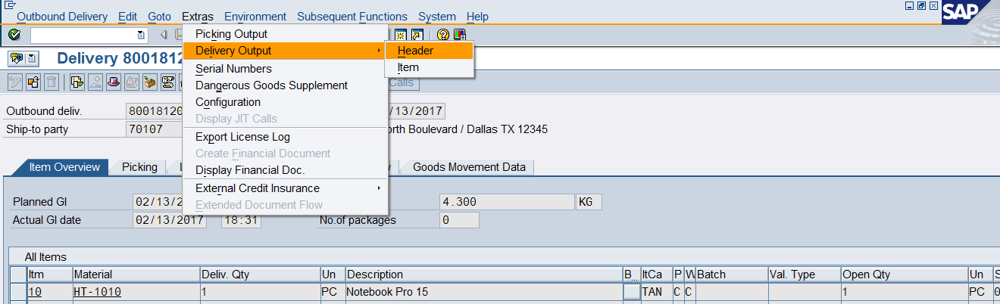

**Figure-125** Deployment of the delivery process in which a new ZDEC IDoc is generated.

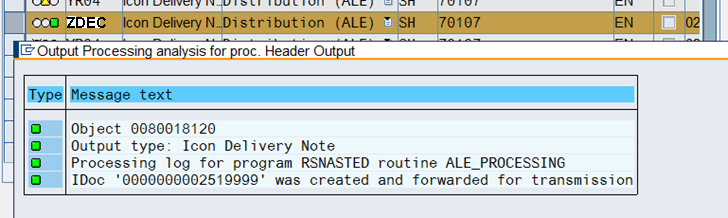

**Figure-126** General information of a new ZDEC IDoc generated as output to E-Commerce when delivering a Purchase Order.

← Previous: [Setting up the ORDRSP IDoc for confirmation of the sales order](../04-sales-document-idocs/04-ordrsp-idoc.md) · Next: [Setting up the INVOIC IDoc to send the invoice](../04-sales-document-idocs/06-invoic-idoc.md) →

---

© 2026 Onibex, LLC · Licensed under [CC BY-NC-ND 4.0](../../../LICENSE) (SPDX: CC-BY-NC-ND-4.0) · [Commercial license](../../../COMMERCIAL-LICENSE.md) · [Trademarks and third-party notices](../../../THIRD-PARTY-NOTICES.md) · SAP and other SAP products and services mentioned herein are trademarks or registered trademarks of SAP SE or an SAP affiliate company in Germany and other countries; names are used for identification only.
