<!-- SPDX-License-Identifier: CC-BY-NC-ND-4.0 -->
<!-- Copyright (c) 2026 Onibex, LLC. Part of the Onibex eCommerce 360° Documentation — https://github.com/Onibex/ecommerce-docs -->

**English** · [Español](../../../es/technical-documents/04-sales-document-idocs/06-invoic-idoc.md) | [↑ Technical documents index](../README.md) | [Repository README](../../../README.md)

# Setting up the INVOIC IDoc to send the invoice

> **Source:** Onibex Help Center article “13. Setting up the INVOIC iDOC to send the invoice” — <https://help.onibex.com/portal/en/kb/articles/setting-up-the-invoic-idoc-to-send-the-invoice>. Spanish chapter D.4.i of the functional specification “D1 – Integración de sistemas”.

The first step is to configure an ***output type*** for message output in the **VF01** transaction. This *Output Type*’s configuration is done starting out in the NACE transaction and thus, creating a ZIEC message type for **V3** application area, as shown in Figure-127. From Figure-128 to Figure-131, the settings for the different tabs comprising this new ZIEC message class in the NACE transaction are shown.

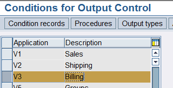 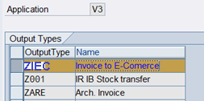

**Figure-127** Creation of the new **ZIEC** message in V3 application area of the NACE transaction.

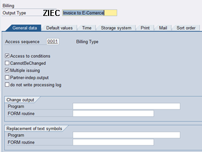

**Figure-128** Configuring the access sequence for the new ZIEC output type in the V3 Application Area of the NACE transaction.

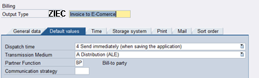

**Figure-129** Setting up the second tab for the new ZIEC output type.

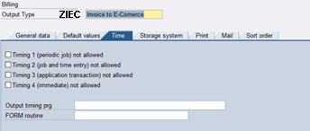

**Figure-130** Setting up the third tab for the new ZIEC output type.

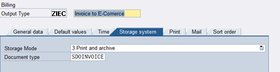

**Figure-131** Setting up the fourth tab for the new ZIEC output type.

The last three tabs are empty for this kind of ZIEC message.

Within the Message Class Dialog Structure, select the folder corresponding to *Processing Routines* and double-click it; Figure-132 appears to add the corresponding settings to the ALE Distribution processing medium.

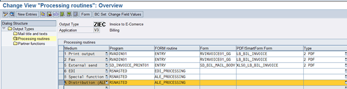

**Figure-132** Setup screen of the *Processing Routines* in the NACE Transaction for the new ZIEC message.

Within the same Message Class Dialog Structure, move to the Partner Functions folder and double-click on it to display the Figure-133.

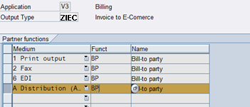

**Figure-133** Configuration screen of the Partner Functions in the NACE Transaction for the new ZIEC message.

Return to the main menu of the NACE Transaction to configure the *MESSAGE DETERMINATION PROCEDURE* 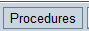 . A screen similar to Figure-134 will be displayed, from there it is needed to have: Procedure **V10000** *Billing Output* as well as the **Control** folder options selected, and thus right-click on the mouse to *Choose subdialog*.

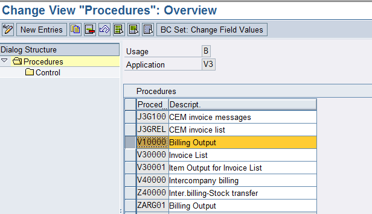

**Figure-134** Configuration screen of the Partner Functions in the NACE Transaction for the new ZIEC message.

The screen from Figure-135 appears, and there, the highlighted line from **ZIEC** message that would be defined by clicking  button.

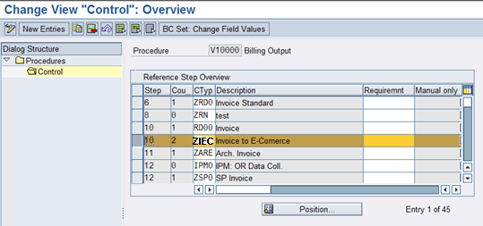

**Figure-135** Setup screen for invoice *output* in the NACE Transaction.

Now create the *Condition Record* from the main menu of the **NACE** transaction for the **V3** area and the **ZIEC** *output type*.

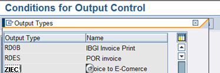

**Figure-136** Setup screen for the *Condition* *record* of the invoice in the NACE Transaction.

Double-click on this record in Figure-136 and enter the screen of Figure-137 to create that *Condition* *Record.* The next step is to fill out the Condition Records fields using the data of Figure-138.

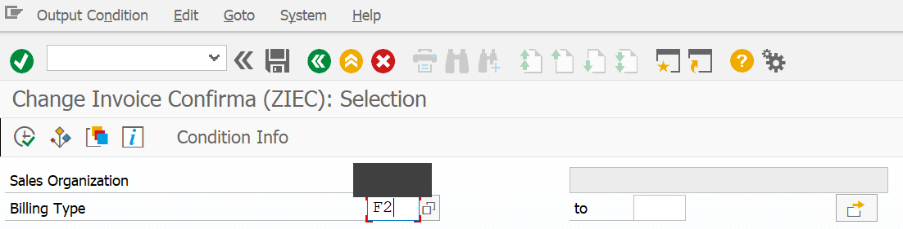

**Figure-137** Invoice *Condition* *record* creation screen in NACE Transaction.

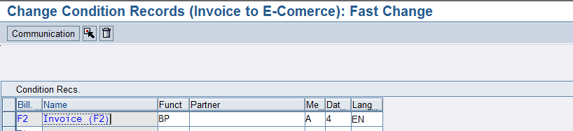

**Figure-138** Screen that defines the Partner Function in the creation of the Invoice *Condition* *record* in the NACE Transaction.

Once the message has been created go to the **WE20** transaction to add the **INVOIC** standard *Message Type*:

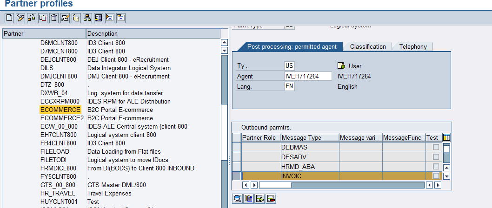

**Figure-139** Display on which the output parameters for the INVOIC message type are configured in WE20 transaction.

In the detail of this configuration, use **INVOIC** *Message Type* and the **INVOIC02** Basic *Type* as shown in Figure-140 and Figure-141:

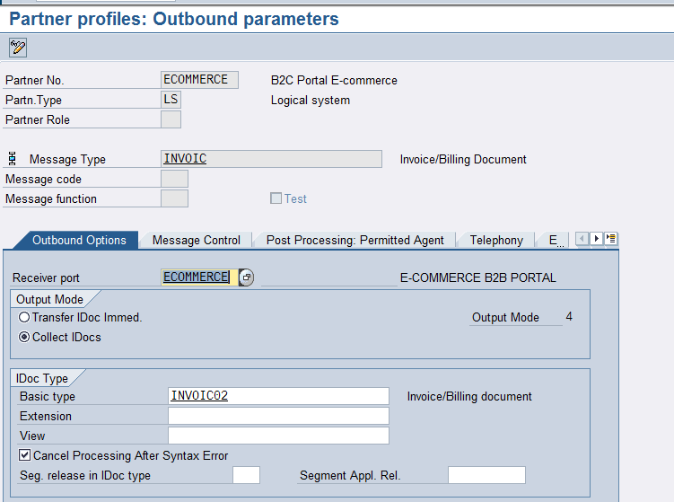

**Figure-140** First tab configuration screen for the INVOIC message type in transaction WE20.

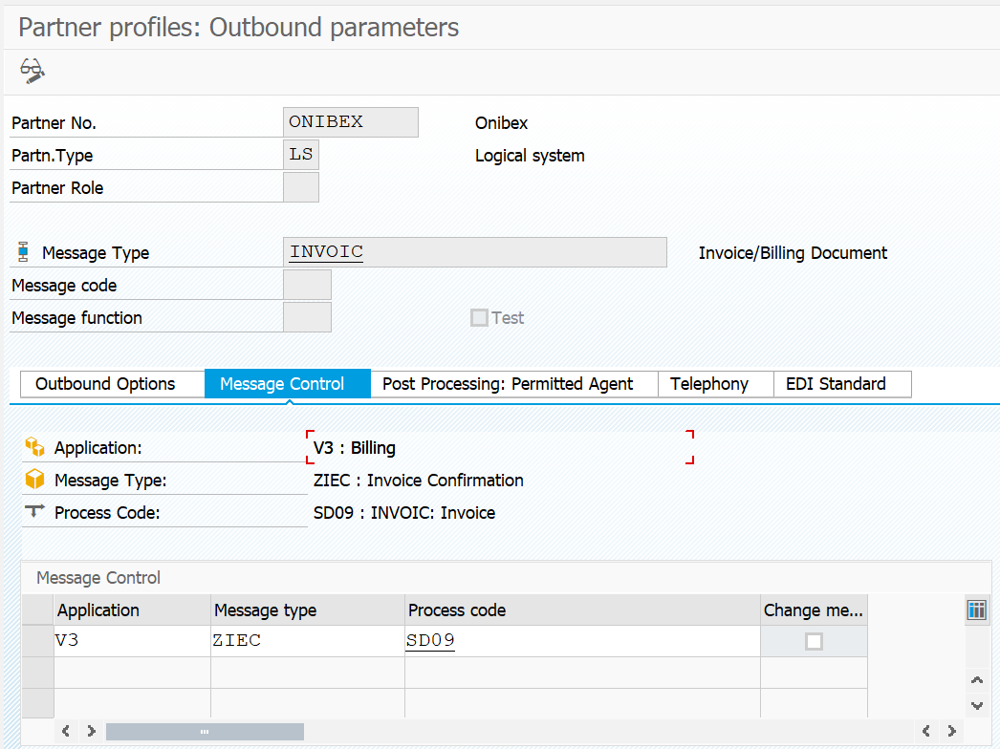

**Figure-141** Second tab configuration screen for INVOIC message type in WE20 transaction.

Now add this *Message Type* in **BD64** transaction: *Distribution Model*, in order to define the direction in which that message will be generated:

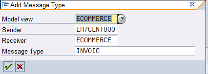

**Figure-142** Adding a new entry for the INVOIC message type in BD64 transaction.

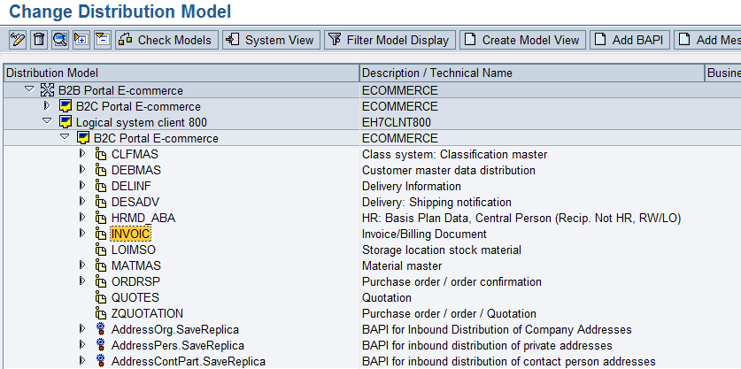

**Figure-143** Deployment of the newly created INVOIC message type in BD64 transaction.

← Previous: [DESADV IDoc configuration to send delivery confirmation](../04-sales-document-idocs/05-desadv-idoc.md) · Next: [ZON_SHP IDoc configuration to send the transport document](../04-sales-document-idocs/07-zon-shp-transport-idoc.md) →

---

© 2026 Onibex, LLC · Licensed under [CC BY-NC-ND 4.0](../../../LICENSE) (SPDX: CC-BY-NC-ND-4.0) · [Commercial license](../../../COMMERCIAL-LICENSE.md) · [Trademarks and third-party notices](../../../THIRD-PARTY-NOTICES.md) · SAP and other SAP products and services mentioned herein are trademarks or registered trademarks of SAP SE or an SAP affiliate company in Germany and other countries; names are used for identification only.
