<!-- SPDX-License-Identifier: CC-BY-NC-ND-4.0 -->
<!-- Copyright (c) 2026 Onibex, LLC. Part of the Onibex eCommerce 360° Documentation — https://github.com/Onibex/ecommerce-docs -->

**English** · [Español](../../../es/technical-documents/04-sales-document-idocs/07-zon-shp-transport-idoc.md) | [↑ Technical documents index](../README.md) | [Repository README](../../../README.md)

# ZON_SHP IDoc configuration to send the transport document

> **Source:** English version of chapter D.4.j of the Spanish functional specification “D1 – Integración de sistemas” (Onibex Help Center) — <https://help.onibex.com/portal/en/kb/articles/d1-integraci%C3%B3n-de-sistemas-v-5-1-espa%C3%B1ol>.

In this case, the first step is also to configure an *output type* for the message output in the **VT01N** transaction. This configuration is done starting out in the **NACE** transaction and thus, creating a ZTEC message type for the **V7** application area, as shown in Figure-127a. From Figure-128a to Figure-131a, the settings for the different tabs comprising this new ZTEC message class in the NACE transaction are shown.

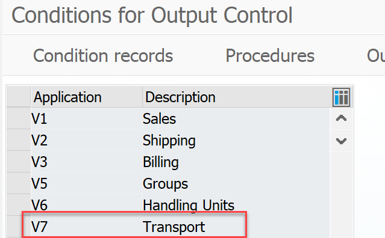 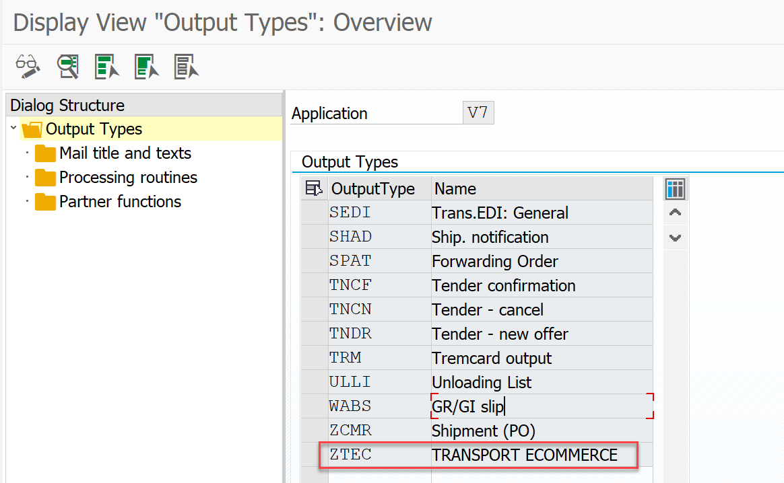

**Figure-127a** Creation of the new **ZTEC** message in the V7 application area of the NACE transaction.

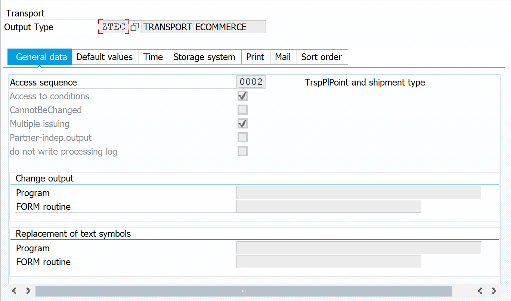

**Figure-128a** Configuring the access sequence for the new ZTEC output type in the V7 application area of the NACE transaction.

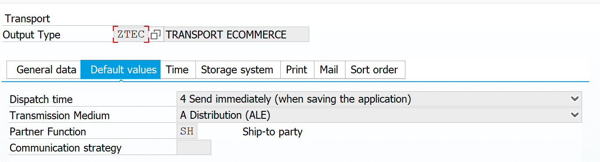

**Figure-129a** Setting up the second tab for the new ZTEC output type.

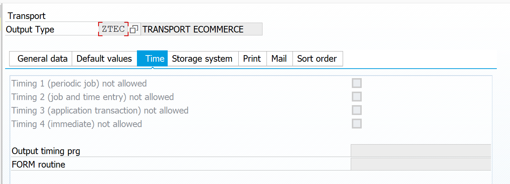

**Figure-130a** Setting up the third tab for the new ZTEC output type.

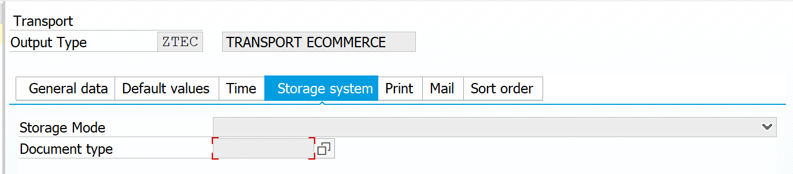

**Figure-131a** Setting up the fourth tab for the new ZTEC output type.

The last three tabs are left empty for this ZTEC message class.

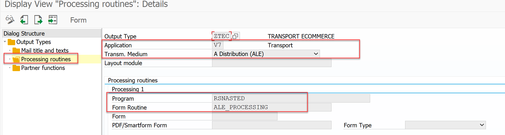 Within the Message Class Dialog Structure, select the folder corresponding to *Processing Routines* and double-click it; the screen of Figure-132a appears, in which the settings corresponding to the ALE Distribution transmission medium are added.

**Figure-132a** Setup screen of the *Processing Routines* in the NACE Transaction for the new ZTEC message.

Within the same Message Class Dialog Structure, now move to the Partner Functions folder and likewise double-click on it to display the screen of Figure-133a.

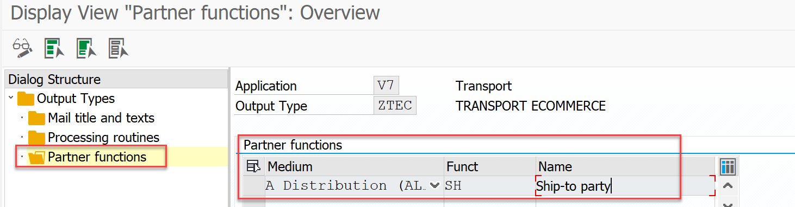

**Figure-133a** Configuration screen of the Partner Functions in the NACE Transaction for the new ZTEC message.

Return to the main menu of the NACE Transaction to configure the *MESSAGE DETERMINATION PROCEDURE* 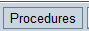. On entering, a screen similar to that of Figure-134a is displayed; select both the *Procedure* **V70001** *Transportation Output* and the **Control** folder, and then right-click to “*Choose subdialog*”.

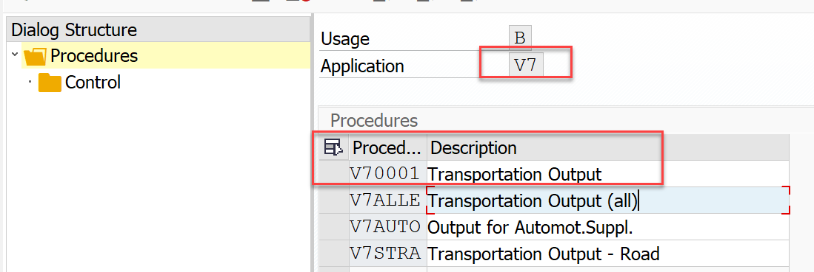

**Figure-134a** Configuration screen of the Partner Functions in the NACE Transaction for the new ZTEC message.

On the screen of Figure-135a, which is the one that appears, the line with the **ZTEC** message being defined is located by pressing the  button.

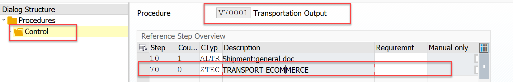

**Figure-135a** Setup screen for the ZTEC *output* in the NACE Transaction.

The next step is to create the *Condition* *Record* from the main menu of the **NACE** transaction for the **V7** area and the **ZTEC** *output type*.

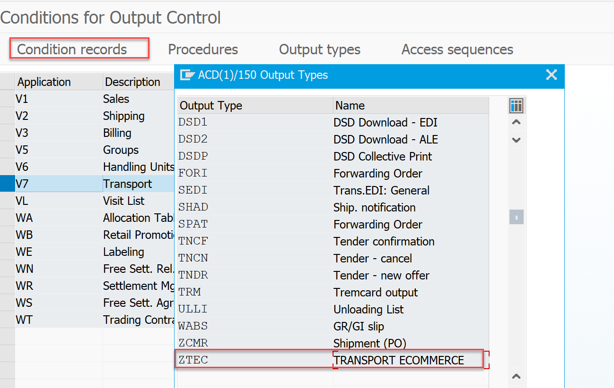

**Figure-136a** Setup screen for the *Condition* *record* of the invoice in the NACE Transaction.

Double-click on this image of Figure-136a to enter a screen where that *Condition* *Record* can be created, as shown in Figure-137a and Figure-138a.

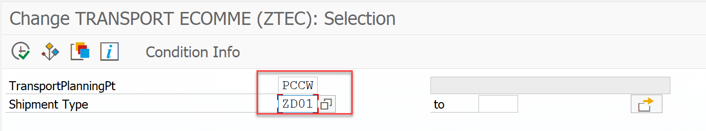

**Figure-137a** Creation screen of the *Condition* *record* of the invoice in the NACE Transaction.

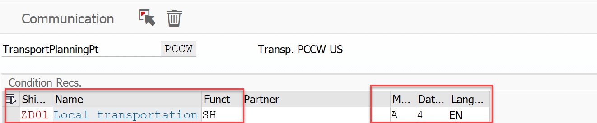

**Figure-138a** Screen that defines the Partner Function in the creation of the *Condition* *record* of the invoice in the NACE Transaction.

In the detail of this configuration, use the **ZON_SHP** *Message* *Type* and the SHPMNT05 *Basic Type*, as shown in Figure-140a and Figure-141a:

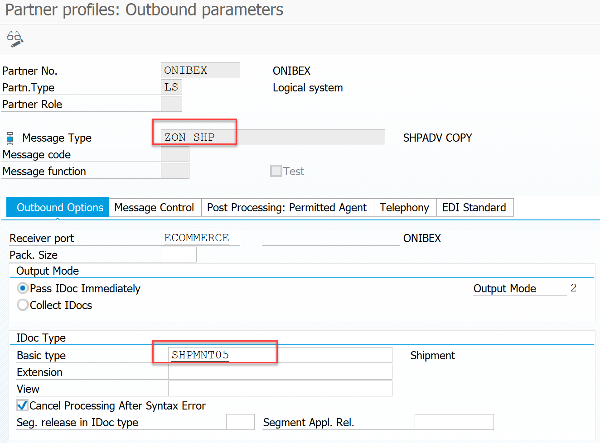

**Figure-140a** First tab configuration screen for the ZON_SHP message type in the WE20 transaction.

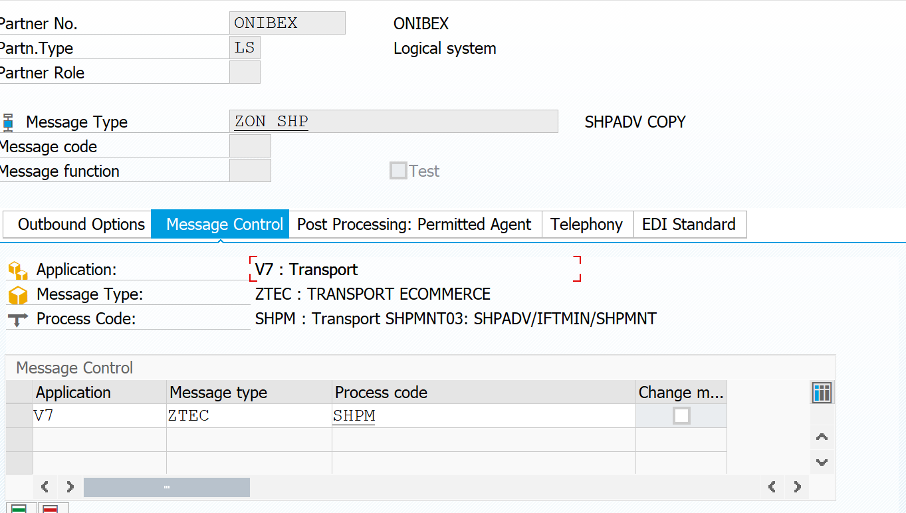

**Figure-141a** Second tab configuration screen for the ZON_SHP message type in the WE20 transaction.

Now this *Message* *Type* must be added in the **BD64** transaction, *Distribution* *Model*, in order to define the direction in which that message will be generated:

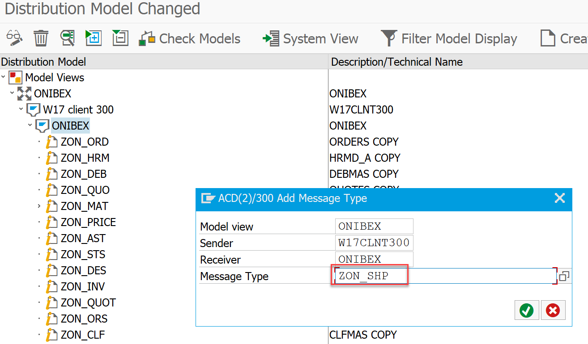

**Figure-142a** Adding a new entry for the ZON_SHP message type in the BD64 transaction.

← Previous: [Setting up the INVOIC IDoc to send the invoice](../04-sales-document-idocs/06-invoic-idoc.md) · Next: [Deployment of SICF services for communications using web services](../05-web-services/01-sicf-web-services.md) →

---

© 2026 Onibex, LLC · Licensed under [CC BY-NC-ND 4.0](../../../LICENSE) (SPDX: CC-BY-NC-ND-4.0) · [Commercial license](../../../COMMERCIAL-LICENSE.md) · [Trademarks and third-party notices](../../../THIRD-PARTY-NOTICES.md) · SAP and other SAP products and services mentioned herein are trademarks or registered trademarks of SAP SE or an SAP affiliate company in Germany and other countries; names are used for identification only.
