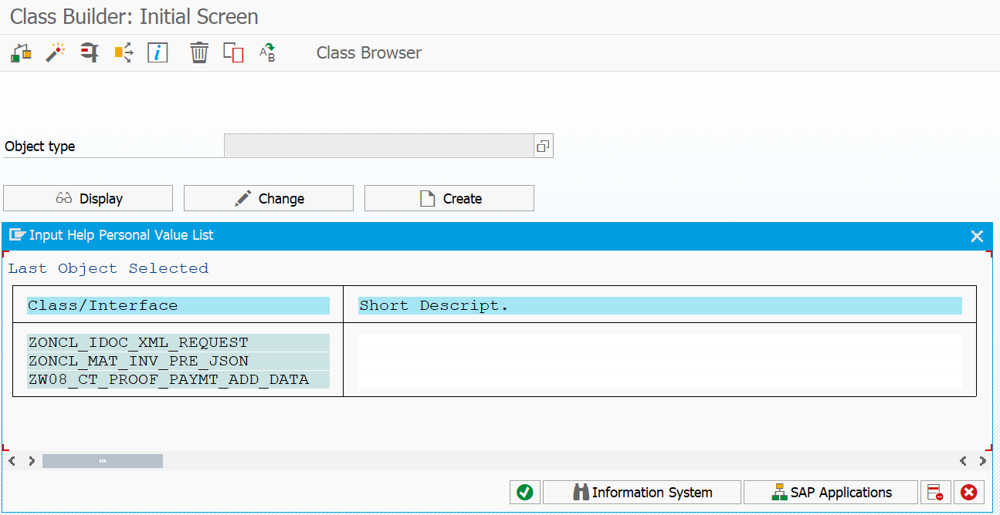
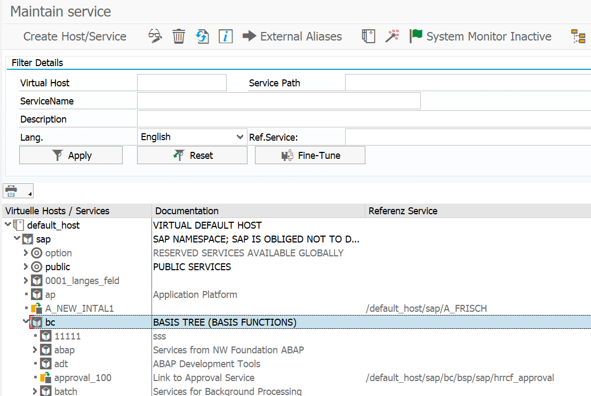
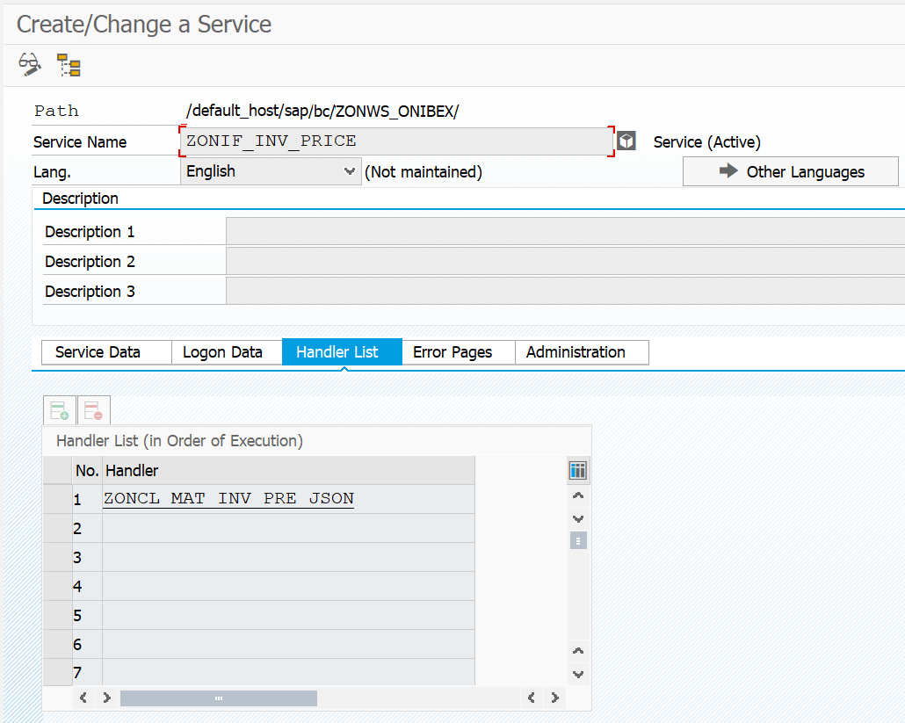
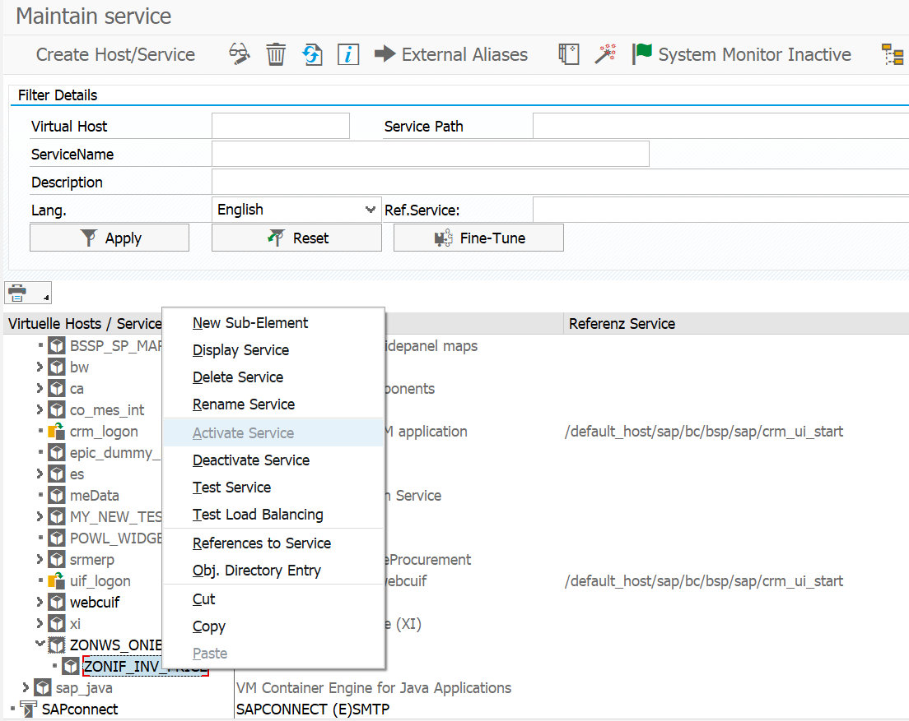

<!-- SPDX-License-Identifier: CC-BY-NC-ND-4.0 -->
<!-- Copyright (c) 2026 Onibex, LLC. Part of the Onibex eCommerce 360° Documentation — https://github.com/Onibex/ecommerce-docs -->

**English** · [Español](../../../es/technical-documents/05-web-services/01-sicf-web-services.md) | [↑ Technical documents index](../README.md) | [Repository README](../../../README.md)

# Deployment of SICF services for communications using web services

> **Source:** Onibex Help Center article “14. Deployment of SICF Service for communications using Web Services” — <https://help.onibex.com/portal/en/kb/articles/deployment-of-sicf-service-for-communications-using-web-services>. Spanish chapter D.4.k of the functional specification “D1 – Integración de sistemas”.

Once IDocs messages and their activation mechanisms are defined, ensure that all those IDocs are created in SAP and sent immediately to the portal. Similarly, other information required in real time is the corresponding to specific Inventories and Prices from SAP to E-Commerce. To meet this pair of requirements, another type of communication is initiated through Web Services consumption.

Web Services can, in principle, be called from a WEB browser with a URL. For this case, a Service is created in the SAP SICF transaction, and the service content is provided by a class handler ("*handler* *Class*").

As a first step, classes are created in SE24 Transaction, as shown in Figure-144. The classes consumed by each of the two ONIBEX Web Services are: 1) ZONCL_IDOC_XML_REQUEST, and 2) ZONCL_MAT_INV_PRE_JSON. These classes would be loaded along with all other SAP objects through Nuggets by the SAP Link application. Once verified that the two classes exist and their methods are active, go to SICF transaction.

From SICF T-Code, create the "Host/Service" with the route: 'default_host/sap/bc/ZONWS_ONIBEX', i.e. ONIBEX WEB Service Group for ECommerce. The principle of this process is shown in Figure-145.

**Figure-144** Deployment of the two ZONCL classes for ONIBEX WS in SE24 T-Code.

**Figure-145** Route to the creation of the ZONWS_ONIBEX service group in the SICF T-Code.

Once the service name "ZONWS_ONIBEX" is provided and the continue button was clicked, two other services with the names: 1) ZONIF_IDOC_XML, and 2) ZONIF_INV_PRICE are added under this same path. For these last two services go to their "Handler list" tab and add the classes defined in Figure-144 for each service; the results are shown in Figure-146 and Figure-147 respectively.

**Figure-146** Route to ZONIF_IDOC_XML service creation to which the ZONCL_IDOC_XML_REQUEST class is added in the SICF transaction.

**Figure-147** Route to ZONIF_INV_PRICE service creation to which the class ZONCL_MAT_INV_PRE_JSON is added in the SICF transaction.

Finally, ensure that the services previously created are active by right-clicking on the name of the Service. Then, click on "Activate Service" and repeat this same procedure for the "Test service"; this is shown in Figure-148. Once these two services in Figures 146 and 147 have been activated and tested, all communication channels between SAP and the E-Commerce portal are configured successfully.

In the next section you will find the detailed list of Objects that have been configured or improved in SAP for the complete automation of business processes to the ONIBEX E-Commerce portal. These are automatically deployed through the SAP Link and its "Nuggets" packages.

**Figure-148** ZONIF_INV_PRICE service activation and verification in the SICF T-Code.

← Previous: [ZON_SHP IDoc configuration to send the transport document](../04-sales-document-idocs/07-zon-shp-transport-idoc.md) · Next: [Creating a credit-control blocking reason in the Business Partner (BP)](../06-sales-configuration/01-credit-block-reason-business-partner.md) →

---

© 2026 Onibex, LLC · Licensed under [CC BY-NC-ND 4.0](../../../LICENSE) (SPDX: CC-BY-NC-ND-4.0) · [Commercial license](../../../COMMERCIAL-LICENSE.md) · [Trademarks and third-party notices](../../../THIRD-PARTY-NOTICES.md) · SAP and other SAP products and services mentioned herein are trademarks or registered trademarks of SAP SE or an SAP affiliate company in Germany and other countries; names are used for identification only.
