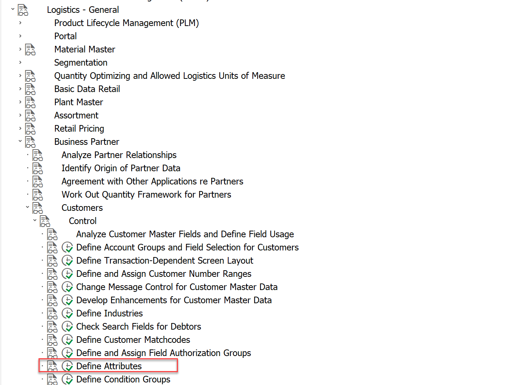
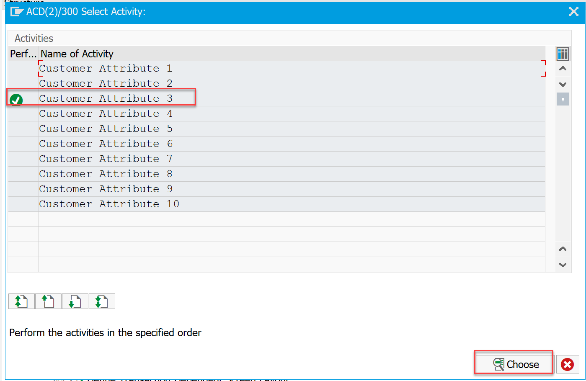
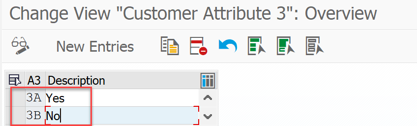
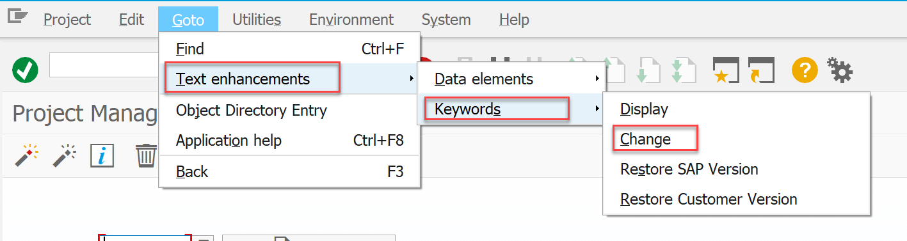
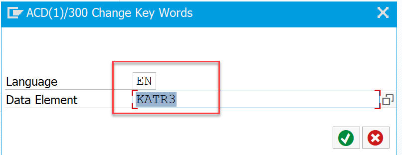
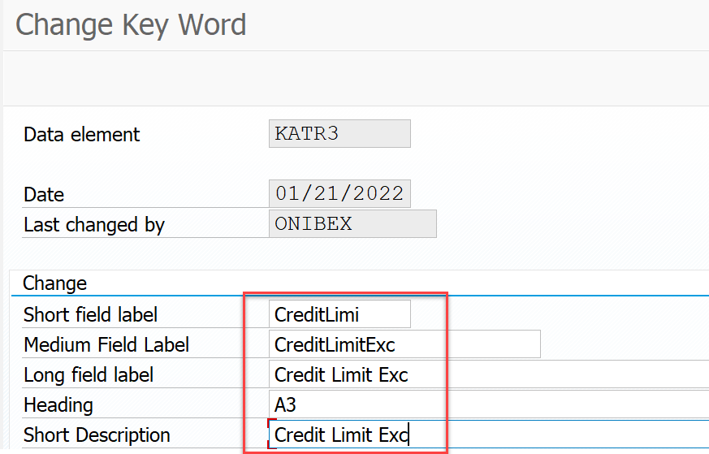
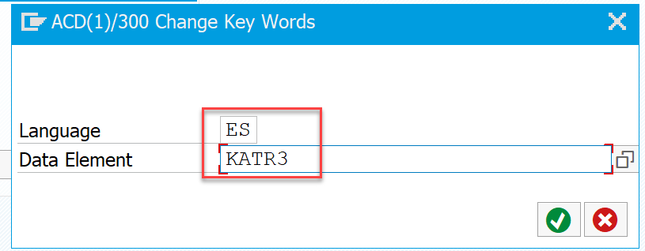
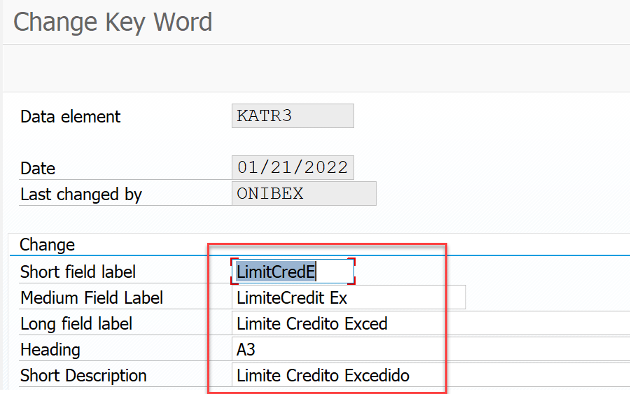

<!-- SPDX-License-Identifier: CC-BY-NC-ND-4.0 -->
<!-- Copyright (c) 2026 Onibex, LLC. Part of the Onibex eCommerce 360° Documentation — https://github.com/Onibex/ecommerce-docs -->

**English** · [Español](../../../es/technical-documents/06-sales-configuration/01-credit-block-reason-business-partner.md) | [↑ Technical documents index](../README.md) | [Repository README](../../../README.md)

# Creating a credit-control blocking reason in the Business Partner (BP)

> **Source:** English version of chapter D.4.i (bis) of the Spanish functional specification “D1 – Integración de sistemas” (Onibex Help Center) — <https://help.onibex.com/portal/en/kb/articles/d1-integraci%C3%B3n-de-sistemas-v-5-1-espa%C3%B1ol>.

Step 1: Add the values of attribute 3:

In the configuration menu, attributes 3A and 3B are assigned to indicate whether a customer has exceeded its credit limit.

The configuration path and the newly added value are shown below.

Step 2: Change the description of attribute 3

To change the text of the Attribute 3 field to Credit Limit Exceeded (Límite Crédito Excedido):

This is done in transaction code CMOD, in the following menu:

Step 2A: Specify the data element whose field text is to be changed, and click the check button.

Then update the texts, as shown in the image below:

This last sub-step 2A is repeated for the ES language.

← Previous: [Deployment of SICF services for communications using web services](../05-web-services/01-sicf-web-services.md) · Next: [Cross-selling and up-selling configuration (alternative materials)](../06-sales-configuration/02-cross-selling-up-selling.md) →

---

© 2026 Onibex, LLC · Licensed under [CC BY-NC-ND 4.0](../../../LICENSE) (SPDX: CC-BY-NC-ND-4.0) · [Commercial license](../../../COMMERCIAL-LICENSE.md) · [Trademarks and third-party notices](../../../THIRD-PARTY-NOTICES.md) · SAP and other SAP products and services mentioned herein are trademarks or registered trademarks of SAP SE or an SAP affiliate company in Germany and other countries; names are used for identification only.
