<!-- SPDX-License-Identifier: CC-BY-NC-ND-4.0 -->
<!-- Copyright (c) 2026 Onibex, LLC. Part of the Onibex eCommerce 360° Documentation — https://github.com/Onibex/ecommerce-docs -->

**English** · [Español](../../../es/technical-documents/06-sales-configuration/02-cross-selling-up-selling.md) | [↑ Technical documents index](../README.md) | [Repository README](../../../README.md)

# Cross-selling and up-selling configuration (alternative materials)

> **Source:** English version of chapter D.7 of the Spanish functional specification “D1 – Integración de sistemas” (Onibex Help Center) — <https://help.onibex.com/portal/en/kb/articles/d1-integraci%C3%B3n-de-sistemas-v-5-1-espa%C3%B1ol>.

*Cross-selling* is a sales practice in which customers are offered goods in addition to those they order, in an effort to increase sales volume.

*Up-selling* refers to the complete replacement of the item originally requested by a customer with another item of higher value. It involves marketing more profitable products or services that, at the same time, offer the customer more value-added options for the purchase.

*Up-selling & Cross-selling* are part of offering alternative services and materials to the customer. The most direct way to assign them in the E-Commerce portal is by uploading a table that relates one or more “parent” products (id_master) to one or more “child” products (id_slave). The task would be to maintain this table manually for Cross-selling, for example.

Another alternative, which seeks to automate the maintenance of the various material combinations in *Up-selling & Cross-selling*, is to use the “Condition technique” concept in SAP. The implementation guide is presented in four configuration blocks, as follows:

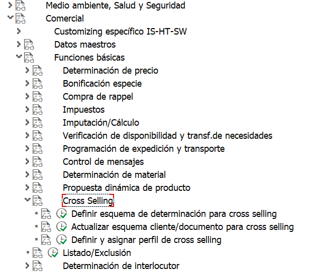

Menu path – In the IMG screen – Sales & distribution – Basic functions – Cross selling

## D.7.a Define the determination procedure for Cross-selling

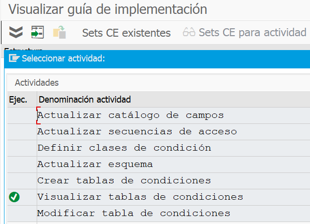

### D.7.a.1 Create the condition table: for example, 011 – Material

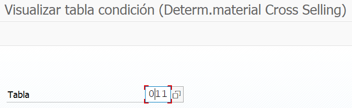

Only one field is used, but depending on the business needs, other fields can be added or a new condition table can be created. 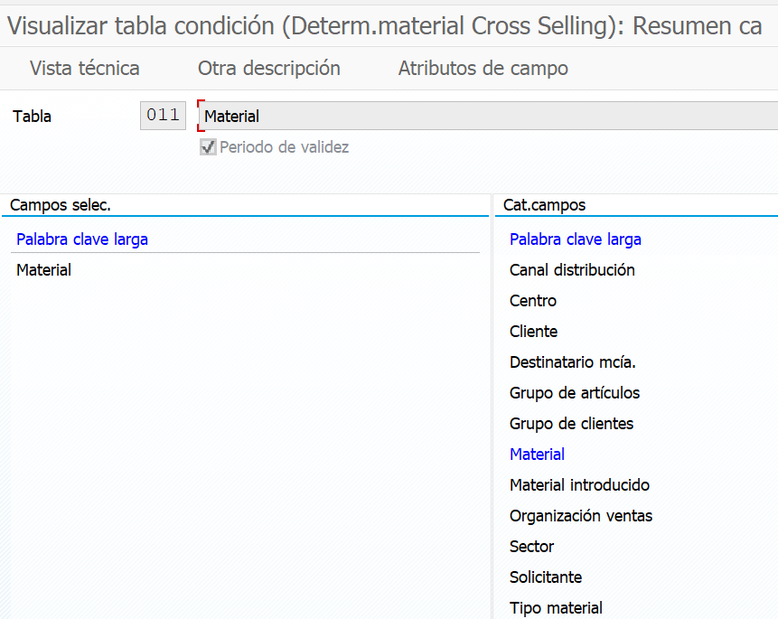

### D.7.a.2 Maintain the access sequence and assign the condition table to it

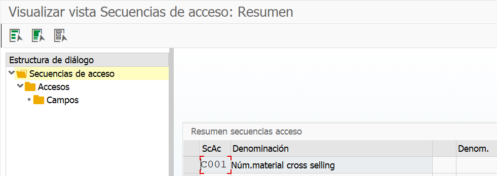

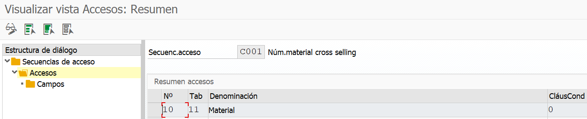

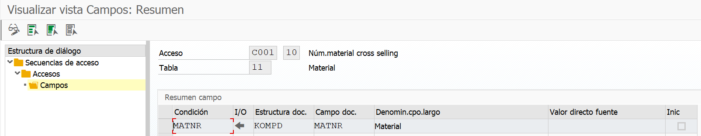

### D.7.a.3 Define the condition types: for example, CS01, and assign the access sequence to it

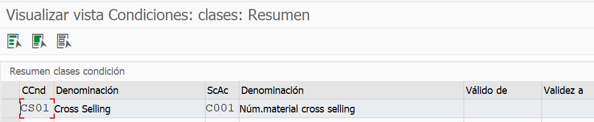

### D.7.a.4 Maintain the procedure: for example, CS0001 – Cross-selling, and assign condition type CS01

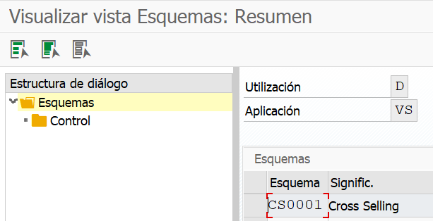

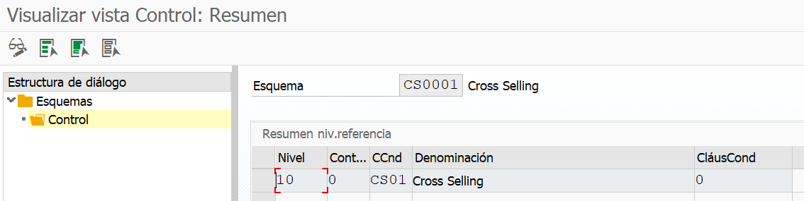

## D.7.b Maintain the customer / document procedure for Cross-selling

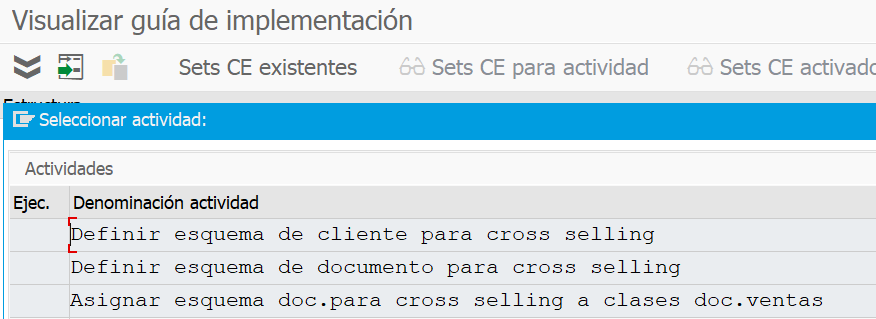

### D.7.b.1 Define the customer procedure for Cross-selling: for example, B – Cross Selling

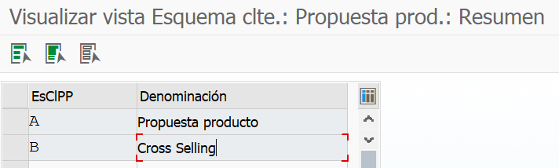

### D.7.b.2 Define the document procedure for Cross-selling: B – Cross Selling

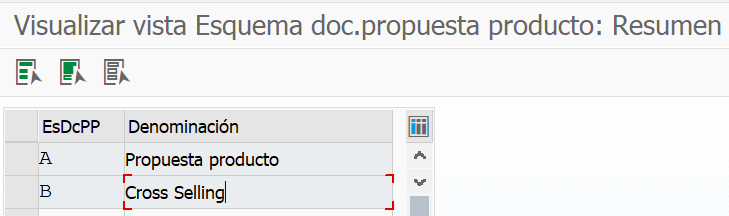

**D.7.b.3.** Assign this customer procedure in the customer master (XD02 / VD02), sales area data section, Sales tab, customer PP proc. as B - *Cross-selling*.

D.7.b.4 Assign the document procedure for cross-selling to the sales document type: choose the sales document type, for example, OR, and assign the doc. proc. as B - *Cross-selling*.

## D.7.c Define and assign the Cross-selling profile

D.7.c.1. Define the *Cross-selling* profile: here, under New Entries, the key for the *Cross-selling* profile must be defined, for example, CS001 - *Cross-selling* profile. And in the general controls, the product proposal procedure must be specified: for example, A00002; cross-selling procedure: CS0001; pricing procedure: ZPrice.

D.7.c.2. Assign the cross-selling profile: here, under New Entries, a table is maintained with: Sales area + Cross-selling customer procedure + Cross-selling document procedure + Cross-selling profile.

## D.7.d Create the condition records

D.7.d.1. Create them through T-Code VB41: specify the material determination type, for example, C001, and maintain the condition records.

D.7.d.2. Select the condition record, click on alternative materials and list all the materials that can be suggested as a material combination. Save it and go back.

A sales order is created (VA01), the material ordered is specified, and the cross-selling effect can then be verified.

← Previous: [Creating a credit-control blocking reason in the Business Partner (BP)](../06-sales-configuration/01-credit-block-reason-business-partner.md) · Next: [Complete SAP object list specification](../07-reference/01-sap-object-list.md) →

---

© 2026 Onibex, LLC · Licensed under [CC BY-NC-ND 4.0](../../../LICENSE) (SPDX: CC-BY-NC-ND-4.0) · [Commercial license](../../../COMMERCIAL-LICENSE.md) · [Trademarks and third-party notices](../../../THIRD-PARTY-NOTICES.md) · SAP and other SAP products and services mentioned herein are trademarks or registered trademarks of SAP SE or an SAP affiliate company in Germany and other countries; names are used for identification only.
