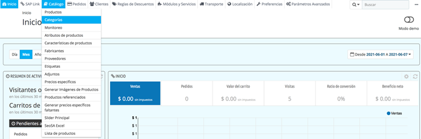
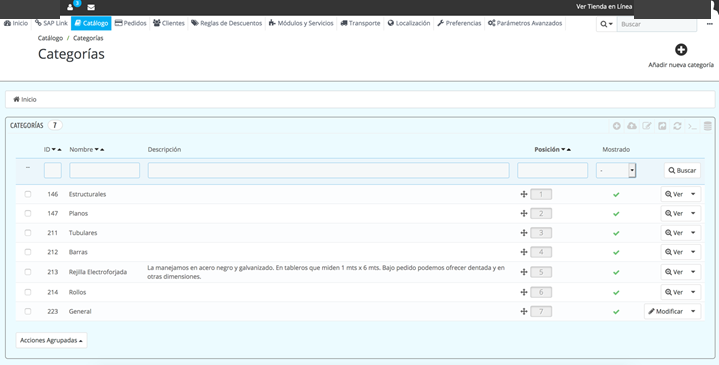
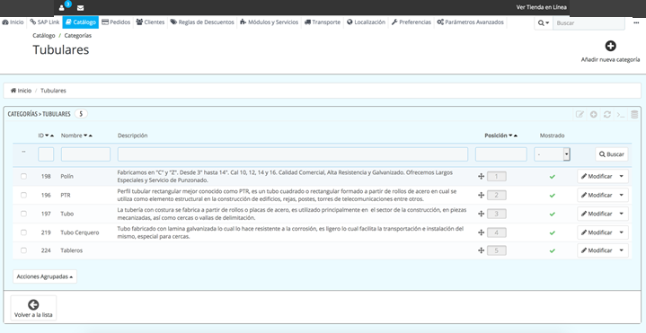
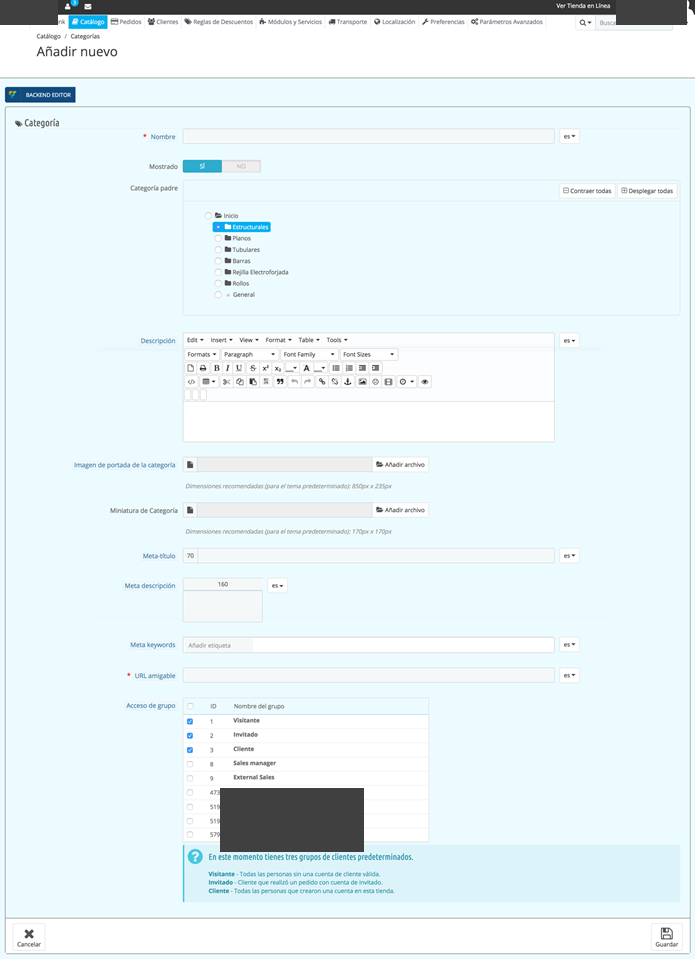

<!-- SPDX-License-Identifier: CC-BY-NC-ND-4.0 -->
<!-- Copyright (c) 2026 Onibex, LLC. Part of the Onibex eCommerce 360° Documentation — https://github.com/Onibex/ecommerce-docs -->

[English](../../../en/faq/01-catalog/01-add-subcategories-and-images.md) · **Español** | [↑ Índice de preguntas frecuentes](../README.md) | [README del repositorio](../../../README.md)

# Agregar subcategorías e imágenes

> **Fuente:** artículo “Agregar subcategorías e imágenes” del Help Center de Onibex — <https://help.onibex.com/portal/en/kb/articles/agregar-subcategorias-e-im%C3%A1genes>.

1. Iniciar sesión en el
/panel.

2. Una vez iniciada la sesión,
en la parte del menú entrar a Catálogo › Categorías

3. Se despliega la
pantalla donde están dadas de alta las categorías, y se da clic en el botón
“Ver”

4. Al entrar a la
categoría, se muestran las subcategorías en caso de modificar alguna se le da
clic al botón “modificar”, y si se crea una subcategoría se da clic “Añadir
nueva categoría”

5. Se despliega la
pantalla y salen los siguientes campos:

   1. Nombre (Nombre de la subcategoría)
   2. Mostrado (Si se activará en ese momento o no)
   3. Categoría padre (Sale por default la categoría en la que se entró)
   4. Descripción
   5. Imagen de la portada de la categoría (Recomendada 850px x 235px)
   6. Miniatura de categoría (Recomendada 170px x 170px)
   7. Meta título
   8. Meta descripción
   9. Meta keywords
   10. URL amigable (se crea automáticamente)
   11. Acceso de grupo (Seleccione el grupo que se va a mostrar)

6. Se da clic en
guardar.

---

© 2026 Onibex, LLC · Licenciado bajo [CC BY-NC-ND 4.0](../../../LICENSE) (SPDX: CC-BY-NC-ND-4.0) · [Licencia comercial](../../../COMMERCIAL-LICENSE.md) · [Marcas y avisos de terceros](../../../THIRD-PARTY-NOTICES.md) · SAP y los demás productos y servicios SAP mencionados son marcas comerciales o marcas registradas de SAP SE o de una empresa afiliada a SAP en Alemania y otros países; los nombres se usan solo con fines de identificación.
