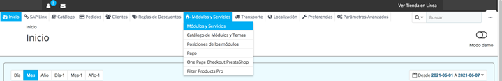
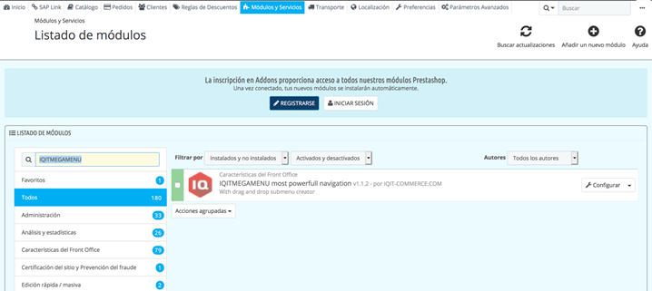
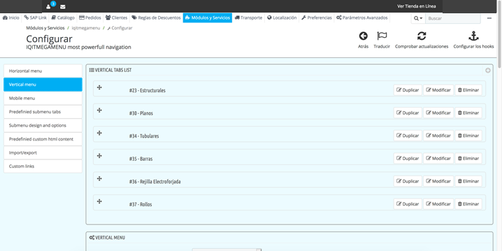
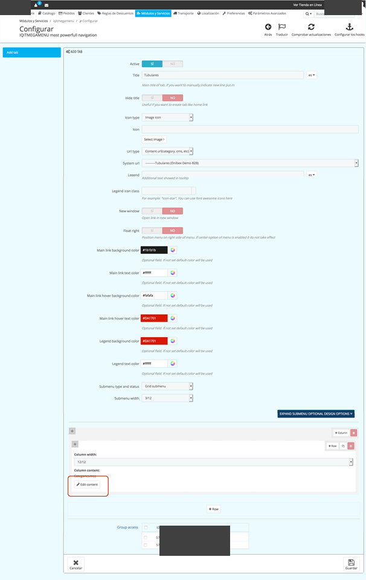
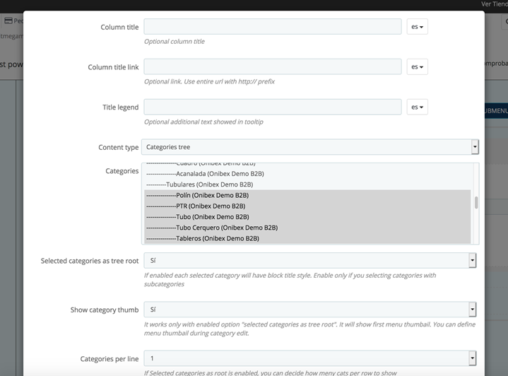

<!-- SPDX-License-Identifier: CC-BY-NC-ND-4.0 -->
<!-- Copyright (c) 2026 Onibex, LLC. Part of the Onibex eCommerce 360° Documentation — https://github.com/Onibex/ecommerce-docs -->

[English](../../../en/faq/01-catalog/02-add-subcategory-to-menu.md) · **Español** | [↑ Índice de preguntas frecuentes](../README.md) | [README del repositorio](../../../README.md)

# Dar de alta la subcategoría en el menú

> **Fuente:** artículo “Dar de alta la subcategoría en el menú” del Help Center de Onibex — <https://help.onibex.com/portal/en/kb/articles/dar-de-alta-la-subcategoria-en-el-menu-29-7-2021>.

1. Entrar al menú Módulos y Servicios › Módulos y
Servicios

2. Buscar en el listado de módulos “IQITMEGAMENU”

3. Dar clic en el botón “Configurar”

4. De lado izquierdo sale un menú del módulo, dar
clic en “Vertical menu”

5. Se despliegan las categorías dadas de alta en el
módulo y dar clic en el botón “Modificar” en la categoría a la que se dio de
alta la categoría anteriormente

6. Dar clic en el botón “Edit content”

7. Se abre un pop up y en el campo de “categorías”
se selecciona con Shift + clic la subcategoría que se va a agregar.

8. Se da clic en el botón “guardar” y se cierra el
pop up

9. Igual hasta abajo se da clic en el botón
“guardar” y se actualiza el menú en el sitio

---

© 2026 Onibex, LLC · Licenciado bajo [CC BY-NC-ND 4.0](../../../LICENSE) (SPDX: CC-BY-NC-ND-4.0) · [Licencia comercial](../../../COMMERCIAL-LICENSE.md) · [Marcas y avisos de terceros](../../../THIRD-PARTY-NOTICES.md) · SAP y los demás productos y servicios SAP mencionados son marcas comerciales o marcas registradas de SAP SE o de una empresa afiliada a SAP en Alemania y otros países; los nombres se usan solo con fines de identificación.
