<!-- SPDX-License-Identifier: CC-BY-NC-ND-4.0 -->
<!-- Copyright (c) 2026 Onibex, LLC. Part of the Onibex eCommerce 360° Documentation — https://github.com/Onibex/ecommerce-docs -->

[English](../../../en/faq/01-catalog/03-subcategory-features-mapping.md) · **Español** | [↑ Índice de preguntas frecuentes](../README.md) | [README del repositorio](../../../README.md)

# Dar de alta características de la subcategoría y mapearlas

> **Fuente:** artículo “Dar de alta características de la subcategoría y mapearlas” del Help Center de Onibex — <https://help.onibex.com/portal/en/kb/articles/dar-de-alta-caracter%C3%ADsticas-de-la-subcategoria-y-mapearlas>.

1. En el Menú principal del PANEL irse al submenú
de Catálogo → Características
de Productos:

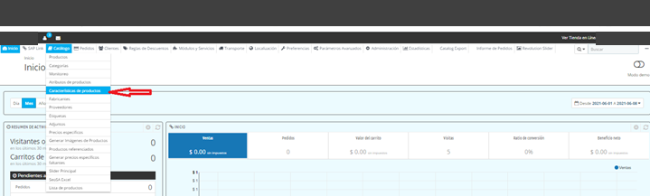

2. Se edita o se añade la Característica de cada
nueva Clase con el texto y/o Unidad de medida a como se desea que se presente
en la sección de Filtros en el Frente de la Categoría del Portal

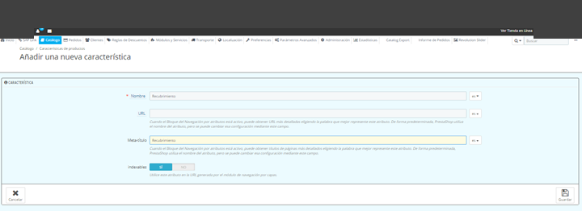

3. Se consulta en SAP la Jerarquía de cada nueva
Subcategoría a través de la T-Code V/76 para darla de alta en la sección de Mapeo
de Categorías en el Menu de “SAP Link” del PANEL:

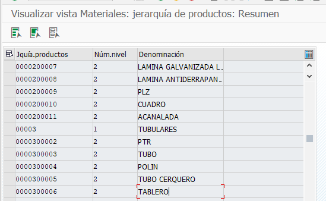

Planos → Acanalada = 0000200011

Tubulares → Tablero = 0000300006

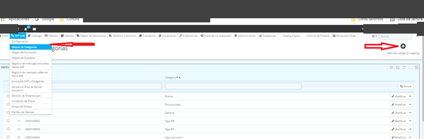

4. Se agrega la nueva clave de Jerarquía consultada
en SAP como “Código de Categoría” y se mapea a la nueva Subcategoría dada ya de
alta en el Portal:

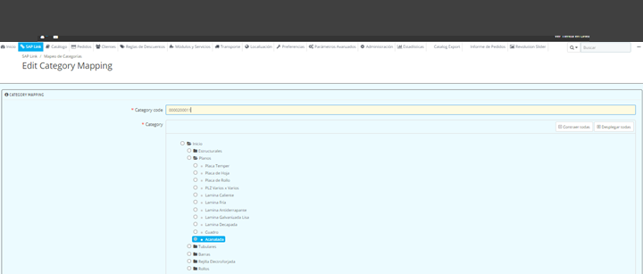

5. Se accede al Menú de “SAP Link” para verificar
que en la sección de “Mapeo de Funciones” estén todas las Características de las
nuevas Clases dadas de alta en SAP:

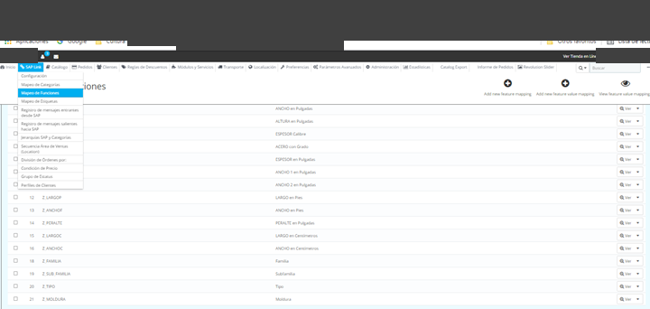

6. En el Menu principal del PANEL se accede al
submenú de “Módulos y Servicios” entrar al módulo de “Filter Products Pro”
donde se mapearán las Características o Funciones al Frente del Portal:

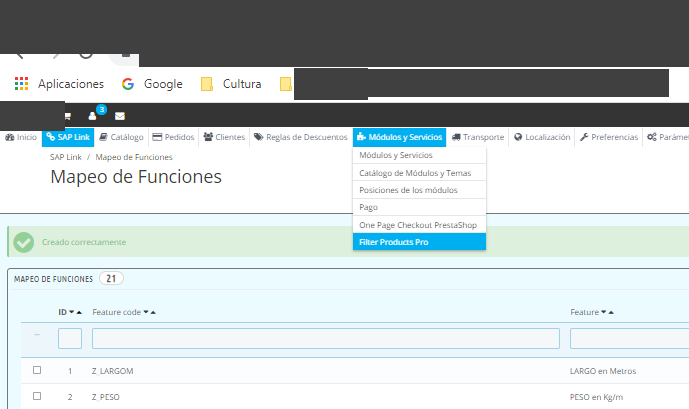

7. En la página principal del configurador de
Filtros, se da clic al ajuste de “Adicionar un nuevo buscador”

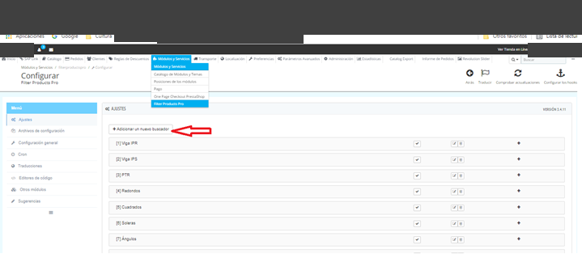

8. Se crea un nuevo buscador el cual se edita para ponerle
el nombre de la nueva subcategoría como se presentará en el frente del Portal,
en este primer caso: “Acanalada”:

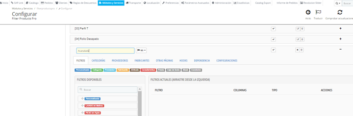

9. A esta nueva subcategoría “Acanalada”, se le
agregan todas las características de su clase Z_ACA que fueron creadas en la
T-Code CL03 de SAP:

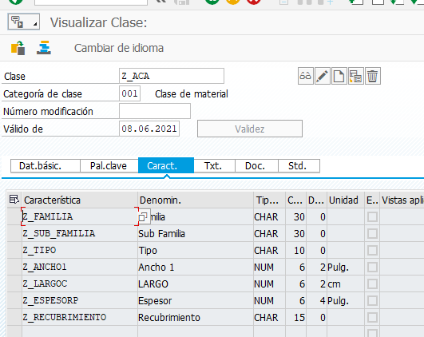

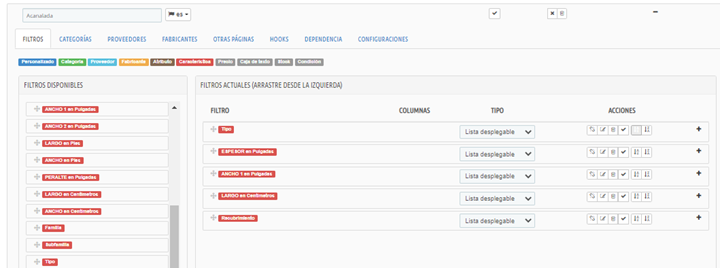

10. Una vez hecho el Mapeo de las Funciones que
están como Filtros disponibles desde las Características de SAP, se procede a la
siguiente pestaña de CATEGORÍAS para mapear el nuevo buscador a la nueva
Subcategoría seleccionada:

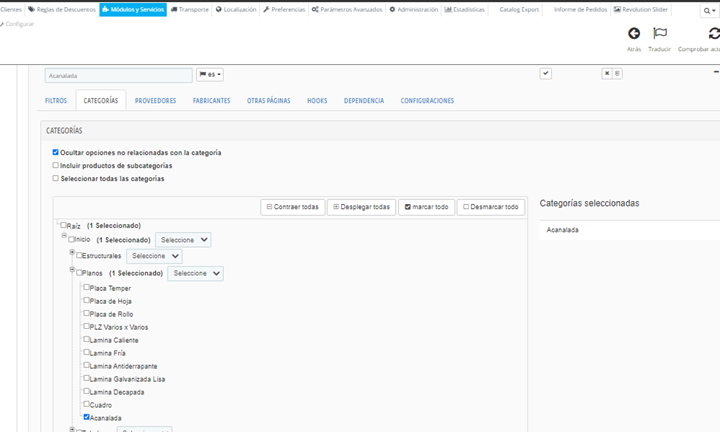

11. Se procede a la siguiente única otra pestaña
que tenemos que configurar, que es la de HOOKS, que es donde se señala que los
filtros estarán anclados a la sección izquierda de la página de la Subcategoría
en el frente del Portal:

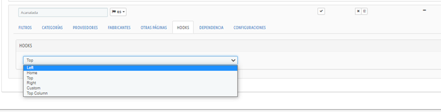

12. Habiendo hecho la configuración completa, se
procede a mandar todos los nuevos materiales con sus clasificaciones, para lo
cual se puede usar la T-Code BD10 de manera estándar como sigue:

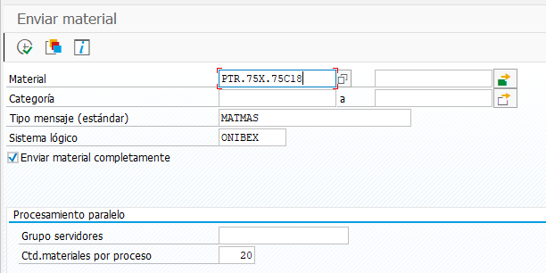

Hay que asegurarse que se hayan listado todos los
materiales y que se tenga activada la casilla de “Enviar material completamente”.

13. Por último, se asignan imágenes a los nuevos materiales.

---

© 2026 Onibex, LLC · Licenciado bajo [CC BY-NC-ND 4.0](../../../LICENSE) (SPDX: CC-BY-NC-ND-4.0) · [Licencia comercial](../../../COMMERCIAL-LICENSE.md) · [Marcas y avisos de terceros](../../../THIRD-PARTY-NOTICES.md) · SAP y los demás productos y servicios SAP mencionados son marcas comerciales o marcas registradas de SAP SE o de una empresa afiliada a SAP en Alemania y otros países; los nombres se usan solo con fines de identificación.
