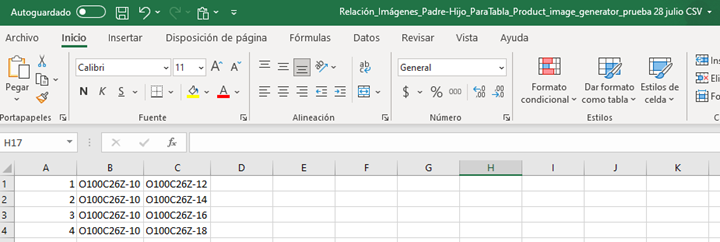
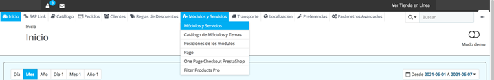
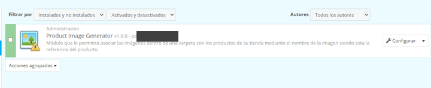
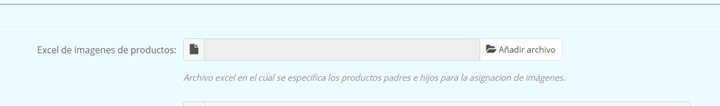
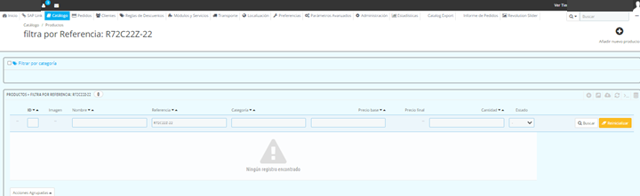
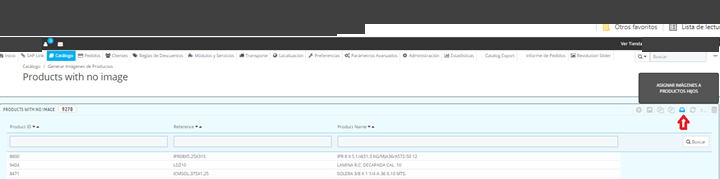

<!-- SPDX-License-Identifier: CC-BY-NC-ND-4.0 -->
<!-- Copyright (c) 2026 Onibex, LLC. Part of the Onibex eCommerce 360° Documentation — https://github.com/Onibex/ecommerce-docs -->

[English](../../../en/faq/01-catalog/04-assign-parent-images-to-child-products.md) · **Español** | [↑ Índice de preguntas frecuentes](../README.md) | [README del repositorio](../../../README.md)

# Asignar imágenes de productos “padres” a nuevos productos “hijos” relacionados

> **Fuente:** artículo “Asignar imágenes de productos “padres” a nuevos productos “hijos” relacionados” del Help Center de Onibex — <https://help.onibex.com/portal/en/kb/articles/asiganar-im%C3%A1genes-de-productos-padres-a-nuevos-productos-hijos-relacionados>.

1. Se prepara un archivo de Excel con la relación
de imágenes “padre” e “hijo” en tres columnas:

2. Se les quita el encabezado de manera que sólo se
presenten valores de relación “padre” e “hijo” para así grabar el archivo en
formato CSV (MS-DOS).

3. Entrar al menú Módulos y Servicios › Módulos y
Servicios

4. Buscar en el listado de módulos el de “PRODUCT
IMAGE GENERATOR”:

5. Dar clic al botón de Configurar el módulo para
entrar y cargar el archivo de Excel previamente preparado con sólo dos columnas
de relación imágenes “padre” a “hijo”:

6. Una vez importada la lista de productos, nos
aseguramos de que el producto “padre” tenga imagen en el portal:

7. El último paso es que una vez teniendo las
imágenes de los “padres”, se les asignan a los “hijos” a través de la siguiente
función en el PANEL:

Al correr esta función, se asignan en automático las
imágenes de “padres” a “hijos”, lo que se podría verificar en el Catálogo de
Productos.

---

© 2026 Onibex, LLC · Licenciado bajo [CC BY-NC-ND 4.0](../../../LICENSE) (SPDX: CC-BY-NC-ND-4.0) · [Licencia comercial](../../../COMMERCIAL-LICENSE.md) · [Marcas y avisos de terceros](../../../THIRD-PARTY-NOTICES.md) · SAP y los demás productos y servicios SAP mencionados son marcas comerciales o marcas registradas de SAP SE o de una empresa afiliada a SAP en Alemania y otros países; los nombres se usan solo con fines de identificación.
