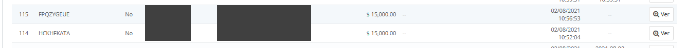
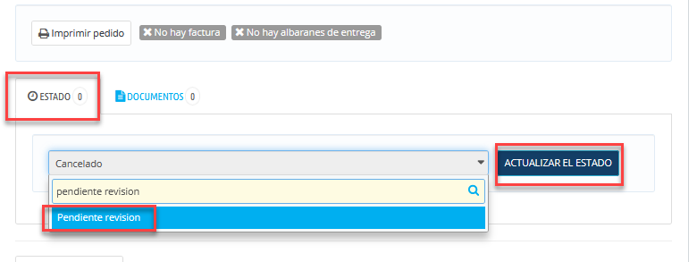
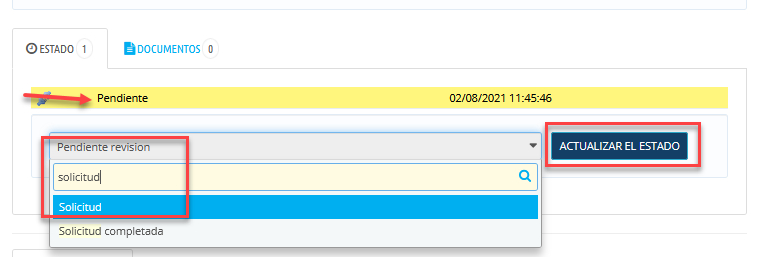

<!-- SPDX-License-Identifier: CC-BY-NC-ND-4.0 -->
<!-- Copyright (c) 2026 Onibex, LLC. Part of the Onibex eCommerce 360° Documentation — https://github.com/Onibex/ecommerce-docs -->

[English](../../../en/faq/03-orders/01-alphanumeric-orders-to-confirmed.md) · **Español** | [↑ Índice de preguntas frecuentes](../README.md) | [README del repositorio](../../../README.md)

# Convertir pedidos con números alfanuméricos en pedidos confirmados en SAP

> **Fuente:** artículo “Convertir pedidos con números alfanuméricos en pedidos confirmados en SAP” del Help Center de Onibex — <https://help.onibex.com/portal/en/kb/articles/c%C3%B3mo-convertir-pedidos-con-alfanum%C3%A9ricos-a-pedidos-confirmados-en-sap>.

1. Ir al pedido con número alfanumérico\

2. En la sección de ESTADOS cambiarlo primero al ESTADO (1) "Pendiente Revisión"\

3. Después, cambiar al siguiente ESTADO (2): SOLICITUD\

4. De esta manera, el pedido en automático es confirmado en SAP y se convierte de forma automática al ESTADO en PEDIDO WEB CONFIRMADO

---

© 2026 Onibex, LLC · Licenciado bajo [CC BY-NC-ND 4.0](../../../LICENSE) (SPDX: CC-BY-NC-ND-4.0) · [Licencia comercial](../../../COMMERCIAL-LICENSE.md) · [Marcas y avisos de terceros](../../../THIRD-PARTY-NOTICES.md) · SAP y los demás productos y servicios SAP mencionados son marcas comerciales o marcas registradas de SAP SE o de una empresa afiliada a SAP en Alemania y otros países; los nombres se usan solo con fines de identificación.
