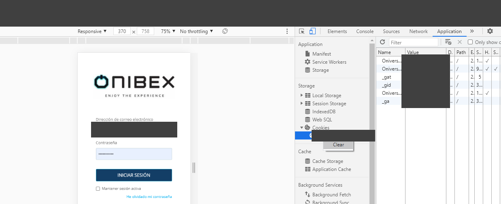
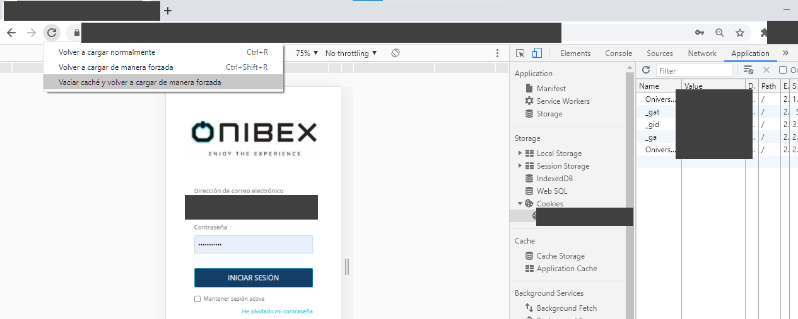

<!-- SPDX-License-Identifier: CC-BY-NC-ND-4.0 -->
<!-- Copyright (c) 2026 Onibex, LLC. Part of the Onibex eCommerce 360° Documentation — https://github.com/Onibex/ecommerce-docs -->

[English](../../../en/faq/04-administration/01-refresh-cache-cookies-login-as-customer.md) · **Español** | [↑ Índice de preguntas frecuentes](../README.md) | [README del repositorio](../../../README.md)

# Refrescar caché y cookies para corregir «Login as customer»

> **Fuente:** artículo “Refrescar caché y cookies para corregir «Login as customer»” del Help Center de Onibex — <https://help.onibex.com/portal/en/kb/articles/refrescar-cach%C3%A9-para-correcci%C3%B3n-de-login-as-customer>.

En ciertas ocasiones al abrir múltiples sesiones de usuario desde un navegador y no finalizar la sesión de forma correcta, se puede presentar un problema de confusión de Logs, por lo que para corregir este problema será necesario borrar Cookies y Refrescar el Caché.

En primer lugar se liberan Cookies mediante el siguiente procedimiento:

1. Entrar en el apartado de "Panel" de la plataforma
2. Usar la tecla F12 o presionar al mismo tiempo las teclas: “**Control-Shift-i**”
en el navegador (se recomienda utilizar Google Chrome)
3. Dentro de la pestaña de Aplicación, identificar el apartado de Cookies, dar clic derecho y seleccionar "Clear".

**Pueden realizar el proceso
de Limpieza de Cookies para verificar que los datos se presentan de la forma
correcta.**

**En Firefox:** Entrar en Opciones -> Buscar Cookies -> Limpiar
datos y caché 

CTRL + Shift + I -> Almacenamiento ->Cookies (clic derecho y Eliminar)

**En Chrome: CTRL + Shift +
I**

En la parte superior derecha
buscar: Aplicación -> Cookies -> Clic derecho y seleccionar
"Clear"

Posterior a esto se refresca el Caché mediante el siguiente procedimiento:

1. Entrar en el apartado de "Panel" de la plataforma
2. Usar la tecla F12 o presionar al mismo tiempo las teclas: “**Control-Shift-i**”
en el navegador (se recomienda utilizar Google Chrome)
3. Dirigirse al ícono de
“Refrescar” la pantalla en la parte superior izquierda.
4. Dar clic derecho en la opción y seleccionar "Vaciar caché y volver a cargar de manera forzada"\

Este proceso sólo es requerido si se llegasen a
corromper las cookies por seguridad desde el PANEL, este proceso permite que se “refresquen” las
pantallas a la última versión con la que cuente el servidor del portal.

---

© 2026 Onibex, LLC · Licenciado bajo [CC BY-NC-ND 4.0](../../../LICENSE) (SPDX: CC-BY-NC-ND-4.0) · [Licencia comercial](../../../COMMERCIAL-LICENSE.md) · [Marcas y avisos de terceros](../../../THIRD-PARTY-NOTICES.md) · SAP y los demás productos y servicios SAP mencionados son marcas comerciales o marcas registradas de SAP SE o de una empresa afiliada a SAP en Alemania y otros países; los nombres se usan solo con fines de identificación.
