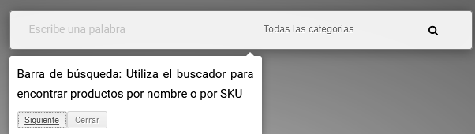
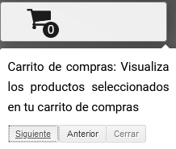
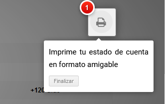
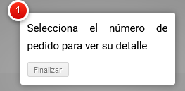
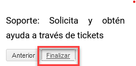

<!-- SPDX-License-Identifier: CC-BY-NC-ND-4.0 -->
<!-- Copyright (c) 2026 Onibex, LLC. Part of the Onibex eCommerce 360° Documentation — https://github.com/Onibex/ecommerce-docs -->

[English](../../../en/faq/04-administration/02-why-navigation-tutorial-appears.md) · **Español** | [↑ Índice de preguntas frecuentes](../README.md) | [README del repositorio](../../../README.md)

# ¿Por qué siempre me aparece el tutorial de navegación?

> **Fuente:** artículo “¿Por qué siempre me aparece el tutorial de navegación?” del Help Center de Onibex — <https://help.onibex.com/portal/en/kb/articles/por-qu%C3%A9-siempre-me-aparece-el-tutorial-de-navegaci%C3%B3n>.

El tutorial de navegación es una herramienta que le permite al usuario conocer paso a paso cómo utilizar de forma correcta la plataforma en cada uno de sus diferentes apartados, desde la página principal hasta el proceso de checkout.

A continuación se muestran algunos ejemplos de tutorial de navegación:

Este tutorial se presenta la primera vez que cada usuario accede a la plataforma y es necesario completarlo para que en el futuro no aparezca de nuevo; esto se consigue siguiendo todos los pasos haciendo clic en "Siguiente" hasta terminarlo por completo y haciendo clic en "Finalizar"

---

© 2026 Onibex, LLC · Licenciado bajo [CC BY-NC-ND 4.0](../../../LICENSE) (SPDX: CC-BY-NC-ND-4.0) · [Licencia comercial](../../../COMMERCIAL-LICENSE.md) · [Marcas y avisos de terceros](../../../THIRD-PARTY-NOTICES.md) · SAP y los demás productos y servicios SAP mencionados son marcas comerciales o marcas registradas de SAP SE o de una empresa afiliada a SAP en Alemania y otros países; los nombres se usan solo con fines de identificación.
