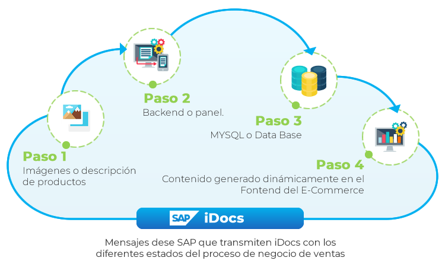
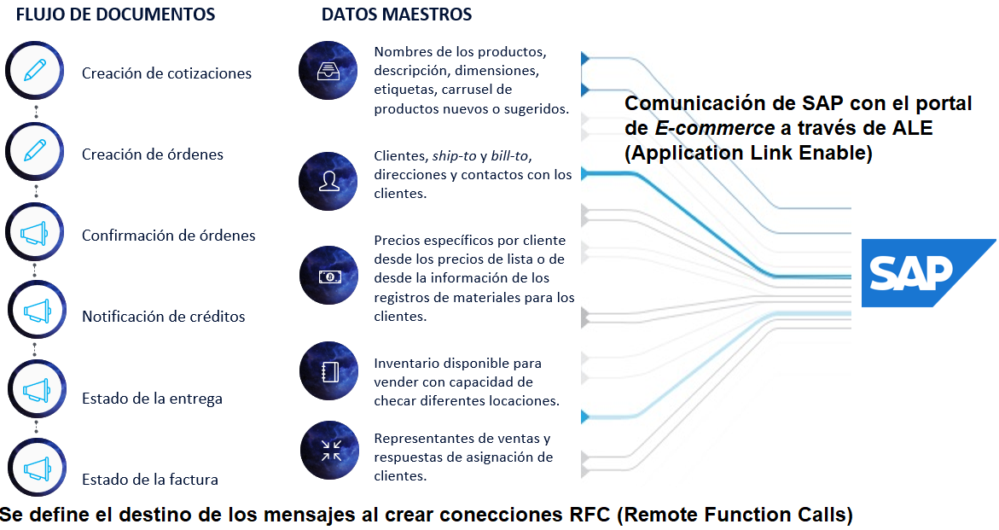

<!-- SPDX-License-Identifier: CC-BY-NC-ND-4.0 -->
<!-- Copyright (c) 2026 Onibex, LLC. Part of the Onibex eCommerce 360° Documentation — https://github.com/Onibex/ecommerce-docs -->

[English](../../../en/technical-documents/01-overview/01-systems-integration-overview.md) · **Español** | [↑ Índice de documentos técnicos](../README.md) | [README del repositorio](../../../README.md)

# Integración de sistemas: visión general (SAP ERP y eCommerce 360°)

> **Fuente:** capítulo Introducción de la especificación funcional “D1 – Integración de sistemas” del Help Center de Onibex — <https://help.onibex.com/portal/en/kb/articles/d1-integraci%C3%B3n-de-sistemas-v-5-1-espa%C3%B1ol>.

El sistema de comercio electrónico B2B (Business To Business) de ONIBEX, es uno que comprende funcionalidades avanzadas de un sistema *E-commerce*; pero, además, está integrado completamente al sistema ERP (Enterprise Resource Planning) de SAP. En este capítulo se describe a detalle toda la integración del sistema de comercio electrónico con SAP; pero antes de introducirnos a las configuraciones necesarias en SAP para este intercambio de mensajes, presentamos el flujo de trabajo para la gestión de contenidos en el eCommerce 360° de ONIBEX.

El sistema de comercio electrónico cuenta con un *backend* o panel que es usado para gestionar o administrar el contenido específico de una publicación a realizarse en una tienda en línea. Con el panel, personal no técnico puede responsabilizarse del contenido, las palabras y dibujos de un sitio web, sin tener que saber nada de códigos, tales como HTML y CSS. De esta manera uno se puede enfocar más a las estadísticas, a las ventas o al proceso de negocio, es decir, al modo en que el contenido es mostrado.

El *backend* o panel usa instrucciones “poner el contenido aquí” que le dice al sistema de comercio electrónico que tome el contenido de una base de datos llamada ***MySQL***, el “contenido puro”, y lo coloque en un lugar determinado en el diseño de cada página. Al final, esto separa las responsabilidades entre desarrollo del diseño y la operación de las páginas web que conforman el sistema de comercio electrónico. Todo esto se resume en la siguiente Figura-1.

**Figura-1**: Integración de sistemas para el proceso de ventas del sistema *E-Commerce* en la nube.

ONIBEX ofrece la puesta en marcha y los servicios en la nube del sistema de comercio electrónico integrado completamente al sistema ERP (*Enterprise Resource* *Planning*) de SAP.

La mayor parte de la comunicación de los sistemas que integra ONIBEX en la nube, se da a partir de los mensajes de SAP con el panel de administración del sistema de comercio electrónico. La información que se consulta desde SAP es de dos tipos:

1. Datos maestros: Son los tipos de datos que menos cambian en el proceso de negocios, es decir, los que no son transaccionales, como lo son los incluidos en el maestro de clientes, maestro de materiales, el registro de condiciones relativo a precios.

2. Datos transaccionales: Son los datos temporales que existen y atraen la atención en un periodo particular de tiempo, pero después de esto se empieza a trabajar en un nuevo flujo de documentos, tales como órdenes, cotizaciones, facturas, etc.

Para detallar la figura 1 en cuanto la integración del sistema del comercio electrónico con los dos tipos de datos que se intercambian desde SAP, se agrega la figura 2 que introduce flujo de documentos y datos maestros para el proceso de negocio de ventas.

**Figura-2**: Integración de los dos tipos de datos de SAP con el sistema de *E-Commerce* en la nube.

Una vez realizada la anterior introducción sobre integración de sistemas, las tres siguientes secciones tienen como objetivo mostrar los pasos necesarios a configurar en SAP para poder intercambiar información mediante ALE (*Application Link Enabling*).

ALE comprende el intercambio controlado de mensajes de negocios para procesar la creación de documentos tales como: Ordenes de Venta, Datos maestros de clientes y de materiales, en interfaces del tipo *Inbound* (entrantes). Así como la administración consistente de datos desde SAP a la aplicación de *E-commerce* como lo son: Datos maestros de clientes, materiales, niveles de inventario en cierto centro y almacén, confirmación de creación de documentos como la orden de venta, la entrega y la factura.

Siguiente: [Definición de sistema lógico en SAP](../02-ale-foundations/01-logical-system-definition.md) →

---

© 2026 Onibex, LLC · Licenciado bajo [CC BY-NC-ND 4.0](../../../LICENSE) (SPDX: CC-BY-NC-ND-4.0) · [Licencia comercial](../../../COMMERCIAL-LICENSE.md) · [Marcas y avisos de terceros](../../../THIRD-PARTY-NOTICES.md) · SAP y los demás productos y servicios SAP mencionados son marcas comerciales o marcas registradas de SAP SE o de una empresa afiliada a SAP en Alemania y otros países; los nombres se usan solo con fines de identificación.
