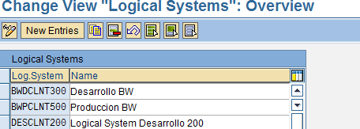
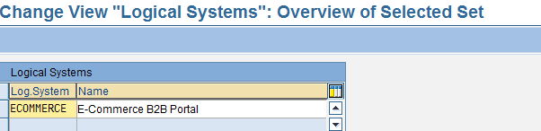

<!-- SPDX-License-Identifier: CC-BY-NC-ND-4.0 -->
<!-- Copyright (c) 2026 Onibex, LLC. Part of the Onibex eCommerce 360° Documentation — https://github.com/Onibex/ecommerce-docs -->

[English](../../../en/technical-documents/02-ale-foundations/01-logical-system-definition.md) · **Español** | [↑ Índice de documentos técnicos](../README.md) | [README del repositorio](../../../README.md)

# Definición de sistema lógico en SAP

> **Fuente:** versión en español del artículo “2. Logical system definition in SAP” del Help Center de Onibex — <https://help.onibex.com/portal/en/kb/articles/logical-system-definition-in-sap>; redacción tomada del capítulo D.1 de la especificación funcional “D1 – Integración de sistemas”.

ALE asegura una instalación distribuida pero integrada de SAP. Para implementar la distribución de procesos de aplicaciones de negocios y demás funciones usando ALE, uno necesita construir un Modelo de Distribución Lógico del sistema completo. Dentro del marco de esta configuración, se realiza la especificación funcional de qué aplicaciones correr sobre cuáles sistemas, y cuáles mensajes son intercambiados entre las aplicaciones.

Para poder comenzar con esta configuración se hace necesario entrar por medio de la transacción ALE al menú desde donde se puede llevar a cabo toda la configuración necesaria para poder recibir y transmitir información.

RUTA: **IDOC Interface / Application Link Enabling (ALE) > Basic Settings > Logical Systems > Define Logical System.**

**Transacción:** **BD54**

De manera estándar, SAP cuenta con algunas entradas entre las distintas instancias; hay que asegurarse de estar en un ambiente abierto a la configuración para poder crear la entrada nueva ECOMMERCE. Se verá una pantalla muy similar a la siguiente:

**Figura-3** Pantalla de Inicio de Creación de Sistemas Lógicos

Presione el botón *New Entries* y cree una entrada con la clave ECOMMERCE y el nombre E-Commerce B2B Portal.

**Figura-4** Creación del ID y descripción del sistema lógico

Grabe sus cambios y el sistema le solicitará generar la respectiva orden de transporte para poder mover este cambio en la configuración a otro ambiente; es decir, cada una de las configuraciones y programas descritos en este documento genera una orden de transporte para después poder mover o trasladar tales configuraciones y programas desde el ambiente de Desarrollo (“DEV”) hacia el ambiente de calidad, “QAs”. Dentro de esta configuración en específico, no hay ningún otro parámetro que se deba de especificar.

← Anterior: [Integración de sistemas: visión general (SAP ERP y eCommerce 360°)](../01-overview/01-systems-integration-overview.md) · Siguiente: [Definición del destino RFC (Remote Function Call) en SAP](../02-ale-foundations/02-rfc-destination.md) →

---

© 2026 Onibex, LLC · Licenciado bajo [CC BY-NC-ND 4.0](../../../LICENSE) (SPDX: CC-BY-NC-ND-4.0) · [Licencia comercial](../../../COMMERCIAL-LICENSE.md) · [Marcas y avisos de terceros](../../../THIRD-PARTY-NOTICES.md) · SAP y los demás productos y servicios SAP mencionados son marcas comerciales o marcas registradas de SAP SE o de una empresa afiliada a SAP en Alemania y otros países; los nombres se usan solo con fines de identificación.
