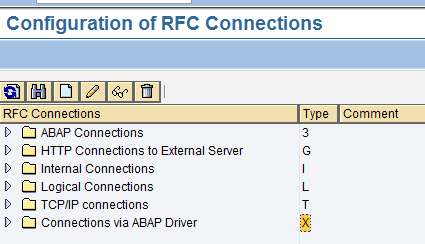
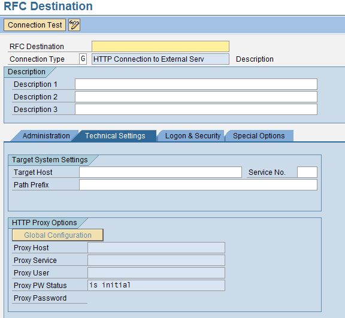
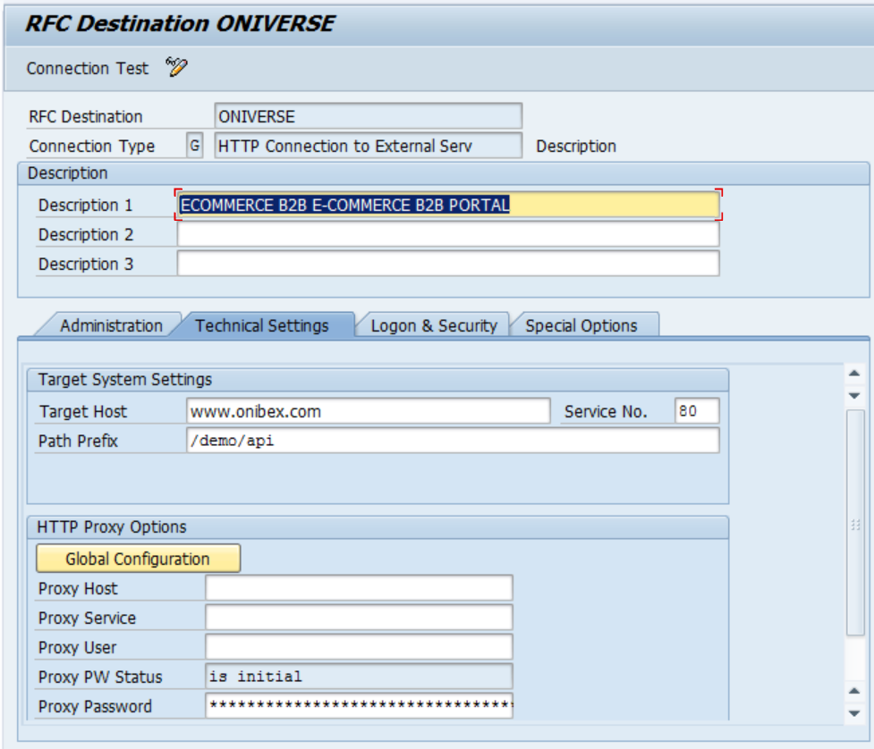
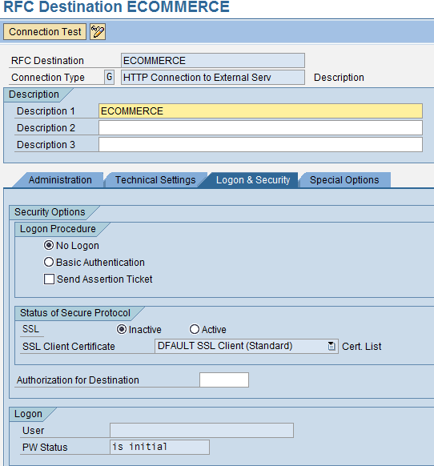
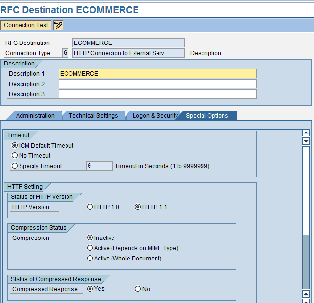
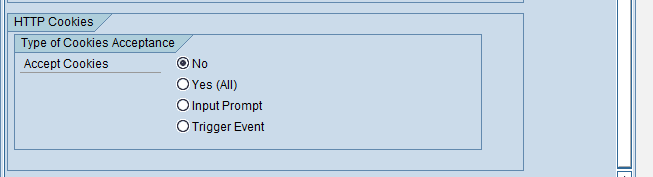
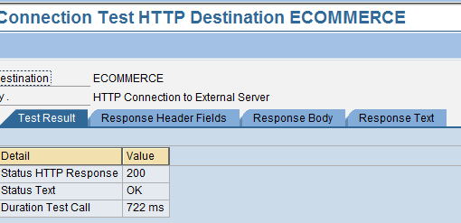

<!-- SPDX-License-Identifier: CC-BY-NC-ND-4.0 -->
<!-- Copyright (c) 2026 Onibex, LLC. Part of the Onibex eCommerce 360° Documentation — https://github.com/Onibex/ecommerce-docs -->

[English](../../../en/technical-documents/02-ale-foundations/02-rfc-destination.md) · **Español** | [↑ Índice de documentos técnicos](../README.md) | [README del repositorio](../../../README.md)

# Definición del destino RFC (Remote Function Call) en SAP

> **Fuente:** versión en español del artículo “3. Defining the RFC Destination in SAP” del Help Center de Onibex — <https://help.onibex.com/portal/en/kb/articles/defining-the-rfc-destination-in-sap>; redacción tomada del capítulo D.2 de la especificación funcional “D1 – Integración de sistemas”.

Para que el sistema de comercio electrónico pueda escribir datos en SAP, se tiene que definir el destino *RFC*. Esta es una interfaz propietaria de SAP para comunicaciones entre sistemas SAP y programas externos, como el sistema de E-Commerce de ONIBEX. Es decir, las transacciones de datos no están limitadas a obtener datos del servidor, sino que se pueden insertar también registros; SAP puede actuar tanto como Cliente o Servidor en una llamada *RFC*.

Para poder hacer la configuración del *RFC* en SAP, se necesita conocer varios parámetros de la página Web con la que se va a estar intercambiando información, como son: URL, Puerto, tipo de *RFC*, la ruta, la versión del protocolo a utilizar, etc.

RUTA: **IDOC Interface / Application Link Enabling (ALE) > Communication > Create RFC Connections**

**Transacción: SM59**

Al entrar a esta transacción, veremos una pantalla muy similar a la siguiente:

**Figura-5** Pantalla Inicial Transacción SM59

El siguiente paso consiste en colocar el cursor sobre el folder HTTP *Connections to External Server* o tipo G y presionar el icono “Create New” para crear una nueva entrada. Con esto el sistema nos mostrará la pantalla *RFC Destination*, como se muestra en la Figura-6:

**Figura-6** Campos a llenar para establecer comunicación.

A continuación, llene los recuadros en rojo:

1. **RFC Destination.-** Aquí se coloca el ID que tendrá el sistema de destino, en nuestro caso: ECOMMERCE

2. **Description 1.-** Aquí se coloca un texto breve para describir de qué se trata esta conexión: Portal E-Commerce.

3. **Target Host.-** Aquí se coloca la dirección IP del servidor en que está instalado el Portal del E-Commerce.

4. **Service NO.-** Aquí se coloca el puerto que se utiliza para la comunicación: 80

5. **Path Prefix:** Aquí se coloca la ruta en donde está la app: /demos/CUSTOMER/api/

**Figura-7** Pantalla *Destino RFC* con datos capturados.

En la siguiente pestaña, dejamos la configuración como se muestra en la Figura-8:

**Figura-8**: Pestaña *Logon & Security*.

Por último, la cuarta pestaña, *Special Options*, debe quedar como se muestra en la siguiente Figura-9:

**Figura-9**: Pestaña *Special Options*

Finalmente, hay que probar la comunicación para ver si el *backend* del *E-commerce* responde a SAP; para ello se presiona el botón “*Test Connection*”. Si la comunicación se lleva a cabo de manera exitosa, se deberá de ver una pantalla como la que se ilustra en la siguiente imagen:

**Figura-10** Pantalla con prueba de conexión exitosa con el sistema externo.

← Anterior: [Definición de sistema lógico en SAP](../02-ale-foundations/01-logical-system-definition.md) · Siguiente: [Definición del puerto para el procesamiento de IDocs en SAP](../02-ale-foundations/03-idoc-port-definition.md) →

---

© 2026 Onibex, LLC · Licenciado bajo [CC BY-NC-ND 4.0](../../../LICENSE) (SPDX: CC-BY-NC-ND-4.0) · [Licencia comercial](../../../COMMERCIAL-LICENSE.md) · [Marcas y avisos de terceros](../../../THIRD-PARTY-NOTICES.md) · SAP y los demás productos y servicios SAP mencionados son marcas comerciales o marcas registradas de SAP SE o de una empresa afiliada a SAP en Alemania y otros países; los nombres se usan solo con fines de identificación.
