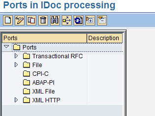
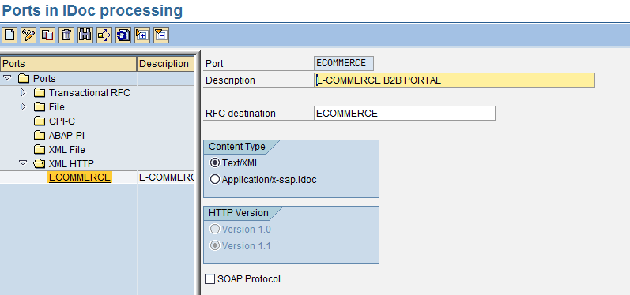

<!-- SPDX-License-Identifier: CC-BY-NC-ND-4.0 -->
<!-- Copyright (c) 2026 Onibex, LLC. Part of the Onibex eCommerce 360° Documentation — https://github.com/Onibex/ecommerce-docs -->

[English](../../../en/technical-documents/02-ale-foundations/03-idoc-port-definition.md) · **Español** | [↑ Índice de documentos técnicos](../README.md) | [README del repositorio](../../../README.md)

# Definición del puerto para el procesamiento de IDocs en SAP

> **Fuente:** versión en español del artículo “4. Port definition for iDoc processing in SAP” del Help Center de Onibex — <https://help.onibex.com/portal/en/kb/articles/port-definition-for-idoc-processing-in-sap>; redacción tomada del capítulo D.3 de la especificación funcional “D1 – Integración de sistemas”.

Junto con las dos anteriores secciones de Modelo Lógico de Distribución y definición del destino RFC, para el proceso ALE se debe configurar un puerto destinatario para el procesamiento de IDocs. Los IDocs son documentos estandarizados semejantes a los documentos EDI (*Electronic Data Interchange*) que SAP soporta para comunicaciones asincrónicas con sistemas diferentes a SAP. Es decir, los IDocs se utilizan para enviar o recibir documentos de “negocio” tales como pedidos de venta (sales orders), por ejemplo, hacia o desde sistemas “*partners*” de SAP, o algún otro programa externo. El puerto es un adaptador de SAP que soporta el envío y la recepción de IDocs vía llamadas RFC transaccionales o, en nuestro caso, vía documentos XML con protocolo HTTP versión 1.1.

Para poder definir el puerto se debe de entrar a la transacción **WE21**.

Al entrar a esta transacción, veremos una pantalla como la siguiente Figura-11:

**Figura-11** Pantalla inicial de Transacción **WE21**.

Colocamos el cursor sobre el último folder: XML HTTP, y presionamos el icono de la hoja en blanco para crear una nueva entrada que se llame ECOMMERCE; es importante que seleccionemos también la versión 1.1 de HTTP.

**Figura-12** Configuración del Puerto para el procesamiento de IDocs.

Grabe sus cambios y genere la orden de transporte de la configuración.

← Anterior: [Definición del destino RFC (Remote Function Call) en SAP](../02-ale-foundations/02-rfc-destination.md) · Siguiente: [Definición de perfiles de interlocutor (partner profile) en SAP](../02-ale-foundations/04-partner-profile.md) →

---

© 2026 Onibex, LLC · Licenciado bajo [CC BY-NC-ND 4.0](../../../LICENSE) (SPDX: CC-BY-NC-ND-4.0) · [Licencia comercial](../../../COMMERCIAL-LICENSE.md) · [Marcas y avisos de terceros](../../../THIRD-PARTY-NOTICES.md) · SAP y los demás productos y servicios SAP mencionados son marcas comerciales o marcas registradas de SAP SE o de una empresa afiliada a SAP en Alemania y otros países; los nombres se usan solo con fines de identificación.
