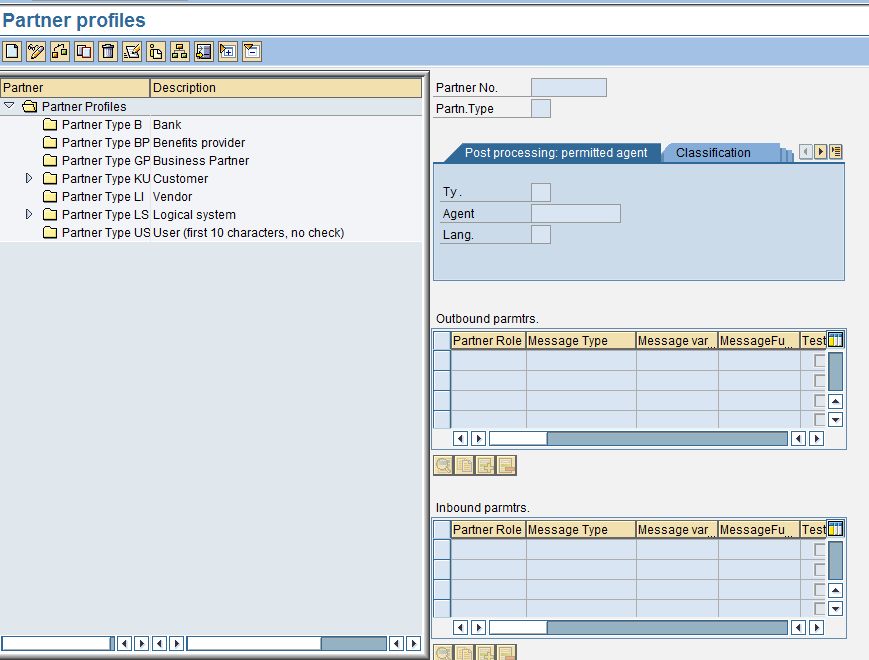
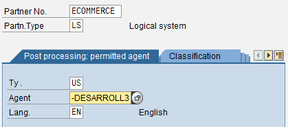
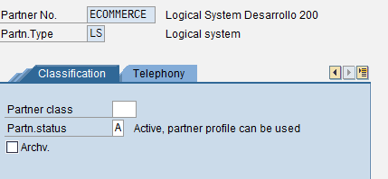
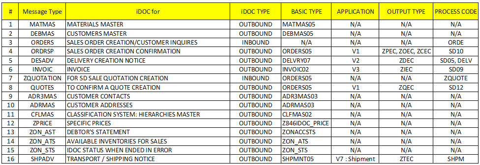

<!-- SPDX-License-Identifier: CC-BY-NC-ND-4.0 -->
<!-- Copyright (c) 2026 Onibex, LLC. Part of the Onibex eCommerce 360° Documentation — https://github.com/Onibex/ecommerce-docs -->

[English](../../../en/technical-documents/02-ale-foundations/04-partner-profile.md) · **Español** | [↑ Índice de documentos técnicos](../README.md) | [README del repositorio](../../../README.md)

# Definición de perfiles de interlocutor (partner profile) en SAP

> **Fuente:** versión en español del artículo “5. SAP Partner profile definition idocs” del Help Center de Onibex — <https://help.onibex.com/portal/en/kb/articles/sap-partner-profile-definition-idocs>; redacción tomada del capítulo D.4 de la especificación funcional “D1 – Integración de sistemas”.

Para entrar a esta parte de la configuración se deben de tener definidos con anterioridad el sistema lógico en SAP y el puerto para el procesamiento de IDocs en SAP, ya que se procede a configurar los distintos tipos de mensajes como se muestra en la Figura-13.

La primera división que se hace de los mensajes a crear es si son de entrada (INBOUND) o bien de salida (OUTBOUND). Además, se debe considerar qué tipo de información se consulta: **1)** Datos maestros o **2)** Datos transaccionales, como lo son los flujos de documentos. Si son datos maestros no es necesario que se configure la parte del tipo de mensaje, como se verá en las figuras de la 18 a la 21. Pero si se trata de flujos de documentos como SALES ORDERS, DELIVERIES, INVOICES, ahí sí se tiene que configurar un tipo de mensaje que haga sentido con el área aplicativa: **V1** para INQUIRIES o SALES ORDERS; **V2** para documentos que tengan que ver con actividades de Despacho como DELIVERIES, PICKING LIST; o bien, **V3** para documentos que tengan que ver con facturación como son INVOICES, CREDIT MEMO REQUEST, O CREDIT MEMO.

Al entrar a la Transacción **WE20** *Partner Profiles*, se observará una pantalla como la siguiente:

**Figura-13** Pantalla Inicial de la transacción WE20: “*Creation of Partner Profiles*”.

El siguiente paso para crear un primer mensaje es ir al folder que se llama *Partner Type* LS LOGICAL SYSTEM y colocar ahí el cursor para posteriormente dar un clic al icono de la hoja de color blanco y así generar una nueva entrada. A la nueva entrada se le agregan los siguientes datos en los campos de la Figura-14:

**Figura-14** Configuraciones iniciales del *Partner Profile* para el Sistema Lógico.

5. **Partner NO.-** Aquí colocamos el ID del sistema de destino: ECOMMERCE.
6. **Partner Type**.- Aquí colocamos el tipo LS que corresponde a Logical System o sistema lógico.
7. **Ty**.- Aquí colocamos US que corresponde a un User ID de SAP.
8. **Agent**.- En este campo se pone el user ID de SAP con el que estamos trabajando.
9. **Lang**. En este campo colocamos el idioma en el que nos encontremos: EN para inglés o bien ES para español.

**Nota: Es muy importante que dentro de la pestaña Classification el campo Partner Status tenga la letra “A” de Active, porque si no la tiene esto causa problemas a la hora de recibir los IDocs.**

**Figura-15** Activación del *Partner Profile* para poderlo utilizar usando la transacción WE20.

Para comenzar a agregar mensajes, debemos tener en cuenta los parámetros que se definen en la siguiente tabla de la Figura-16:

**Figura-16** Mensajes de acuerdos en SAP para un sistema lógico LS con el interlocutor ECOMMERCE que se configuran a través de las transacciones WE20, BD64 y NACE, en su caso.

Estos son los principales mensajes que se intercambian a través de documentos IDocs. Como se puede apreciar en la tabla de la Figura-16, cada uno tiene sus propios parámetros de configuración, aunque se tengan que llenar las mismas secciones en iguales formatos de SAP, como lo es el mismo “*Partner profile*”, “*Distribution model*” y “*Condition Record*”, entre otros.

En las siguientes subsecciones veremos cómo agregar cada uno de los principales mensajes de tal Figura-16. Además, se muestra cómo configurar los formatos correspondientes en SAP para su integración al sistema de comercio electrónico a través de IDocs.

En otra sección se describe otro tipo de comunicación entre SAP y el portal de E-Commerce, esto es a través de Web Services. La comunicación por Web Services se realiza activando el Servicio ICF (Internet Communication Framework) tanto para Inventarios y Precios como para asegurarnos de que los IDocs se creen y se ejecuten de inmediato.

Ya al final, se hace un resumen completo de la lista de Objetos de SAP utilizados para integrar los procesos y los mensajes de este ERP con el sistema de E-Commerce.

← Anterior: [Definición del puerto para el procesamiento de IDocs en SAP](../02-ale-foundations/03-idoc-port-definition.md) · Siguiente: [Configuración de los punteros de modificación (change pointers)](../02-ale-foundations/05-change-pointers.md) →

---

© 2026 Onibex, LLC · Licenciado bajo [CC BY-NC-ND 4.0](../../../LICENSE) (SPDX: CC-BY-NC-ND-4.0) · [Licencia comercial](../../../COMMERCIAL-LICENSE.md) · [Marcas y avisos de terceros](../../../THIRD-PARTY-NOTICES.md) · SAP y los demás productos y servicios SAP mencionados son marcas comerciales o marcas registradas de SAP SE o de una empresa afiliada a SAP en Alemania y otros países; los nombres se usan solo con fines de identificación.
