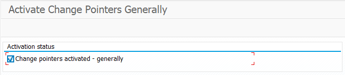
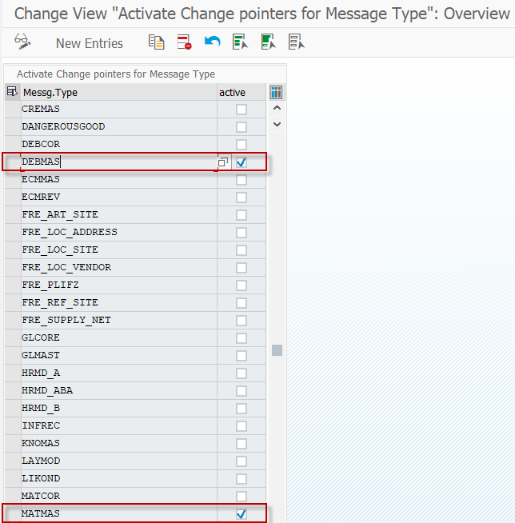
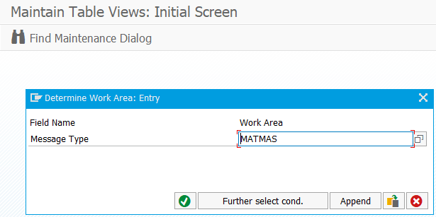
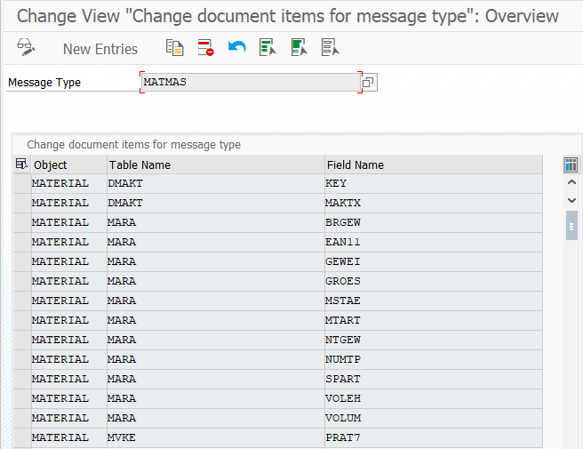
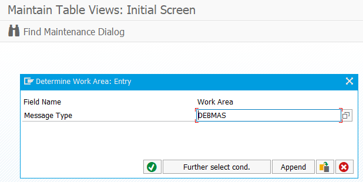
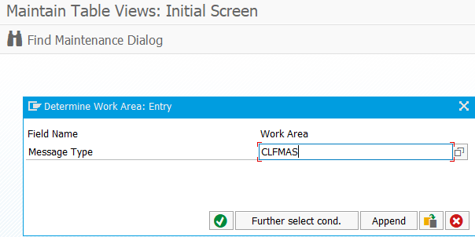
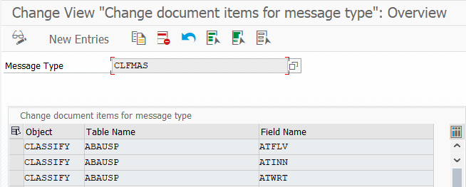

<!-- SPDX-License-Identifier: CC-BY-NC-ND-4.0 -->
<!-- Copyright (c) 2026 Onibex, LLC. Part of the Onibex eCommerce 360° Documentation — https://github.com/Onibex/ecommerce-docs -->

[English](../../../en/technical-documents/02-ale-foundations/05-change-pointers.md) · **Español** | [↑ Índice de documentos técnicos](../README.md) | [README del repositorio](../../../README.md)

# Configuración de los punteros de modificación (change pointers)

> **Fuente:** versión en español del artículo “16. Setting up Change pointers” del Help Center de Onibex — <https://help.onibex.com/portal/en/kb/articles/setting-up-change-pointers>; redacción tomada del capítulo D.6 de la especificación funcional “D1 – Integración de sistemas”.

Los *Change Pointers* (punteros de modificación) se encargan de las actualizaciones que el sistema SAP realiza hacia el E-Commerce cuando hay cambios en los Maestros de Clientes y Materiales. Para realizar estas tareas se procede con las siguientes configuraciones:

**Transacción: BD61**

1. Activar de manera general los “*change pointers*”:

**Transacción BD50 / tabla TBDA2**

2. Activar los *change pointers* para los tipos de mensajes DEBMAS, ADRMAS, ADR3MAS, MATMAS y CLFMAS:

**Transacción BD52 / tabla TBD62**

1. Especificar los campos que deben disparar los “*Change pointers*”:

Nota: No hay cambios para el tipo de mensaje DEBMAS; la definición estándar se deja como en la configuración inicial.

Una vez que los pasos anteriores son configurados, cualquier cambio en los campos que definen los Maestros de materiales y clientes va a ser registrado en la tabla BDCP2; de esta manera, con el programa RBDMIDOC de la Transacción BD21 será evaluado. Adicionalmente, el programa RBDCPCLR toma la tarea de borrar todos los registros obsoletos de esta tabla BDCP2 y evitar así que crezca demasiado.

← Anterior: [Definición de perfiles de interlocutor (partner profile) en SAP](../02-ale-foundations/04-partner-profile.md) · Siguiente: [Configuración del IDoc MATMAS (maestro de materiales)](../03-master-data-idocs/01-matmas-idoc.md) →

---

© 2026 Onibex, LLC · Licenciado bajo [CC BY-NC-ND 4.0](../../../LICENSE) (SPDX: CC-BY-NC-ND-4.0) · [Licencia comercial](../../../COMMERCIAL-LICENSE.md) · [Marcas y avisos de terceros](../../../THIRD-PARTY-NOTICES.md) · SAP y los demás productos y servicios SAP mencionados son marcas comerciales o marcas registradas de SAP SE o de una empresa afiliada a SAP en Alemania y otros países; los nombres se usan solo con fines de identificación.
