<!-- SPDX-License-Identifier: CC-BY-NC-ND-4.0 -->
<!-- Copyright (c) 2026 Onibex, LLC. Part of the Onibex eCommerce 360° Documentation — https://github.com/Onibex/ecommerce-docs -->

[English](../../../en/technical-documents/03-master-data-idocs/01-matmas-idoc.md) · **Español** | [↑ Índice de documentos técnicos](../README.md) | [README del repositorio](../../../README.md)

# Configuración del IDoc MATMAS (maestro de materiales)

> **Fuente:** versión en español del artículo “6. MATMAS iDoc configuration” del Help Center de Onibex — <https://help.onibex.com/portal/en/kb/articles/matmas-idoc-configuration>; redacción tomada del capítulo D.4.a de la especificación funcional “D1 – Integración de sistemas”.

Como se ha mencionado en la tabla de configuración de la Figura-16, el IDoc MATMAS se utiliza para el envío de información del maestro de materiales de SAP a un sistema Externo, en este caso, el sistema E-Commerce.

Para comenzar a crear esos mensajes, se debe tomar como inicio la pantalla de la **Figura-13**, colocarse en la sección ***Outbound*** y presionar el icono  para agregar una nueva entrada.

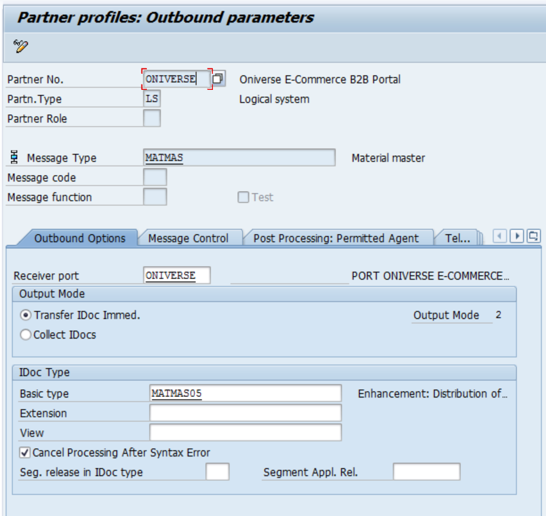

***Figura-17*** *Pantalla Inicial WE20 para la creación del mensaje MATMAS de Maestro de Materiales.*

Las siguientes pestañas se dejan sin cambios; debido a que el IDoc MATMAS corresponde a un dato maestro, no es necesario configurar ningún mensaje.

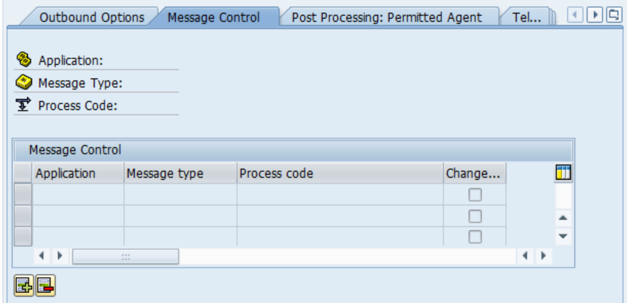

***Figura-18*** *Pestaña Control de mensajes*

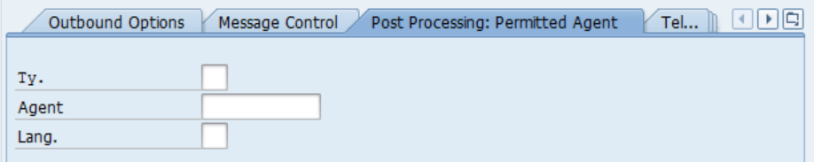

***Figura-19*** *Pestaña Tratamiento Posterior*

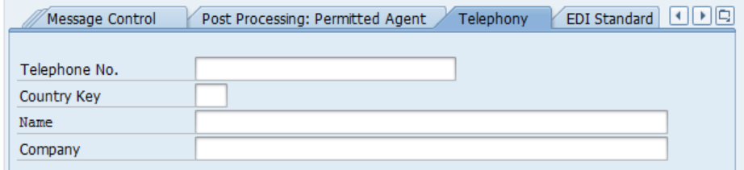

***Figura-20*** *Pestaña Telefonía*

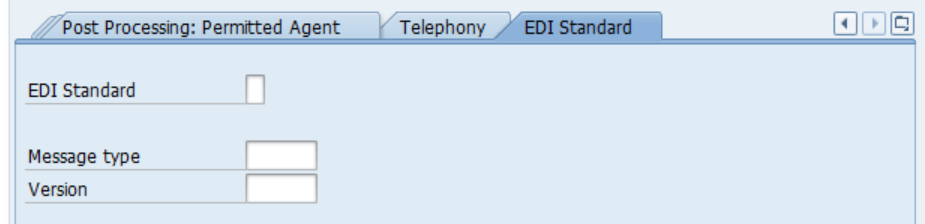

***Figura-21*** *Pestaña Estándar EDI.*

Una vez que se ha configurado esta parte, el siguiente paso es configurar el *DISTRIBUTION MODEL*; esto se hace en la transacción **BD64.** Al entrar a esta transacción se muestra una pantalla como la que se ilustra en la Figura-22.

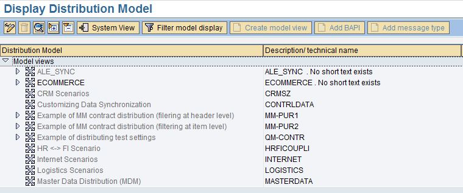

***Figura-22*** *Pantalla Inicial de la Transacción BD64:* *Modelo de Distribución.*

A continuación, se debe presionar el botón 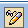 para cambiar al modo de modificación y posteriormente se presiona el botón ; con esto aparece una pantalla como la que se muestra en la Figura-23.

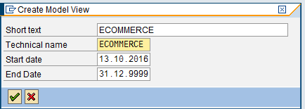

***Figura-23*** *Pantalla para crear la Definición del Modelo de Distribución, transacción BD64.*

A continuación, el siguiente paso consiste en ir agregando los mensajes tomados de la tabla de la Figura-16; aquí se debe tener cuidado sobre cuál es el sistema fuente y cuál el sistema destino, porque en el caso de los mensajes OUTBOUND, como en este caso, el sistema Fuente es el sistema lógico que pertenece a SAP en el mandante en que se está trabajando, y el sistema destino debe ser E-COMMERCE, puesto que esa información tiene como destino final ese ambiente. Para agregar los mensajes a la transacción BD64 de la Figura-22, presione el botón 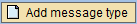 y a continuación llene los campos con los siguientes datos:

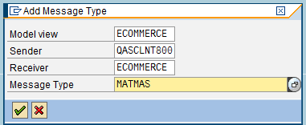

***Figura-24*** *Creando el tipo de Mensaje MATMAS para Enviar Maestro de Materiales de SAP a ECOMMERCE usando la transacción BD64.*

A continuación, se hace algo similar para todos los demás mensajes tomando como base la tabla de la Figura-16, y así se obtiene una vista de modelo (Model View) para ONIBEX E-COMMERCE B2B DATA MODEL semejante a la mostrada en la Figura-25.

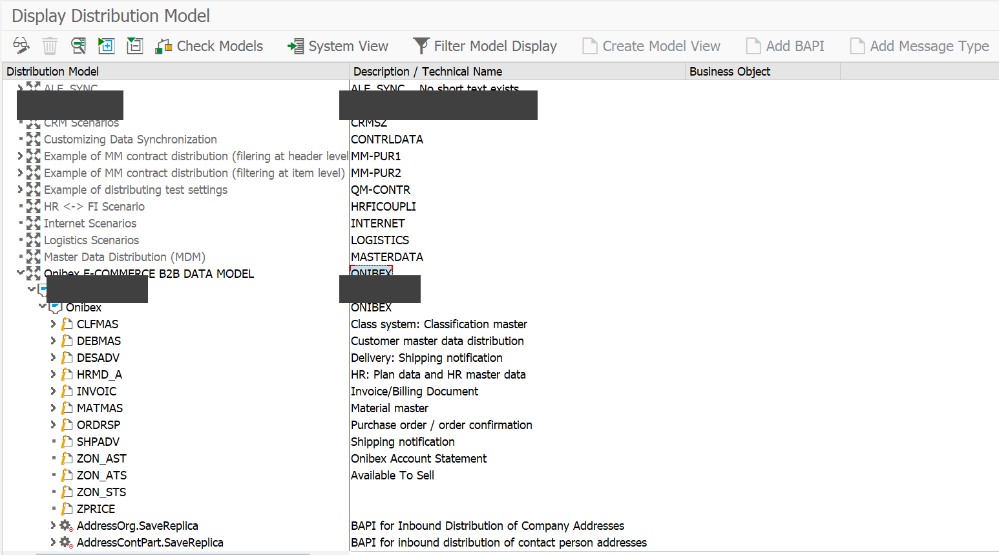

**Figura-25** Mensajes para los IDocs ***Outbound*** en el Modelo de Distribución de la transacción BD64.

En esta parte del DATA MODEL es donde se pueden establecer FILTROS para poder discriminar sobre ciertas estructuras organizacionales y tipos de registros; por ejemplo, si dentro del mensaje MATMAS se abre esa sección, se encontrará un apartado que indica que no se ha fijado ningún filtro. Para que aparezcan los atributos del filtro, presione el botón 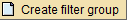 como se muestra en la Figura-26.

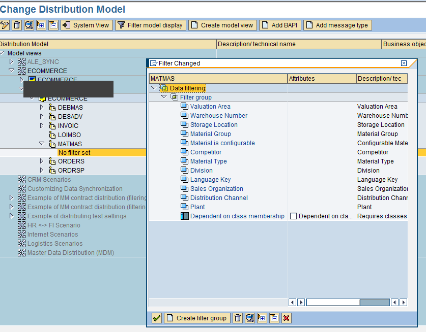

***Figura-26*** *Estableciendo un Filtro para el IDoc MATMAS en la transacción BD64.*

Para poder especificar los valores que ha de tener cada uno de esos campos, solo es cuestión de dar doble clic con el botón izquierdo del mouse para entrar a la pantalla que se ilustra en la Figura-27.

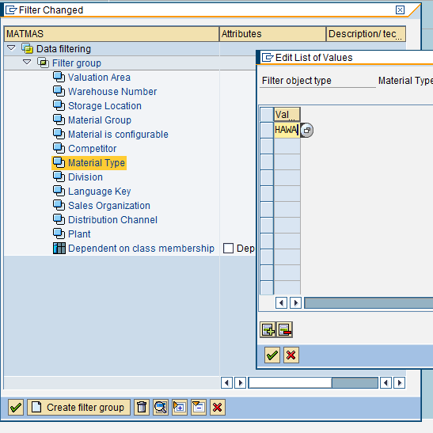

***Figura-27*** *Colocando valores al Filtro del Maestro de Materiales usando la transacción BD64.*

Cabe señalar que, del inventario, de los tipos de materiales que se consideran para las ventas, ONIBEX toma únicamente el tipo HAWA.

Finalmente, el último paso consiste en mandar los registros al sistema destino; para esta tarea se debe utilizar la transacción **BD10 ENVÍO DE MATERIALES.**

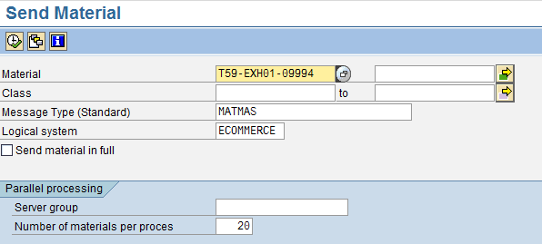

***Figura-28*** *Pantalla de la transacción BD10 para mandar Materiales al catálogo del sistema Ecommerce*

Al dar clic en la marca de verificación de la transacción BD10 de la Figura-28, el sistema SAP va a generar un IDoc por cada número de material. El sistema va a mostrar los siguientes mensajes para confirmar que se está mandando la información de materiales.

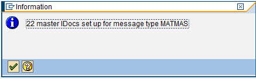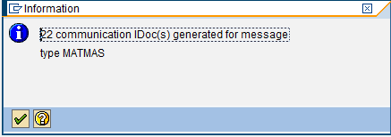

***Figura-29*** *Mensajes que da el sistema al procesar los IDocs usando la transacción BD10.*

Los anteriores IDocs de la Figura-29 se pueden ver desde la transacción **WE02**, y si están en color verde significa que se transmitieron de manera correcta, tal y como se aprecia en la Figura-30.

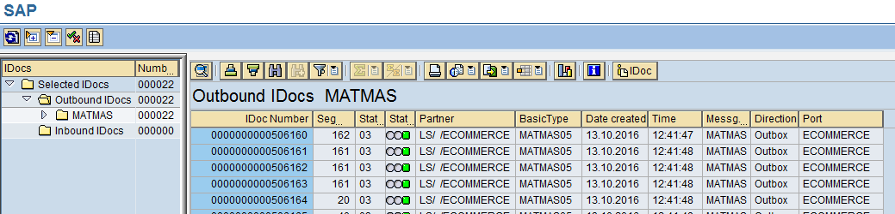

***Figura-30*** *IDocs* ***Outbound*** *MATMAS procesados correctamente y vistos por la transacción WE02.*

← Anterior: [Configuración de los punteros de modificación (change pointers)](../02-ale-foundations/05-change-pointers.md) · Siguiente: [Configuración del IDoc DEBMAS (maestro de clientes)](../03-master-data-idocs/02-debmas-idoc.md) →

---

© 2026 Onibex, LLC · Licenciado bajo [CC BY-NC-ND 4.0](../../../LICENSE) (SPDX: CC-BY-NC-ND-4.0) · [Licencia comercial](../../../COMMERCIAL-LICENSE.md) · [Marcas y avisos de terceros](../../../THIRD-PARTY-NOTICES.md) · SAP y los demás productos y servicios SAP mencionados son marcas comerciales o marcas registradas de SAP SE o de una empresa afiliada a SAP en Alemania y otros países; los nombres se usan solo con fines de identificación.
