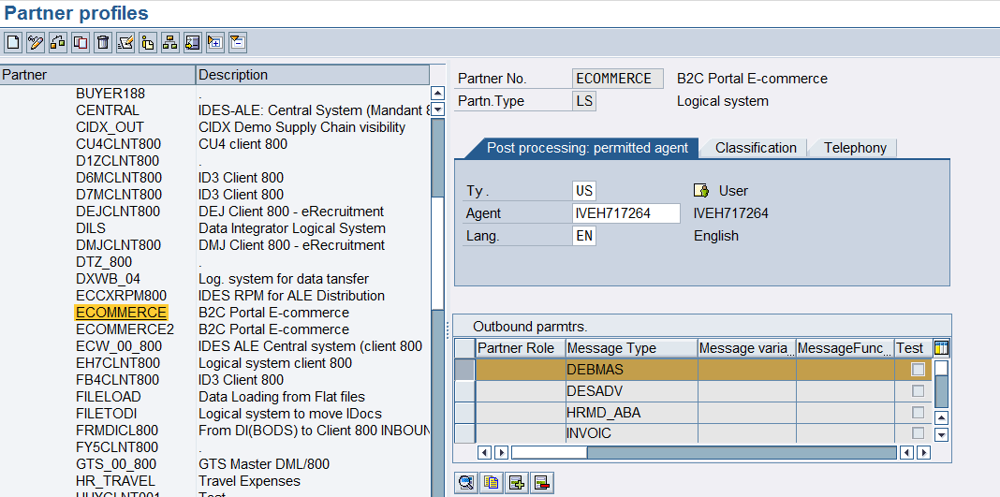
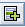
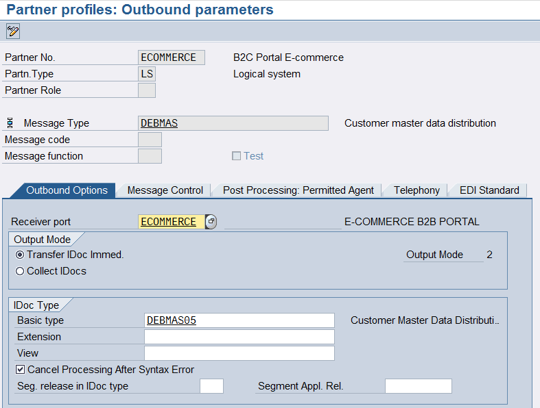
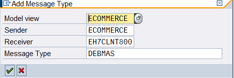
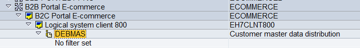
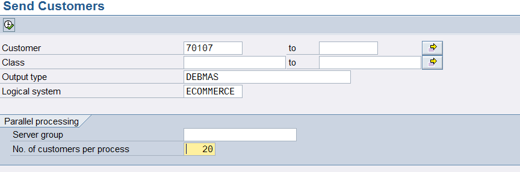
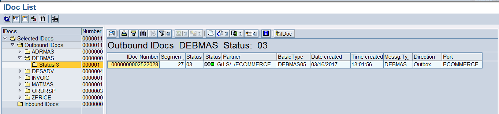
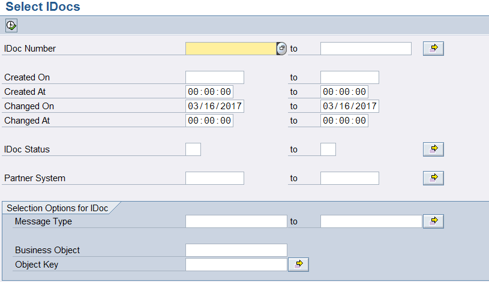

<!-- SPDX-License-Identifier: CC-BY-NC-ND-4.0 -->
<!-- Copyright (c) 2026 Onibex, LLC. Part of the Onibex eCommerce 360° Documentation — https://github.com/Onibex/ecommerce-docs -->

[English](../../../en/technical-documents/03-master-data-idocs/02-debmas-idoc.md) · **Español** | [↑ Índice de documentos técnicos](../README.md) | [README del repositorio](../../../README.md)

# Configuración del IDoc DEBMAS (maestro de clientes)

> **Fuente:** versión en español del artículo “7. DEBMAS iDoc configuration” del Help Center de Onibex — <https://help.onibex.com/portal/en/kb/articles/debmas-idoc-configuration>; redacción tomada del capítulo D.4.b de la especificación funcional “D1 – Integración de sistemas”.

Como se ha discutido con anterioridad a través de la tabla de la Figura-16, en el IDoc **DEBMAS** se encuentran los datos maestros de los clientes. Inicialmente, este IDoc se configura también dentro de la transacción **WE20**, *Partner Profiles*, al agregar un tipo de mensaje nuevo como se ilustra en la Figura-31.

***Figura-31*** *Agregando el Message Type DEBMAS para Partner Type LS Logical System Ecommerce.*

Para agregar este mensaje solamente hay que presionar el icono  y con eso se va a abrir la pantalla que se ve en la Figura-32.

En la pantalla de la Figura-32 se debe colocar el *Message type* ***DEBMAS***; dentro del *Receiver port* coloque **ECOMMERCE** y, dentro del campo *Basic type*, coloque la entrada **DEBMAS05.**

***Figura-32*** *Creando el IDoc para Maestro de Clientes a través de la transacción WE20.*

Las demás pantallas de este IDoc deben quedar vacías.

Siguiendo el procedimiento estándar, se debe ir a la transacción BD64 para colocar una entrada en el Modelo de Distribución; en esta sección se podría considerar o no la configuración de algún filtro para los clientes que se cargarán a la base de datos del portal de E-Commerce:

***Figura-33*** *Entrada en la transacción BD64 para el Modelo de Distribución*

Para poder procesar los clientes y mandarlos al sistema destino, se debe entrar a la transacción **BD12** como se muestra en la siguiente figura:

***Figura-34*** *Pantalla de la transacción BD12 para el envío de la información de clientes al sistema destino Ecommerce.*

Una vez que se manda la información, se puede entrar a la transacción **WE02** para verificar si los mensajes se procesaron, tal y como se muestra en la Figura-35.

***Figura-35*** *Pantalla de la transacción* ***WE02*** *donde se puede conocer si los IDocs fueron procesados de manera exitosa.*

Si algún mensaje se llegara a encontrar con un semáforo en amarillo, se tendría que ir a la transacción **BD87** para poder reprocesar ese IDoc. Esta es la pantalla de esa transacción:

***Figura-36*** *Pantalla de selección de la transacción* ***BD87*** *para procesar IDocs en amarillo.*

← Anterior: [Configuración del IDoc MATMAS (maestro de materiales)](../03-master-data-idocs/01-matmas-idoc.md) · Siguiente: [Configuración del IDoc para crear cotizaciones (quotations) SD](../04-sales-document-idocs/01-quotation-idoc.md) →

---

© 2026 Onibex, LLC · Licenciado bajo [CC BY-NC-ND 4.0](../../../LICENSE) (SPDX: CC-BY-NC-ND-4.0) · [Licencia comercial](../../../COMMERCIAL-LICENSE.md) · [Marcas y avisos de terceros](../../../THIRD-PARTY-NOTICES.md) · SAP y los demás productos y servicios SAP mencionados son marcas comerciales o marcas registradas de SAP SE o de una empresa afiliada a SAP en Alemania y otros países; los nombres se usan solo con fines de identificación.
