<!-- SPDX-License-Identifier: CC-BY-NC-ND-4.0 -->
<!-- Copyright (c) 2026 Onibex, LLC. Part of the Onibex eCommerce 360° Documentation — https://github.com/Onibex/ecommerce-docs -->

[English](../../../en/technical-documents/04-sales-document-idocs/01-quotation-idoc.md) · **Español** | [↑ Índice de documentos técnicos](../README.md) | [README del repositorio](../../../README.md)

# Configuración del IDoc para crear cotizaciones (quotations) SD

> **Fuente:** versión en español del artículo “8. Setting up the iDoc to create SD QUOTATIONS” del Help Center de Onibex — <https://help.onibex.com/portal/en/kb/articles/setting-up-the-idoc-to-create-sd-quotations>; redacción tomada del capítulo D.4.c de la especificación funcional “D1 – Integración de sistemas”.

De manera estándar, SAP no soporta la creación de documentos de cotización dentro del módulo SD, por lo que se tiene que hacer un IDoc **Z** basado en el tipo básico de mensaje ORDERS05. Este tipo de mensaje es procesado por un programa (llamado “*Función ZIDOC_INPUT_QUOTATION*”) -escrito en el Workbench de ABAP- para ser procesado por SAP como tipo de documento **QT**. Este tipo de documento QT es el que a final de cuentas se utiliza para poder generar documentos de ventas de tipo cotización. Aquí la diferencia es que el tipo de documento es QT y no OR. Además, la cotización en SAP necesita que se le indique un rango de fechas para la vigencia que tendrá ese documento de ventas, por eso se debe definir este IDoc de manera semejante a los que se presentaron anteriormente en la tabla de la Figura-16.

La cotización es un documento preliminar que sirve para formalizar una posible transacción de ventas y, además, es la única manera de poder mantener al cliente los precios de los productos, sobre todo si sus precios cambian constantemente, siempre y cuando el periodo de vigencia siga vivo. Si este ya expiró, no se podrá generar una orden de venta con referencia a ese documento y será necesario procesar un nuevo documento de venta.

Es conveniente que el número del carrito de cotización que es generado desde el ECommerce sea guardado en el campo de número de PO (Orden de Compra: “*Purchasing Order*”) de SAP, y una vez que se cree la orden de venta para tal cliente se tengan ambos números: el del carrito, el de la cotización y el de la Orden de Compra generado desde el ECommerce en el mismo campo de registro.

Para configurar todo este nuevo tipo de mensaje, lo primero es entrar a la transacción **WE81: CREATE MESSAGE TYPES** para crear una entrada ZQUOTATION:

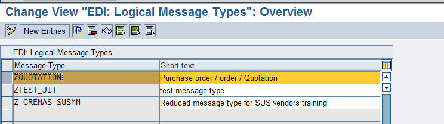

**Figura-37** Pantalla de la transacción **WE81** para definir el mensaje de entrada para Reservas.

Lo que sigue es entrar a la transacción **WE82: IDOC TYPE- MESSAGE TYPE COMBINATION** para crear una combinación del mensaje ZQUOTATION con el tipo de IDoc ORDERS05:

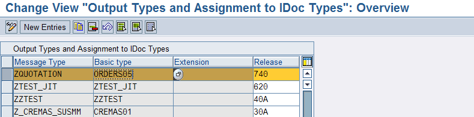

**Figura-38** Pantalla de la transacción **WE82** para relacionar el mensaje de entrada para Reservas.

A continuación, se entra a la transacción **WE42: Inbound Process Code** para crear una entrada que posteriormente se relacionará con la función ZIDOC_INPUT_QUOTATION para poder crear este documento de tipo QT.

Cabe señalar que tal función ZIDOC_INPUT_QUOTATION es escrita en el lenguaje de programación ABAP, que es el lenguaje propio de SAP y que se escribe inicialmente en un ambiente de desarrollo Workbench. Para mover tales tipos de programas, como la función ZIDOC_INPUT_QUOTATION, de un ambiente SAP de Desarrollo, DEV, a uno de pruebas de calidad, QAS, se genera una orden de transporte.

Regresando a la transacción WE42, su pantalla de configuración principal se muestra en la Figura-39.

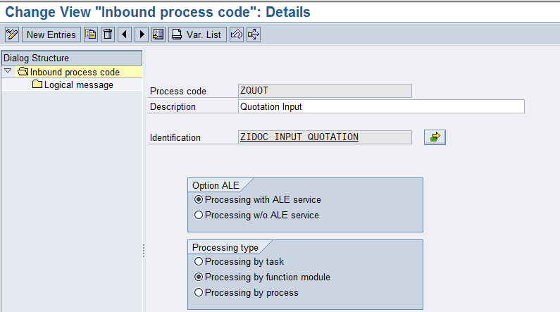

**Figura-39** Pantalla de la transacción **WE42** de procesamiento de mensajes de entrada para Reservas a través de la función ZIDOC_INPUT_QUOTATION.

La función para crear las cotizaciones es la siguiente:

```
FUNCTION ZIDOC_INPUT_QUOTATION.
*"----------------------------------------------------------------------
*"*"Local Interface:
*"  IMPORTING
*"     VALUE(INPUT_METHOD) LIKE  BDWFAP_PAR-INPUTMETHD
*"     VALUE(MASS_PROCESSING) LIKE  BDWFAP_PAR-MASS_PROC
*"  EXPORTING
*"     VALUE(WORKFLOW_RESULT) LIKE  BDWFAP_PAR-RESULT
*"     VALUE(APPLICATION_VARIABLE) LIKE  BDWFAP_PAR-APPL_VAR
*"     VALUE(IN_UPDATE_TASK) LIKE  BDWFAP_PAR-UPDATETASK
*"     VALUE(CALL_TRANSACTION_DONE) LIKE  BDWFAP_PAR-CALLTRANS
*"     VALUE(DOCUMENT_NUMBER) LIKE  VBAK-VBELN
*"  TABLES
*"      IDOC_CONTRL STRUCTURE  EDIDC
*"      IDOC_DATA STRUCTURE  EDIDD
*"      IDOC_STATUS STRUCTURE  BDIDOCSTAT
*"      RETURN_VARIABLES STRUCTURE  BDWFRETVAR
*"      SERIALIZATION_INFO STRUCTURE  BDI_SER
*"      EDI_TEXT STRUCTURE  EDIORDTXT1 OPTIONAL
*"      EDI_TEXT_LINES STRUCTURE  EDIORDTXT2 OPTIONAL
*"----------------------------------------------------------------------
*{   INSERT         EH7K900900                                        1
*ENHANCEMENT-POINT IDOC_INPUT_ORDERS_G1 SPOTS ES_SAPLVEDA.

*  LOOP AT idoc_contrl.--
* SET/GET Parameter und interne Tabellen neu initialisieren
* initialize SET/GET Parameter and internal tables
*   PERFORM initialize_organizational_data.
**   PERFORM zinitialize_organizational_dat.
*** IDOC-Segmente in die entsprechenden Anwendungsdaten übernehmen
*** Move IDOC to internal tables
***    PERFORM interpret_idoc_orders.
**    PERFORM zinterpret_idoc_orders TABLES IDOC_DATA.
*** Prüfen ob gewisse Segmente gefüllt sind
*** check IDOC-Segments
**    PERFORM check_idoc_segments.
*** Prüfen und Ermitteln von Organisationsdaten
*** check internal tables and determine organization data
**    PERFORM check_idoc_orders.
*** Prüfen und Ermitteln von Konfigurationsdaten
*** check internal tables and determine configuration order data
**    PERFORM check_configuration.
*** ermitteln Partner für Auftrag
*** determine partner
**    PERFORM determine_partner.
*** ermitteln Positionstyp
*** determine item type
**    PERFORM determine_postyp.
*** ermitte-ln Texte
*** determine texts
**    PERFORM check_text.
*** exportieren Posguid ins globale Memory
*** export posguid to global memory
**    PERFORM check_posguid.
*** vergleichen errtab mit Ausnahmetabelle WFMCMSGENQ
*** compare ERRTAB with message table WFMCMSGENQ
**    PERFORM errorhandling TABLES errtab.
*** abschliessendes Bearbeiten der internen Fehlertabelle.
*** final coding to change the internal ERRTAB
**    CALL CUSTOMER-FUNCTION '011'
**         EXPORTING
**              dxvbak  = xvbak
**              docnum  = idoc_contrl-docnum
**         TABLES
**              derrtab = errtab
**              dxvbap  = xvbap
**              dxvbep  = xvbep
**              dxvbadr = xvbadr
**              dxvbpa  = xvbpa
**              dxvbuv  = xvbuv
**              dedidc  = idoc_contrl
**              dedidd  = idoc_data
**              dxkomv  = xkomv
**              dxvekp  = xvekp
**              dyvekp  = yvekp.
**    DESCRIBE TABLE errtab LINES anzahl.
**
**ENDLOOP.

DATA :
        V_DOC     TYPE VBELN,
        v_index   TYPE sy-tabix,
        v_ind2    TYPE sy-tabix,
        W_HEADER  TYPE BAPISDHD1,
        W_PART    TYPE BAPIPARNR,
        W_control TYPE EDIDC,
        I_PART    TYPE TABLE OF BAPIPARNR,
        W_ITEM    TYPE BAPISDITM,
        I_ITEM    TYPE TABLE OF BAPISDITM,
        W_SCHED   TYPE BAPISCHDL,
        I_SCHED   TYPE TABLE OF BAPISCHDL,
        W_RETURN  TYPE BAPIRET2,
        I_RETURN  TYPE TABLE OF BAPIRET2,
        W_EDD     TYPE EDIDD,
        W_ED2     TYPE EDIDD,
        w_stat    TYPE EDI_DS,
        W_K01     TYPE E1EDK01,
        W_K02     TYPE E1EDK02,
        W_K03     TYPE E1EDK03,
        W_K14     TYPE E1EDK14,
        W_KA1     TYPE E1EDKA1,
        W_p01     TYPE E1EDp01,
        W_p19     TYPE E1EDp19,
        v_plant   TYPE werks_d.

READ TABLE idoc_contrl into w_control INDEX 1.

  LOOP AT IDOC_DATA INTO W_EDD.
    v_index = sy-tabix.
*  move:  x_vbak.
    CASE W_EDD-SEGNAM.
      WHEN 'E1EDK01'.
        MOVE W_EDD-SDATA TO W_K01.
        W_HEADER-DOC_TYPE     = 'AG'.
        W_HEADER-PMNTTRMS     = W_K01-zterm.
        W_HEADER-CURRENCY     = W_K01-CURCY.
        w_header-INCOTERMS1   = 'FOB'.
        w_header-INCOTERMS2   = 'FREE ON BOARD'.
      WHEN 'E1EDK02'.
        MOVE W_EDD-SDATA TO W_K02.
        W_HEADER-PURCH_NO_C   = W_K02-belnr.
        W_HEADER-PO_DAT_S     = W_K02-datum.
      WHEN 'E1EDK03'.
        MOVE W_EDD-SDATA TO W_K03.
        case w_k03-iddat.
          when '001'.
             w_header-QT_VALID_F   = w_k03-datum.
          when '002'.
             w_header-QT_VALID_t   = w_k03-datum.
        endcase.
      WHEN 'E1EDK14'.
        MOVE W_EDD-SDATA TO W_K14.
        case w_k14-QUALF.
          WHEN '005'.
            v_plant = w_k14-orgid.
          WHEN '006'.
            w_header-DIVISION = w_k14-orgid.
          WHEN '007'.
            w_header-DISTR_CHAN = w_k14-orgid.
          WHEN '008'.
            w_header-SALES_ORG = w_k14-orgid.
        endcase.
      WHEN 'E1EDKA1'.
        MOVE W_EDD-SDATA TO W_KA1.
        CASE W_KA1-PARVW.
          WHEN 'AG'.
            W_PART-partn_role = 'AG'.
            W_PART-PARTN_NUMB = w_ka1-partn.
            APPEND w_part to i_Part.
          WHEN 'WE'.
            W_PART-partn_role = 'WE'.
            W_PART-PARTN_NUMB = w_ka1-partn.
            APPEND w_part to i_Part.
          WHEN 'RG'.
            W_PART-partn_role = 'RG'.
            W_PART-PARTN_NUMB = w_ka1-partn.
            APPEND w_part to i_Part.
          WHEN 'RE'.
            W_PART-partn_role = 'RE'.
            W_PART-PARTN_NUMB = w_ka1-partn.
            APPEND w_part to i_Part.
         ENDCASE.
      WHEN 'E1EDP01'.
        MOVE W_EDD-SDATA TO W_P01.
        V_IND2 = V_INDEX + 1.
        READ TABLE IDOC_DATA INTO W_ED2 INDEX V_IND2.
        MOVE W_ED2-SDATA TO W_P19.
        W_ITEM-ITM_NUMBER   =  W_P01-POSEX.
        W_ITEM-MATERIAL     =  W_P19-IDTNR.
        W_ITEM-PART_DLV     =  'C'.
        W_ITEM-PLANT        =  V_PLANT.
        W_ITEM-SHIP_POINT   =  V_PLANT.
        W_ITEM-STORE_LOC    =  '0001'.
        W_ITEM-TARGET_QTY   =  W_P01-MENGE.
        W_ITEM-TARGET_QU    =  W_P01-MENEE.
        W_ITEM-ITEM_CATEG   =  'AGN'.
        W_ITEM-PMNTTRMS     =  W_HEADER-PMNTTRMS.
        w_ITEM-INCOTERMS1   = 'FOB'.
        w_ITEM-INCOTERMS2   = 'FREE ON BOARD'.
        w_SCHED-ITM_NUMBER  = W_P01-POSEX.
        w_SCHED-SCHED_LINE  = '0001'.
        w_SCHED-REQ_DATE    = SY-DATUM.
        w_SCHED-REQ_QTY     = W_P01-MENGE.
        w_SCHED-SCHED_TYPE  = 'BN'.
        APPEND W_ITEM TO I_ITEM.
        APPEND W_SCHED TO I_SCHED.
    ENDCASE.
  ENDLOOP.

CALL FUNCTION 'BAPI_QUOTATION_CREATEFROMDATA2'
  EXPORTING
    QUOTATION_HEADER_IN            =  W_HEADER
  IMPORTING
    SALESDOCUMENT                  =  V_DOC
  TABLES
    RETURN                         =  I_RETURN
    QUOTATION_ITEMS_IN             =  I_ITEM
    QUOTATION_PARTNERS             =  I_PART
    QUOTATION_SCHEDULES_IN         =  I_SCHED.
if v_doc is NOT INITIAL.
  CALL FUNCTION 'BAPI_TRANSACTION_COMMIT'
    EXPORTING
      WAIT          = 'X'.

*  MOVE v_idoc

 w_stat-DOCNUM    = w_control-docnum.
 w_stat-status    = '53'.
 w_stat-LOGDAT    = sy-datum.
 w_stat-LOGtim    = sy-uzeit.
 concatenate 'Quotation #' v_doc 'Created' into w_stat-STATXT SEPARATED BY space.

CALL FUNCTION 'EDI_DOCUMENT_STATUS_SET'
  EXPORTING
    document_number               = w_control-docnum
    idoc_status                   = w_stat.

ENDIF.
*****
*****    IF anzahl GT 0 AND input_method = 'X'.
*****      EXPORT errtab TO MEMORY ID 'idoc_test_errtab'.
*****    ENDIF.
*****
*****    IF anzahl GT  0  AND
*****       xaprau EQ 'D'.
****** Bei der Anlage von Auslieferungsaufträgen dienen Meldungen bzgl.
****** Lieferplänen mit Absagegrund nur der Information: Sie dürfen
****** nicht zum Abbruch der IDoc-Verarbeitung führen.
******                When creating delivery orders messages regarding
****** scheduling agreement with 'reason for rejection' are only for
****** information: They must not force the idoc integration to fail.
*****      LOOP AT errtab WHERE arbgb EQ 'VG' AND
*****                           msgnr EQ '219'.
*****        anzahl = anzahl - 1.
*****      ENDLOOP.
*****      IF anzahl EQ 0.
*****        REFRESH errtab.
*****      ENDIF.
*****    ENDIF.
*****    IF anzahl NE 0
*****     AND input_method IS INITIAL.
*****      PERFORM determine_user.
*****      PERFORM statusrecord TABLES errtab.
****** Userexit zum Ändern der Statustabelle
****** User exit to change the status table
*****      CALL CUSTOMER-FUNCTION '010'
*****           EXPORTING
*****                docnum      = idoc_contrl-docnum
*****           TABLES
*****                derrtab     = errtab
*****                xbdidocstat = idoc_status.
*****    ELSE.
*****      IF check_orga IS INITIAL.
*****
****** EDI Kennzeichen für Sonderprüfungen innerhalb anderer Anwendungen als
****** Folge der Auftragsbearbeitung.
****** EDI checkmark for other applications processed during order creation.
*****        PERFORM edi_mode_to_mem.
*****************************************************************************
****** Aufruf Transaktion Auftragerfassung VA01                             *
****** call transaction Order Entry VA01                                    *
*****************************************************************************
*****        CASE xaprau.
*****          WHEN ' '.
*****            PERFORM call_va01_new_orders USING ok.
*****          WHEN 'Q'.
****** Aufruf Transaktion Auftragerfassung VA01 mit Bezug auf Angebot
****** call transaction Order Entry VA01 with refer to quote number.
*****            PERFORM call_va01_new_orders_angbt USING ok.
*****          WHEN 'C'.
****** Aufruf Transaktion Auftragerfassung VA01 mit Bezug auf Kontrakt
****** call transaction Order Entry VA01 with refer to contract number
*****            PERFORM call_va01_new_orders_contk USING ok.
*****          WHEN 'L'.
****** Aufruf Transaktion Auftragerfassung für Auftragsarten mit Vertiebs-
****** belegtypen D,G,K,L
****** call transaction Order Entry VA01 for order types with
****** SD document category D,G,K,L
*****            PERFORM call_va01_new_orders_cremo USING ok.
*****          WHEN 'R'.
****** Aufruf Transaktion Auftragerfassung für Auftragsarten mit Vertiebs-
****** belegtypen H (z.B. Konsigantionsretoure)
****** call transaction Order Entry VA01 for order types with
****** SD document category H (for example consingment return)
*****            PERFORM call_va01_new_orders_return USING ok.
*****          WHEN 'D'.
****** Aufruf Transaktion Auftragerfassung für Auslieferungsauftrag
****** call transaction Order Entry VA01 for delivery order
*****            PERFORM call_va01_new_orders_delord USING ok.
*****          WHEN 'K'.
****** Aufruf Transaktion Auftragerfassung für Anlegen mit Bezug auf
****** Positionsebene (Anlegen mit Bezug zum Angebot/Kontrakt)
****** call transaction Order Entry VA01 for delivery order
*****            PERFORM call_va01_new_orders_refer USING ok.
*****        ENDCASE.
****** Zusätzliche Aktionen nach call transaction VA01
****** additional checks after call transaction VA01
*****        CALL CUSTOMER-FUNCTION '003'
*****          EXPORTING
*****            sales_document = belegnummer
*****            docnum         = idoc_contrl-docnum
*****          TABLES
*****            didoc_data      = idoc_data
*****            dbdcmsgcoll     = xbdcmsgcoll
*****          CHANGING
*****            status         = ok.
*****
****** Löschen des EDI-Kennzeichens im Memory / delete EDI-checkmark from
****** memory
*****        PERFORM edi_mode_delete_mem.
*****
*****      ENDIF.
*****
****** füllen IDOC_Status
****** fill IDOC_Status
*****      IF ok = space.
*****        idoc_status-docnum = idoc_contrl-docnum.
*****        idoc_status-status = beleg_nicht_gebucht.
*****        IF check_orga = 'X'.
*****          idoc_status-msgty  = 'E'.
*****          idoc_status-msgid  = 'VG'.
*****          idoc_status-msgno  = '204'.
*****          idoc_status-msgv1  = xvbak-kunnr.
*****          idoc_status-msgv2  = lieferant.
*****          APPEND idoc_status.
*****        ELSE.
*****          idoc_status-msgty  = sy-msgty.
*****          idoc_status-msgid  = sy-msgid.
*****          idoc_status-msgno  = sy-msgno.
*****          idoc_status-msgv1  = msgv1.
*****          idoc_status-msgv2  = msgv2.
*****          idoc_status-msgv3  = msgv3.
*****          idoc_status-msgv4  = msgv4.
*****          APPEND idoc_status.
*****        ENDIF.
*****      ELSE.
*****        call_transaction_done = 'X'.
*****
******- Übergabe  BUS für Verknüpfungssätze --------------------------------*
******- set object type for the link ---------------------------------------*
******       if not object_type is initial.
******        return_variables-doc_number = object_type.
******        append return_variables.
******       endif.
******- Wenn Texte geschrieben werden muss nochmals ein Commit abgesetzt ---*
******- werden. Das Hilfsfeld CALL-TRANSACTION_DONE bewirkt, dass dieser ---*
******- Commit nicht von der ALE-Schicht abgesetzt wird, da der Commit von -*
******- Transaktion abgesetzt wurde ----------------------------------------*
*****        IF xe1edkt2 NE space OR
*****           xe1edpt2 NE space.
*****          COMMIT WORK.
*****        ENDIF.
****** Belegnummer in die Schnittstelle zurückgeben für Textworkflow
****** send document number back for textworkflow
*****        document_number = belegnummer.
*****      ENDIF.
*****      CLEAR msgv1.
*****      CLEAR msgv2.
*****      CLEAR msgv3.
*****      CLEAR msgv4.
*****    ENDIF.
*****
****** setzen Workflow Ausgangsparameter
****** Allocate IDOC numbers to Workflow output parameters
*****    IF ok = space.
*****      return_variables-wf_param = eid.
*****      return_variables-doc_number = idoc_contrl-docnum.
*****      APPEND return_variables.
*****      workflow_result = c_wf_result_error.
*****    ENDIF.
****** Abschließende Aktionen pro Auftrag
****** final checks per order
*****    CALL CUSTOMER-FUNCTION '004'
*****      EXPORTING
*****        sales_document = belegnummer
*****        docnum         = idoc_contrl-docnum
*****      TABLES
*****        didoc_data      = idoc_data
*****        didoc_status    = idoc_status
*****        didoc_cntrl     = idoc_contrl.
*****
*****  ENDLOOP.                             "End loop at idoc_contrl.
*****
******- Clear auf APPLICATION_VARIABLE - nur für Auslieferungsaufträge -----*
******- Clear APPLICATION_VARIABLE  - only for delivery-orders -------------*
*****  PERFORM clear_appl_variable.
******-potentiellen Mailempfänger ermitteln - nur für Auslieferungsaufträge *
******- determine mail receiver - only for delivery-orders -----------------*
*****  PERFORM determine_mail_receiver.
*****
****** Abschließende Aktionen (Massenverarbeitung)
****** final checks (mass processing)
*****  CALL CUSTOMER-FUNCTION '005'
*****    TABLES
*****      didoc_data        = idoc_data
*****      didoc_status      = idoc_status
*****      didoc_cntrl       = idoc_contrl
*****      dreturn_variables = return_variables.
*****
*}   INSERT
ENDFUNCTION.
```

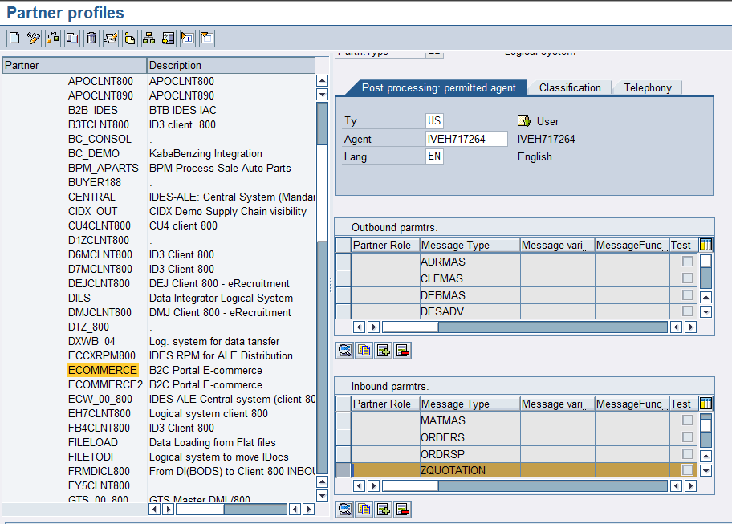

**Figura-40** Pantalla de la transacción **WE20** para agregar el mensaje ZQUOTATION como entrada a SAP desde el portal de ECommerce.

Siguiendo con la configuración basada en los mensajes de la tabla de la Figura-16. En este caso de las Reservas, el siguiente paso consiste en entrar a la transacción **WE20** para agregar dentro de la sección de INBOUND el IDoc **Z** que ha sido definido a través de los pasos de las Figuras 37, 38 y 39. Se da doble clic en el campo del “*Message Type: ZQUOTATION*” para que aparezca la pantalla de la Figura-41.

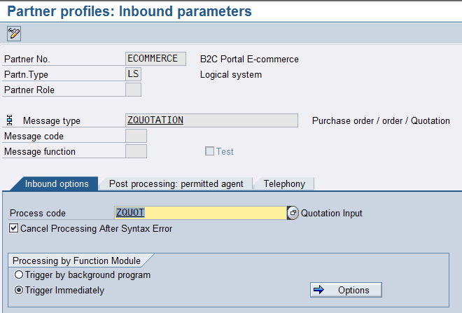

**Figura-41** Pantalla de la sección de **Inbound parameters** de la transacción **WE20** para configurar el “*Message Type: ZQUOTATION*” como entrada de Reservas desde el portal de ECommerce.

Observe cómo en el campo *Process Code* se ha definido una **Z** para usar la BAPI estándar y poder generar el documento QT.

El siguiente paso consiste en alimentar el modelo de distribución para este IDoc, lo cual se hace en la transacción **BD64**.

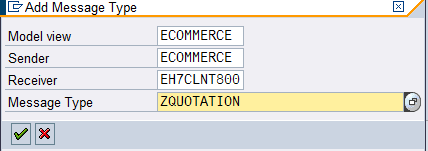

**Figura-42** Pantalla de configuración que se abre al presionar el botón de “Add Message Type” en la transacción **BD64** para definir el Modelo de Distribución del “*Message Type: ZQUOTATION*” como entrada de Reservas desde el portal de ECommerce.

Este último paso, descrito a través de las Figuras 42 y 43, se realiza para todos los tipos de mensajes basados en la tabla de la Figura-16.

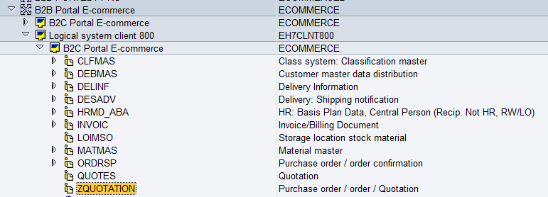

**Figura-43** Pantalla inicial de la transacción **BD64** en la que se ha definido el Modelo de Distribución del “*Message Type: ZQUOTATION*” como entrada de Reservas desde el portal de ECommerce.

Cuando el sistema E-Commerce manda un documento a SAP, en la transacción WE02 se puede ver cómo se creó un IDoc ZQuotation en la parte de **Inbound**, listo para ser procesado:

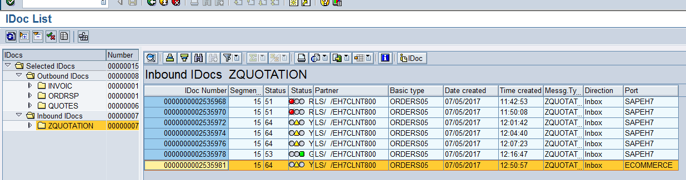

**Figura-44** Pantalla secundaria de la transacción **WE02** en la que se muestran IDocs de entrada “*Message Type: ZQUOTATION*” como documento de Reserva desde el portal de E-Commerce.

En las siguientes imágenes, de las Figuras 45 a 59, se muestra la información que contiene ese IDoc *ZQUOTATION*.

En la imagen de la Figura-45 se observa cómo se selecciona el tipo de documento: QT, las condiciones de pago, la moneda y el número de carrito de la cotización desde el portal de E-Commerce.

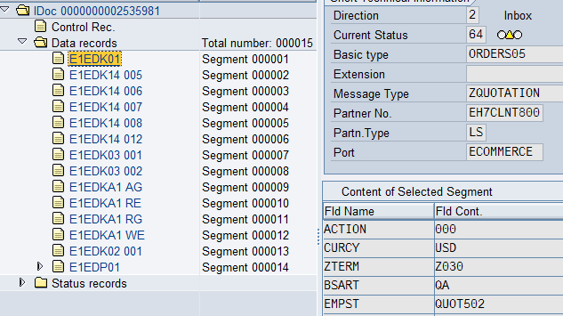

**Figura-45** Pantalla secundaria de la transacción **WE02** en la que se muestra el IDoc *ZQUOTATION* en los campos del segmento correspondiente a la condición de pago, la moneda y el número de carrito de la cotización.

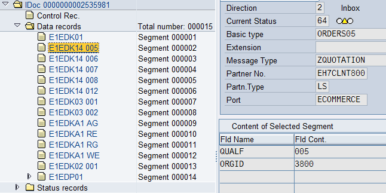

**Figura-46** Pantalla secundaria de la transacción **WE02** en la que se muestra el IDoc *ZQUOTATION* en los campos del segmento correspondiente a la información de la planta.

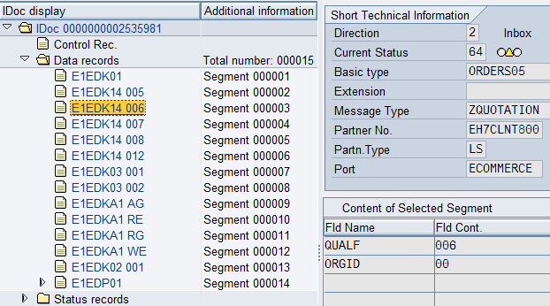

**Figura-47** Pantalla secundaria de la transacción **WE02** en la que se muestra el IDoc *ZQUOTATION* en los campos del segmento correspondiente a la información del sector (División).

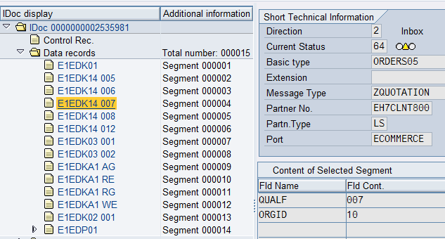

**Figura-48** Pantalla secundaria de la transacción **WE02** en la que se muestra el IDoc *ZQUOTATION* en los campos del segmento correspondiente a la información del *Distribution Channel*.

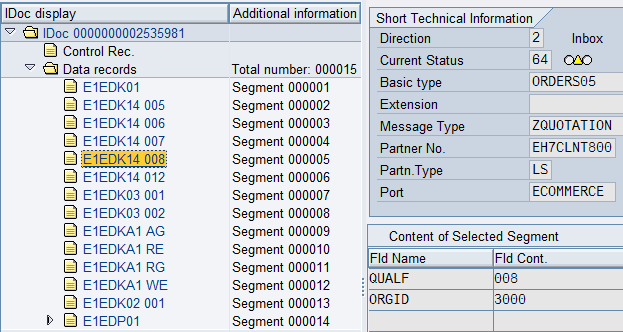

**Figura-49** Pantalla secundaria de la transacción **WE02** en la que se muestra el IDoc *ZQUOTATION* en los campos del segmento correspondiente a la información de la organización de ventas.

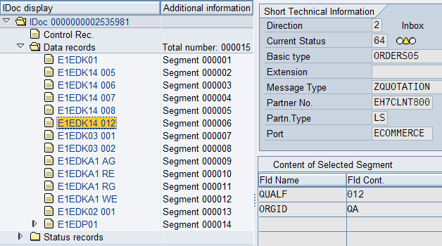

**Figura-50** Pantalla secundaria de la transacción **WE02** en la que se muestra el IDoc *ZQUOTATION* en los campos del segmento correspondiente a la información de la clase de documento.

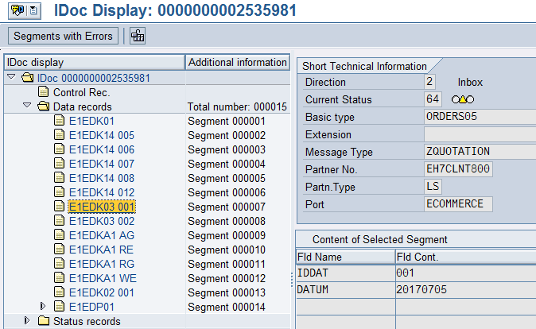

**Figura-51** Pantalla secundaria de la transacción **WE02** en la que se muestra el IDoc *ZQUOTATION* en los campos del segmento correspondiente a la fecha de inicio de la vigencia del documento.

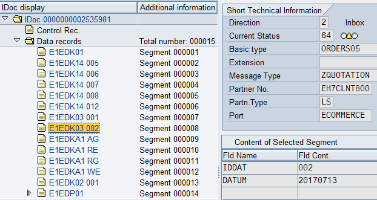

**Figura-52** Pantalla secundaria de la transacción **WE02** en la que se muestra el IDoc *ZQUOTATION* en los campos del segmento correspondiente a la vigencia del documento (fecha hasta la cual la cotización será válida).

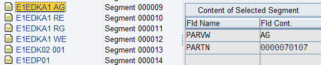

**Figura-53** Pantalla secundaria de la transacción **WE02** en la que se muestra el IDoc *ZQUOTATION* en los campos del segmento correspondiente a la información del interlocutor: solicitante (*Sold-To Party*).

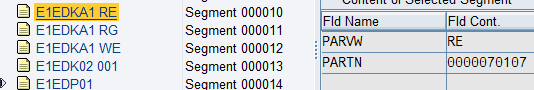

**Figura-54** Pantalla secundaria de la transacción **WE02** en la que se muestra el IDoc *ZQUOTATION* en los campos del segmento correspondiente a la información del interlocutor: destinatario de factura (*Bill-To Party*).

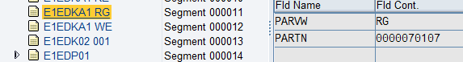

**Figura-55** Pantalla secundaria de la transacción **WE02** en la que se muestra el IDoc *ZQUOTATION* en los campos del segmento correspondiente a la información del interlocutor: pagador (*Payer*).

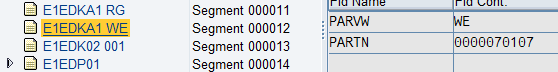

**Figura-56** Pantalla secundaria de la transacción **WE02** en la que se muestra el IDoc *ZQUOTATION* en los campos del segmento correspondiente a la información del interlocutor: destinatario de mercancías (*Ship-To*).

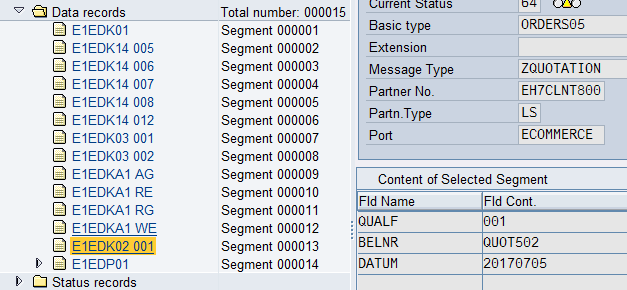

**Figura-57** Pantalla secundaria de la transacción **WE02** en la que se muestra el IDoc *ZQUOTATION* en los campos del segmento correspondiente a la información de la fecha del pedido y el número de la Orden de Compra (PO) del cliente.

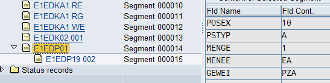

**Figura-58** Pantalla secundaria de la transacción **WE02** en la que se muestra el IDoc *ZQUOTATION* en los campos del segmento correspondiente a la información de la PO: número de partida, cantidad requerida, unidad de medida base y unidad de medida de venta.

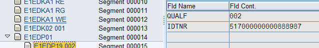

**Figura-59** Pantalla secundaria de la transacción **WE02** en la que se muestra el IDoc *ZQUOTATION* en los campos del segmento correspondiente al número de material.

Cuando se procesa este IDoc en la transacción **BD87**, aparece una pantalla similar a la que se muestra en la Figura-60:

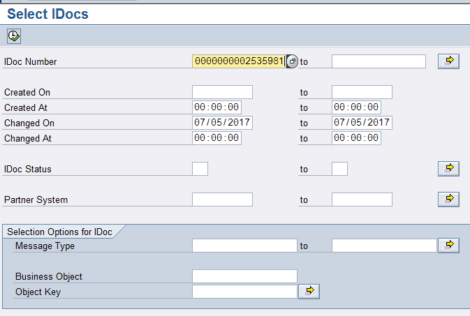

**Figura-60** Pantalla principal de la transacción **BD87** para procesar IDocs en cola de espera.

Al ejecutar esta transacción BD87, aparece una pantalla similar a la de la Figura-61:

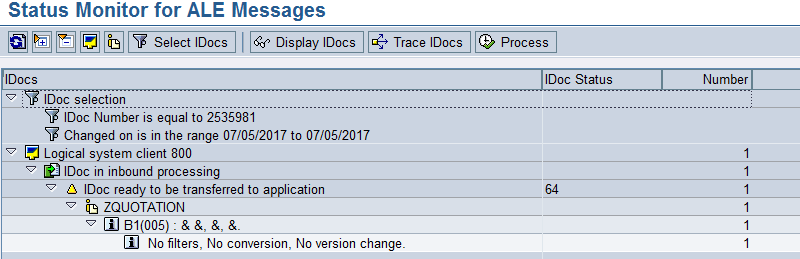

**Figura-61** Pantalla secundaria de la transacción **BD87** con el estatus y flujo del IDoc *ZQUOTATION*.

Presione el botón Process para crear el documento de cotización:

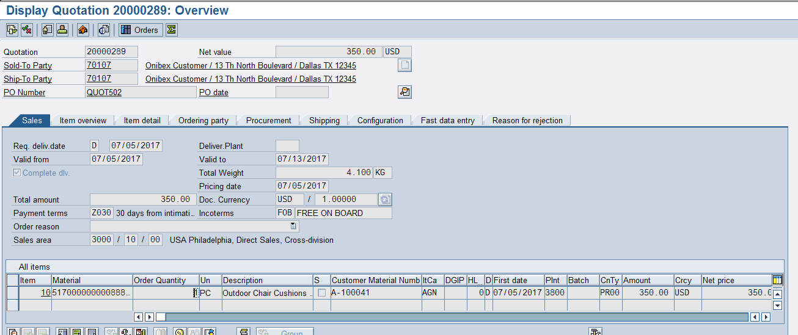

**Figura-62** Pantalla del tipo de documento de cotización que se crea al procesar el IDoc *ZQUOTATION* procedente del portal de E-Commerce.

← Anterior: [Configuración del IDoc DEBMAS (maestro de clientes)](../03-master-data-idocs/02-debmas-idoc.md) · Siguiente: [Configuración del IDoc para confirmar la creación de la cotización](../04-sales-document-idocs/02-quotation-confirmation-idoc.md) →

---

© 2026 Onibex, LLC · Licenciado bajo [CC BY-NC-ND 4.0](../../../LICENSE) (SPDX: CC-BY-NC-ND-4.0) · [Licencia comercial](../../../COMMERCIAL-LICENSE.md) · [Marcas y avisos de terceros](../../../THIRD-PARTY-NOTICES.md) · SAP y los demás productos y servicios SAP mencionados son marcas comerciales o marcas registradas de SAP SE o de una empresa afiliada a SAP en Alemania y otros países; los nombres se usan solo con fines de identificación.
