<!-- SPDX-License-Identifier: CC-BY-NC-ND-4.0 -->
<!-- Copyright (c) 2026 Onibex, LLC. Part of the Onibex eCommerce 360° Documentation — https://github.com/Onibex/ecommerce-docs -->

[English](../../../en/technical-documents/04-sales-document-idocs/02-quotation-confirmation-idoc.md) · **Español** | [↑ Índice de documentos técnicos](../README.md) | [README del repositorio](../../../README.md)

# Configuración del IDoc para confirmar la creación de la cotización

> **Fuente:** versión en español del artículo “9. Setting up the iDOC to confirm zQuote creation” del Help Center de Onibex — <https://help.onibex.com/portal/en/kb/articles/setting-up-the-idoc-to-confirm-zquote-creation>; redacción tomada del capítulo D.4.d de la especificación funcional “D1 – Integración de sistemas”.

Con objeto de que el portal de E-Commerce se entere del número de cotización que ha sido creada en SAP, tenemos que configurar un nuevo mensaje personalizado que llamaremos **ZQEC**. Debemos configurar SAP para que este nuevo tipo de mensaje “**ZQEC**” se active y se genere en el momento de la creación de una cotización tipo QT estándar, como tipo de condición de salida al procesar el IDoc *ZQUOTATION* de la sección anterior. Se configura este tipo de condición de salida para que sea procesado mediante ALE (*Application Link Enabling*) hacia el E-Commerce; así vamos implementando la tabla de parámetros a configurar para los mensajes que se agregan como comunicación con el E-Commerce, tal y como se presentó en la Figura-16.

Para configurar el nuevo tipo de mensaje de salida, comenzamos entrando a la transacción **NACE** para seleccionar la aplicación **V1** y presionar el botón 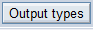. En este primer paso vamos a crear el *output type* ZQEC como una copia del mensaje estándar *AN00*:

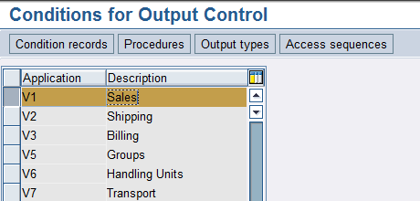

**Figura-63** Pantalla en la que se selecciona el área aplicativa **V1** para documentos de ventas y se presiona el botón de *Output types* para configurar el mensaje **ZQEC** hacia el E-Commerce.

Ya que se copia el *Output type* estándar ***AN00*** en uno personalizado que nombramos ZQEC, hay que asegurarse de tener las mismas entradas de configuración que las mostradas en la Figura-64. En esta Figura-64 hay que destacar el campo *Access sequence* como el adecuado para que el mensaje ZQEC se active como respuesta exclusiva al documento de Ventas creado al procesar el IDoc *ZQUOTATION*.

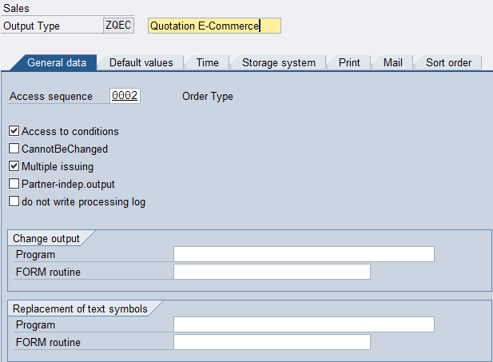

**Figura-64** Primera pantalla de configuración general del *Output Type* ZDEC en la que se define el *Access sequence*.

En las siguientes pestañas de la misma transacción NACE, se configura este tipo de mensaje ZQEC para que, inmediatamente al activarse una cotización con un interlocutor SP (Sold-to-party), se genere una salida por el medio de transmisión ALE (*Application Link Enabling*) hacia el E-Commerce.

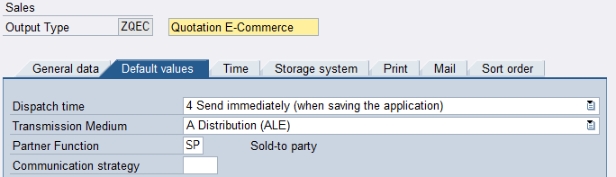

**Figura-65** Pestaña que refina la definición del *Access sequence* para generar una salida ALE.

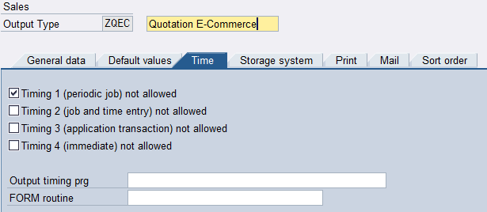

**Figura-66** Pestaña que define la secuencia de tiempo entre la activación del tipo de documento y la generación del mensaje como tipo de condición de salida.

Siguiendo con la secuencia de la misma transacción NACE, tal y como se muestra en la imagen de la Figura-67, del lado derecho, seleccionamos el folder ***Processing Routines*** y debemos asegurarnos de que exista una entrada para el medio de procesamiento A (ALE) que contenga el programa RSNASTED y el *form* *routine* ALE_PROCESSING.

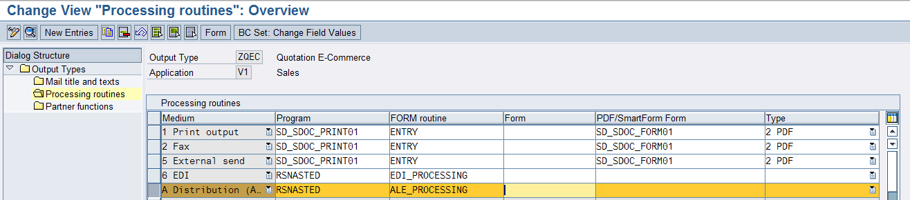

**Figura-67** Selección del folder ***Processing Routines*** dentro de la misma transacción **NACE**.

El siguiente paso, que se muestra en la Figura-68, es seleccionar con doble clic el folder *Partner* *Functions* y asegurarnos de que tengamos una entrada para el medio **A** y el *Partner* *function* **SP**. Esto será utilizado más adelante al crear el *Condition* *Record* para esa clase de mensaje.

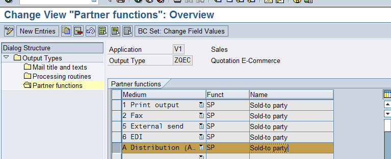

**Figura-68** Selección del folder ***Partner*** ***function*** dentro de la misma transacción **NACE**.

Guardamos la entrada de la Figura-68 y regresamos ahora al menú principal que se muestra en la Figura-69. Siguiendo en el área aplicativa **V1**, entramos ahora a la opción 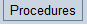:

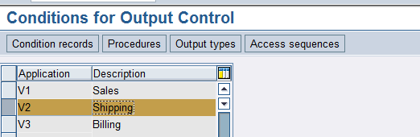

**Figura-69** Menú principal de la misma transacción **NACE** donde entramos a la opción ***Procedures***.

Se escoge el *procedure* **V06000**, que es donde vamos a agregar una entrada adicional para el nuevo *output type* que acabamos de crear:

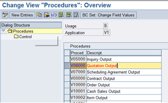

**Figura-70** Dentro de la opción ***Procedures*** seleccionamos el tipo de condición de salida V06000.

A continuación, del lado derecho damos un doble clic al folder que dice **Control** y veremos aparecer la pantalla de la Figura-71. Presionamos el botón 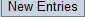 y agregamos la entrada presentada de color mostaza para que el sistema encuentre el mensaje:

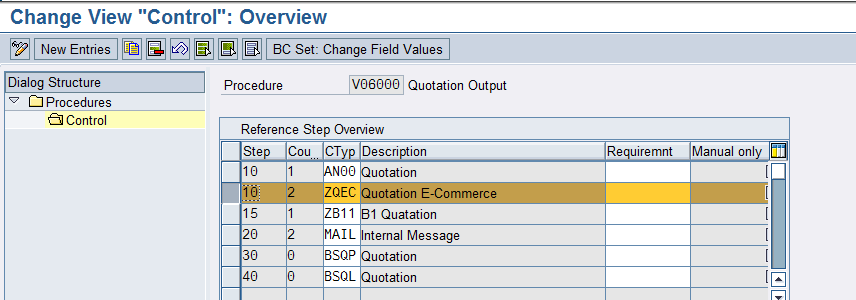

**Figura-71** Presionando el botón ***New Entries***, determinamos el procedimiento para la condición de salida ZQEC.

Guarde sus cambios y regrese al menú de configuración inicial para crear el *Condition* *Record* para este nuevo *output type*. Entre al menú 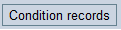 y seleccione la entrada **ZQEC** dando un doble clic, tal y como se muestra en la Figura-72:

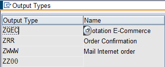

**Figura-72** Una vez entrando a la opción de *Condition* *Records*, se da doble clic en el campo ZQEC.

Aparece una pantalla como la de la Figura-73, donde se selecciona el tipo de cotización que se va a crear. Cabe destacar que este tipo de documento de ventas debe coincidir con el que se está usando como IDoc.

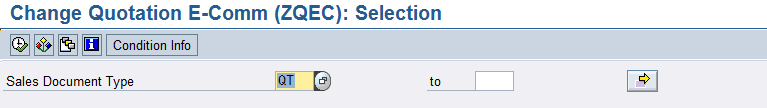

**Figura-73** Selección del tipo de documento de ventas QT como *Condition* *Record* para el mensaje ZQEC.

Al presionar ejecutar con el botón del ícono de la palomita, aparece una ventana como la de la Figura-74, en donde podemos capturar los siguientes parámetros:

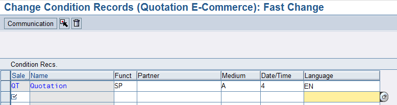

**Figura-74** Último paso de la transacción NACE en donde se acaba de configurar el *Condition* *Record*.

Grabe sus cambios.

Ahora necesitamos configurar esta nueva clase de mensaje ZQEC como IDoc de salida en la sección de ***Outbound*** dentro de la transacción **WE20**, como se puede apreciar en la imagen de la Figura-75. Para dar de alta la entrada como *Partner* *Profile*, seleccionamos en el lado derecho de la transacción WE20 la entrada E-Commerce y, del lado izquierdo, bajo *Outbound* *parameters*, se debe presionar el botón 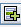 para agregar una nueva entrada para el mensaje estándar **QUOTES**.

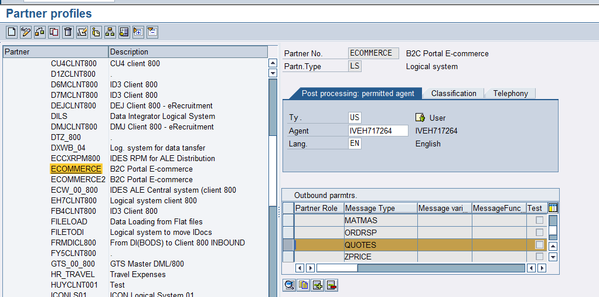

**Figura-75** Pantalla principal de la transacción WE20 *Partner* *Profiles* donde seleccionamos el parámetro QUOTES como mensaje estándar para el *Output type* ZQEC.

En la pantalla de la Figura-75, se tiene que dar doble clic en el campo QUOTES para que se abran las opciones de la Figura-76. En el detalle de esta configuración, asegúrese de utilizar el *message* *type* QUOTES y el puerto ECOMMERCE. Dentro del *Basic Type* escoja **ORDERS05**.

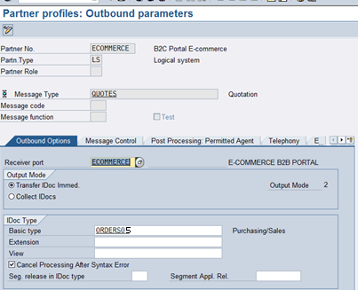

**Figura-76** Primera pestaña de configuración de los parámetros del tipo de mensaje QUOTES.

Tomando la Figura-76 como referencia, nos pasamos a la siguiente pestaña nombrada *Message Control*. Aquí es donde se pone el mensaje que se configuró en la transacción **NACE** con el *process* *code* SD12, tal y como se muestra en la pantalla de la Figura-77.

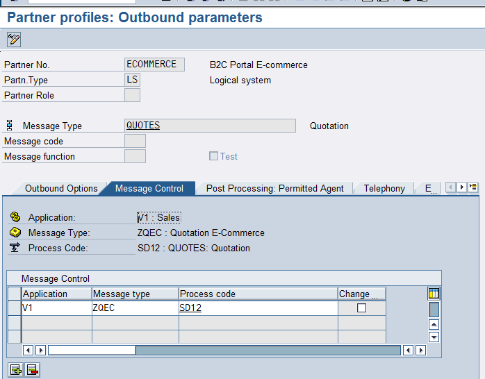

**Figura-77** Segunda pestaña donde se configura el mensaje que se agregó en la transacción NACE.

Grabe sus cambios, ya que es todo por el momento en la transacción WE20.

Ahora nos pasamos a la transacción **BD64** para la última configuración, que tiene que ver con el Modelo de Distribución del IDoc QUOTES de salida hacia el E-Commerce. En el modo de edición de esta transacción, se presiona el botón “Add Message Type” para que aparezca la pantalla de la Figura-78:

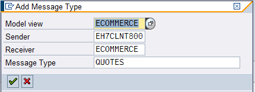

**Figura-78** Agregando el IDoc QUOTES como mensaje que se genera junto con el tipo de condición de salida ZQEC.

Este mensaje tipo QUOTES corresponde al octavo de la tabla de la Figura-16 y, una vez agregado en la transacción **BD64**, se obtiene un Modelo de Distribución para el portal E-Commerce semejante al mostrado en la Figura-79.

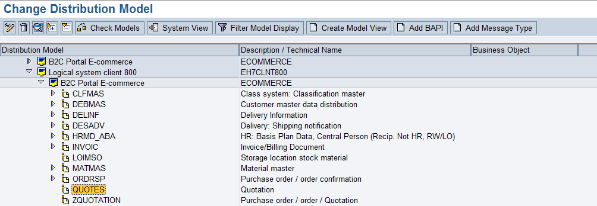

**Figura-79** Transacción BD64 después de haber agregado el tipo de mensaje QUOTES al Modelo de Distribución para el E-Commerce.

Cuando se agrega el documento tipo QT a partir del mensaje QUOTATION y nos vamos a la transacción VA22, en su menú superior en la sección EXTRAS → Output, tal y como se muestra en la Figura-80, podemos ver que el mensaje de respuesta ZQEC se ha creado, pero que está en color amarillo esperando a ser procesado:

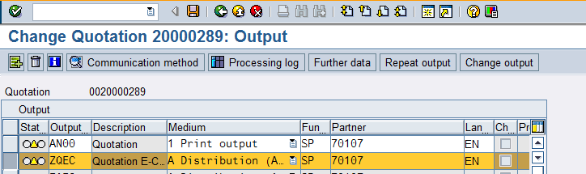

**Figura-80** Vista de la sección de encabezados de Salida de la Transacción VA22.

Si vamos a la transacción WE02, tal y como aparece en la Figura-81, veremos que aparece un IDoc para ser procesado; si se desea ejecutarlo, se haría desde la transacción **BD87**. Al procesar este IDoc, el semáforo del documento cambiará a color verde.

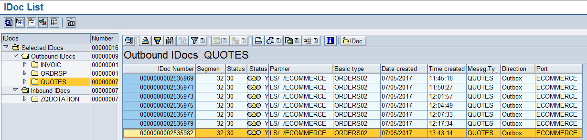

**Figura-81** Transacción WE02 con la vista del IDoc QUOTES de salida como respuesta de confirmación de una Reserva.

## Configuración del IDoc para confirmar la creación de contratos

De inicio, los precios de lista se cargan para una combinación cliente-material en la transacción VK11. Al iniciar tal transacción VK11, se pide la clase de condición para los precios de lista, la cual es PR00. El siguiente paso es que, en el pop-up en el que se pregunta la combinación de claves, seleccionemos “Cliente-Material”; de esta manera aparece la pantalla de la Figura-82.

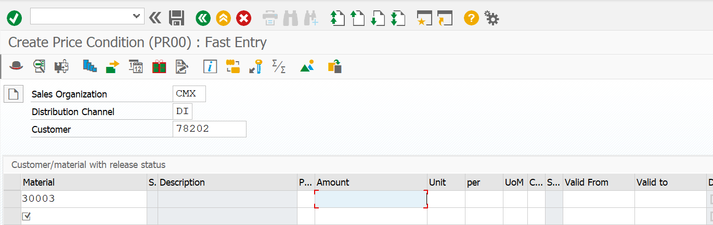

**Figura-82**: Ejemplo de creación de precio PR00 para una combinación Cliente-Material en la transacción VK11.

En la Figura-82 se presenta un ejemplo de la introducción de un primer material, pero se puede seguir introduciendo códigos de materiales y, en la columna de importe, irles agregando su precio de lista. Al terminar de crear la lista de precios para tal cliente en específico, se guarda la información y SAP muestra el mensaje: “Se han grabado los registros de condición”.

Una vez creados todos los precios específicos para un cliente, estos se mandarán de SAP al portal de E-Commerce a través de un programa llamado “ZONRE_CUST_MAT_PRICE2”, que se ejecuta en la transacción SE38, tal y como se muestra en la pantalla de la Figura-83. Al presionar el botón de ejecutar tal programa, nos aparece otra pantalla en la transacción SE38 en la que se pueden definir delimitaciones o cargar una variante en cuanto al número del deudor al que se le enviarán los precios de lista; una vez que el campo de parametrización S_PAR marca ONIBEX, se ejecuta el programa presionando el botón con el ícono de la palomita: 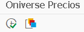

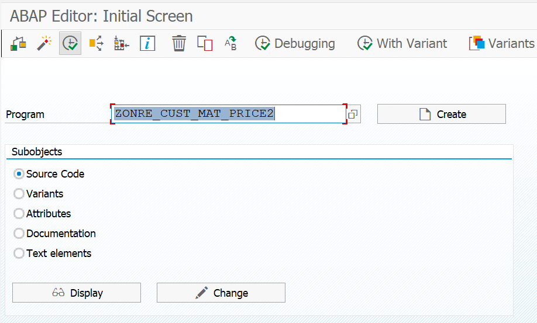

**Figura-83**: Transacción SE38 en la que se ejecuta el programa de Oniverse Precios para mandar los precios específicos al portal de E-Commerce.

Se ejecuta el programa de Oniverse Precios y al final SAP nos arroja el mensaje de cuántos IDocs con nuevos precios de lista fueron mandados y actualizados en el portal de E-Commerce.

A diferencia de los precios de lista, que tienen la condición de precio PR00, existen los Convenios, que son contratos creados y configurados con el Tipo de Condición KA00. Para crear un Convenio se usa la transacción VA41, que se muestra en la pantalla de la Figura-84.

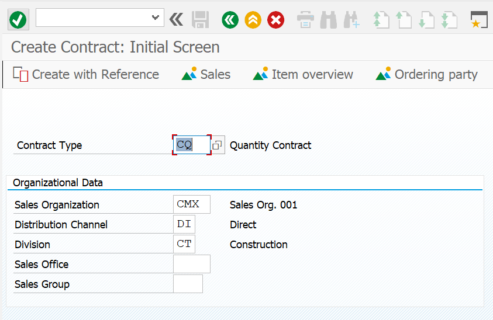

**Figura-84**: Crear Convenio en la transacción VA41 como Pedido abierto por cantidad.

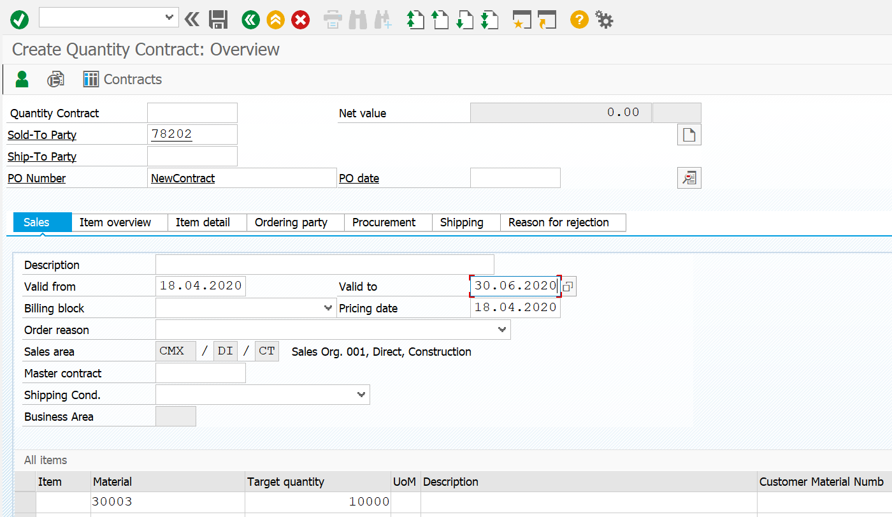

**Figura-85**: Campos a llenar en la transacción VA41 como Pedido abierto por cantidad.

En la Figura-85 aparecen los campos a llenar en la pantalla principal de la transacción VA41 para crear un Pedido abierto por cantidad. Cabe destacar que es necesario ingresar a las Condiciones, en la cabecera del Convenio, para agregar ahí el Tipo de Condición KA00 y su respectivo porcentaje de descuento, tal y como se muestra en la Figura-86:

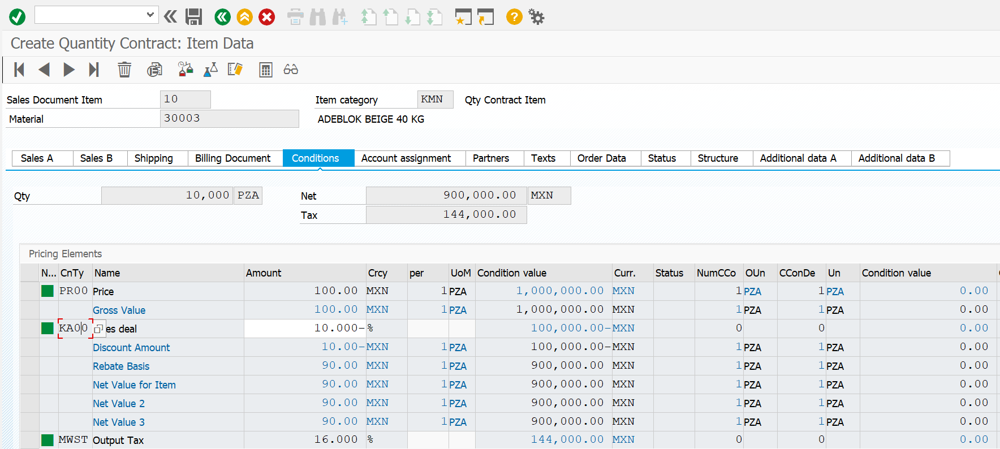

**Figura-86**: Agregando el Tipo de Condición KA00 con su importe de descuento para un material.

Con esos datos básicos para un nuevo contrato, al guardar el Convenio, SAP genera el mensaje: “Pedido abierto por cantidad se ha grabado”, lo que automáticamente manda un IDoc hacia el portal para confirmar la creación del Contrato. Los IDocs de salida se pueden verificar a través de la transacción WE02 y se ven reflejados inmediatamente en la sección de Convenios del portal de E-Commerce.

← Anterior: [Configuración del IDoc para crear cotizaciones (quotations) SD](../04-sales-document-idocs/01-quotation-idoc.md) · Siguiente: [Configuración del IDoc ORDERS para pedidos de venta (sales orders)](../04-sales-document-idocs/03-orders-idoc.md) →

---

© 2026 Onibex, LLC · Licenciado bajo [CC BY-NC-ND 4.0](../../../LICENSE) (SPDX: CC-BY-NC-ND-4.0) · [Licencia comercial](../../../COMMERCIAL-LICENSE.md) · [Marcas y avisos de terceros](../../../THIRD-PARTY-NOTICES.md) · SAP y los demás productos y servicios SAP mencionados son marcas comerciales o marcas registradas de SAP SE o de una empresa afiliada a SAP en Alemania y otros países; los nombres se usan solo con fines de identificación.
