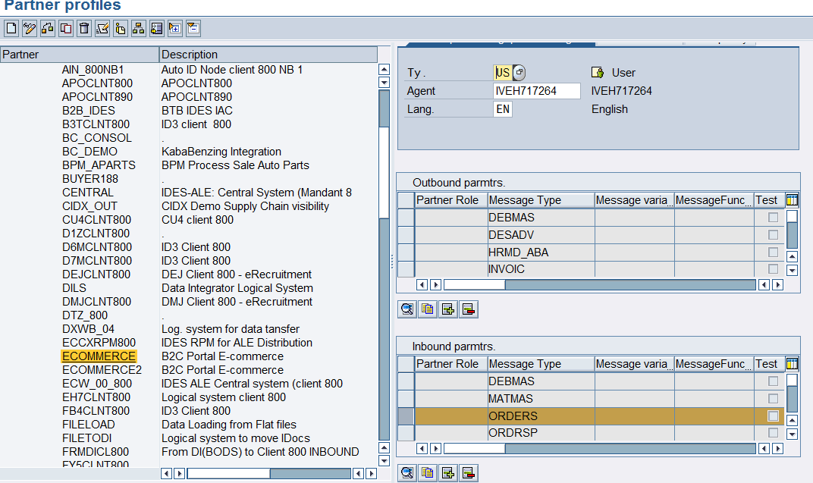
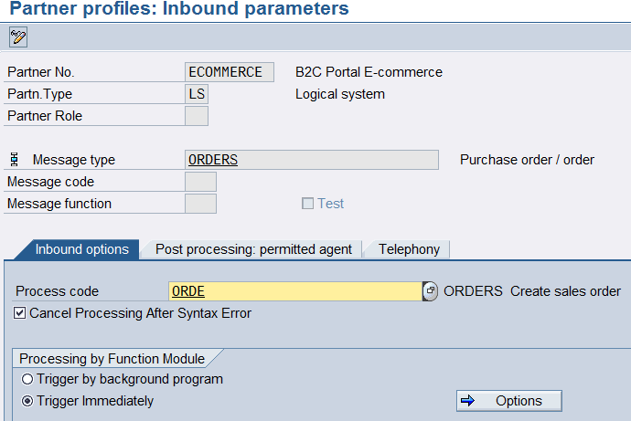

<!-- SPDX-License-Identifier: CC-BY-NC-ND-4.0 -->
<!-- Copyright (c) 2026 Onibex, LLC. Part of the Onibex eCommerce 360° Documentation — https://github.com/Onibex/ecommerce-docs -->

[English](../../../en/technical-documents/04-sales-document-idocs/03-orders-idoc.md) · **Español** | [↑ Índice de documentos técnicos](../README.md) | [README del repositorio](../../../README.md)

# Configuración del IDoc ORDERS para pedidos de venta (sales orders)

> **Fuente:** versión en español del artículo “10. ORDERS iDOC configuration for Sales Orders” del Help Center de Onibex — <https://help.onibex.com/portal/en/kb/articles/orders-idoc-configuration-for-sales-orders>; redacción tomada del capítulo D.4.f de la especificación funcional “D1 – Integración de sistemas”.

El IDoc ORDERS se utiliza para la creación de un pedido de venta (Sales Order) en SAP; para ello se requiere la creación de un mensaje que ha de ser enviado al sistema SAP por el portal de E-Commerce.

En SAP, la configuración del IDoc ORDERS comienza en la transacción **WE20**, en la parte de Sistemas Lógicos como mensaje ***Inbound***, tal y como se describe en la pantalla de la Figura-87.



**Figura-87** Configuración del IDoc ORDERS ***Inbound*** para la recepción de los pedidos de venta en SAP desde el portal de E-Commerce.

Cuando se agrega esta entrada, se deben llenar los parámetros de entrada (***Inbound***) que se muestran en la pantalla de la Figura-88:



**Figura-88** Configuración del IDoc en WE20 para la recepción del mensaje de pedido de venta.

Todas las demás pestañas que aparecen en la pantalla de la Figura-88 se quedan vacías, sin información.

El mensaje que se debe recibir para poder crear este pedido de manera satisfactoria se muestra en el siguiente ejemplo, o bien puede consultarse mediante WE02:

```
<?xml version="1.0" encoding="UTF-8"?>
<ORDERS05>

 <IDOC BEGIN="1">
  <EDI_DC40 SEGMENT="1">
   <TABNAM>EDI_DC40</TABNAM>
   <MANDT>800</MANDT>
   <DOCNUM>0000000025103215</DOCNUM>
   <DOCREL>740</DOCREL>
   <STATUS>30</STATUS>
   <DIRECT>1</DIRECT>
   <OUTMOD>2</OUTMOD>
   <IDOCTYP>ORDERS05</IDOCTYP>
   <MESTYP>ORDERS</MESTYP>
   <SNDPOR>SAPERP</SNDPOR>
   <SNDPRT>LS</SNDPRT>
   <SNDPRN>EH7CLNT800</SNDPRN>
   <RCVPOR>ECOMMERCE</RCVPOR>
   <RCVPRT>LS</RCVPRT>
   <RCVPRN>ECOMMERCE</RCVPRN>
   <CREDAT>20160901</CREDAT>
   <CRETIM>072024</CRETIM>
   <SERIAL>20160819072024</SERIAL>
  </EDI_DC40>

  <E1EDK01 SEGMENT="1">
   <ACTION>000</ACTION>
   <BELNR>25103000</BELNR>
   <CURCY>USD</CURCY>
   <ZTERM>Z030</ZTERM>
   <BSART>OR</BSART>
   <LIFSK>90</LIFSK>
  </E1EDK01>

  <E1EDK14 SEGMENT="1">
   <QUALF>012</QUALF>
   <ORGID>TA</ORGID>
  </E1EDK14>

   <E1EDK14 SEGMENT="1">
   <QUALF>005</QUALF>
   <ORGID>3800</ORGID>
  </E1EDK14>

<E1EDK14 SEGMENT="1">
   <QUALF>006</QUALF>
   <ORGID>00</ORGID>
  </E1EDK14>

  <E1EDK14 SEGMENT="1">
   <QUALF>007</QUALF>
   <ORGID>10</ORGID>
  </E1EDK14>

  <E1EDK14 SEGMENT="1">
   <QUALF>008</QUALF>
   <ORGID>3000</ORGID>
  </E1EDK14>

  <E1EDK03 SEGMENT="1">
   <IDDAT>002</IDDAT>
   <DATUM>20160913</DATUM>
  </E1EDK03>

  <E1EDKA1 SEGMENT="1">
   <PARVW>AG</PARVW>
   <PARTN>0000100016</PARTN>
   <NAME1>John Sample</NAME1>
   <STRAS>100 Sample Street</STRAS>
   <ORT01>Los Angeles</ORT01>
   <PSTLZ>92308</PSTLZ>
   <LAND1>US</LAND1>
   <REGIO>CA</REGIO>
   <PFORT>92308</PFORT>
  </E1EDKA1>

  <E1EDKA1 SEGMENT="1">
   <PARVW>RE</PARVW>
   <PARTN>0000100016</PARTN>
   <NAME1>John Sample</NAME1>
   <STRAS>100 Sample Street</STRAS>
   <ORT01>Los Angeles</ORT01>
   <PSTLZ>02308</PSTLZ>
   <LAND1>US</LAND1>
   <REGIO>CA</REGIO>
   <PFORT>92308</PFORT>
  </E1EDKA1>

  <E1EDKA1 SEGMENT="1">
   <PARVW>RG</PARVW>
   <PARTN>0000100016</PARTN>
   <NAME1>John Sample</NAME1>
   <STRAS>100 Sample Street</STRAS>
   <ORT01>Los Angeles</ORT01>
   <PSTLZ>773811234</PSTLZ>
   <LAND1>US</LAND1>
   <REGIO>CA</REGIO>
   <PFORT>92308</PFORT>
  </E1EDKA1>

  <E1EDKA1 SEGMENT="1">
   <PARVW>WE</PARVW>
   <PARTN>0000100016</PARTN>
   <NAME1>John Sample</NAME1>
   <STRAS>100 Sample Street</STRAS>
   <ORT01>Los Angeles</ORT01>
   <PSTLZ>92308</PSTLZ>
   <LAND1>US</LAND1>
   <REGIO>CA</REGIO>
   <PFORT>92308</PFORT>
  </E1EDKA1>

   <E1EDK02 SEGMENT="1">
   <QUALF>001</QUALF>
   <BELNR>450012345</BELNR>
   <DATUM>20160813</DATUM>
  </E1EDK02>

   <E1EDP01 SEGMENT="1">
   <QUALF>001</QUALF>
   <IDTNR>021V007534937002</IDTNR>
   <POSEX>00010</POSEX>
   <PSTYP>TAN</PSTYP>
   <MENGE>2</MENGE>
   <WERKS>3800</WERKS>
   <LGORT>0001</LGORT>

   <E1EDP19 SEGMENT="1">
    <QUALF>001</QUALF>
    <IDTNR>021V007534937002</IDTNR>
   </E1EDP19>

   <E1EDP19 SEGMENT="1">
    <QUALF>002</QUALF>
    <IDTNR>US-01-1000</IDTNR>
   </E1EDP19>

    <E1EDP01 SEGMENT="1">
   <QUALF>001</QUALF>
   <IDTNR>021V007534937002</IDTNR>
   <POSEX>00020</POSEX>
   <PSTYP>TAN</PSTYP>
   <MENGE>8</MENGE>
   <WERKS>3800</WERKS>
   <LGORT>0001</LGORT>

   <E1EDP19 SEGMENT="1">
    <QUALF>001</QUALF>
    <IDTNR>021V007534937004</IDTNR>
   </E1EDP19>

   <E1EDP19 SEGMENT="1">
    <QUALF>002</QUALF>
    <IDTNR>US-01-2000</IDTNR>
   </E1EDP19>

   <E1EDP19 SEGMENT="1">
    <QUALF>003</QUALF>
    <IDTNR>753793815800</IDTNR>
   </E1EDP19>

   </E1EDP01>
 </IDOC>
</ORDERS05>
```

← Anterior: [Configuración del IDoc para confirmar la creación de la cotización](../04-sales-document-idocs/02-quotation-confirmation-idoc.md) · Siguiente: [Configuración del IDoc ORDRSP para la confirmación del pedido de venta](../04-sales-document-idocs/04-ordrsp-idoc.md) →

---

© 2026 Onibex, LLC · Licenciado bajo [CC BY-NC-ND 4.0](../../../LICENSE) (SPDX: CC-BY-NC-ND-4.0) · [Licencia comercial](../../../COMMERCIAL-LICENSE.md) · [Marcas y avisos de terceros](../../../THIRD-PARTY-NOTICES.md) · SAP y los demás productos y servicios SAP mencionados son marcas comerciales o marcas registradas de SAP SE o de una empresa afiliada a SAP en Alemania y otros países; los nombres se usan solo con fines de identificación.
