<!-- SPDX-License-Identifier: CC-BY-NC-ND-4.0 -->
<!-- Copyright (c) 2026 Onibex, LLC. Part of the Onibex eCommerce 360° Documentation — https://github.com/Onibex/ecommerce-docs -->

[English](../../../en/technical-documents/04-sales-document-idocs/04-ordrsp-idoc.md) · **Español** | [↑ Índice de documentos técnicos](../README.md) | [README del repositorio](../../../README.md)

# Configuración del IDoc ORDRSP para la confirmación del pedido de venta

> **Fuente:** versión en español del artículo “11. Setting up the ORDRSP iDOC for confirmation of the Sales Order” del Help Center de Onibex — <https://help.onibex.com/portal/en/kb/articles/setting-up-the-ordrsp-idoc-for-confirmation-of-the-sales-order>; redacción tomada del capítulo D.4.g de la especificación funcional “D1 – Integración de sistemas”.

Para poder configurar el envío del IDoc ORDRSP como respuesta al E-Commerce de la creación de la Orden de Venta en SAP, lo primero que se hace es definir en la transacción **NACE** un tipo de mensaje nuevo: **ZOEC** para el área aplicativa **V1**. Este mensaje personalizado **ZOEC** lo creamos en la sección de *Output types* como copia del mensaje estándar **BA00**, tal y como se muestra en la pantalla de la Figura-89:

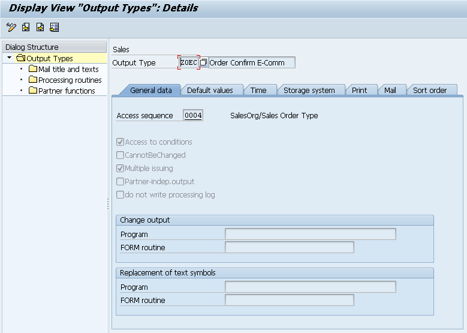

**Figura-89** Configuración del *Output type* **ZOEC** a partir de la copia del mensaje estándar **BA00** en la transacción **NACE**.

Una vez llenado el campo de *Access sequence* en la pestaña de Datos generales, procedemos a completar la configuración de las demás pestañas de la Figura-89, empezando por la configuración de la distribución del nuevo mensaje mediante **ALE** (Application Link Enabling), tal y como se muestra en la Figura-90:

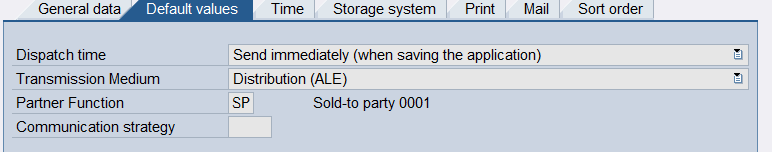

**Figura-90** Configuración del *Output type* **ZOEC** en su pestaña de *Default* *values* de la transacción NACE.

Así procedemos con la configuración de las restantes cinco pestañas de la Figura-89, las cuales se muestran respectivamente desde la Figura-91 a la Figura-95:

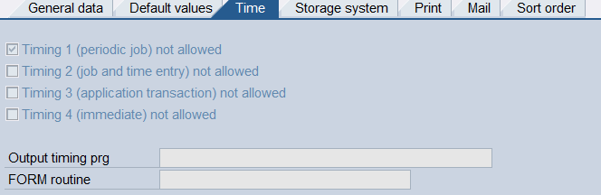

**Figura-91** Configuración del *Output type* **ZOEC** en su pestaña de *Time* de la transacción NACE.

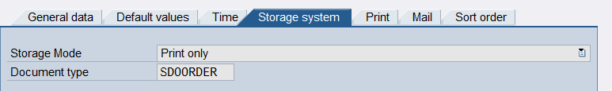

**Figura-92** Configuración del *Output type* **ZOEC** en su pestaña de *Storage System* de la transacción NACE.

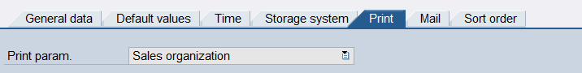

**Figura-93** Configuración del *Output type* **ZOEC** en su pestaña de *Print* de la transacción NACE.

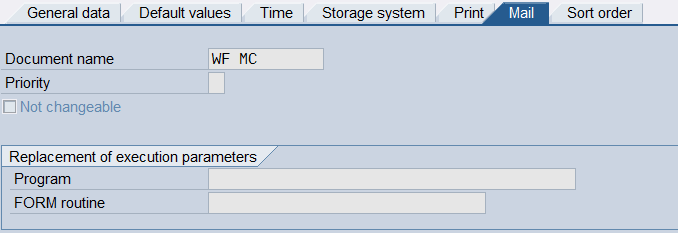

**Figura-94** Configuración del *Output type* **ZOEC** en su pestaña de *Mail* de la transacción NACE.

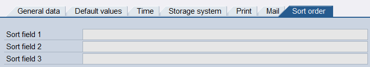

**Figura-95** Configuración del *Output type* **ZOEC** en su pestaña de *Sort* *order* de la transacción NACE.

Regresando a los folders del lado izquierdo de la Figura-89, dentro de la opción de *Processing Routines*, hay que asegurarse de tener una entrada para ALE con el programa ***RSNASTED*** y, en el *Form* *Routine*, ***ALE_PROCESSING***, tal y como aparece en la Figura-96:

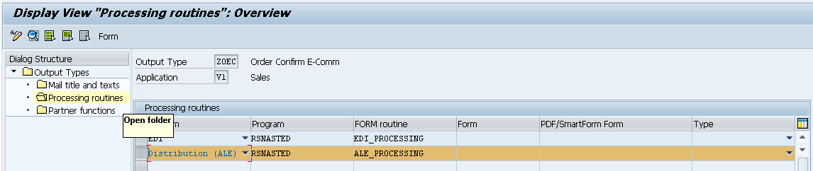

**Figura-96** Configuración del *Output type* **ZOEC** dentro del Folder de *Processing Routines*.

Dentro del último folder de la estructura de diálogos de la izquierda, *Partner* *functions*, hay que asegurarse de que la función de interlocutor *Sold-to Party* exista para la entrada en el medio **ALE**, tal y como se presenta en la Figura-97.

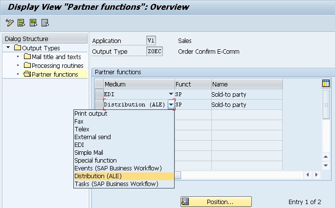

**Figura-97** Configuración del *Output type* **ZOEC** dentro del Folder de *Partner* *functions*.

Cabe señalar que desde la pantalla de la Figura-89 se selecciona la secuencia de acceso 004, la cual ahora mostramos en la Figura-98 para el área aplicativa V1. No se cambia ninguna configuración de la secuencia de acceso estándar 004; es solo para mostrar que hay diferentes opciones de condiciones para activar el mensaje de salida ZOEC a partir de la Orden de Venta.

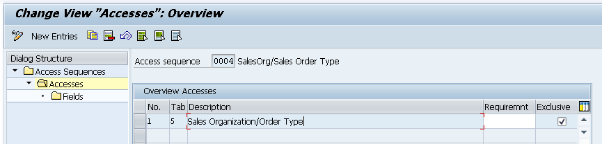

**Figura-98** Despliegue de la selección del *Access sequence* para el mensaje de respuesta de confirmación de la creación de una Orden de Venta desde el E-Commerce.

También hay que asegurar que este tipo de mensaje ZOEC aparezca en el *Output procedure* **V10000**, tal y como se muestra en la pantalla de la Figura-99.

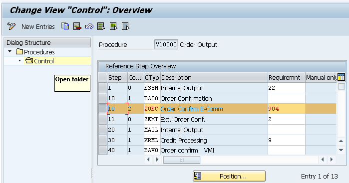

**Figura-99** Despliegue de la selección del *Procedure* **V10000** para el área aplicativa V1 de la transacción NACE.

Para finalizar las configuraciones en esta transacción NACE, también es necesario definir el *Condition* *Record* para el *output type* **ZOEC** con su respectiva organización de ventas y el tipo de pedido, tal y como se muestra en la pantalla de la Figura-100. Esto para poder generar en automático el pedido.

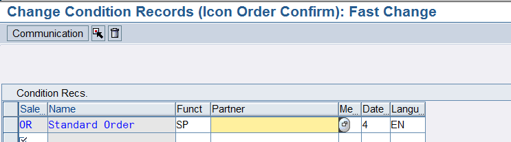

**Figura-100** Configuración del *Condition* *Record* para la confirmación de la Orden del E-Commerce.

Una vez configurado el tipo de mensaje para la confirmación de creación de la orden de venta, el siguiente paso consiste en ir a la transacción **WE20** para crear una entrada con el tipo de mensaje ORDRSP dentro de la sección ***Outbound*** para el sistema lógico ECOMMERCE. En este caso, solo llenaremos las primeras dos pestañas de configuración, tal y como aparecen respectivamente en las pantallas de la Figura-101 y la Figura-102.

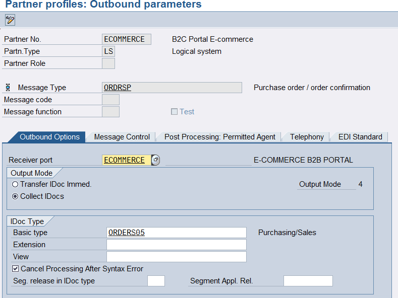

**Figura-101** Configuración de la primera pestaña de los parámetros de salida para el mensaje ORDRSP en la transacción WE20.

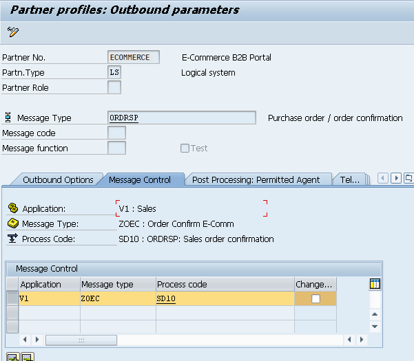

**Figura-102** Configuración de la segunda pestaña de los parámetros de salida para el mensaje ORDRSP en la transacción WE20.

Las demás pestañas se pueden quedar en blanco.

El siguiente paso es agregar este mensaje ORDRSP en la transacción **BD64**: Modelo de Distribución. Esto es en esencia lo mismo que se ha presentado en las pantallas de la Figura-33; la única diferencia es que ahora el campo de *Message* *type* cambia a ORDRSP, lo que corresponde a la confirmación de creación de orden de venta o mensaje #4 de la tabla de la Figura-16: Mensajes de acuerdos en SAP para un sistema lógico LS con el interlocutor ECOMMERCE que se crean y configuran a través de las transacciones WE20, BD64 y NACE, en su caso.

Finalmente, en la orden de venta, una vez que ha sido creada, se debe generar de manera automática el mensaje **ZOEC**, que se manda como IDoc del tipo ORDRSP hacia el E-Commerce. Podemos enviar también el mensaje entrando a la transacción VA02 con el número de pedido de cliente o de “Orden de Compra” y siguiendo la ruta del Menú de detalles que se muestra en la Figura-103. La pantalla de la Figura-104 nos aparece a partir de esta instrucción para visualizar la salida.

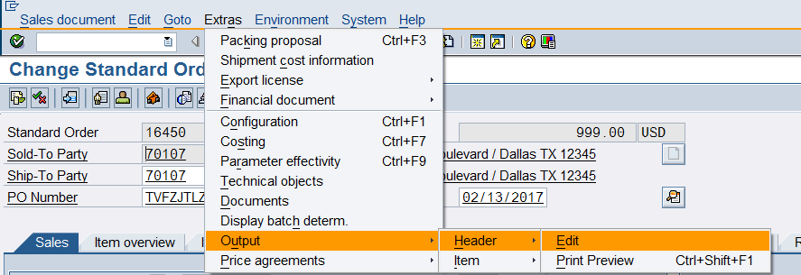

**Figura-103** Sección de detalles en el menú superior para enviar el mensaje de salida tipo ORDRSP a partir de la Orden de Compra en la transacción VA02.

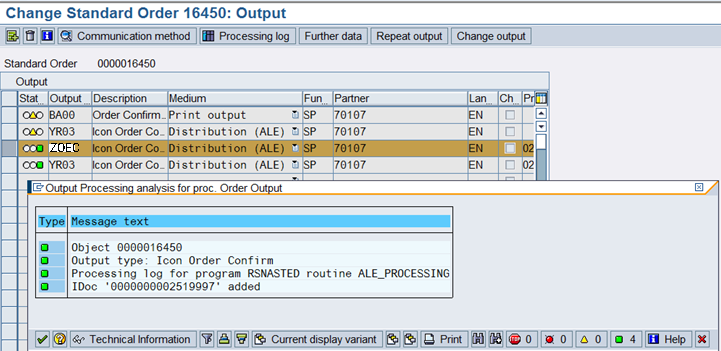

**Figura-104** Señalamiento del IDoc de salida **ZOEC** como tipo de mensaje ORDRSP para confirmar la creación de la Orden de Venta en SAP hacia el E-Commerce.

Para visualizar el contenido completo de este IDoc de salida ZOEC, nos vamos a la transacción **WE02** que se muestra en la Figura-105. En la Figura-106 se muestra el despliegue de los segmentos y campos que enviaría SAP hacia el E-Commerce.

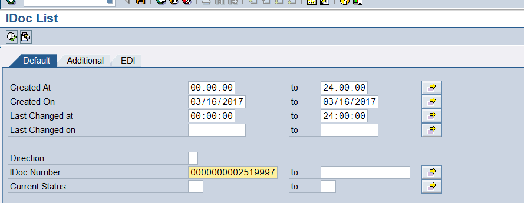

**Figura-105** Transacción WE02 en la que introducimos el número de IDoc de salida del tipo ZOEC hacia el E-Commerce.

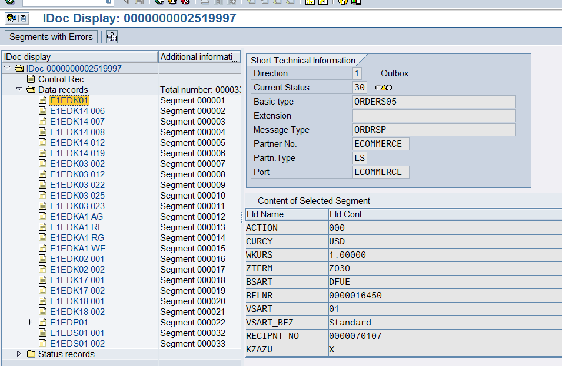

**Figura-106** Despliegue de segmentos y campos del IDoc de salida del tipo ZOEC hacia el E-Commerce usando la transacción **WE02**.

Para procesar este IDoc ZOEC manualmente, lo vamos a mandar por medio de la transacción **BD87**.

← Anterior: [Configuración del IDoc ORDERS para pedidos de venta (sales orders)](../04-sales-document-idocs/03-orders-idoc.md) · Siguiente: [Configuración del IDoc DESADV para enviar la confirmación de la entrega](../04-sales-document-idocs/05-desadv-idoc.md) →

---

© 2026 Onibex, LLC · Licenciado bajo [CC BY-NC-ND 4.0](../../../LICENSE) (SPDX: CC-BY-NC-ND-4.0) · [Licencia comercial](../../../COMMERCIAL-LICENSE.md) · [Marcas y avisos de terceros](../../../THIRD-PARTY-NOTICES.md) · SAP y los demás productos y servicios SAP mencionados son marcas comerciales o marcas registradas de SAP SE o de una empresa afiliada a SAP en Alemania y otros países; los nombres se usan solo con fines de identificación.
