<!-- SPDX-License-Identifier: CC-BY-NC-ND-4.0 -->
<!-- Copyright (c) 2026 Onibex, LLC. Part of the Onibex eCommerce 360° Documentation — https://github.com/Onibex/ecommerce-docs -->

[English](../../../en/technical-documents/04-sales-document-idocs/05-desadv-idoc.md) · **Español** | [↑ Índice de documentos técnicos](../README.md) | [README del repositorio](../../../README.md)

# Configuración del IDoc DESADV para enviar la confirmación de la entrega

> **Fuente:** versión en español del artículo “12. DESADV iDoc configuration to send Delivery confirmation” del Help Center de Onibex — <https://help.onibex.com/portal/en/kb/articles/desadv-idoc-configuration-to-send-delivery-confirmation>; redacción tomada del capítulo D.4.h de la especificación funcional “D1 – Integración de sistemas”.

Esta configuración se hace comenzando en la transacción **NACE** y creando un tipo de mensaje ZDEC para el área aplicativa **V2**, tal y como se muestra en la Figura-107. Desde la Figura-108 a la Figura-114 se muestran las configuraciones para las diferentes pestañas que comprenden esta nueva clase de mensaje ZDEC en la transacción NACE.

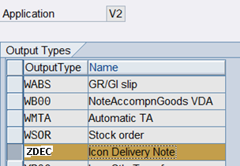

**Figura-107** Creación del nuevo mensaje **ZDEC** en el área aplicativa **V2** de la transacción NACE.

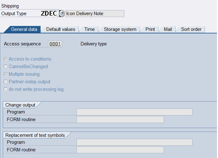

**Figura-108** Configuración de la Secuencia de acceso para el nuevo tipo de salida ZDEC en el área aplicativa V2 de la transacción NACE.

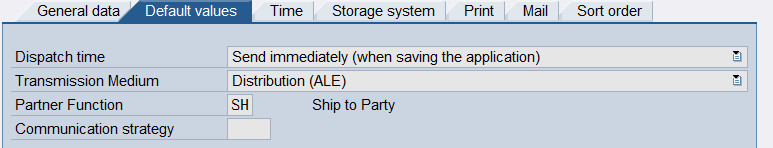

**Figura-109** Configuración de la segunda pestaña para el nuevo tipo de salida ZDEC.

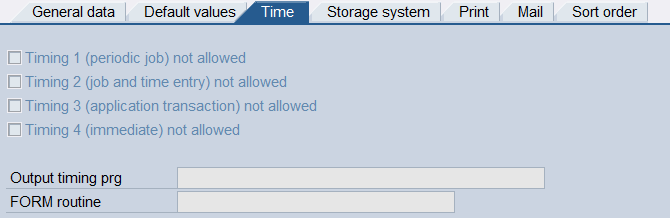

**Figura-110** Configuración de la tercera pestaña para el nuevo tipo de salida ZDEC.

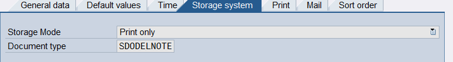

**Figura-111** Configuración de la cuarta pestaña para el nuevo tipo de salida ZDEC.

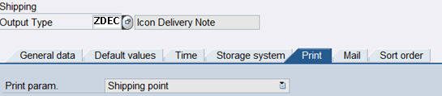

**Figura-112** Configuración de la quinta pestaña para el nuevo tipo de salida ZDEC.

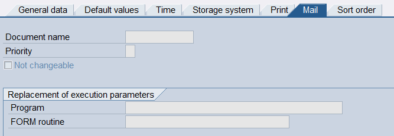

**Figura-113** Configuración de la sexta pestaña para el nuevo tipo de salida ZDEC.

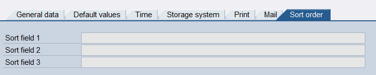

**Figura-114** Configuración de la séptima pestaña para el nuevo tipo de salida ZDEC.

Dentro de la Estructura de Diálogo de Clases de Mensajes, seleccione la carpeta correspondiente a Rutinas de proceso y dé doble clic en ella; aparece la pantalla de la Figura-115, en la que se agrega la configuración correspondiente al medio de envío Distribución ALE.

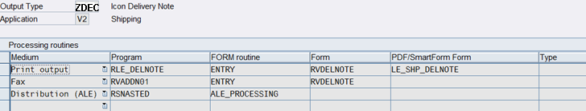

**Figura-115** Pantalla de configuración de las Rutinas de Procesamiento en la Transacción NACE para el nuevo mensaje ZDEC.

Dentro de la misma Estructura de Diálogo de Clases de Mensajes, pase ahora a la carpeta de Funciones de Interlocutor y dé igualmente doble clic en ella para desplegar la pantalla de la Figura-116.

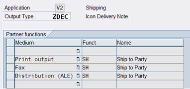

**Figura-116** Pantalla de configuración de las Funciones de Interlocutor en la Transacción NACE para el nuevo mensaje ZDEC.

Regrese al menú principal de la Transacción NACE para acceder ahora al botón de Secuencias de Acceso, el cual despliega la pantalla de la Figura-117.

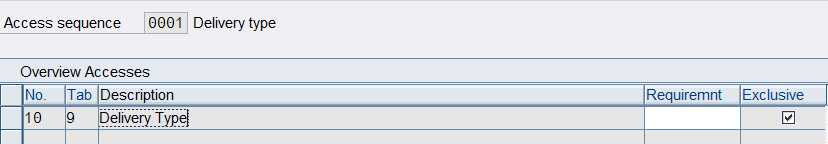

**Figura-117** Pantalla de configuración de la Secuencia de Acceso en la Transacción NACE para el nuevo mensaje ZDEC.

El *output determination procedure* **V10000** de la entrega dentro de V2 debe contener los datos que se muestran en la Figura-118 para poder encontrar el tipo de mensaje que se va a crear:

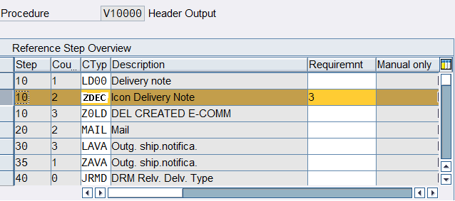

**Figura-118** Pantalla de configuración del procedimiento de salida en la Transacción NACE para el nuevo mensaje **ZDEC**.

El *Condition Record* del mensaje ZDEC, para el tipo de entrega **LF**, la Partner Function **SH** *Ship to party* y el medio **A** (ALE), se crea tal y como se muestra en la Figura-119.

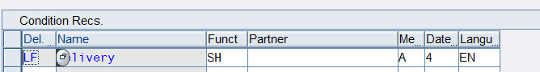

**Figura-119** Pantalla de configuración de los Registros de Condición en la Transacción NACE para el nuevo mensaje ZDEC.

Una vez que se ha configurado el tipo de mensaje ZDEC, vaya a la transacción **WE20** a crear una entrada nueva para el sistema lógico ECOMMERCE y el tipo de mensaje DESADV. Es importante que el mensaje DESADV no se use en ningún otro sistema lógico porque, si no, no funciona. Este paso se ilustra en la Figura-120.

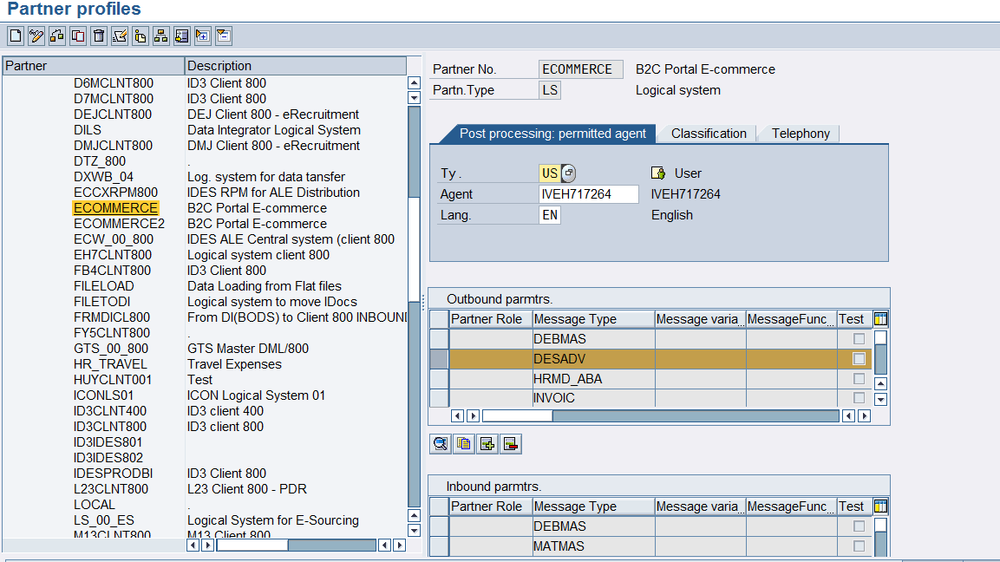

**Figura-120** Nueva entrada para el sistema lógico E-Commerce con el tipo de mensaje DESADV en la transacción WE20.

Ahora dé doble clic sobre el tipo de mensaje DESADV para que aparezca la pantalla de configuración que se muestra en la Figura-121.

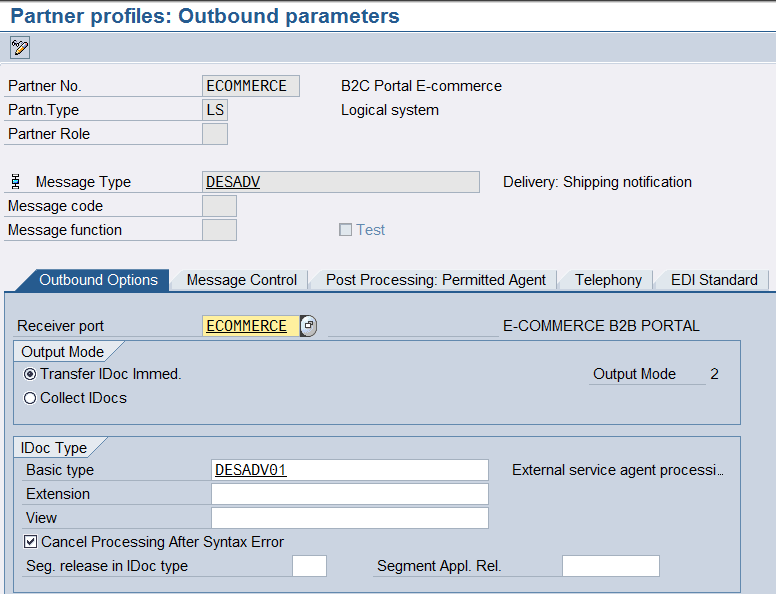

**Figura-121** Configuración de la primera pestaña del tipo de mensaje DESADV en la transacción WE20.

Y dentro de la pestaña *Message Control* se pone el mensaje que se configuró previamente en la transacción NACE, tal y como se ilustra en la Figura-122.

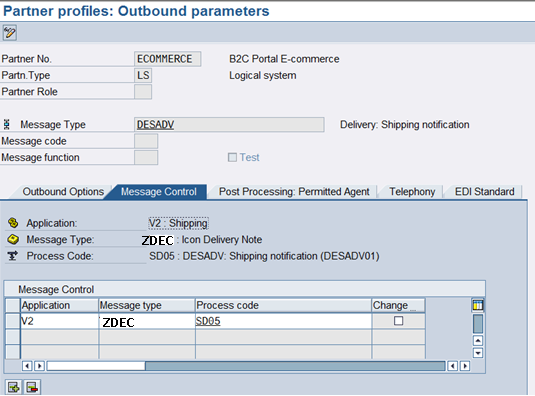

**Figura-122** Configuración de la segunda pestaña del tipo de mensaje DESADV en la transacción WE20.

Por último, hay que agregar una entrada en la transacción **BD64** para este tipo de mensaje, tal y como se muestra en la Figura-123, y que posteriormente se despliega en el menú principal de tal transacción como se muestra en la Figura-124.

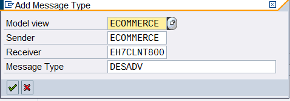

**Figura-123** Agregando una nueva entrada del tipo de mensaje DESADV en la transacción BD64.

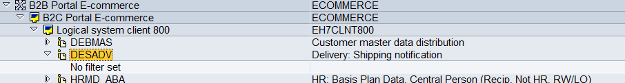

**Figura-124** Despliegue del tipo de mensaje DESADV recién creado en la transacción BD64.

Regresando al procesamiento de la Orden de compra y su respectiva entrega que se muestra en la Figura-125, se puede ver cómo se procesa este mensaje ZDEC sin problema y genera un IDoc que es mostrado en la Figura-126.

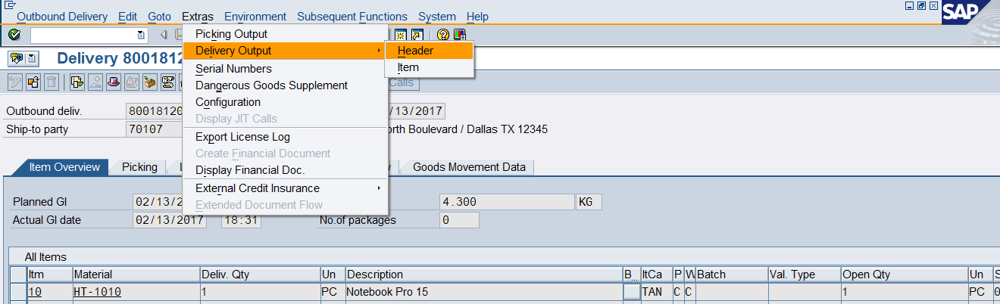

**Figura-125** Despliegue del proceso de entrega en la que se genera un nuevo IDoc ZDEC.

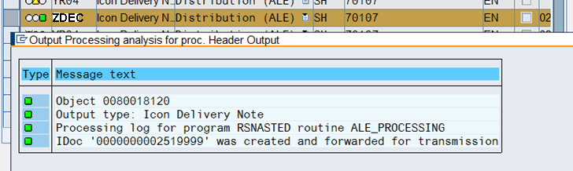

**Figura-126** Ejemplo de información general de un nuevo IDoc ZDEC generado como salida al E-Commerce al realizar la entrega de una Orden de Compra.

← Anterior: [Configuración del IDoc ORDRSP para la confirmación del pedido de venta](../04-sales-document-idocs/04-ordrsp-idoc.md) · Siguiente: [Configuración del IDoc INVOIC para enviar la factura](../04-sales-document-idocs/06-invoic-idoc.md) →

---

© 2026 Onibex, LLC · Licenciado bajo [CC BY-NC-ND 4.0](../../../LICENSE) (SPDX: CC-BY-NC-ND-4.0) · [Licencia comercial](../../../COMMERCIAL-LICENSE.md) · [Marcas y avisos de terceros](../../../THIRD-PARTY-NOTICES.md) · SAP y los demás productos y servicios SAP mencionados son marcas comerciales o marcas registradas de SAP SE o de una empresa afiliada a SAP en Alemania y otros países; los nombres se usan solo con fines de identificación.
