<!-- SPDX-License-Identifier: CC-BY-NC-ND-4.0 -->
<!-- Copyright (c) 2026 Onibex, LLC. Part of the Onibex eCommerce 360° Documentation — https://github.com/Onibex/ecommerce-docs -->

[English](../../../en/technical-documents/04-sales-document-idocs/06-invoic-idoc.md) · **Español** | [↑ Índice de documentos técnicos](../README.md) | [README del repositorio](../../../README.md)

# Configuración del IDoc INVOIC para enviar la factura

> **Fuente:** versión en español del artículo “13. Setting up the INVOIC iDOC to send the invoice” del Help Center de Onibex — <https://help.onibex.com/portal/en/kb/articles/setting-up-the-invoic-idoc-to-send-the-invoice>; redacción tomada del capítulo D.4.i de la especificación funcional “D1 – Integración de sistemas”.

El primer paso es la configuración de un ***output type*** para la salida del mensaje en la transacción **VF01**. Esta configuración se hace comenzando en la transacción **NACE** y creando un tipo de mensaje ZIEC para el área aplicativa **V3**, tal y como se muestra en la Figura-127. Desde la Figura-128 a la Figura-131 se muestran las configuraciones para las diferentes pestañas que comprenden esta nueva clase de mensaje ZIEC en la transacción NACE.

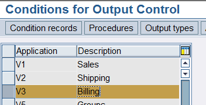 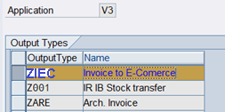

**Figura-127** Creación del nuevo mensaje **ZIEC** en el área aplicativa V3 de la transacción NACE.

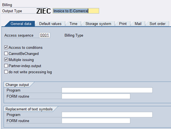

**Figura-128** Configuración de la Secuencia de acceso para el nuevo tipo de salida ZIEC en el área aplicativa V3 de la transacción NACE.

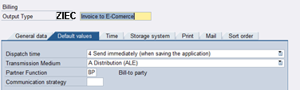

**Figura-129** Configuración de la segunda pestaña para el nuevo tipo de salida ZIEC.

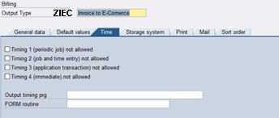

**Figura-130** Configuración de la tercera pestaña para el nuevo tipo de salida ZIEC.

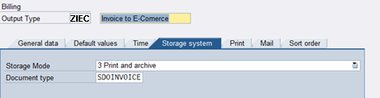

**Figura-131** Configuración de la cuarta pestaña para el nuevo tipo de salida ZIEC.

Las últimas tres pestañas quedan vacías para esta clase de mensaje ZIEC.

Dentro de la Estructura de Diálogo de Clases de Mensajes, seleccione la carpeta correspondiente a *Rutinas de proceso* y dé doble clic en ella; aparece la pantalla de la Figura-132, en la que se agrega la configuración correspondiente al medio de envío Distribución ALE.

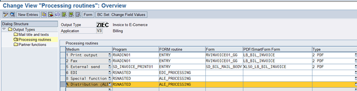

**Figura-132** Pantalla de configuración de las *Rutinas de Procesamiento* en la Transacción NACE para el nuevo mensaje ZIEC.

Dentro de la misma Estructura de Diálogo de Clases de Mensajes, pase ahora a la carpeta de Funciones de Interlocutor y dé igualmente doble clic en ella para desplegar la pantalla de la Figura-133.

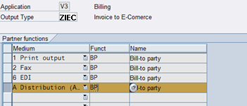

**Figura-133** Pantalla de configuración de las Funciones de Interlocutor en la Transacción NACE para el nuevo mensaje ZIEC.

Regrese al menú principal de la Transacción NACE para configurar el *MESSAGE DETERMINATION PROCEDURE* 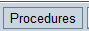. Al entrar se muestra una pantalla similar a la de la Figura-134; seleccione tanto el *Procedure* **V10000** *Billing Output* como la carpeta de **Control**, para así dar luego un clic con el botón derecho del ratón en “*Seleccionar diálogo parcial*”.

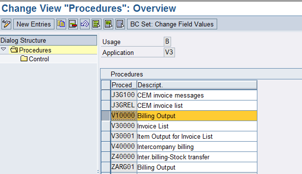

**Figura-134** Pantalla de configuración de las Funciones de Interlocutor en la Transacción NACE para el nuevo mensaje ZIEC.

En la pantalla de la Figura-135, que es la que aparece, se localiza la línea en donde se encuentra el mensaje **ZIEC** que se está definiendo al presionar el botón .

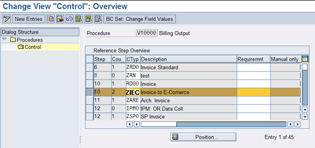

**Figura-135** Pantalla de configuración para el *output* de la factura en la Transacción NACE.

Lo que sigue es crear el *Condition Record* desde el menú principal de la transacción **NACE** para el área **V3** y el *output type* **ZIEC**.

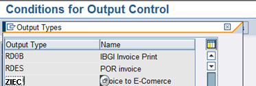

**Figura-136** Pantalla de configuración para el *Condition record* de la factura en la Transacción NACE.

Dé doble clic en este registro de la Figura-136 y entre a la pantalla de la Figura-137, en donde se puede crear ese *Condition Record*. El siguiente paso es llenar los campos del *Condition Record* con los datos de la Figura-138.

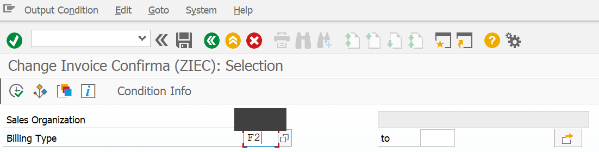

**Figura-137** Pantalla de creación del *Condition record* de la factura en la Transacción NACE.

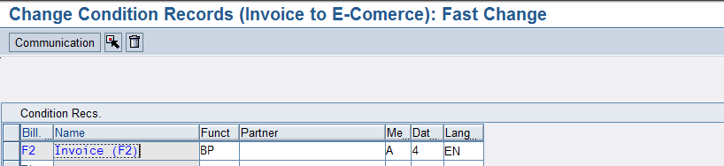

**Figura-138** Pantalla que define la Función de Interlocutor en la creación del *Condition record* de la factura en la Transacción NACE.

Una vez que se ha creado el mensaje, el siguiente paso es ir a la transacción **WE20** para agregar el *Message Type* **INVOIC**, que es un estándar de SAP:

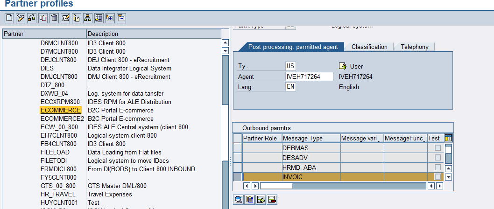

**Figura-139** Pantalla en que se configuran los parámetros de salida para el tipo de mensaje INVOIC en la transacción WE20.

En el detalle de esta configuración se usa el *Message Type* **INVOIC** y el *Basic Type* **INVOIC02**, como se muestra en la Figura-140 y Figura-141:

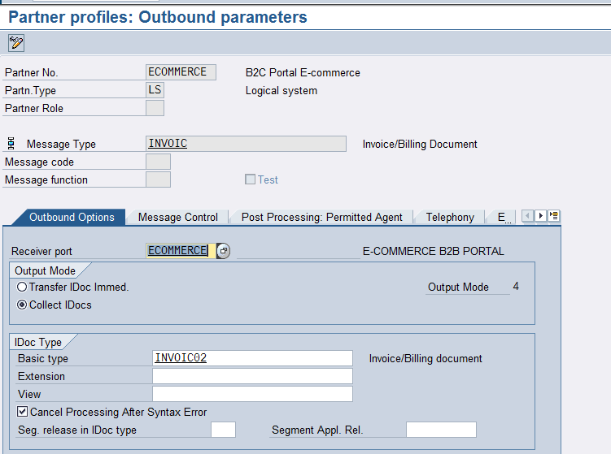

**Figura-140** Pantalla de primera pestaña de configuración para el tipo de mensaje INVOIC en la transacción WE20.

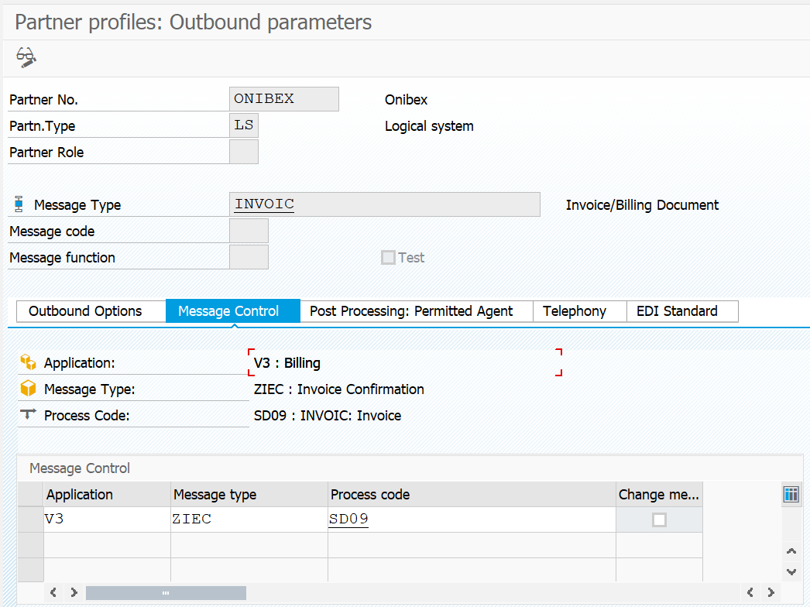

**Figura-141** Pantalla de segunda pestaña de configuración para el tipo de mensaje INVOIC en la transacción WE20.

Ahora se debe agregar este *Message Type* en la transacción **BD64**, *Distribution Model*, para poder definir el sentido en el que ese mensaje será generado:

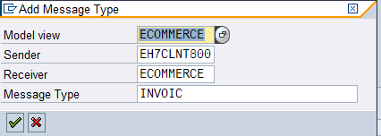

**Figura-142** Agregando una nueva entrada del tipo de mensaje INVOIC en la transacción BD64.

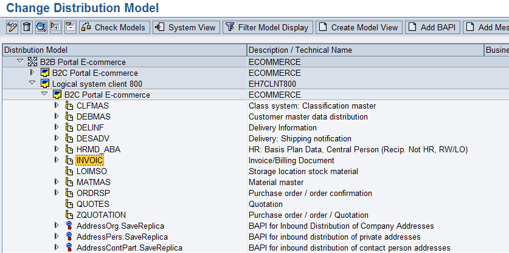

**Figura-143** Despliegue del tipo de mensaje INVOIC recién creado en la transacción BD64.

← Anterior: [Configuración del IDoc DESADV para enviar la confirmación de la entrega](../04-sales-document-idocs/05-desadv-idoc.md) · Siguiente: [Configuración del IDoc ZON_SHP para enviar el documento de transporte](../04-sales-document-idocs/07-zon-shp-transport-idoc.md) →

---

© 2026 Onibex, LLC · Licenciado bajo [CC BY-NC-ND 4.0](../../../LICENSE) (SPDX: CC-BY-NC-ND-4.0) · [Licencia comercial](../../../COMMERCIAL-LICENSE.md) · [Marcas y avisos de terceros](../../../THIRD-PARTY-NOTICES.md) · SAP y los demás productos y servicios SAP mencionados son marcas comerciales o marcas registradas de SAP SE o de una empresa afiliada a SAP en Alemania y otros países; los nombres se usan solo con fines de identificación.
