<!-- SPDX-License-Identifier: CC-BY-NC-ND-4.0 -->
<!-- Copyright (c) 2026 Onibex, LLC. Part of the Onibex eCommerce 360° Documentation — https://github.com/Onibex/ecommerce-docs -->

[English](../../../en/technical-documents/04-sales-document-idocs/07-zon-shp-transport-idoc.md) · **Español** | [↑ Índice de documentos técnicos](../README.md) | [README del repositorio](../../../README.md)

# Configuración del IDoc ZON_SHP para enviar el documento de transporte

> **Fuente:** capítulo D.4.j de la especificación funcional “D1 – Integración de sistemas” del Help Center de Onibex — <https://help.onibex.com/portal/en/kb/articles/d1-integraci%C3%B3n-de-sistemas-v-5-1-espa%C3%B1ol>.

El primer paso en este caso también es la configuración de un *output type* para la salida del mensaje en la transacción **VT01N**. Esta configuración se hace comenzando en la transacción **NACE** y creando un tipo de mensaje ZTEC para el área aplicativa **V7**, tal y como se muestra en la Figura-127a. Desde la Figura-128a a la Figura-131a se muestran las configuraciones para las diferentes pestañas que comprenden esta nueva clase de mensaje ZTEC en la transacción NACE.

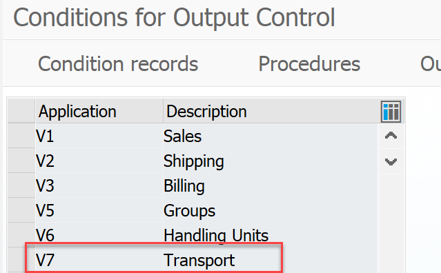 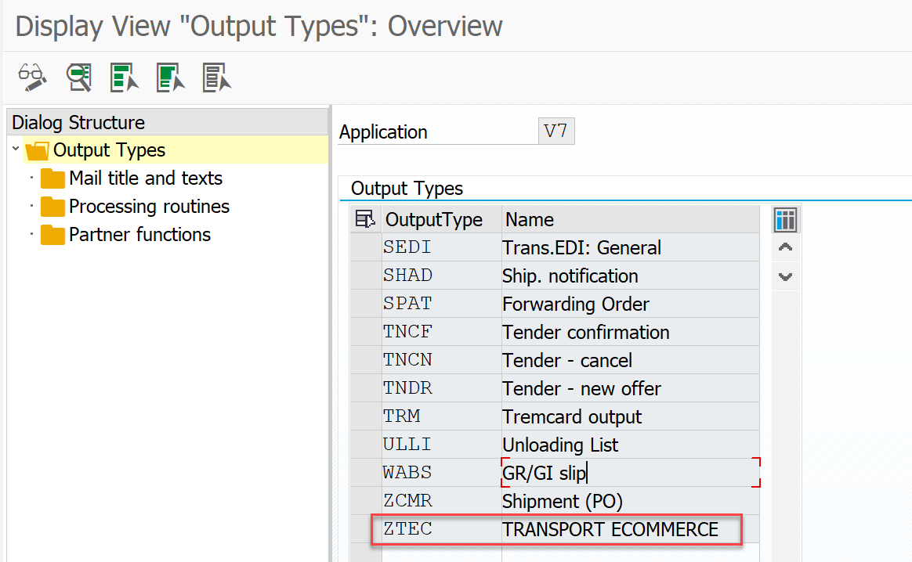

**Figura-127a** Creación del nuevo mensaje **ZTEC** en el área aplicativa V7 de la transacción NACE.

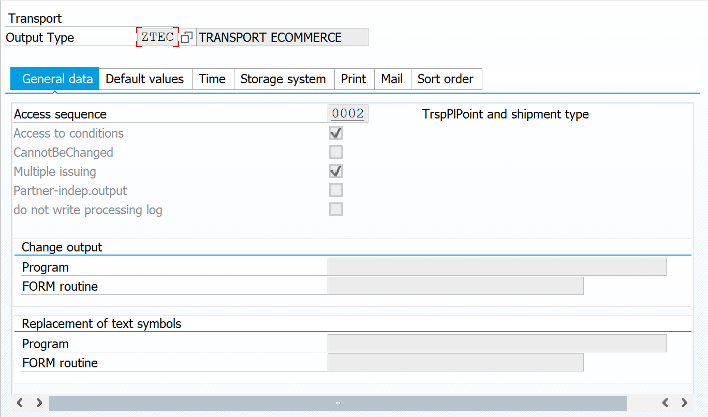

**Figura-128a** Configuración de la Secuencia de acceso para el nuevo tipo de salida ZTEC en el área aplicativa V7 de la transacción NACE.

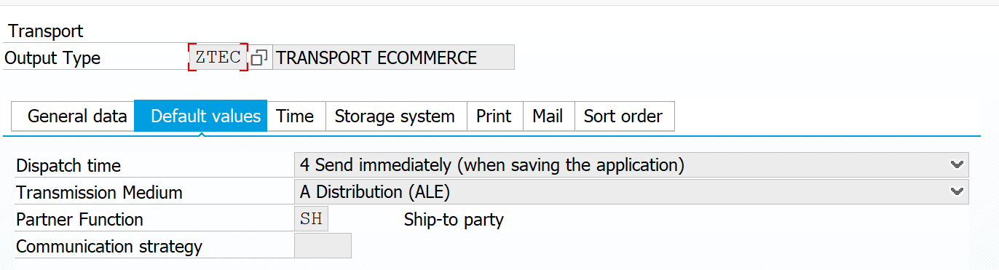

**Figura-129a** Configuración de la segunda pestaña para el nuevo tipo de salida ZTEC.

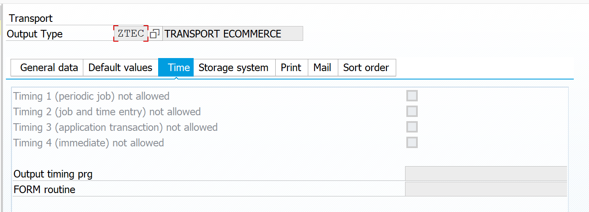

**Figura-130a** Configuración de la tercera pestaña para el nuevo tipo de salida ZTEC.

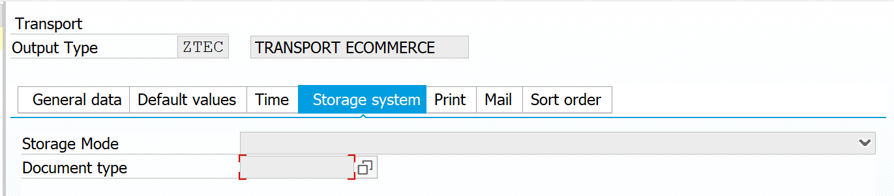

**Figura-131a** Configuración de la cuarta pestaña para el nuevo tipo de salida ZTEC.

Las últimas tres pestañas quedan vacías para esta clase de mensaje ZTEC.

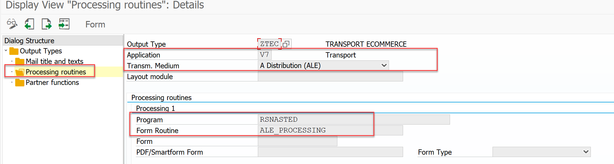 Dentro de la Estructura de Diálogo de Clases de Mensajes, seleccionamos la carpeta correspondiente a Rutinas de proceso y le damos doble clic; aparece la pantalla de la Figura-132a en la que agregaremos la configuración correspondiente al medio de envío Distribución ALE.

**Figura-132a** Pantalla de configuración de las Rutinas de Procesamiento en la Transacción NACE para el nuevo mensaje ZTEC.

Dentro de la misma Estructura de Diálogo de Clases de Mensajes, pasamos ahora a la carpeta de Funciones de Interlocutor y le damos al igual doble clic para desplegar la pantalla de la Figura-133a.

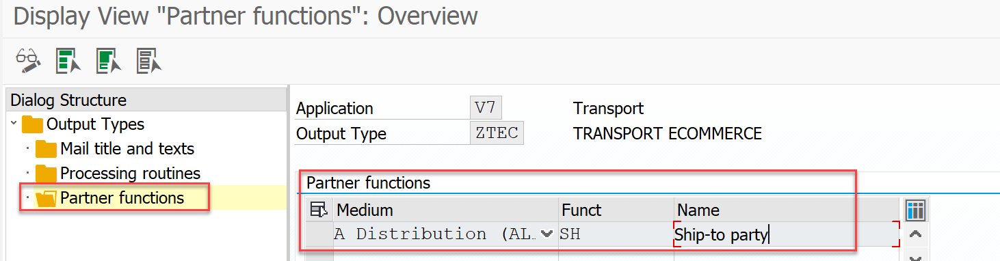

**Figura-133a** Pantalla de configuración de las Funciones de Interlocutor en la Transacción NACE para el nuevo mensaje ZTEC.

Regresamos al menú principal de la Transacción NACE para configurar el *MESSAGE DETERMINATION PROCEDURE* 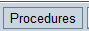. Al entrar vemos una pantalla similar a la de la Figura-134a, y seleccionamos tanto el *Procedure* **V70001** *Transportation Output* como el folder de **Control,** para así dar luego un clic al botón derecho del ratón para “*Seleccionar diálogo parcial*”.

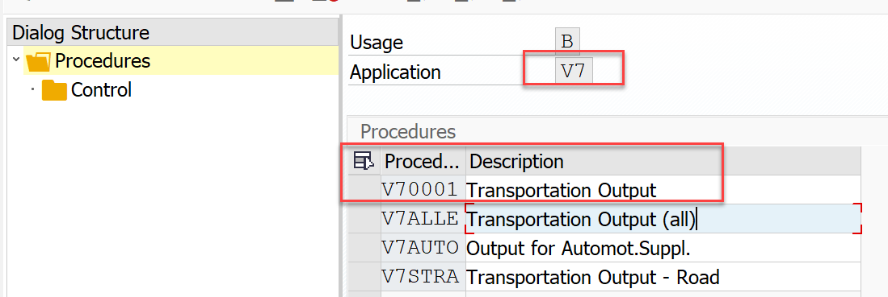

**Figura-134a** Pantalla de configuración de las Funciones de Interlocutor en la Transacción NACE para el nuevo mensaje ZTEC.

En la pantalla de la Figura-135a que es la que aparece, se localiza la línea en donde tenemos el mensaje **ZTEC** que estamos definiendo al presionar el botón .

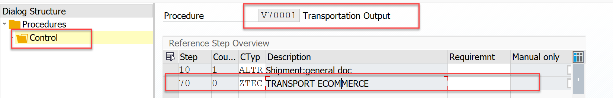

**Figura-135a** Pantalla de configuración para el *output* ZTEC en la Transacción NACE.

Lo que sigue es crear el *Condition* *Record* desde el menú principal de la transacción **NACE** para el área **V7** y el *output type* **ZTEC**.

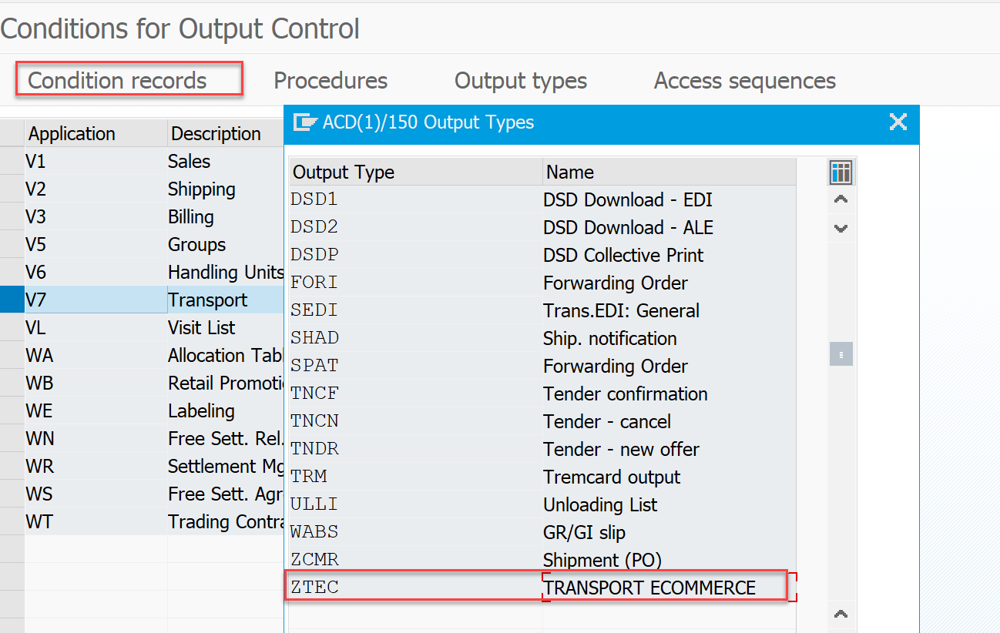

**Figura-136a** Pantalla de configuración para el *Condition* *record* de la factura en la Transacción NACE.

Se da un doble clic en esta imagen de la Figura-136a y entramos a una pantalla en donde podemos crear ese *Condition* *Record*, tal y como se muestra en la Figura-137a y Figura-138a.

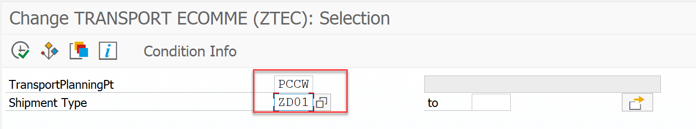

**Figura-137a** Pantalla de creación del *Condition* *record* de la factura en la Transacción NACE.

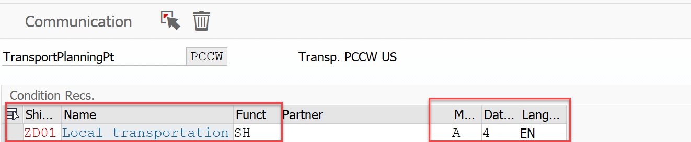

**Figura-138a** Pantalla que define la Función de Interlocutor en la creación del *Condition* *record* de la factura en la Transacción NACE.

En el detalle de esta configuración usamos el *Message* *Type* **ZON_SHP** y el *Basic Type* SHPMNT05 como se muestra en la Figura-140a y Figura-141a:

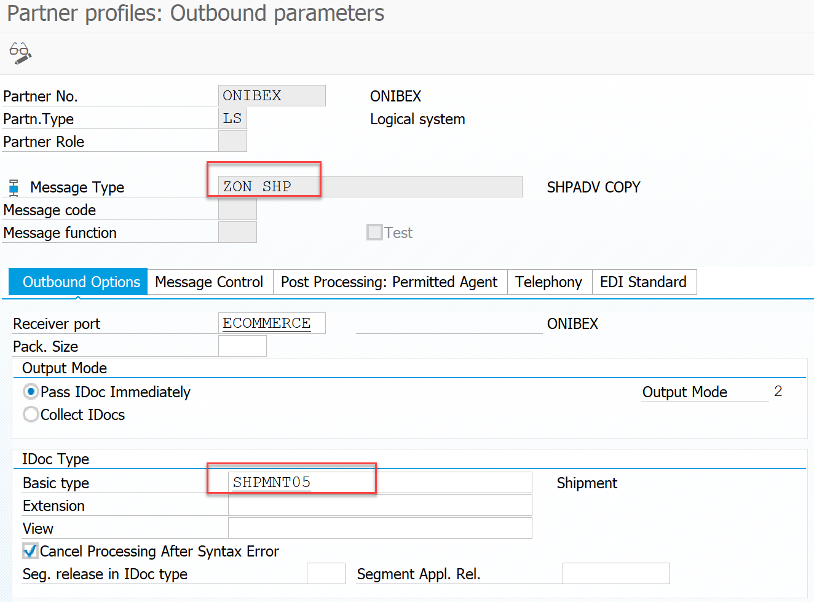

**Figura-140a** Pantalla de primera pestaña de configuración para el tipo de mensaje ZON_SHP en la transacción WE20.

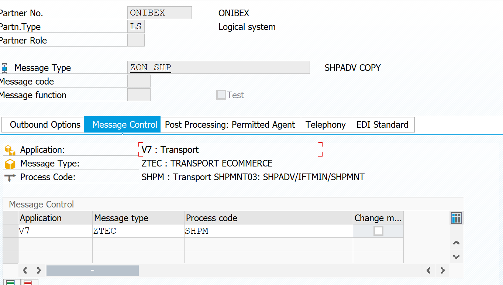

**Figura-141a** Pantalla de segunda pestaña de configuración para el tipo de mensaje ZON_SHP en la transacción WE20.

Ahora debemos agregar este *Message* *Type* en la transacción **BD64**, *Distribution* *Model*, para poder definir el sentido en el que ese mensaje será generado:

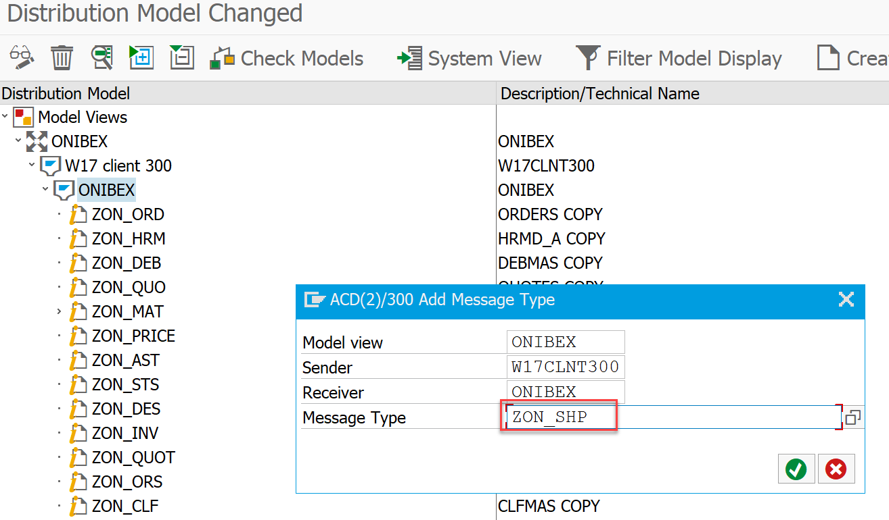

**Figura-142a** Agregando una nueva entrada del tipo de mensaje ZON_SHP en la transacción BD64.

← Anterior: [Configuración del IDoc INVOIC para enviar la factura](../04-sales-document-idocs/06-invoic-idoc.md) · Siguiente: [Creación de servicios en SICF para la comunicación por web services](../05-web-services/01-sicf-web-services.md) →

---

© 2026 Onibex, LLC · Licenciado bajo [CC BY-NC-ND 4.0](../../../LICENSE) (SPDX: CC-BY-NC-ND-4.0) · [Licencia comercial](../../../COMMERCIAL-LICENSE.md) · [Marcas y avisos de terceros](../../../THIRD-PARTY-NOTICES.md) · SAP y los demás productos y servicios SAP mencionados son marcas comerciales o marcas registradas de SAP SE o de una empresa afiliada a SAP en Alemania y otros países; los nombres se usan solo con fines de identificación.
