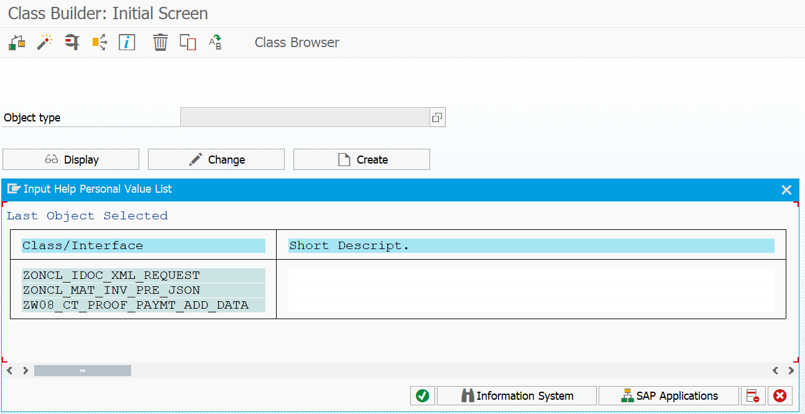
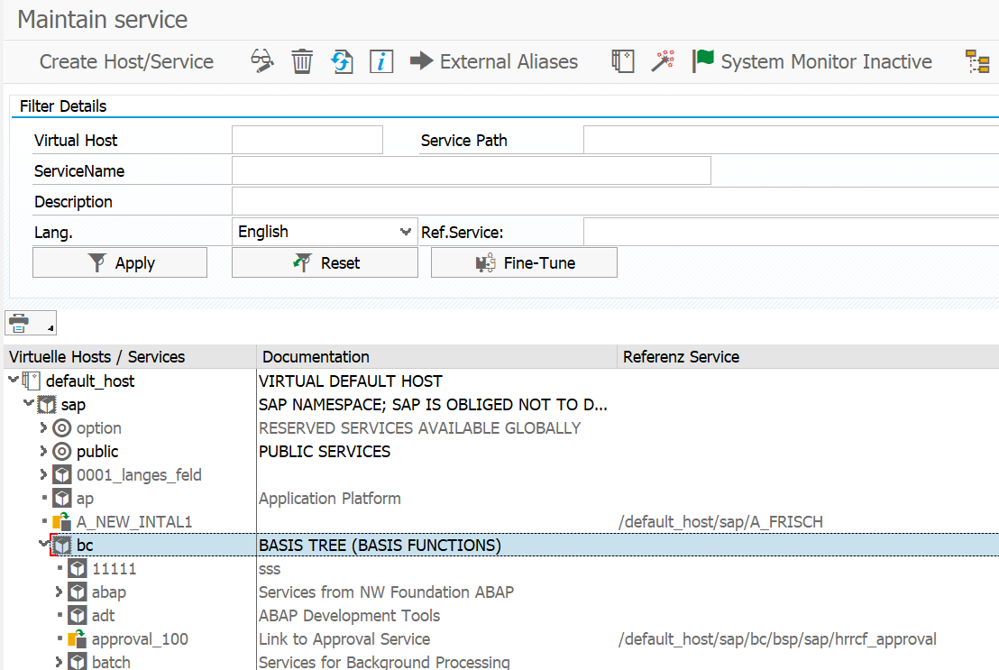
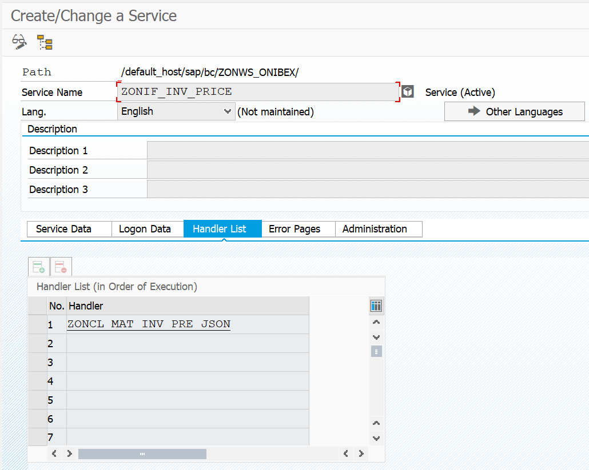
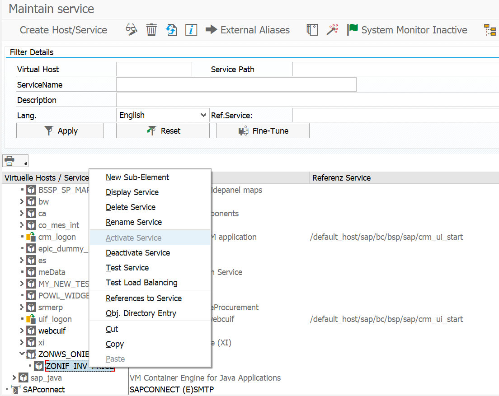

<!-- SPDX-License-Identifier: CC-BY-NC-ND-4.0 -->
<!-- Copyright (c) 2026 Onibex, LLC. Part of the Onibex eCommerce 360° Documentation — https://github.com/Onibex/ecommerce-docs -->

[English](../../../en/technical-documents/05-web-services/01-sicf-web-services.md) · **Español** | [↑ Índice de documentos técnicos](../README.md) | [README del repositorio](../../../README.md)

# Creación de servicios en SICF para la comunicación por web services

> **Fuente:** versión en español del artículo “14. Deployment of SICF Service for communications using Web Services” del Help Center de Onibex — <https://help.onibex.com/portal/en/kb/articles/deployment-of-sicf-service-for-communications-using-web-services>; redacción tomada del capítulo D.4.k de la especificación funcional “D1 – Integración de sistemas”.

Una vez definidos los mensajes IDocs y sus mecanismos de activación, hay que asegurarse de que los mismos se creen en SAP y se manden inmediatamente al portal. Al igual, otra información requerida en tiempo real es la correspondiente a los Inventarios y los Precios específicos desde SAP hacia el E-Commerce. Para cumplir este par de requerimientos, se entabla otro tipo de comunicación a través del consumo de Web Services (servicios web).

Los Web Services, en principio, pueden ser llamados desde un navegador WEB con una URL. Para este caso, se crea un Servicio en la transacción SICF de SAP, y el contenido del servicio es proveído por una clase controladora ("*handler class*").

Como primer paso, se crean las clases en la transacción SE24, tal y como se muestra en la Figura-144. Las clases consumidas por cada uno de los dos Web Services de ONIBEX son: 1) ZONCL_IDOC_XML_REQUEST, y 2) ZONCL_MAT_INV_PRE_JSON. Estas clases serían cargadas junto con todos los demás objetos de SAP a través de Nuggets por la aplicación SAP Link. Una vez verificado que existen las dos clases y que sus métodos están activos, vaya a la transacción SICF.

En la T-Code SICF se crea el "Host/Service" (Host/Servicio) con la ruta: 'default_host/sap/bc/ZONWS_ONIBEX', es decir, el grupo de servicios WEB de ONIBEX para ECommerce. El principio de este proceso se visualiza en la Figura-145.

**Figura-144** Despliegue de las dos clases ZONCL para los WS de ONIBEX en la T-Code SE24.

**Figura-145** Ruta hacia la creación del grupo de servicios ZONWS_ONIBEX en la T-Code SICF.

Una vez que se proveyó el nombre del servicio "ZONWS_ONIBEX" y se dio clic en el botón continuar, se agregan bajo esta misma ruta otros dos servicios con los nombres: 1) ZONIF_IDOC_XML, y 2) ZONIF_INV_PRICE. Para estos dos últimos servicios, vaya a su pestaña "Handler List" (lista de controladores) y agregue a cada servicio las clases definidas en la Figura-144; el resultado se muestra en la Figura-146 y la Figura-147, respectivamente.

**Figura-146** Ruta hacia la creación del servicio ZONIF_IDOC_XML a la que se le agrega la clase ZONCL_IDOC_XML_REQUEST en la transacción SICF.

**Figura-147** Ruta hacia la creación del servicio ZONIF_INV_PRICE a la que se le agrega la clase ZONCL_MAT_INV_PRE_JSON en la transacción SICF.

Por último, asegúrese de que los servicios anteriormente creados estén activos; para esto, dé clic con el botón derecho del mouse sobre el nombre del Servicio. Dé clic en "Activate Service" (Activar servicio) y luego repita este mismo procedimiento para la opción "Test Service" (Verificar servicio); esto se muestra en la Figura-148. Una vez activados y probados estos dos servicios de las Figuras 146 y 147, queda terminada la configuración de todos los canales de comunicación entre SAP y el portal de E-Commerce.

En la siguiente sección se detalla la lista de Objetos que se han configurado o mejorado en SAP para la completa automatización de los procesos de negocio hacia el portal de E-Commerce de ONIBEX. Estos son desplegados de manera automática a través del SAP Link y sus paquetes de "Nuggets".

**Figura-148** Activación y verificación del servicio ZONIF_INV_PRICE creado en la T-Code SICF.

← Anterior: [Configuración del IDoc ZON_SHP para enviar el documento de transporte](../04-sales-document-idocs/07-zon-shp-transport-idoc.md) · Siguiente: [Creación del motivo de bloqueo para control de crédito en el Business Partner (BP)](../06-sales-configuration/01-credit-block-reason-business-partner.md) →

---

© 2026 Onibex, LLC · Licenciado bajo [CC BY-NC-ND 4.0](../../../LICENSE) (SPDX: CC-BY-NC-ND-4.0) · [Licencia comercial](../../../COMMERCIAL-LICENSE.md) · [Marcas y avisos de terceros](../../../THIRD-PARTY-NOTICES.md) · SAP y los demás productos y servicios SAP mencionados son marcas comerciales o marcas registradas de SAP SE o de una empresa afiliada a SAP en Alemania y otros países; los nombres se usan solo con fines de identificación.
