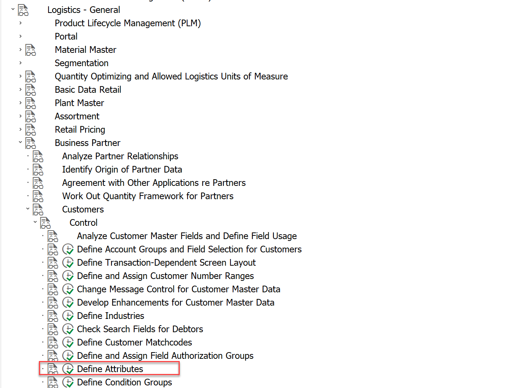
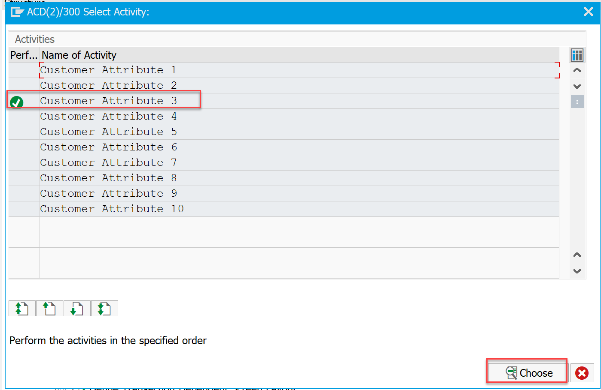
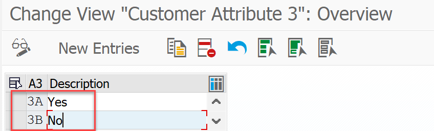
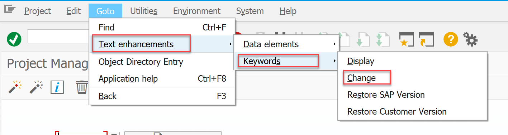
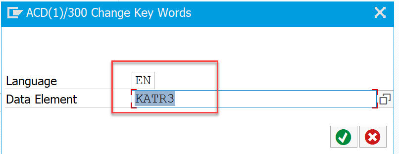
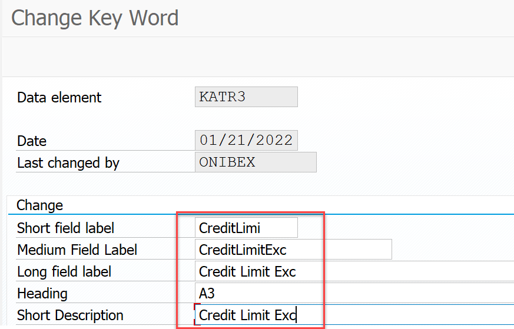
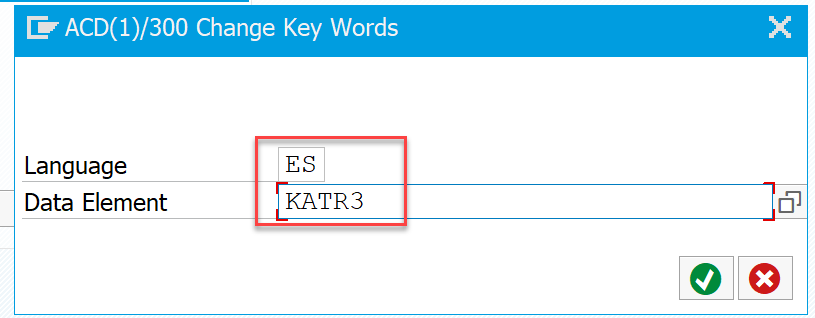
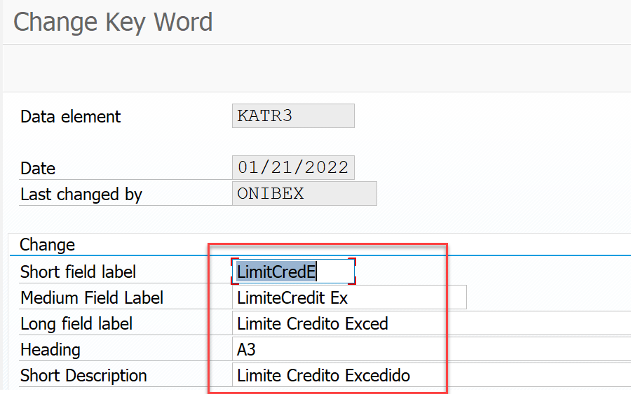

<!-- SPDX-License-Identifier: CC-BY-NC-ND-4.0 -->
<!-- Copyright (c) 2026 Onibex, LLC. Part of the Onibex eCommerce 360° Documentation — https://github.com/Onibex/ecommerce-docs -->

[English](../../../en/technical-documents/06-sales-configuration/01-credit-block-reason-business-partner.md) · **Español** | [↑ Índice de documentos técnicos](../README.md) | [README del repositorio](../../../README.md)

# Creación del motivo de bloqueo para control de crédito en el Business Partner (BP)

> **Fuente:** capítulo D.4.i (bis) de la especificación funcional “D1 – Integración de sistemas” del Help Center de Onibex — <https://help.onibex.com/portal/en/kb/articles/d1-integraci%C3%B3n-de-sistemas-v-5-1-espa%C3%B1ol>.

Paso 1: Agregar los valores del atributo 3:

En el menu de configuración se asigna los atributos 3A y 3B, para indicar si un cliente tiene limite de crédito excedido

A continuación se muestra la ruta de configuración y el nuevo valor agregado

Paso 2: Cambiar descripción del atributo 3

Para cambiar el texto del campo Atributo 3 por Limite Crédito Excedido:

Esto se realiza en la tcode CMOD, en el siguiente menú:

Paso 2A: Se indica el elemento de dato a cambiar el texto del campo, y se da clic en el botón check

Se procede a actualizar los textos, como se indica en la imagen de abajo:

Este último subpaso 2A, se repite, para el idioma ES

← Anterior: [Creación de servicios en SICF para la comunicación por web services](../05-web-services/01-sicf-web-services.md) · Siguiente: [Configuración de materiales alternativos: cross-selling y up-selling](../06-sales-configuration/02-cross-selling-up-selling.md) →

---

© 2026 Onibex, LLC · Licenciado bajo [CC BY-NC-ND 4.0](../../../LICENSE) (SPDX: CC-BY-NC-ND-4.0) · [Licencia comercial](../../../COMMERCIAL-LICENSE.md) · [Marcas y avisos de terceros](../../../THIRD-PARTY-NOTICES.md) · SAP y los demás productos y servicios SAP mencionados son marcas comerciales o marcas registradas de SAP SE o de una empresa afiliada a SAP en Alemania y otros países; los nombres se usan solo con fines de identificación.
