<!-- SPDX-License-Identifier: CC-BY-NC-ND-4.0 -->
<!-- Copyright (c) 2026 Onibex, LLC. Part of the Onibex eCommerce 360° Documentation — https://github.com/Onibex/ecommerce-docs -->

[English](../../../en/technical-documents/06-sales-configuration/02-cross-selling-up-selling.md) · **Español** | [↑ Índice de documentos técnicos](../README.md) | [README del repositorio](../../../README.md)

# Configuración de materiales alternativos: cross-selling y up-selling

> **Fuente:** capítulo D.7 de la especificación funcional “D1 – Integración de sistemas” del Help Center de Onibex — <https://help.onibex.com/portal/en/kb/articles/d1-integraci%C3%B3n-de-sistemas-v-5-1-espa%C3%B1ol>.

El *Cross-selling* es una práctica de ventas en la se ofrecen a los clientes mercancías adicionales a las que hacen pedidos, en un esfuerzo por aumentar el volumen de ventas.

El *Up-selling* indica el reemplazo completo del artículo requerido originalmente por un cliente con otro artículo de mayor valor. Implica la comercialización de productos o servicios más rentables que ofrecen simultáneamente al cliente más opciones de valor agregado para la compra.

El *Up-selling & Cross-selling* forman parte del ofrecimiento de servicios y materiales alternativos al cliente. La manera más directa de asignarlos en el portal de E-Commerce es subiendo una tabla que relacione uno o varios productos “padre” (id_master) a uno o varios productos “hijos” (id_slave). La tarea sería mantener de manera manual esta tabla para el Cross-selling, por ejemplo.

Otra alternativa que busque automatizar el mantenimiento de las varias combinaciones de materiales en el *Up-selling & Cross-selling*, es usar el concepto de “Condition technique” en SAP. La guía de implementación la presentamos en cuatro bloques de configuraciones como sigue:

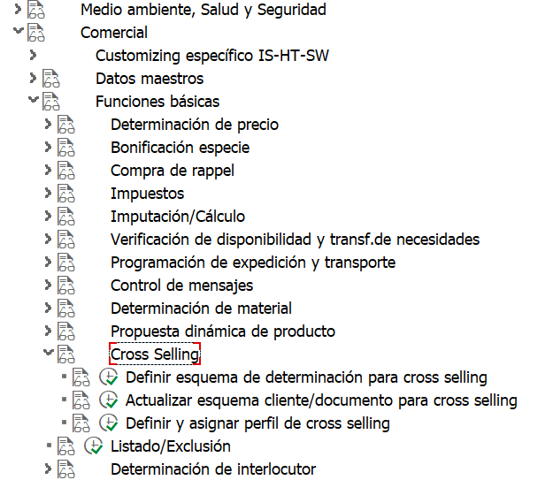

Ruta de menú – En la pantalla IMG – Sales & distribution – Basic functions – Cross selling

## D.7.a Definir esquema de determinación para Cross-selling

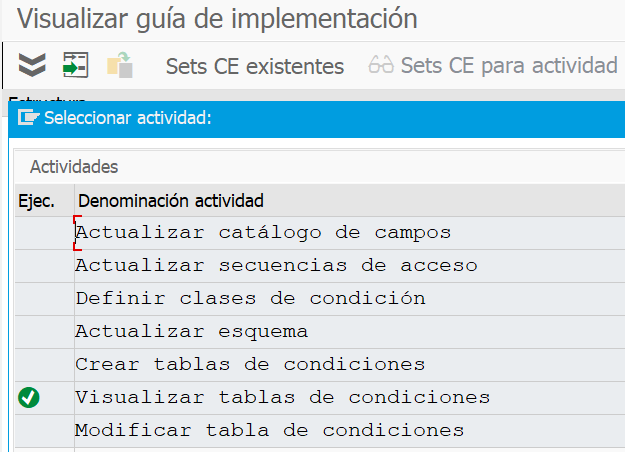

### D.7.a.1 Crear tabla de condiciones: - por ejemplo – 011 – Material

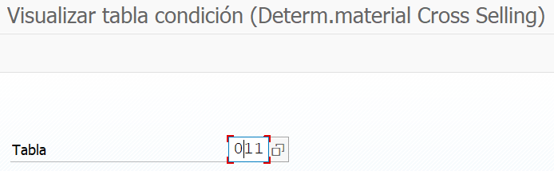

Sólo se utiliza un campo, pero dependiendo de las necesidades comerciales, se pueden agregar otros campos o se puede crear una nueva tabla de condiciones. 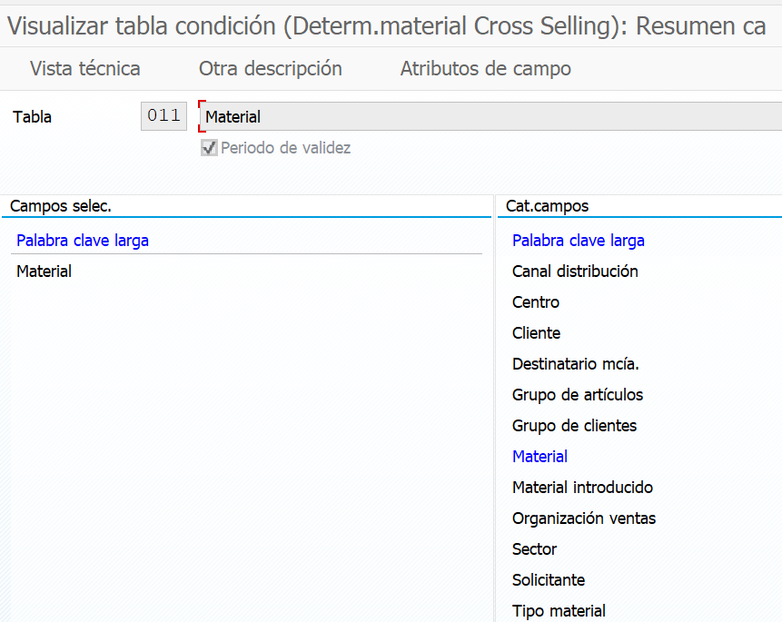

### D.7.a.2 Mantenga la secuencia de acceso y asígnele la tabla de condiciones

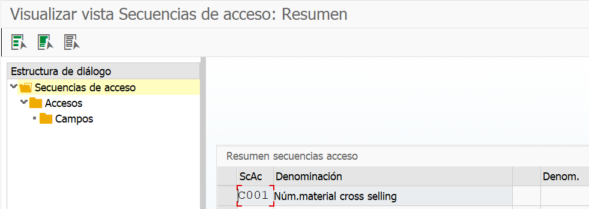

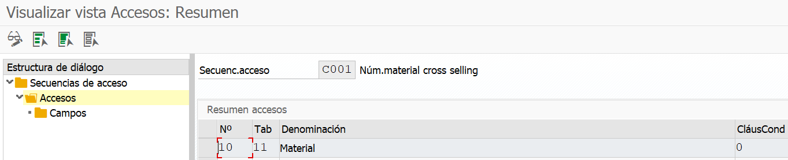

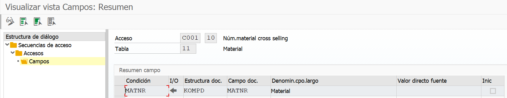

### D.7.a.3 Defina los tipos de condición: por ejemplo, CS01 y asígnele la secuencia de acceso

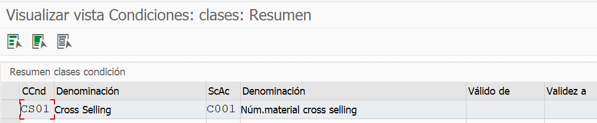

### D.7.a.4 Actualizar Esquema: - por ejemplo – CS0001 - Cross-selling y asignación de tipo de condición CS01

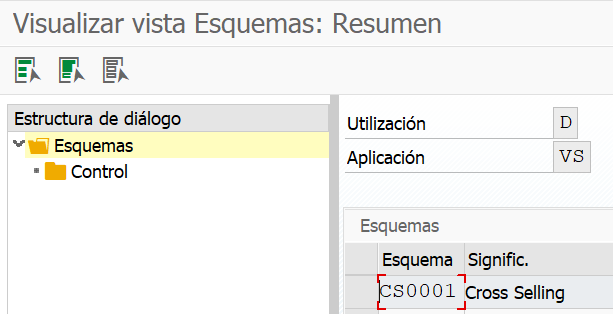

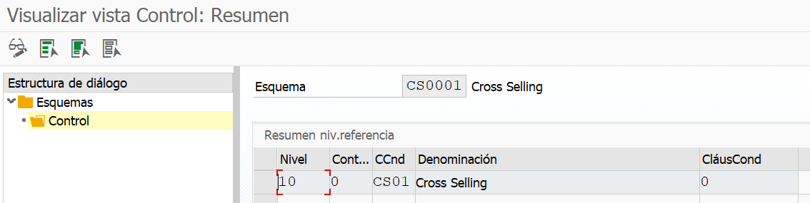

## D.7.b Actualizar Esquema cliente / documento para el Cross-selling

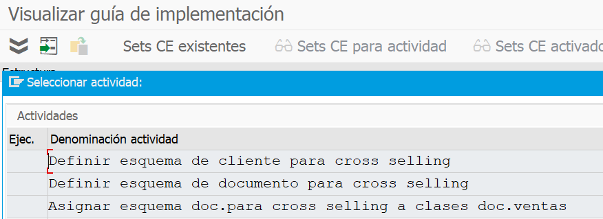

### D.7.b.1 Defina el esquema del Cliente para el Cross-selling: - por ejemplo – B – Cross Selling

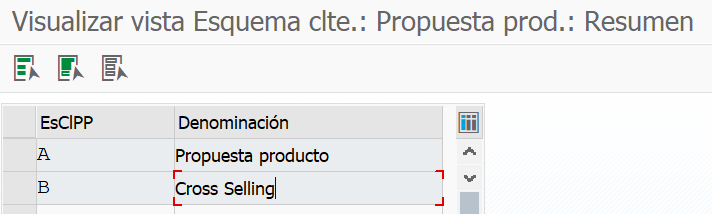

### D.7.b.2 Definir procedimiento de documento para el Cross-selling: - B – Cross Selling

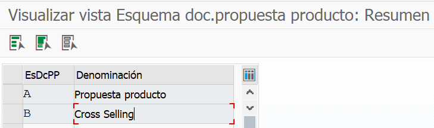

**D.7.b.3.** Asigne este procedimiento de cliente en el maestro de clientes (XD02 / VD02), sección de datos del área de ventas, pestaña de ventas, cliente PP. proc. como B - *Cross-selling*.

D.7.b.4 Asigne el procedimiento de documento para la venta cruzada al tipo de documento de ventas: - Elija el tipo de documento de ventas, por ejemplo, - OR y asigne el procedimiento de documento como B - *Cross-selling*.

## D.7.c Definir y asignar perfil de Cross-selling

D.7.c.1. Defina el perfil de *Cross-selling*: - Aquí en las Nuevas entradas tenemos que definir la clave para el perfil de *Cross-selling*, por ejemplo - CS001 - Perfil de *Cross-selling*. Y en los controles generales tenemos que especificar el procedimiento de propuesta de producto: - por ejemplo - A00002, procedimiento de venta cruzada - CS0001, procedimiento de fijación de precios: - ZPrice.

D.7.c.2. Asignar perfil de venta cruzada: - Aquí en las nuevas entradas mantendremos una tabla: - Área de ventas + Venta cruzada Procedimiento del cliente + Venta cruzada Procedimiento de documento + Perfil de venta cruzada.

## D.7.d Crear los registros de condición

D.7.d.1. Crear por medio de la T-Code VB41: - Especifique el tipo de determinación de material, por ejemplo - C001 y mantenga registros de condición.

D.7.d.2. Seleccione el registro de condición, haga clic en materiales alternativos y enumere todos los materiales que se pueden sugerir como combinación de materiales. Guárdelo y regrese.

Levantaremos un pedido de ventas (VA01), especificaremos el material pedido y podremos verificar el efecto de venta cruzada.

← Anterior: [Creación del motivo de bloqueo para control de crédito en el Business Partner (BP)](../06-sales-configuration/01-credit-block-reason-business-partner.md) · Siguiente: [Especificación completa de la lista de objetos de SAP](../07-reference/01-sap-object-list.md) →

---

© 2026 Onibex, LLC · Licenciado bajo [CC BY-NC-ND 4.0](../../../LICENSE) (SPDX: CC-BY-NC-ND-4.0) · [Licencia comercial](../../../COMMERCIAL-LICENSE.md) · [Marcas y avisos de terceros](../../../THIRD-PARTY-NOTICES.md) · SAP y los demás productos y servicios SAP mencionados son marcas comerciales o marcas registradas de SAP SE o de una empresa afiliada a SAP en Alemania y otros países; los nombres se usan solo con fines de identificación.
